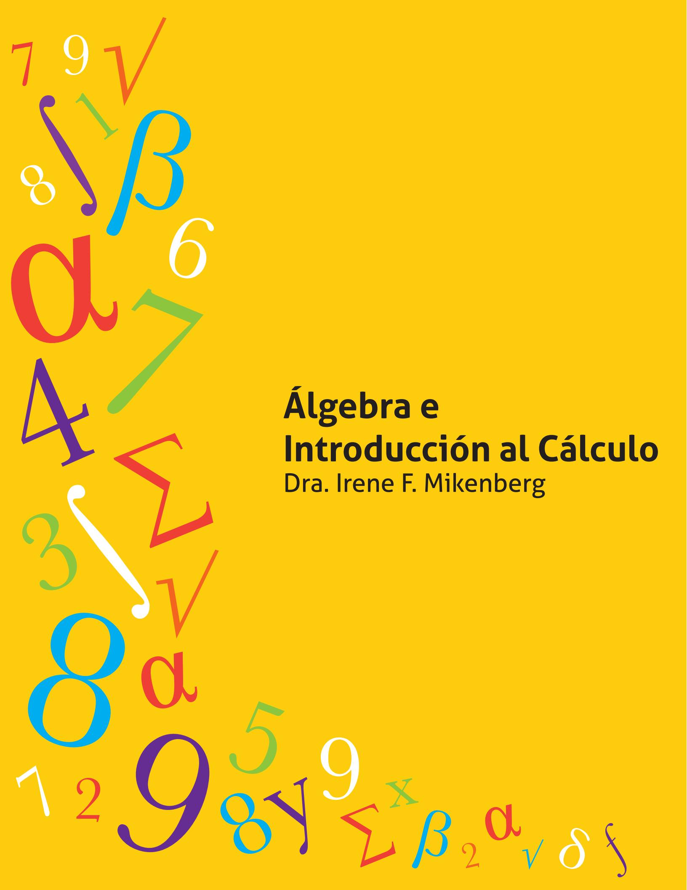


# **Álgebra e Introducción al Cálculo**

**Dra. Irene F. Mikenberg**

# Álgebra e Introducción al Cálculo

Dra. Irene F. Mikenberg Facultad de Matemáticas

Pontificia Universidad Católica de Chile

2 de enero de 2013

|   | Prólogo |                  |                                                                   | XVII |
|---|---------|------------------|-------------------------------------------------------------------|------|
| 1 |         |                  | Lenguaje Matemático                                               | 1    |
|   | 1.1     |                  | Introducción                                                      | 1    |
|   | 1.2     |                  | Lenguaje Matemático<br>                                           | 1    |
|   |         | 1.2.1            | Proposiciones                                                     | 2    |
|   |         | 1.2.2            | Conectivos<br>                                                    | 2    |
|   |         | 1.2.3            | Predicados<br>                                                    | 5    |
|   |         | 1.2.4            | Cuantificadores                                                   | 6    |
|   | 1.3     |                  | Las Leyes de la Lógica                                            | 9    |
|   |         | 1.3.1            | Verdad                                                            | 9    |
|   |         | 1.3.2            | Verdad lógica<br>                                                 | 11   |
|   |         | 1.3.3            | Contradicciones<br>                                               | 12   |
|   |         | 1.3.4            | Equivalencia lógica<br>                                           | 13   |
|   |         | 1.3.5            | Consecuencia lógica                                               | 14   |
|   |         | 1.3.6            | Verdades lógicas usuales<br>                                      | 15   |
|   | 1.4     |                  | Aplicaciones                                                      | 19   |
|   |         | 1.4.1            | Negación de una proposición dada                                  | 19   |
|   |         | 1.4.2            | Demostraciones por contradicción<br>                              | 21   |
|   |         | 1.4.3            | Demostraciones por contraposición                                 | 21   |
|   | 1.5     |                  | Problemas Resueltos                                               | 23   |
|   | 1.6     |                  | Ejercicios Propuestos<br>                                         | 30   |
|   |         | Autoevaluación 1 |                                                                   | 36   |
| 2 |         |                  | Los Números Reales                                                | 37   |
|   | 2.1     |                  | Sistemas Numéricos<br>                                            | 37   |
|   | 2.2     |                  | Operaciones Básicas en los Números Reales:<br>Suma y Producto<br> | 42   |
|   | 2.3     |                  | Orden de los Números Reales<br>                                   | 46   |
|   | 2.4     |                  | Conjuntos de Números Reales<br>                                   | 52   |

|   | 2.5 | Completud de los Números Reales                     | 56  |
|---|-----|-----------------------------------------------------|-----|
|   | 2.6 | Ecuaciones e Inecuaciones<br>                       | 58  |
|   |     | 2.6.1<br>Ecuaciones en una variable<br>             | 58  |
|   |     | 2.6.2<br>La ecuación de primer grado<br>            | 59  |
|   |     | 2.6.3<br>La ecuación de segundo grado<br>           | 59  |
|   |     | 2.6.4<br>Inecuaciones en una variable<br>           | 61  |
|   |     | 2.6.5<br>Inecuación de primer grado<br>             | 62  |
|   |     | 2.6.6<br>Inecuación de segundo grado                | 62  |
|   | 2.7 | Problemas Resueltos                                 | 63  |
|   | 2.8 | Ejercicios Propuestos<br>                           | 70  |
| 3 |     | Autoevaluación 2<br>Relaciones y                    | 74  |
|   |     | Funciones                                           | 75  |
|   | 3.1 | Pares Ordenados y Producto Cartesiano               | 75  |
|   | 3.2 | Relaciones<br>                                      | 77  |
|   |     | 3.2.1<br>Noción intuitiva<br>                       | 77  |
|   | 3.3 | Gráfico de Relaciones Reales                        | 80  |
|   |     | 3.3.1<br>Ecuación e inecuación de primer grado<br>  | 83  |
|   | 3.4 | Concepto de Función y Propiedades Básicas<br>       | 86  |
|   | 3.5 | Gráficos de las Funciones Reales                    | 97  |
|   | 3.6 | Estudio de una Función Real<br>101                  |     |
|   | 3.7 | Sucesiones<br>123                                   |     |
|   | 3.8 | Ejercicios Propuestos<br>126                        |     |
|   |     | Autoevaluación 3                                    | 130 |
| 4 |     | Trigonometría                                       | 133 |
|   | 4.1 | Las Razones Trigonométricas 133                     |     |
|   | 4.2 | Las Funciones Trigonométricas<br>138                |     |
|   |     | 4.2.1<br>Estudio de la función seno 140             |     |
|   |     | 4.2.2<br>La función coseno<br>142                   |     |
|   |     | 4.2.3<br>Las otras funciones trigonométricas<br>142 |     |

|   | 4.3        | Identidades Trigonométricas 150                               |     |
|---|------------|---------------------------------------------------------------|-----|
|   | 4.4        | Resolución de Ecuaciones Trigonométricas<br>156               |     |
|   |            | 4.4.1<br>Función seno<br>156                                  |     |
|   |            | 4.4.2<br>Función coseno 157                                   |     |
|   |            | 4.4.3<br>Función tangente.<br>157                             |     |
|   | 4.5        | Funciones Trigonométricas Inversas<br>159                     |     |
|   |            | 4.5.1<br>Función inversa del seno<br>159                      |     |
|   |            | 4.5.2<br>Función inversa del coseno<br>160                    |     |
|   |            | 4.5.3<br>Función inversa del tangente<br>161                  |     |
|   | 4.6        | Resolución de Triángulos<br>165                               |     |
|   |            | 4.6.1<br>Área de un triángulo<br>165                          |     |
|   |            | 4.6.2<br>Teorema del seno<br>166                              |     |
|   |            | 4.6.3<br>Teorema del coseno<br>167                            |     |
|   |            | 4.6.4<br>Problemas Resueltos 168                              |     |
|   | 4.7        | Ejercicios Propuestos<br>171                                  |     |
|   |            |                                                               |     |
|   |            | Autoevaluación 4                                              | 177 |
|   |            |                                                               |     |
|   |            |                                                               |     |
| 5 |            | Números Naturales                                             | 179 |
|   | 5.1        | Propiedades Básicas de los Números Naturales<br>179           |     |
|   | 5.2<br>5.3 | Inducción Matemática<br>182<br>Definiciones Recursivas<br>188 |     |
|   | 5.4        | La Exponenciación<br>201                                      |     |
|   | 5.5        | Ejercicios Propuestos<br>204                                  |     |
|   |            |                                                               |     |
|   |            | Autoevaluación 5                                              | 208 |
|   |            |                                                               |     |
| 6 |            | Aplicaciones de<br>Inducción                                  | 209 |
|   | 6.1        | Sumatoria<br>209                                              |     |
|   | 6.2        | Una Desigualdad Importante<br>223                             |     |
|   | 6.3        | Teorema del Binomio 230                                       |     |

|   |     | Autoevaluación 6                                                               | 244 |
|---|-----|--------------------------------------------------------------------------------|-----|
| 7 |     | Polinomios y Números Complejos                                                 | 245 |
|   | 7.1 | Números Complejos<br>245                                                       |     |
|   |     | 7.1.1<br>Introducción 245                                                      |     |
|   |     | 7.1.2<br>El sistema de los números complejos<br>246                            |     |
|   | 7.2 | Forma Polar de un Número Complejo<br>255                                       |     |
|   |     | 7.2.1<br>Gráfico de números complejos<br>255                                   |     |
|   |     | 7.2.2<br>Teorema de DeMoivre<br>259                                            |     |
|   | 7.3 | Polinomios<br>264                                                              |     |
|   |     | 7.3.1<br>División de un polinomio por un polinomio de grado uno<br>268         |     |
|   |     | 7.3.2<br>Teorema Fundamental del Álgebra<br>275                                |     |
|   | 7.4 | Ejercicios Propuestos<br>280                                                   |     |
|   |     | Autoevaluación 7                                                               | 283 |
| 8 |     | Logaritmo y<br>Exponencial                                                     | 285 |
|   | 8.1 | Introducción 285                                                               |     |
|   | 8.2 | La Función Exponencial<br>285                                                  |     |
|   |     | 8.2.1<br>Ejemplos de modelamiento con la<br>función exponencial natural<br>287 |     |
|   | 8.3 | La Función Logaritmo<br>290                                                    |     |
|   |     | 8.3.1<br>Cambio de base<br>292                                                 |     |
|   | 8.4 | Ejercicios Propuestos<br>296                                                   |     |
|   |     | Autoevaluación 8                                                               | 299 |
| 9 |     | Geometría Analítica                                                            | 301 |
|   | 9.1 | La Línea Recta<br>301                                                          |     |
|   |     | 9.1.1<br>Pendiente e inclinación de una recta<br>301                           |     |
|   |     | 9.1.2<br>Ecuación de la recta<br>304                                           |     |
|   | 9.2 | Distancia de un Punto a una recta<br>307                                       |     |
|   | 9.3 | La Circunferencia 310                                                          |     |

|   |     | 9.3.1<br>Eje radical 315                        |     |
|---|-----|-------------------------------------------------|-----|
|   | 9.4 | La Parábola<br>317                              |     |
|   |     | 9.4.1<br>Ecuación de la parábola<br>318         |     |
|   |     | 9.4.2<br>Elementos de una parábola<br>321       |     |
|   |     | 9.4.3<br>Translación de ejes coordenados<br>322 |     |
|   | 9.5 | La Elipse<br>328                                |     |
|   |     | 9.5.1<br>La ecuación de la elipse<br>328        |     |
|   |     | 9.5.2<br>Los elementos de la elipse.<br>329     |     |
|   | 9.6 | La Hipérbola<br>333                             |     |
|   |     | 9.6.1<br>La ecuación de la hipérbola 334        |     |
|   |     | 9.6.2<br>Elementos de la hipérbola.<br>334      |     |
|   | 9.7 | Ecuación General de Segundo Grado<br>339        |     |
|   |     | 9.7.1<br>Rotación de ejes coordenados<br>340    |     |
|   | 9.8 | Ejercicios Propuestos<br>345                    |     |
|   |     | Autoevaluación 9                                | 348 |
|   |     | 10 Axioma del Supremo y Limites de Sucesiones   | 349 |
|   |     | 10.1 Axioma del Supremo 349                     |     |
|   |     | 10.1.1 Axioma del Supremo 354                   |     |
|   |     | 10.2 Limites de Sucesiones<br>362               |     |
|   |     | 10.2.1 Teorema del Sandwich 372                 |     |
|   |     | 10.3 Ejercicios Propuestos<br>384               |     |
|   |     | Autoevaluación 10                               | 387 |
|   |     | Autoevaluación 11                               | 389 |
| A |     | Respuestas a Algunos Ejercicios                 | 397 |
|   | A.1 | Capítulo 1<br>397                               |     |
|   | A.2 | Autoevaluación 1<br>404                         |     |
|   | A.3 | Capítulo 2<br>404                               |     |
|   | A.4 | Autoevaluación 2<br>407                         |     |
|   | A.5 | Capítulo 3<br>410                               |     |

|   | A.6<br>Autoevaluación 3<br>416   |     |
|---|----------------------------------|-----|
|   | A.7<br>Capítulo 4<br>422         |     |
|   | A.8<br>Autoevaluación 4<br>425   |     |
|   | A.9<br>Autoevaluación 5<br>429   |     |
|   | A.10 Capítulo 6<br>431           |     |
|   | A.11 Autoevaluación 6<br>434     |     |
|   | A.12 Capítulo 7<br>436           |     |
|   | A.13 Autoevaluación 7<br>440     |     |
|   | A.14 Capítulo 8<br>445           |     |
|   | A.15 Autoevaluación 8<br>447     |     |
|   | A.16 Capítulo 9<br>450           |     |
|   | A.17 Autoevaluación 9<br>452     |     |
|   | A.18 Capítulo 10<br>456          |     |
|   | A.19 Autoevaluación 10<br>458    |     |
|   | A.20 Autoevaluación Final<br>460 |     |
| B | BIBLIOGRAFÍA                     | 463 |
|   | B.1<br>TEXTOS 463                |     |
|   | B.2<br>VIDEOS<br>464             |     |

| 1.1 | Verdades lógicas                                                   | 11 |
|-----|--------------------------------------------------------------------|----|
| 1.2 | Ejemplo de una proposición que no es verdad lógica                 | 12 |
| 1.3 | Contradicción                                                      | 12 |
| 1.4 | Proposiciones no lógicamente equivalentes                          | 13 |
| 1.5 | Consecuencia lógica                                                | 14 |
| 1.6 | Tabla de verdad del Teorema 1.1 (XXVIII)                           | 17 |
| 1.7 | Tabla de verdad de la proposición ((α<br>→ β)<br>∧ α)<br>β<br>↔    | 18 |
| 4.1 | Valores para el seno y coseno de 0, 30, 45, 60 y 90 grados.<br>136 |    |
| 6.1 | Triángulo de Pascal.<br>232                                        |    |

| 1.1 | Diagrama de Venn para los conjuntos<br>P,<br>Q<br>y<br>R<br>de<br>A                      | 25 |
|-----|------------------------------------------------------------------------------------------|----|
| 1.2 | Modificación de la figura 1.1.<br>                                                       | 25 |
| 1.3 | Objeto<br>a<br>que pertenece a<br>R<br>y<br>Q.<br>                                       | 26 |
| 1.4 | Diagrama de Venn para la proposición "Hay números naturales pares que<br>son racionales" | 27 |
| 2.1 | Recta con origen<br>O.<br>                                                               | 37 |
| 2.2 | Semirecta positiva y semirecta negativa                                                  | 38 |
| 2.3 | Trazo unitario                                                                           | 38 |
| 2.4 | Número 0 en el origen                                                                    | 38 |
| 2.5 | Número 1 a una distancia unitaria del origen.<br>                                        | 38 |
| 2.6 | Posición del número<br>n.<br>                                                            | 38 |
| 2.7 | Posición del número<br>−n                                                                | 38 |
| 2.8 | Posición del racional positivo<br>m/n.<br>                                               | 39 |
| 2.9 | Posición del racional negativo<br>−m/n                                                   | 39 |
|     | 2.10 Ejemplo de asignaciones.<br>                                                        | 39 |
|     | 2.11 Cuadrado de lado unitario                                                           | 39 |
|     | 2.12 Trazo de largo<br>r.<br>                                                            | 40 |
|     | 2.13 Rectángulo de lados<br>r<br>y 1                                                     | 40 |
|     | 2.14 Volumen del paralelepípedo de arista<br>r, 1 y 1                                    | 40 |
|     | 2.15 Suma de dos reales.<br>                                                             | 41 |
|     | 2.16 Producto de dos números reales                                                      | 41 |
|     | 2.17 Conjunto solución del problema 2.4.<br>                                             | 66 |
| 3.1 | Gráfico de las rectas<br>`1<br>y<br>`2                                                   | 80 |
| 3.2 | Gráfico de<br>Px<br>,Py<br>, los puntos asignados a<br>x<br>y a<br>y.<br>                | 80 |
| 3.3 | Gráfico del rectángulo<br>OPxP(x,<br>y)Py<br>                                            | 81 |
| 3.4 | Gráfico de<br>S0                                                                         | 81 |
| 3.5 | Gráfico de<br>S1                                                                         | 82 |
| 3.6 | Gráfico de<br>S2                                                                         | 82 |
| 3.7 | Gráfico de<br>S3                                                                         | 83 |

| 3.8 Gráfico de la ecuación $5x + 3y - 1 = 0$                                                    | 83  |
|-------------------------------------------------------------------------------------------------|-----|
| 3.9 Gráfico de la inecuación $5x + 3y - 1 < 0$                                                  | 84  |
| 3.10 Gráfico de la ecuación $2x - 1 = y$                                                        | 85  |
| 3.11 Gráfico de la inecuación $y-5<1$                                                           | 85  |
| 3.12 Gráfico de $S = \{(x, y) \in \mathbb{R} \times \mathbb{R} : 2x - 1 = y \land y - 5 < 1\}.$ | 85  |
| 3.13 Gráfico de $F(x) = -2x + 5$ , $x \in \mathbb{R}$                                           | 97  |
| 3.14 Gráfico de $F(x) = 2x^2 + 6x - 1$                                                          | 98  |
| 3.15 Gráfico de $f(x) =  x $                                                                    | 99  |
| 3.16 Gráfico de $f(x)$ en cada región                                                           | 100 |
| 3.17 Gráfico de $f(x)$                                                                          | 100 |
| 3.18 Gráfico de $f(x) = \sqrt{1 - x^2}$                                                         | 102 |
| 3.19 Gráfico de $f(x) = -3x + 1$                                                                | 102 |
| 3.20 Simetría de funciones pares                                                                | 103 |
| 3.21 Simetría de funciones impares                                                              | 103 |
| 3.22 Gráfico de la función periódica del Ejemplo 3.36                                           | 110 |
| 3.23 Gráfico de la función del Ejemplo 3.38 para el intervalo [0, 2]                            | 111 |
| 3.24 Gráfico de la función del Ejemplo 3.38 para el intervalo $[-2,2]$                          | 112 |
| 3.25 Gráfico de la función del Ejemplo 3.38 para todo $\mathbb{R}.$                             | 112 |
| 3.26 Gráfico de la función $f(x) = x^2$ para $[0, \infty[]$                                     | 113 |
| 3.27 Gráfico de la función $f(x) = x^2$ para $\mathbb{R}$                                       | 113 |
| 3.28 Gráfico de la función inversa restringida $f^{-1}(x) = \sqrt{x}, x \ge 0.$                 | 113 |
| 3.29 Gráfico de la función $f(x) = x^3$                                                         | 114 |
| 3.30 Gráfico de la función inversa $f^{-1}(x) = \sqrt[3]{x}, \ x \in \mathbb{R}$                | 114 |
| 3.31 Gráfico de $f(x) = \frac{1}{x}$ en $[0, \infty[$                                           | 115 |
| 3.32 Gráfico de $f(x) = \frac{1}{x}$ en $\mathbb{R}$                                            | 116 |
| 3.33 Gráfico de $f(x) = \frac{1}{x^2}$ en $[0, \infty[$                                         | 117 |
| 3.34 Gráfico de $f(x) = \frac{1}{x^2}$ en todo $\mathbb{R}$                                     |     |
| 3.35 Gráfico de la función parte entera de x                                                    |     |
| 3.36 Gráfico de las funciones $f(x) = 2x + 5$ y $(-f)(x) = -2x - 5$                             | 119 |
| 3.37 Gráfico de <i>f</i> y de <i>f</i> + 5                                                      | 120 |

| 3.38 | Gráfico de $f(x) = \sqrt{1 - x^2}$ y $(4f)(x) = 4\sqrt{1 - x^2}$                                                                                                                                      | 20 |
|------|-------------------------------------------------------------------------------------------------------------------------------------------------------------------------------------------------------|----|
| 3.39 | Gráfico de $f(x) = 2x$ y $ f (x) = 2 x $                                                                                                                                                              | 21 |
| 3.40 | Gráfico de $f(x) = x^2$ y $f(x-2) = (x-2)^2 \dots \dots \dots \dots \dots \dots \dots \dots \dots \dots \dots \dots \dots \dots \dots \dots \dots \dots \dots$                                        | 21 |
| 3.41 | Gráfico de $f(x) = \sqrt{1 - x^2}$ y $g(x) = f(2x) = \sqrt{1 - 4x^2}$                                                                                                                                 | 22 |
|      | Gráfico de $f(x) = 2x + 5$ y $f(-x) = -2x + 5$                                                                                                                                                        |    |
| 3.43 | Gráfico de $f(x) = 2x - 3$ y $f^{-1}(x) = \frac{x+3}{2}$                                                                                                                                              | 23 |
| 4.1  | Triángulo rectángulo                                                                                                                                                                                  | 33 |
| 4.2  | Triángulo equilátero                                                                                                                                                                                  |    |
| 4.3  | Triángulo rectángulo isósceles                                                                                                                                                                        | 36 |
| 4.4  | Diagrama para calcular el seno de la suma de dos ángulos                                                                                                                                              | 37 |
| 4.5  | Punto $P(a_x, b_x)$ definido por el ángulo que mide $x$ radianes en la circunferencia de centro en el origen y radio 1                                                                                | 39 |
| 4.6  | Gráfico de la función seno en $[0,2\pi[$                                                                                                                                                              | 41 |
| 4.7  | Gráfico de la función seno en $[-2\pi, 2\pi[$                                                                                                                                                         | 41 |
| 4.8  | Gráfico de la función coseno                                                                                                                                                                          | 42 |
| 4.9  | Gráfico de la función tangente                                                                                                                                                                        | 43 |
| 4.10 | Gráfico de la función cotangente                                                                                                                                                                      | 43 |
| 4.11 | Gráfico de la función cosecante                                                                                                                                                                       | 14 |
| 4.12 | Gráfico de la función secante                                                                                                                                                                         | 14 |
| 4.13 | Gráfico de la función $g(x) = 2 \operatorname{sen} 3\left(x + \frac{\pi}{3}\right) \dots \dots \dots \dots \dots \dots \dots \dots \dots \dots \dots \dots \dots \dots \dots \dots \dots \dots \dots$ | 45 |
| 4.14 | Gráfico de la función $f(x) = 2 \operatorname{sen}(3x + \pi) + 2$                                                                                                                                     | 45 |
| 4.15 | Gráficos de las funciones del problema 4.3                                                                                                                                                            | 46 |
| 4.16 | Gráfico de una función de la forma $f(x) = A \operatorname{sen}(Bx + C)$ , Problema 4.4 14                                                                                                            | 47 |
| 4.17 | Desplazamiento de una masa atada a un resorte                                                                                                                                                         | 48 |
| 4.18 | Gráfico del desplazamiento de la masa en función del tiempo                                                                                                                                           | 49 |
| 4.19 | Gráfico de la variación de la presión en función del tiempo                                                                                                                                           | 50 |
| 4.20 | Soluciones a la ecuación sen $(x) = a$                                                                                                                                                                | 56 |
| 4.21 | Soluciones a la ecuación $cos(x) = a$                                                                                                                                                                 | 57 |
| 4.22 | Gráfico de la función $arc sen(x)$                                                                                                                                                                    | 30 |
| 4.23 | Gráfico de la función $arc cos (x)$                                                                                                                                                                   | 30 |
| 4.24 | Gráfico de la función $\arctan(x)$                                                                                                                                                                    | 31 |

|     | 4.25 Triángulo<br>ABC.<br>165                                                           |
|-----|-----------------------------------------------------------------------------------------|
|     | 4.26 Caso ángulo<br>agudo.<br>165<br>γ                                                  |
|     | 4.27 Caso ángulo<br>γ<br>no-agudo.<br>166                                               |
|     | 4.28 Demostración del Teorema 4.5.<br>167                                               |
|     | 4.29 Diagrama para el Problema 4.23.<br>170                                             |
|     | 4.30 Diagrama del ejercicio 30.<br>175                                                  |
|     | 4.31 Diagrama del ejercicio 31.<br>175                                                  |
|     | 4.32 Diagrama del ejercicio 32.<br>175                                                  |
|     | 4.33 Diagrama del ejercicio 35.<br>176                                                  |
| 5.1 | Ejemplo de una definición recursiva.<br>188                                             |
| 7.1 | Gráfico de<br>z1<br>= 1 + 2i<br>y<br>z2<br>= 2<br>− i.<br>256                           |
| 7.2 | Gráfico de los números complejos del Ejemplo 7.9 257                                    |
| 7.2 | Gráfico de los números complejos del Ejemplo 7.9 (cont.) 258                            |
| 7.3 | Gráfico de las raíces cúbicas de<br>z<br>=<br>i.<br>261                                 |
| 8.1 | Gráfico de la función exponencial.<br>286                                               |
| 8.2 | x<br><br>1<br>f1(x) = 2x<br>f2(x) = 3x<br>Gráfico de<br>,<br>, y<br>f3(x) =<br>286<br>2 |
| 8.3 | Gráfico de la función logaritmo.<br>290                                                 |
| 9.1 | Recta L.<br>302                                                                         |
| 9.2 | Distancia de un punto<br>P<br>a una recta<br>L 308                                      |
| 9.3 | Rectas tangentes a la circunferencia del problema 9.6<br>314                            |
| 9.4 | Elementos de una parábola<br>317                                                        |
| 9.5 | Parábolas con su eje coincidendo con el eje<br>X.<br>319                                |
| 9.6 | Parábolas con su eje coincidendo con el eje<br>Y.<br>320                                |
| 9.7 | Elementos de una parábola 321                                                           |
| 9.8 | Translación de un eje coordenado.<br>323                                                |
| 9.9 | Relación entre las coordenadas de un sistema transladado.<br>323                        |
|     | 9.10 Parábola bajo la translación de ejes coordenados.<br>325                           |
|     | 9.11 Elipse.<br>328                                                                     |
|     | 9.12 Elementos de una elipse.<br>330                                                    |

| 9.13 Hipérbola.<br>333                                             |  |
|--------------------------------------------------------------------|--|
| 9.14 Hipérbola equilátera.<br>336                                  |  |
| 9.15 Sistemas ortogonales con el mismo origen<br>O 340             |  |
| 9.16 Triángulo rectángulo que cumple tan(θ) = 1/2.<br>341          |  |
| 2 + 4xy<br>2 = 1.<br>9.17 Gráfica de la ecuación 5x<br>+ 2y<br>342 |  |

<span id="page-19-0"></span>

# **Prólogo**

El presente texto tiene por objetivo entregar los conocimientos necesarios al alumno para que pueda tomar un primer curso de cálculo en la Pontificia Universidad Católica de Chile abarcando todos los temas de la asignatura *"Álgebra e Introducción al Cálculo"* que se imparte a diversas carreras y en diferentes formas.

Este volumen se preocupa de los temas más formales permitiendo al alumno familiarizarse con los lenguajes científicos y con el método deductivo, aspectos fundamentales en la formación de un profesional.

En el primer capítulo se presenta el lenguaje matemático, se introduce el uso de variables y se desarrollan algunos de los principales conceptos lógicos: verdad, consecuencia, equivalencia y demostración. Este capítulo es el eje transversal de todo el texto, pues entrega las herramientas necesarias para hacer demostraciones correctas en matemática.

El segundo capítulo se refiere a los números reales. Aquí se hace una presentación axiomática y en base a ella se estudian ecuaciones e inecuaciones.

En el tercer capítulo se introducen los conceptos de relación, función real, sus propiedades y sus gráficos.

El cuarto capítulo está dedicado a las funciones trigonométricas, sus propiedades, sus gráficos y sus aplicaciones.

En el capítulo cinco se presentan los números naturales, basado en los axiomas de los números reales. Aquí se estudian principalmente los conceptos de *inducción* y *recursión*.

En el capítulo seis se desarrollan las principales aplicaciones de la inducción matemática, destacando las propiedades de sumatorias, progresiones, números combinatorios y el Teorema del Binomio.

En el séptimo capítulo se introducen los números complejos y los polinomios.

En el capítulo ocho se presentan las funciones exponencial y logaritmo, destacando las propiedades de modelamiento de estas funciones.

En el capítulo nueve se introducen los conceptos básicos de la geometría analítica, estudiando rectas y las cónicas.

Finalmente, en el capítulo diez se introducen los primeros conceptos del cálculo diferencial, estudiando el concepto de completud de los números reales y el de límites de sucesiones.

Al final de cada capítulo se entrega una prueba de autoevaluación de los conocimientos relevantes de cada capítulo. Esta prueba consta de siete preguntas que el alumno deberá responder y autoevaluar cada pregunta con una nota entre cero y uno. El promedio de las diez evaluaciones será el setenta por ciento de la nota del curso y el restante treinta por ciento es la nota que se obtenga en el examen final que se encuentra en el capítulo once. Con esta nota, el alumno podrá saber si está en condiciones apropiadas para tomar un primer curso de cálculo universitario.

Las respuestas a muchos de los ejercicios propuestos en cada capítulo, a las pruebas de autoevaluación y al examen final se encuentran en el capítulo doce.

Deseo agradecer muy especialmente a mi amiga y colega María Isabel Rauld por sus correcciones, revisión del presente texto y su invaluable cooperación.

Irene Mikenberg L.

Santiago, noviembre de 2012.

<span id="page-21-3"></span><span id="page-21-0"></span>

# **Lenguaje Matemático**

<span id="page-21-1"></span>**Introducción 1.1**

La matemática estudia las propiedades de ciertos objetos, tales como números, operaciones, conjuntos, funciones, relaciones, etc. y para ello, es necesario poder contar con un lenguaje apropiado para expresar estas propiedades de manera precisa. Desarrollaremos aquí un lenguaje que cumpla estos requisitos, al cual llamaremos lenguaje matemático.

Aunque algunas de estas propiedades son evidentes, la mayoría de ellas no lo son y necesitan de una cierta argumentación que permita establecer su validez. Es fundamental por lo tanto conocer las principales leyes de la lógica que regulan la corrección de estos argumentos. Desarrollaremos aquí los conceptos de verdad, equivalencia y consecuencia lógica y algunas de sus aplicaciones al razonamiento matemático.

# <span id="page-21-2"></span>**Lenguaje Matemático 1.2**

El **lenguaje matemático** está formado por una parte del lenguaje natural, al cual se le agregan variables y símbolos lógicos que permiten una interpretación precisa de cada frase.

# <span id="page-22-2"></span><span id="page-22-0"></span>**Proposiciones 1.2.1**

Llamaremos **proposiciones** a aquellas frases del lenguaje natural sobre las cuales podamos afirmar que son verdaderas o falsas. Ejemplos de proposiciones son:

"Dos es par".

"Tres es mayor que siete".

"Tres más cuatro es nueve".

"Si dos es mayor que cinco entonces dos es par".

"Dos no es par" .

En cambio las siguientes frases no son proposiciones:

"¿Es dos número par?".

" Dos más tres".

"¡Súmale cinco!".

Usamos letras griegas α, β, γ,. . . etc., para denotar proposiciones.

<span id="page-22-1"></span>**Conectivos 1.2.2**

Una proposición puede estar compuesta a su vez por una o varias proposiciones más simples, conectadas por una palabra o frase que se llama **conectivo**.

Los conectivos más usados son:

# **Negación**

Consideremos la proposición

"dos **no** es par".

Ésta está compuesta por la proposición más simple "dos es par" y por la palabra "no", que constituye el conectivo **negación**.

Si α es una proposición, ¬ α denotará la proposición " no es verdad que α".

# <span id="page-23-0"></span>**Conjunción**

Consideremos la proposición

"dos es par **y** tres es impar",

la cual está compuesta por las proposiciones más simples "dos es par" y " tres es impar", conectadas por la palabra "y", que constituye el conectivo **conjunción**.

Si α y β son dos proposiciones, usamos (α ∧ β) para denotar la proposición "α y β".

# **Disyunción**

Consideremos la proposición

"dos es mayor que siete **o** siete es mayor que dos".

Esta está compuesta por las proposiciones más simples "dos es mayor que siete" y " siete es mayor que dos", conectadas por la palabra "o", que constituye el conectivo **disyunción**.

Si α y β son dos proposiciones, usamos (α ∨ β) para denotar la proposición"α o β."

# **Implicación**

Consideremos la proposición

"**si** dos es par **entonces** tres es impar".

Ésta está compuesta por las dos proposiciones más simples "dos es par" y " tres es impar", conectadas por las palabras "si. . . , entonces. . . ", que constituyen el conectivo **implicación**.

Como notación usamos (α → β) para la proposición "si α entonces β".

# **Bicondicional**

Consideremos la proposición

"dos es mayor que siete **si y sólo si** siete es menor que dos".

Ésta está compuesta por las proposiciones más simples "dos es mayor que siete" y " siete es menor que dos", conectadas por las palabras "si y sólo si", que constituyen el conectivo **bicondicional**.

Denotamos por (α ↔ β) a la proposición "α si y sólo si β".

<span id="page-24-0"></span>Una proposición es **simple** si ninguna parte de ella es a su vez una proposición. Ejemplos de proposiciones simples son:

"Dos es un número par".

"Tres es mayor que cuatro".

"Tres más cinco es mayor que cuatro".

Se usan letras minúsculas *p*, *q*, *r*, *s*,. . . etc., para denotar proposiciones simples.

# *Ejemplos*

# *Ejemplo 1.1*

*Usando símbolos matemáticos conocidos y símbolos para los conectivos, podemos expresar las siguientes proposiciones:*

- *a) "Si dos es par entonces tres es impar" como (2 es par* → *3 es impar).*
- *b) "No es verdad, que dos es par o impar" como* ¬ *(2 es par* ∨ *2 es impar).*
- *c) "Si no es verdad que cinco es menor que siete, entonces cinco es mayor que siete o cinco es igual que siete" como (*¬ (5 < 7) → ( 5 > 7 ∨ 5 = 7 ))*.*

# *Ejemplo 1.2*

*Usando además los siguientes símbolos:*

*p* : "2 *es par," q* : "3 *es impar,"*

*r* : "5 < 7 00 , *s* : "5 > 7 00 *,*

$$t: "5 = 7", u: "2 es impar,"$$

*podemos expresar:*

*a) "Si dos es par entonces tres es impar" como*

$$(p \rightarrow q)$$
.

*b) "No es verdad que dos es par o impar" como*

$$\neg (p \lor u).$$

*c) "Si no es verdad que cinco es menor que siete, entonces cinco es mayor que siete o cinco es igual que siete" como*

$$(\neg r \rightarrow (s \lor t)).$$

<span id="page-25-1"></span><span id="page-25-0"></span>**Predicados 1.2.3**

Consideremos proposiciones en las que hemos reemplazado uno o más nombres de objetos por letras como: *x*, *y*, *z*, *u*, etc. Por ejemplo, las siguientes:

```
"x es positivo"
```

"*y* es par"

"*x* es mayor que *y*"

"*x* es mayor que *y* más *z*"

"Si *x* es mayor que 5, entonces *x* es positivo".

Estas frases se llaman **predicados** y las letras usadas se llaman **variables**. Los predicados no son verdaderos ni falsos, pero al reemplazar las variables por nombres de objetos se transforman en proposiciones.

Como en el caso de las proposiciones, los predicados pueden estar compuestos por otros más simples ligados entre sí por conectivos. Por ejemplo, el predicado: "*x* es par o *x* es primo" está compuesto por los predicados simples: "*x* es par" y "*x* es primo" unidos por el conectivo "o".

Como notación usamos:

- Letras griegas seguidas de las variables correspondientes: α(*x*), β(*x*, *y*), . . . etc., para denotar predicados.
- Letras minúsculas seguidas de las variables correspondientes: *p*(*x*), *q*(*x*, *y*),. . . etc., para denotar predicados simples.

# *Ejemplos*

# *Ejemplo 1.3*

*Usando símbolos matemáticos conocidos y símbolos para los conectivos, podemos expresar los siguientes predicados:*

- *a) "Si x es par entonces x no es impar" como (x es par* → ¬ (*x es impar)).*
- *b) "x es mayor que y si y solo si no es verdad, que x es menor que y o que x es igual a y " como* (*x* > *y* ↔ ¬ (*x* < *y* ∨ *x* = *y*))*.*

# <span id="page-26-1"></span>*Ejemplo 1.4*

*Usando además los siguientes símbolos:*

$$p(x)$$
: " $x$  es par,"  $q(x)$ : " $x$  es impar,"  $r(x, y)$ : " $x > y$ ",  $s(x, y)$ : " $x < y$ ",  $t$ : " $x = y$ ",

*podemos expresar:*

*a) "Si x es par entonces x no es impar" como*

$$(p(x) \rightarrow \neg q(x)).$$

*b) "x es mayor que y si y sólo si no es verdad, que x es menor que y o que x es igual a y como*

$$(r(x,y) \leftrightarrow \neg (s(x,y) \lor t(x,y))).$$

<span id="page-26-0"></span>**Cuantificadores 1.2.4**

A partir de un predicado se puede obtener una proposición anteponiendo una frase llamada **cuantificador**. Los cuantificadores mas usados son:

# **Cuantificador universal**

Consideremos el predicado

"*x* es positivo",

al cual le anteponemos la frase

"para todo número *x* se tiene que".

Obtenemos la proposición

"para todo número *x* se tiene que *x* es positivo",

cuyo significado es equivalente al de la proposición

"todo número es positivo".

La frase "para todo *x*" constituye el **cuantificador universal**.

# <span id="page-27-0"></span>**Cuantificador existencial**

Si al mismo predicado

"*x* es positivo",

le anteponemos la frase

"existe un número *x* tal que",

obtenemos la proposición

"existe un número *x* tal que *x* es positivo",

cuyo significado es equivalente al de la proposición

"existen números positivos".

La frase "existe un *x*" constituye el **cuantificador existencial**.

# **Cuantificador "existe un único"**

Si anteponemos al mismo predicado

"*x* es positivo",

la frase

"existe un único número *x* talque",

obtenemos la proposición

"existe un único número *x* tal que *x* es positivo",

cuyo significado es equivalente al de la proposición

"existe un único número positivo".

La frase "existe un único *x*" constituye el **cuantificador "existe un único"** .

En todo cuantificador se debe especificar el tipo de objetos involucrados en la afirmación, y para hacer ésto se usan colecciones o conjuntos de objetos que se denotan por letras mayúsculas: *A*,*B*, *C*,. . . etc.

# Como notación usamos:

∀*x* ∈ *A*α(*x*) : "para todo *x* elemento de la colección *A*, α(*x*)."

∃*x* ∈ *A*α(*x*) : "existe al menos un elemento *x* de la colección *A* tal que α(*x*)."

∃!*x* ∈ *A*α(*x*) : "existe un único elemento *x* de la colección *A* tal que α(*x*).".

α(*a*) denota la proposición obtenida de α(*x*) al reemplazar *x* por *a*.

Notemos que si se tiene un predicado con dos variables diferentes, es necesario anteponer dos cuantificadores para obtener una proposición. Por ejemplo, a partir del predicado *x* < *y* se pueden obtener entre otras:

$$\forall x \in A \forall y \in A (x < y),$$

$$\exists x \in A \forall y \in A (x < y),$$

$$\forall x \in A \exists y \in A (x < y),$$

$$\exists x \in A \exists y \in A (x < y),$$

$$\forall y \in A \exists x \in A (x < y).$$

# *Ejemplos*

# *Ejemplo 1.5*

*Sea* N *el conjunto de los números naturales. Entonces podemos expresar:*

*a) "Todo número natural impar es primo"*

$$\forall x \in \mathbb{N} \text{ ($x$ es impar} \rightarrow x \text{ es primo)}.$$

*b) "Existen números naturales impares que no son primos"*

$$\exists x \in \mathbb{N} (x \text{ es impar } \land \neg (x \text{ es primo})).$$

*c) "Existe un único número natural primo que no es impar"*

$$\exists ! x \in \mathbb{N} (x \text{ es primo} \land \neg (x \text{ es impar})).$$

# *Ejemplo 1.6*

*Sea* N *el conjunto de los números naturales . Usando los símbolos matemáticos usuales y los símbolos lógicos, podemos expresar las siguientes proposiciones:*

*a) Dos más dos es ocho:*

$$2 + 2 = 8$$
.

*b) Todo número natural es par:*

$$\forall x \in \mathbb{N} \ (x \ es \ par).$$

*c) Si dos es par, todo número natural es par:*

(2 es par 
$$\rightarrow \forall x \in \mathbb{N}$$
 (x es par)).

*d) Si uno es par, entonces* 3 *no es par:*

(1 es par 
$$\rightarrow \neg$$
 (3 es par)).

*e) Todo número natural mayor que cinco es par:*

$$\forall x \in \mathbb{N} \ (x > 5 \to x \ \textit{es par}).$$

*f) Hay números naturales pares mayores que cinco:*

$$\exists x \in \mathbb{N} (x \text{ es par } \wedge x > 5).$$

*g) El producto de dos números naturales pares, es par:*

$$\forall x \in \mathbb{N} \ \forall y \in \mathbb{N} \ ((x \ es \ par \land \ y \ es \ par) \rightarrow x \cdot y \ es \ par).$$

*h) Existe un único número natural cuyo cuadrado es cuatro:*

$$\exists ! x \in \mathbb{N} (x^2 = 4).$$

*i) No hay un número natural que sea mayor que todo número natural:*

$$\neg \exists x \in \mathbb{N} \,\forall y \in \mathbb{N} \,(x > y).$$

*j) El cuadrado de la suma de dos números naturales es igual al cuadrado del primero más el doble del producto del primero por el segundo más el cuadrado del segundo.*

$$\forall x \in \mathbb{N} \, \forall y \in \mathbb{N} \, ((x+y)^2 = x^2 + 2xy + y^2).$$

# <span id="page-29-1"></span><span id="page-29-0"></span>**Las Leyes de la Lógica 1.3**

**Verdad 1.3.1**

La verdad de una proposición simple depende solamente de su contenido. Por ejemplo las proposiciones "2 < 3", "2 es par" y "3 es impar" son verdaderas y por el contrario, "4 = 5" y "(2 · 5 + 1) <sup>&</sup>gt; (3<sup>2</sup> · 10)" son falsas.

En cambio la verdad de una proposición compuesta depende además de la verdad o falsedad de sus componentes más simples y está dada por las siguientes reglas, donde α y β son proposiciones, α(*x*) es un predicado y *A* es un conjunto:

1. ¬ α es verdadera si y solamente si α es falsa.

- <span id="page-30-1"></span>2. (α ∨ β) es verdadera si y solamente si al menos una de ellas, α o β, es verdadera o ambas son verdaderas.
- 3. (α ∧ β) es verdadera si y solamente si ambas α y β son verdaderas.
- 4. (α → β) es verdadera si y solamente no puede darse el caso que α sea verdadera y β sea falsa.
- 5. (α ↔ β) es verdadera si y solamente si ambas, α y β son verdaderas o ambas son falsas.
- 6. ∀*x* ∈ *A* α(*x*) es verdadera si y solamente si para todo elemento *a* de *A* se tiene que α(*a*) es verdadera.
- 7. ∃*x* ∈ *A* α(*x*) es verdadera si y solamente si existe al menos un elemento *a* de *A* tal que α(*a*) es verdadera.
- 8. ∃!*x* ∈ *A* α(*x*) es verdadera si y solamente si existe un único elemento *a* de *A* tal que α(*a*) es verdadera.

# **Observación**

*Notemos que en el caso de la implicación, si* α *es falsa, automáticamente* (α → β) *es verdadera y en este caso se dice que* (α → β) *es* **trivialmente verdadera.**

# *Ejemplos*

# *Ejemplo 1.7*

*Sea* N *el conjunto de los números naturales. Entonces,*

- *a)* (2 < 3 ∨ 4 = 5) *es verdadera porque* 2 < 3 *es verdadera.*
- *b)* (2 < 3 ∧ 4 = 5) *es falsa porque* 4 = 5 *es falsa.*
- *c)* (2 < 3 → 4 = 5) *es falsa porque* 2 < 3 *es verdadera y* 4 = 5 *es falsa.*
- *d)* (2 < 3 → 3 < 4) *es verdadera porque ambas son verdaderas.*
- *e)* (2 > 3 → 4 = 5) *es trivialmente verdadera porque* 2 > 3 *es falsa.*
- *f)* (2 < 3 ↔ 5 > 1) *es verdadera porque ambas son verdaderas.*
- *g)* (2 > 3 ↔ 4 = 5) *es verdadera porque ambas son falsas.*
- <span id="page-30-0"></span>*h)* <sup>∀</sup>*<sup>x</sup>* <sup>∈</sup> <sup>N</sup> (*<sup>x</sup>* <sup>&</sup>gt; 2) *es falsa porque* <sup>1</sup> <sup>∈</sup> <sup>N</sup> *y no se cumple que* <sup>1</sup> <sup>&</sup>gt; <sup>2</sup>*.*

- <span id="page-31-2"></span>i)  $\exists x \in \mathbb{N} (x > 2)$  es verdadera porque por ejemplo,  $3 \in \mathbb{N}$  y 3 > 2.
- *j)*  $\forall x \in \mathbb{N}$   $(x > 2 \lor x \le 2)$  es verdadera, porque si  $a \in \mathbb{N}$  entonces  $(a > 2 \lor a \le 2)$  es verdadera y esto último es cierto porque o bien a > 2 o bien  $a \le 2$ .
- *k*)  $\exists$ !*x* ∈  $\mathbb{N}$  (*x* > 2) es falsa, porque por ejemplo, 3 *y* 4 ∈  $\mathbb{N}$ , 3 > 2,4 > 2 *y* 4 ≠ 3.
- I)  $\forall x \in \mathbb{N} \ (x > 4 \to x + 3 > 7)$  es verdadera porque si  $a \in \mathbb{N}$  se tiene que  $(a > 4 \to a + 3 > 7)$  es verdadera, y esto último es cierto porque si a > 4, sumando tres se obtiene que a + 3 > 7.
- m)  $\forall x \in \mathbb{N} \ \forall y \in \mathbb{N} \ ((x > 1 \land y > 1) \rightarrow x \cdot y < 1)$  es falsa, porque por ejemplo,  $2 \in \mathbb{N}, 3 \in \mathbb{N} \ y \ ((2 > 1 \land 3 > 1) \rightarrow 2 \cdot 3 < 1)$  es falsa y esto último se debe a que  $2 > 1 \ y \ 3 > 1 \ y$  no se cumple que  $2 \cdot 3 < 1$ .
- n)  $\forall x \in \mathbb{N} \exists y \in \mathbb{N} (x < y)$  es verdadera, pues si  $a \in \mathbb{N}$ , entonces  $a + 1 \in \mathbb{N} y$  a < a + 1, entonces si x = a exsite y = a + 1 tal que x < y.
- $\tilde{n}$ )  $\exists x \in \mathbb{N} \ \forall y \in \mathbb{N} \ (y < x)$  es falsa porque si  $a \in \mathbb{N}$ , entonces  $a + 1 \in \mathbb{N}$  y no se cumple que a + 1 < a.

Notemos que para ver que una proposición de la forma  $\forall x \in A \ \alpha(x)$  es falsa, basta encontrar un objeto a de A que no cumpla con  $\alpha(a)$ . Este objeto se llama un **contraejemplo** de la proposición dada.

Por ejemplo, en (h) del ejemplo anterior, x = 1 es un contraejemplo para la proposición  $\forall x \in \mathbb{N}(x > 2)$ .

<span id="page-31-0"></span>Verdad lógica 1.3.2

Consideremos la proposición

$$((p \land q) \rightarrow p).$$

<span id="page-31-1"></span>Ésta es verdadera, independientemente del valor de verdad de p y de q, como podemos ver al hacer la siguiente tabla llamada **tabla de verdad** de la proposición:

| р | q | $(p \wedge q)$ | $((p \land q) \rightarrow p)$ |
|---|---|----------------|-------------------------------|
| V | V | V              | V                             |
| V | F | F              | V                             |
| F | V | F              | V                             |
| F | F | F              | V                             |

Tabla 1.1: Verdades lógicas.

<span id="page-32-3"></span>Este tipo de proposiciones se llaman **verdades lógicas**.

Por el contrario si consideramos la proposición

$$((p \lor q) \to p),$$

<span id="page-32-1"></span>y hacemos su tabla de verdad:

| p | q | (p<br>∨ q) | ((p<br>∨ q)<br>→ p) |
|---|---|------------|---------------------|
| V | V | V          | V                   |
| V | F | V          | V                   |
| F | V | V          | F                   |
| F | F | F          | V                   |

**Tabla 1.2**: Ejemplo de una proposición que no es verdad lógica.

Vemos que ésta es verdadera sólo para algunos valores de verdad de *p* y *q*. Esta proposición no es una verdad lógica.

El método de las tablas de verdad para verificar una verdad lógica sirve solamente cuando se trata de proposiciones sin variables ni cuantificadores. Por ejemplo, la proposición

$$\forall x \in A (p(x) \vee \neg p(x)),$$

es lógicamente verdadera pues si *a* es un objeto de la colección *A*, o bien se cumple *p* (*a*) o bien su negación ¬ *p* (*a*), y por lo tanto (*p* (*a*) ∨ ¬ *p* (*a*)) es siempre verdadera. En este caso no se puede usar tablas de verdad porque la verdad de ésta depende del universo *A* y de si para cada objeto *a* de *A* se cumple *p* (*a*) o no.

<span id="page-32-0"></span>**Contradicciones 1.3.3**

Si consideramos la proposición

$$(p \wedge \neg p),$$

<span id="page-32-2"></span>vemos que ésta es siempre falsa, cualquiera que sea el valor de verdad de *p* como podemos observar al hacer la tabla de verdad de la proposición:

| p | ¬p | (p<br>∧ ¬ p) |
|---|----|--------------|
| V | F  | F            |
| F | V  | F            |

**Tabla 1.3**: Contradicción.

Este tipo de proposiciones se llaman **contradicciones**.

<span id="page-33-2"></span>También existen contradicciones en el lenguaje con variables. Por ejemplo la proposición

$$\forall x \in A (p(x)) \land \exists x \in A (\neg p(x)),$$

es siempre falsa pues si para todo  $a \in A$  se cumple p(a), entonces no puede existir un  $a \in A$  tal que  $\neg p(a)$ .

# <span id="page-33-0"></span>Equivalencia lógica

1.3.4

La proposición

$$\neg(\forall x \in A (p(x))) \leftrightarrow \exists x \in A (\neg p(x))$$

es lógicamente verdadera pues  $\neg(\forall x \in A \ (p \ (x)))$  es verdadera si y sólo si no es cierto que para todo elemento  $a \in A$  se cumple p (a), lo cual equivale a que exista al menos un elemento  $a \in A$  que cumple  $\neg p(a)$  que a su vez es equivalente a que  $\exists x \in A \ (\neg p \ (x))$  sea verdadera.

En este caso se dice que las proposiciones  $\neg \forall x \in Ap(x)$  y  $\exists x \in A \neg p(x)$  son **lógicamente equivalentes**, y como notación usamos:

$$\neg \forall x \in A (p(x)) \equiv \exists x \in A (\neg p(x)).$$

Por el contrario, las proposiciones  $\neg$   $(p \land q)$  y  $(\neg p \land \neg q)$  no son lógicamente equivalentes porque la proposición

$$(\neg (p \land q) \leftrightarrow (\neg p \land \neg q))$$

<span id="page-33-1"></span>no es una verdad lógica como se puede deducir de su tabla de verdad:

| р | q | $\neg p$ | $\neg q$ | $(p \wedge q)$ | $\neg (p \land q)$ | $(\neg p \wedge \neg q)$ | $(\neg (p \land q) \leftrightarrow (\neg p \land \neg q))$ |
|---|---|----------|----------|----------------|--------------------|--------------------------|------------------------------------------------------------|
| V | V | F        | F        | V              | F                  | F                        | V                                                          |
| V | F | F        | V        | F              | V                  | F                        | F                                                          |
| F | V | V        | F        | F              | V                  | F                        | F                                                          |
| F | F | V        | V        | F              | V                  | V                        | V                                                          |

Tabla 1.4: Proposiciones no lógicamente equivalentes.

Es decir.

$$(\neg (p \land q) \not\equiv (\neg p \land \neg q)).$$

# <span id="page-34-2"></span><span id="page-34-0"></span>Consecuencia lógica

1.3.5

La proposición

$$(p \land (p \rightarrow q)) \rightarrow q)$$

<span id="page-34-1"></span>es lógicamente verdadera como se puede ver fácilmente al hacer su tabla de verdad:

| р | q | $(p \to q)$ | $(p \wedge (p \rightarrow q)$ | $((p \land (p \to q)) \to q)$ |
|---|---|-------------|-------------------------------|-------------------------------|
| V | V | V           | V                             | V                             |
| V | F | F           | F                             | V                             |
| F | V | V           | F                             | V                             |
| F | F | V           | F                             | V                             |

Tabla 1.5: Consecuencia lógica.

En este caso se dice que q (el consecuente), es consecuencia lógica de p y ( $p \rightarrow q$ ) (proposiciones que forman el antecedente).

Como notación también se usa:

$$\left.\begin{array}{c} p \ (p\rightarrow q) \end{array}\right. \left.\begin{array}{c} p \text{remisas} \ q & \text{conclusión} \end{array}\right.$$

Por el contrario, la proposición  $\exists x \in A(p(x) \land q(x))$ , no es consecuencia lógica de  $\exists x \in A(p(x))$  y  $\exists x \in A(q(x))$ , porque la proposición

$$(\exists x \in A (p(x)) \land \exists x \in A (q(x))) \rightarrow \exists x \in A(p(x) \land q(x))$$

no es lógicamente verdadera.

Para verificar que no lo es, basta encontrar un conjunto A, y predicados particulares p(x) y q(x) que hagan falsa a la proposición anterior, es decir, que hagan verdadero al antecedente y falso al consecuente.

Sea  $A = \mathbb{N}$ , p(x): "x es par" y q(x): "x es impar". Entonces,  $\exists x \in A \ (p \ (x))$  es verdadera porque existen números naturales pares,  $\exists x \in A \ (q \ (x))$  es verdadera porque existen números naturales impares y por lo tanto su conjunción:

$$(\exists x \in A (p(x)) \land \exists x \in A (q(x)))$$

es verdadera.

Por otro lado no existe un número natural que sea par e impar simultáneamente, por lo tanto la proposición ∃*x* ∈ *A* (*p* (*x*) ∧ *q* (*x*)) es falsa.

# <span id="page-35-0"></span>**Verdades lógicas usuales 1.3.6**

El siguiente teorema nos proporciona algunas de las verdades lógicas más usadas en el razonamiento matemático:

# **Teorema**

<span id="page-35-1"></span>*Teorema 1.1 Sean* α, β *y* γ *proposiciones. Entonces, las siguientes proposiciones son lógicamente verdaderas:*

- *(*I*)* α ∨ ¬ α.
- *(*II*)* ¬ (α ∧ ¬ α).
- *(*III*)* α → α.
- *(*IV*)* (α ∧ α) ↔ α.
- *(*V*)* (α ∨ α) ↔ α.
- <span id="page-35-2"></span>*(*VI*)* ((α → β) ∧ α) → β.
- *(*VII*)* α → (α ∨ β).
- *(*VIII*)* β → (α ∨ β).
- *(*IX*)* (α ∧ β) → α.
- *(*X*)* (α ∧ β) → β.
- *(*XI*)* ((α → β) ∧ (β → γ)) → (α → γ).
- *(*XII*)* ((α ↔ β) ∧ (β ↔ γ)) → (α ↔ γ).
- *(*XIII*)* (*a* ∈ *A* ∧ ∀*x* ∈ *A* (α(*x*))) → α(*a*).
- *(*XIV*)* (α ∨ β) ↔ (β ∨ α).
- *(*XV*)* (α ∧ β) ↔ (β ∧ α).
- *(*XVI*)* (α ∨ (β ∨ γ)) ↔ ((α ∨ β) ∨ γ).
- *(*XVII*)* (α ∧ (β ∧ γ)) ↔ ((α ∧ β) ∧ γ).
- *(*XVIII*)* ((α ∧ β) ∨ γ) ↔ ((α ∨ γ) ∧ (β ∨ γ)).
  - *(*XIX*)* ((α ∨ β) ∧ γ) ↔ ((α ∧ γ) ∨ (β ∧ γ)).

<span id="page-36-1"></span>(XX) 
$$(\alpha \to \beta) \leftrightarrow (\neg \alpha \lor \beta)$$
.

<span id="page-36-6"></span>(XXI) 
$$(\alpha \to \beta) \leftrightarrow (\neg \beta \to \neg \alpha)$$
.

(XXII) 
$$(\alpha \leftrightarrow \beta) \leftrightarrow ((\alpha \rightarrow \beta) \land (\beta \rightarrow \alpha)).$$

(XXIII) 
$$(\alpha \leftrightarrow \beta) \leftrightarrow (\neg \alpha \leftrightarrow \neg \beta)$$
.

(XXIV) 
$$(\alpha \to (\beta \lor \gamma)) \leftrightarrow ((\alpha \land \neg \beta) \to \gamma).$$

(XXV) 
$$\neg \neg \alpha \leftrightarrow \alpha$$
.

(XXVI) 
$$\neg (\alpha \land \beta) \leftrightarrow (\neg \alpha \lor \neg \beta).$$

(XXVII) 
$$\neg (\alpha \lor \beta) \leftrightarrow (\neg \alpha \land \neg \beta).$$

<span id="page-36-0"></span>(XXVIII) 
$$\neg (\alpha \to \beta) \leftrightarrow (\alpha \land \neg \beta)$$
.

(XXIX) 
$$\neg (\alpha \leftrightarrow \beta) \leftrightarrow ((\alpha \land \neg \beta) \lor (\beta \land \neg \alpha)).$$

<span id="page-36-5"></span>(XXX) 
$$((\neg \alpha \to (\beta \land \neg \beta)) \leftrightarrow \alpha)$$
.

(XXXI) 
$$((\alpha \to \beta) \land (\beta \to \gamma) \land (\gamma \to \alpha)) \leftrightarrow ((\alpha \leftrightarrow \beta) \land (\beta \leftrightarrow \gamma)).$$

(XXXII) 
$$((\alpha \to \beta) \land (\neg \alpha \to \beta)) \leftrightarrow \beta$$
.

(XXXIII) 
$$((\alpha \to \beta) \land (\gamma \to \beta)) \leftrightarrow ((\alpha \lor \gamma) \to \beta).$$

(XXXIV) 
$$(\alpha \to (\beta \land \gamma)) \leftrightarrow ((\alpha \to \beta) \land (\alpha \to \gamma)).$$

(XXXV) 
$$(\alpha \to (\beta \lor \gamma)) \leftrightarrow ((\alpha \to \beta) \lor (\alpha \to \gamma)).$$

(XXXVI) 
$$((\alpha \land \gamma) \to \beta) \leftrightarrow (\alpha \to (\gamma \to \beta)).$$

(XXXVII) 
$$(\alpha \to \beta) \leftrightarrow ((\alpha \land \neg \beta) \to (\gamma \land \neg \gamma)).$$

(XXXVIII) 
$$((\beta \to \alpha) \land (\neg \beta \to \alpha)) \leftrightarrow \alpha$$
.

# <span id="page-36-3"></span>*Teorema 1.2 Sean* α(*x*) *y* β(*x*) *predicados simples. Entonces las siguientes son verdades lógicas:*

<span id="page-36-4"></span>(I) 
$$\neg (\forall x \in A (\alpha(x))) \leftrightarrow \exists x \in A (\neg \alpha(x)).$$

(II) 
$$\neg (\exists x \in A (\alpha(x))) \leftrightarrow \forall x \in A (\neg \alpha(x)).$$

(III) 
$$\exists ! x \in A \ (\alpha(x)) \leftrightarrow \exists x \in A \ (\alpha(x) \land \forall y \in A \ (\alpha(y) \to x = y)).$$

(IV) 
$$\neg (\exists ! x \in A (\alpha(x)))$$
  
 $\leftrightarrow (\neg \exists x \in A (\alpha(x)) \lor \exists x \in A \exists y \in A (x \neq y \land \alpha(x) \land \alpha(y))).$ 

$$(A, A, A, A, A, A, A, A, A, A, A, A, A, A$$

<span id="page-36-2"></span>(V) 
$$\forall x \in A \ (\alpha(x) \land \beta(x)) \leftrightarrow (\forall x \in A \ (\alpha(x)) \land \forall x \in A \ (\beta(x))).$$
  
(VI)  $(\forall x \in A \ (\alpha(x)) \lor \forall x \in A \ (\beta(x))) \rightarrow \forall x \in A \ (\alpha(x) \lor \beta(x)).$ 

(VII) 
$$\exists x \in A \ (\alpha(x) \land \beta(x)) \rightarrow (\exists x \in A \ (\alpha(x)) \land \exists x \in A \ (\beta(x))).$$

(VIII) 
$$\exists x \in A \ (\alpha(x) \lor \beta(x)) \leftrightarrow (\exists x \in A \ (\alpha(x)) \lor \exists x \in A \ (\beta(x))).$$

<span id="page-37-1"></span>*Teorema 1.3 Sea* α(*x*, *y*) *predicado binario. Entonces las siguientes son verdades lógicas.*

(I) 
$$\forall x \in A \ \forall y \in A \ (\alpha(x,y)) \leftrightarrow \forall y \in A \ \forall x \in A \ (\alpha(x,y)).$$

(II) 
$$\exists x \in A \ \exists y \in A \ (\alpha(x,y)) \leftrightarrow \exists y \in A \ \exists x \in A \ (\alpha(x,y)).$$

<span id="page-37-2"></span>(III) 
$$\exists x \in A \ \forall y \in A \ (\alpha(x,y)) \rightarrow \forall y \in A \ \exists x \in A \ (\alpha(x,y)).$$

# **Demostración**

*La verificación de todas aquellas que no contienen variables ni cuantificadores, puede hacerse usando tablas de verdad. Por ejemplo para demostrar Teorema [1.1](#page-35-1) (*[XXVIII](#page-36-0)*), construimos la tabla de verdad de la proposición*

$$(\neg (\alpha \to \beta) \leftrightarrow (\alpha \land \neg \beta)),$$

<span id="page-37-0"></span>

| α | β | (α<br>→ β) | ¬(α<br>→ β) | ¬β | (α<br>∧ ¬β) | (¬<br>(α<br>→ β)<br>(α<br>∧ ¬ β))<br>↔ |
|---|---|------------|-------------|----|-------------|----------------------------------------|
| V | V | V          | F           | F  | F           | V                                      |
| V | F | F          | V           | V  | V           | V                                      |
| F | V | V          | F           | F  | F           | V                                      |
| F | F | V          | F           | V  | F           | V                                      |

**Tabla 1.6**: Tabla de verdad del Teorema [1.1](#page-35-1) ([XXVIII](#page-36-0))

*Esta tabla nos indica que independientemente de los valores de verdad de las proposiciones que la componen, (*α *y* β *en este caso) la proposición es siempre verdadera como puede observarse en la última columna.*

*Otra forma de demostrar una verdad lógica con o sin variables, es aplicar directamente el concepto de verdad. Por ejemplo, para verificar Teorema [1.1\(](#page-35-1)*[XX](#page-36-1)*):*

$$((\alpha \to \beta) \leftrightarrow (\neg \alpha \lor \beta)),$$

*tenemos que:*

(α → β) *es verdadera si y solamente si cada vez que* α *sea verdadera, también* β *es verdadera, si y sólo si no es el caso que* α *sea verdadera y* β *sea falsa, es decir, si y sólo si* α *es falsa o* β *es verdadera, o sea, si y sólo si* ¬α *es verdadera o* β *es verdadera, lo cuál se cumple si y sólo si* (¬ α ∨ β) *es verdadera.*

*Este método se aplica también para verificar verdades lógicas que contienen variables.*

Por ejemplo, para verificar Teorema 1.3 (III):

$$(\exists x \in A \ \forall y \in A \ (\alpha(x,y)) \rightarrow \forall y \in A \ \exists x \in A \ (\alpha(x,y))),$$

tenemos que si  $\exists x \in A \ \forall y \in A \ (\alpha(x,y))$  es verdadera, entonces existe un elemento a de A tal que  $\forall y \in A \ (\alpha(a,y))$  es verdadera; luego, para todo elemento b de A se tiene que  $\alpha(a,b)$  es verdadera. Pero entonces, para todo elemento b de A se tiene que  $\exists x \in A \ (\alpha(x,b))$  es verdadera, y por lo tanto,  $\forall y \in A \ \exists x \in A \ (\alpha(x,y))$  es verdadera.

# Observación

Notemos que algunas de estas verdades lógicas son equivalencias en cambio otras son consecuencias y la equivalencia falla.

Por ejemplo, la proposición (VI) del Teorema 1.1,  $(((\alpha \to \beta) \land \alpha) \to \beta)$  es lógicamente verdadera, pero no es cierta la equivalencia lógica

$$(((\alpha \to \beta) \land \alpha) \leftrightarrow \beta),$$

<span id="page-38-0"></span>como puede verse al hacer su tabla de verdad:

| $\alpha$ | β | $(\alpha \rightarrow \beta)$ | $((\alpha \to \beta) \land \alpha)$ | $(((\alpha \to \beta) \land \alpha) \leftrightarrow \beta)$ |
|----------|---|------------------------------|-------------------------------------|-------------------------------------------------------------|
| V        | V | V                            | V                                   | V                                                           |
| V        | F | F                            | F                                   | V                                                           |
| F        | V | V                            | F                                   | F                                                           |
| F        | F | V                            | F                                   | V                                                           |

**Tabla 1.7**: Tabla de verdad de la proposición  $((\alpha \rightarrow \beta) \land \alpha) \leftrightarrow \beta$ .

También la proposición (VI) del Teorema 1.2:

$$(\forall x \in A (\alpha(x)) \lor \forall x \in A (\beta(x))) \to \forall x \in A (\alpha(x) \lor \beta(x)),$$

es lógicamente verdadera pero no se cumple la equivalencia:

$$(\forall x \in A (\alpha(x)) \vee \forall x \in A (\beta(x))) \leftrightarrow \forall x \in A (\alpha(x) \vee \beta(x)).$$

Para verificar que esta equivalencia falla, consideremos  $A = \mathbb{N}$ ,  $\alpha(x)$  : "x es par" y  $\beta(x)$  : "x es impar".

Entonces  $\forall x \in A(\alpha(x) \vee \beta(x))$  es verdadera porque si  $a \in \mathbb{N}$ , se tiene que  $(\alpha(a) \vee \beta(a))$  es verdadera pues a es par o impar. Pero  $\forall x \in A\alpha(x)$  y  $\forall x \in A\beta(x)$  son falsas pues no todo número natural es par ni todo número natural es impar y por lo tanto su disyunción es falsa.

<span id="page-39-2"></span>1.4. Aplicaciones 19

<span id="page-39-0"></span>**Aplicaciones 1.4**

Si en nuestro trabajo matemático queremos establecer una propiedad que no es evidente, debemos dar un argumento acerca de su verdad, basado en todas las propiedades obtenidas previamente. Este argumento se llama **demostración**. Una demostración es una cadena de implicaciones y en cada paso de ella se obtiene una nueva verdad, ya sea porque es una verdad lógica o porque es equivalente a otra anterior o porque es consecuencia de verdades obtenidas anteriormente.

Si en nuestro trabajo matemático queremos introducir nuevos objetos, debemos dar una explicación de éstos en términos de los objetos ya conocidos. Esta explicación se llama **definición**. Las definiciones son igualdades entre nombres de objetos o equivalencias entre predicados y pueden ser usados como tales en las demostraciones.

Desarrollaremos a continuación tres aplicaciones de la lógica al razonamiento matemático que pueden ser muy útiles para el desarrollo de los capítulos siguientes.

# <span id="page-39-1"></span>**Negación de una proposición dada 1.4.1**

Para interpretar más fácilmente el símbolo de negación es conveniente que éste aparezca siempre ante proposiciones simples. Para ver ésta conveniencia, consideremos la proposición que afirma que la operación ∗ es conmutativa en el conjunto *A*:

$$\forall x \in A \ \forall y \in A \ (x * y = y * x).$$

Esta se interpreta por:

"dado dos objetos cualesquiera *a* y *b* de *A* se tiene que *a* ∗ *b* = *b* ∗ *a*".

Su negación, que afirma que la operación ∗ no es conmutativa en *A* es:

$$\neg (\forall x \in A \ \forall y \in A \ (x * y = y * x)),$$

que se interpreta por:

"no es cierto que, dados dos objetos cualesquiera *a* y *b* de *A* se tiene que *a* ∗ *b* = *b* ∗ *a*",

la cual es equivalente a:

"existen objetos *a* y *b* de *A* tales que no cumplen con *a* ∗ *b* = *b* ∗ *a* 00

y por lo tanto a

"existen objetos 
$$a$$
 y  $b$  de  $A$  tales que  $a*b \neq b*a$ ". (\*)

Por otro lado en virtud de la equivalencia ([I](#page-36-4)) del Teorema [1.2:](#page-36-3)

$$\neg (\forall x \in A (\alpha(x))) \leftrightarrow \exists x \in A (\neg \alpha(x)).$$

Se tiene que

$$\neg (\forall x \in A \ \forall y \in A \ (x * y = y * x))$$

$$\equiv \exists x \in A \ \neg (\forall y \in A \ (x * y = y * x))$$

$$\equiv \exists x \in A \ \exists y \in A \ \neg (x * y = y * x)$$

$$\equiv \exists x \in A \ \exists y \in A \ (x * y \neq y * x).$$

La interpretación de ésta última proposición es precisamente la anteriormente obtenida en (\*).

Dada una proposición, siempre es posible encontrar otra equivalente, tal que el símbolo de negación aparezca sólo ante proposiciones simples. Ésta se obtiene aplicando las siguientes equivalencias del Teorema [1.1:](#page-35-1)

$$(\mathsf{XXV}). \ \neg \neg \ \alpha \ \leftrightarrow \ \alpha.$$

$$(\mathsf{XXVI}). \ \neg \ (\alpha \land \beta) \ \leftrightarrow \ (\neg \ \alpha \lor \neg \ \beta).$$

$$(\mathsf{XXVII}). \ \neg \ (\alpha \lor \beta) \ \leftrightarrow \ (\neg \ \alpha \land \neg \ \beta).$$

$$(\mathsf{XXVIII}). \ \neg \ (\alpha \to \beta) \ \leftrightarrow \ (\alpha \land \neg \ \beta).$$

$$(\mathsf{XXIX}). \ \neg \ (\alpha \leftrightarrow \beta) \ \leftrightarrow \ ((\alpha \land \neg \ \beta) \lor (\beta \land \neg \ \alpha)).$$

$$(\mathsf{XXX}). \ \neg \ (\forall x \in A \ (\alpha(x))) \ \leftrightarrow \ \exists x \in A \ (\neg \ \alpha(x)).$$

$$(\mathsf{XXXI}). \ \neg \ (\exists x \in A \ (\alpha(x))) \ \leftrightarrow \ \forall x \in A \ (\neg \ \alpha(x)).$$

Por ejemplo, la proposición:

$$\exists x \in A \neg (\alpha (x) \rightarrow (\beta (x) \lor \gamma (x)))$$

$$\equiv \exists x \in A (\alpha (x) \land \neg (\beta (x) \lor \gamma (x)))$$

$$\equiv \exists x \in A (\alpha (x) \land (\neg \beta (x) \land \neg \gamma (x)))$$

y esta última satisface las condiciones descritas anteriormente.

Negar una proposición dada es encontrar una proposición equivalente a su negación que contenga el símbolo de negación sólo ante proposiciones simples. Por ejemplo, para negar la proposición:

$$\forall x \in \mathbb{N}(x \neq 0 \rightarrow \exists y (x \cdot y = 1)),$$

<span id="page-41-2"></span>1.4. Aplicaciones 21

aplicamos las equivalencias del teorema a

$$\neg \ (\forall x \in \mathbb{N}(x \neq 0 \rightarrow \exists y(x \cdot y = 1))),$$

obteniendo:

$$\exists x \in \mathbb{N} \neg (x \neq 0 \to \exists y \in \mathbb{N}(x \cdot y = 1))$$

$$\equiv \exists x \in \mathbb{N}(x \neq 0 \land \neg \exists y \in \mathbb{N}(x \cdot y = 1))$$

$$\equiv \exists x \in \mathbb{N}(x \neq 0 \land \forall y \in \mathbb{N}(x \cdot y \neq 1)),$$

<span id="page-41-0"></span>la última de las cuales satisface las condiciones requeridas.

# Demostraciones por contradicción

1.4.2

Supongamos que queremos demostrar la proposición  $\alpha$ . En lugar de demostrarla directamente, demostraremos la siguiente proposición que es equivalente a  $\alpha$  en virtud del Teorema 1.1(xxx):

$$(\neg \alpha \rightarrow (\beta \land \neg \beta)),$$

cuyo consecuente es una contradicción.

Si la proposición es verdadera, como el consecuente es falso, podemos concluir que el antecedente debe ser falso y por lo tanto  $\alpha$  debe ser verdadera. Esto constituye el método de **demostraciones por contradicción** 

Por ejemplo, para demostrar que el sistema:

$$x + y - 2 = 0$$
  
 $2x + 2y - 5 = 0$ 

no tiene solución, supongamos que la tiene y sean x = a y y = b números que satisfacen ambas ecuaciones. Entonces:

$$a + b = 2$$
 y  $2a + 2b = 5$ , de donde  $a + b = 2$  y  $a + b = \frac{5}{2}$ .

Por lo tanto se tiene que a + b = 2 y  $a + b \neq 2$ .

Hemos demostrado que si el sistema tiene solución entonces  $(a+b=2 \land a+b \neq 2)$  y ésto, como es una contradicción, equivale tal como vimos anteriormente a que el sistema no tenga solución.

# <span id="page-41-1"></span>Demostraciones por contraposición

1.4.3

Para demostrar la proposición  $\alpha \to \beta$ , demostraremos la siguiente proposición que es equivalente a ésta en virtud del Teorema 1.1(XXI):

$$(\neg \beta \rightarrow \neg \alpha).$$

<span id="page-42-0"></span>Este procedimiento constituye el método de **demostraciones por contraposición**. Por ejemplo para demostrar:

$$\forall x \in \mathbb{R}(x^2 \text{ es par} \to x \text{ es par}),$$

es más fácil demostrar que:

$$\forall x \in \mathbb{R}(x \text{ es impar} \to x^2 \text{ es impar}).$$

Efectivamente, si  $a \in \mathbb{R}$  y a es impar, entonces a = 2n + 1 para algún natural n o bien a = 1. Luego  $a^2 = 4n^2 + 4n + 1$  o bien  $a^2 = 1$ , es decir  $a^2 = 2(2n^2 + 2n) + 1$  o bien  $a^2 = 1$ , luego  $a^2$  es impar.

# <span id="page-43-0"></span>**Problemas Resueltos**

1.

# Problema 1.1

Luego de un crimen, se comprueban los siguientes hechos:

- 1. El asesino de Don Juan es su hijo Pedro o su sobrino Diego.
- 2. Si Pedro asesinó a su padre entonces el arma está escondida en la casa.
- 3. Si Diego dice la verdad entonces el arma no está escondida en la casa.
- 4. Si Diego miente entonces a la hora del crimen, él se encontraba en la casa.
- 5. Diego no estaba en la casa a la hora del crimen.

¿Quién es el asesino?

# Solución

Usaremos los siguientes símbolos:

- p : El asesino de don Juan es su hijo Pedro.
- a : El asesino de don Juan es su sobrino Diego.
- r : El arma está escondida en la casa.
- s : Diego dice la verdad .
- t : Diego estaba en la casa a la hora del crimen.

Entonces tenemos las siguientes proposiciones verdaderas:

- (1)  $(p \lor q)$ ,
- (2)  $(p \to r)$ ,
- (3)  $(s \rightarrow \neg r)$ ,
- (4)  $(\neg s \rightarrow t)$ ,
- (5)  $\neg t$ .

# Luego:

Como por (5),  $\neg t$  es verdadera, podemos concluir que t es falsa y por (4)  $\neg$  s también es falsa, de donde s es verdadera. Por(3), obtenemos que  $\neg$  r es también verdadera y por lo tanto r es falsa. Entonces por (2) p debe ser falsa. Y por (1), q es verdadera.

Podemos concluir que el asesino de don Juan es su sobrino Diego.

# Problema 1.2

Consideremos el nuevo símbolo  $\downarrow$  e interpretemos la proposición  $(p \downarrow q)$  por "**ni** p **ni** q". Es decir,  $(p \downarrow q)$  es verdadera si y sólo si p y q son ambas falsas. Demostrar las siguientes equivalencias lógicas:

1. 
$$\neg p \equiv (p \downarrow p)$$
.

2. 
$$(p \lor q) \equiv ((p \downarrow q) \downarrow (p \downarrow q)).$$

3. 
$$(p \land q) \equiv ((p \downarrow p) \downarrow (q \downarrow q)).$$

# Solución

Basta hacer las correspondientes tablas de verdad y verificar que los valores de verdad de las proposiciones de ambos lados de la equivalencia sean los mismos.

|    | р | $\neg p$ | ( <i>p</i> ↓ <i>p</i> ) |
|----|---|----------|-------------------------|
| 1. | V | F        | F                       |
|    | F | V        | V                       |

Aquí coinciden los valores de verdad de la segunda y tercera columnas.

|    | р | q | ( <i>p</i> ∨ <i>q</i> ) | ( <i>p</i> ↓ <i>q</i> ) | $((p\downarrow q)\downarrow (p\downarrow q))$ |
|----|---|---|-------------------------|-------------------------|-----------------------------------------------|
|    | V | V | V                       | F                       | V                                             |
| 2. | V | F | V                       | F                       | V                                             |
|    | F | V | V                       | F                       | V                                             |
|    | F | F | F                       | V                       | F                                             |

Aquí coinciden los valores de verdad de la tercera y quinta columnas.

|    | р | q | $(p \wedge q)$ | ( <i>p</i> ↓ <i>p</i> ) | $(q\downarrow q)$ | $((p\downarrow p)\downarrow (q\downarrow q))$ |
|----|---|---|----------------|-------------------------|-------------------|-----------------------------------------------|
|    | V | V | V              | F                       | F                 | V                                             |
| 3. | V | F | F              | F                       | V                 | F                                             |
|    | F | V | F              | V                       | F                 | F                                             |
|    | F | F | F              | V                       | V                 | F                                             |

Aquí coinciden los valores de verdad de la tercera y sexta columnas.

# <span id="page-45-2"></span>**Problema 1.3**

Encontrar un conjunto *A* y predicados *p*(*x*), *q*(*x*) y *r*(*x*) que satisfagan las proposiciones:

$$\forall x \in A(p(x) \to q(x)) \quad \text{y} \quad \exists x \in A(q(x) \land r(x)).$$

# *Solución*

*En primer lugar construiremos el* **diagrama de Venn** *de este par de proposiciones, que consiste de un esquema general de todos aquellos conjuntos A y predicados p*(*x*), *q*(*x*) *y r*(*x*)*, que satisfacen dichas proposiciones.*

<span id="page-45-0"></span>*Como primer paso representamos A como el universo y los predicados p*(*x*), *q*(*x*) *y r*(*x*)*, como los subconjuntos P*, *Q y R de A respectivamente, obteniendo:*

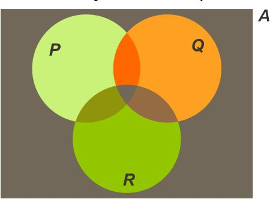

**Figura 1.1**: Diagrama de Venn para los conjuntos *P*, *Q* y *R* de *A*.

<span id="page-45-1"></span>*En segundo lugar modificamos este diagrama, eliminando regiones (achurando) o distinguiendo objetos en alguna región, de modo que cada una de las proposiciones se verifique en el diagrama. La primera proposición afirma que todo objeto de A que está en P, está también en Q. Eliminamos por lo tanto todas aquellas regiones que estando dentro de P, pero que están fuera de Q, reduciendo el tamaño de P y moviéndolo para que quede dentro de Q:*

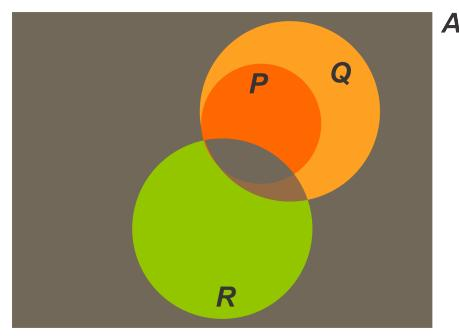

**Figura 1.2**: Modificación de la figura [1.1.](#page-45-0)

<span id="page-46-0"></span>*La segunda proposición afirma que hay un objeto de A que está en Q y en R. Ubicamos por lo tanto un objeto a en la intersección de Q con R, y como no podemos decidir si a está dentro o fuera de P lo ubicamos en la frontera:*

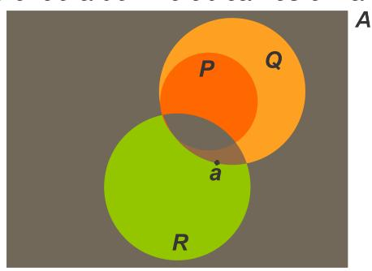

**Figura 1.3**: Objeto *a* que pertenece a *R* y *Q*.

*Este último diagrama constituye el diagrama de Venn de las proposiciones dadas.*

*En tercer lugar construimos un conjunto A y predicados p*(*x*)*, q*(*x*) *y r*(*x*) *que se ajusten al diagrama y que por lo tanto satisfacen las proposiciones dadas.*

*El más simple es:*

$$A = \{a\} \; ; \; p(x) : "x = a" \; ; \; q(x) : "x = a" \; ; \; r(x) : "x = a"$$

# **Problema 1.4**

Decidir si la proposición:

α :"Hay números naturales pares que son racionales"

es o no consecuencia lógica de las proposiciones:

β:"Todo número natural par es positivo".

γ:"Hay números naturales positivos que son racionales".

En el lenguaje Aristotélico este problema consiste en decidir si el silogismo siguiente es o no es válido:

"Todo número natural par es positivo"

"Hay números naturales positivos que son racionales".

"Hay números naturales pares que son racionales"

# *Solución*

*Consideremos los siguientes predicados:*

*p(x): "x es par".*

*q(x): "x es positivo".*

*r(x): "x es racional".*

*Sea* N *el conjunto de los números naturales.*

*Entonces podemos expresar en símbolos:*

<sup>α</sup> : <sup>∃</sup>*<sup>x</sup>* <sup>∈</sup> <sup>N</sup>(*p*(*x*) <sup>∧</sup> *<sup>r</sup>*(*x*))*,*

<sup>β</sup> : <sup>∀</sup>*<sup>x</sup>* <sup>∈</sup> <sup>N</sup>(*p*(*x*) <sup>→</sup> *<sup>q</sup>*(*x*)) *<sup>y</sup>*

<sup>γ</sup> : <sup>∃</sup>*<sup>x</sup>* <sup>∈</sup> <sup>N</sup>(*q*(*x*) <sup>∧</sup> *<sup>r</sup>*(*x*)).

*El problema consiste por lo tanto en determinar si la proposición:*

$$((\forall x \in \mathbb{N}(p(x) \to q(x)) \ \land \ \exists x \in \mathbb{N}(q(x) \land r(x))) \ \to \ \exists x \in \mathbb{N}(p(x) \land r(x))).$$

*es lógicamente verdadera. Para esto hay que probar que para todo x* <sup>∈</sup> <sup>N</sup>*,si p*(*x*), *<sup>q</sup>*(*x*) y *<sup>r</sup>*(*x*) *verifican las premisas, también verifican la conclusión. Esto puede hacerse usando diagramas de Venn y el problema se reduce a verificar que en el diagrama de Venn de las premisas se satisface la conclusión.*

*En virtud del problema anterior este diagrama es:*

<span id="page-47-0"></span>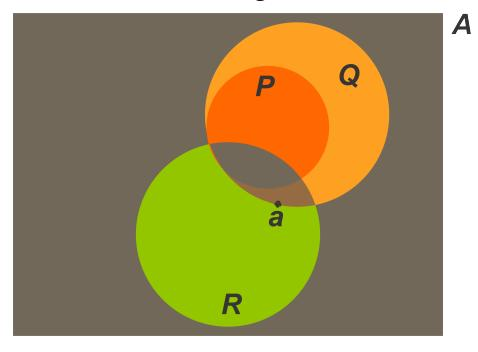

**Figura 1.4**: Diagrama de Venn para la proposición "Hay números naturales pares que son racionales".

*y en él no se verifica necesariamente la conclusión puesto que el objeto a del diagrama puede estar dentro o fuera de P, por lo que se puede concluir que la proposición dada no es una verdad lógica. Con lo anterior se concluye que* α *no es consecuencia lógica de* β *y* γ*.*

# **Problema 1.5**

Encuentre una proposición α que contenga las letras *p*, *q* y *r* y cuya tabla de verdad sea la siguiente:

| p | q | r | α |
|---|---|---|---|
| V | V | V | F |
| V | V | F | F |
| V | F | V | F |
| V | F | F | V |
| F | V | V | V |
| F | V | F | V |
| F | F | V | F |
| F | F | F | V |

# *Solución*

*Mirando las lineas de la tabla de verdad en las cuales* α *es verdadera, podemos interpretar* α *por:*

*"O bien p es verdadera, q falsa y r falsa ; o bien p es falsa, q verdadera y r verdadera; o bien p es falsa, q verdadera y r falsa; o bien p es falsa, q falsa y r falsa".*

*Esto equivale a interpretar la siguiente proposición:*

$$((p \wedge \neg q \wedge \neg r) \vee (\neg p \wedge q \wedge r) \vee (\neg p \wedge q \wedge \neg r) \vee (\neg p \wedge \neg q \wedge \neg r)).$$

*Esta última puede ser reducida aplicando las siguientes equivalencias:*

$$(\neg p \land q \land r) \lor (\neg p \land q \land \neg r)$$

$$\equiv (\neg p \land q) \land (r \lor \neg r)$$

$$\equiv (\neg p \land q).$$

*Y también:*

$$((p \land \neg q \land \neg r) \lor (\neg p \land \neg q \land \neg r))$$

$$\equiv ((p \lor \neg p) \land (\neg q \land \neg r))$$

$$\equiv (\neg q \land \neg r).$$

<span id="page-49-0"></span>*Obteniéndose finalmente la proposición:*

$$((\neg p \land q) \lor (\neg q \land \neg r)),$$

*que tiene la tabla de verdad pedida.*

# **Problema 1.6**

Determine si la frase:

"Yo estoy mintiendo",

es o no una proposición.

# *Solución*

*Supongamos que lo es. Entonces es verdadera o falsa.*

*Si es verdadera, es cierto que está mintiendo y por lo tanto es falsa.*

*Si es falsa, es falso que está mintiendo y por lo tanto dice la verdad, esto es, ella es verdadera.*

*Pero esto es una contradicción, por lo que nuestra suposición es falsa: esta frase no es una proposición.*

*Esta situación se conoce como "***La paradoja del mentiroso***", y constituye una de las razones mas poderosas para desarrollar lenguajes formales y utilizarlos en lugar del lenguaje natural.*

# <span id="page-50-0"></span>**Ejercicios Propuestos**

1.6

- Exprese las siguientes proposiciones utilizando los símbolos matemáticos y lógicos usuales:
  - (a) No es cierto que si el doble de cuatro es dieciséis entonces el cuadrado de cuatro es treinta y dos.
  - (b) El cuadrado de menos tres es nueve y es mayor que siete.
  - (c) Dos es positivo o menos dos es positivo; pero ninguno de los dos es mayor que diez.
  - (d) Existe un número entero mayor que dos.
  - (e) Existe un número natural cuyo cuadrado sumado con tres es uno.
  - (f) Todo número real cumple que él es positivo o su inverso aditivo es positivo, excepto el cero.
  - (g) El cuadrado de todo número real es mayor que el triple del número.
  - (h) La suma de dos números naturales es mayor que cada uno de ellos.
  - (i) Todo número real es igual a sí mismo.
  - (j) Existen números enteros pares y números enteros impares.
  - (k) Hay números reales que son negativos y positivos a la vez.
  - (I) El cero no es ni positivo ni negativo.
  - (m) El cuadrado de un número real negativo es un número real positivo.
  - (n) El uno es neutro del producto en el conjunto de los números reales.
  - (ñ) Todo número real distinto de cero tiene un inverso multiplicativo real.

- (o) El producto de dos números enteros negativos es negativo.
- (p) Todo número real es positivo, negativo o cero.
- (q) Para todo número natural existe un natural mayor.
- (r) Si un número real es positivo, entonces su inverso multiplicativo es positivo.
- (s) No siempre la resta de dos números naturales es un número natural.
- (t) No existe un número real negativo que sea mayor o igual que todo número negativo.
- (u) El cuadrado de la suma de dos números reales es el cuadrado del primero, más el doble del producto del primero por el segundo, más el cuadrado del segundo.
- (v) La raíz cuadrada positiva de un número real positivo es aquel número real positivo cuyo cuadrado es el número dado.
- (w) Dado cualquier número real existe otro número real cuyo cuadrado es el número inicial.
- 2. Exprese en el lenguaje natural las siguientes proposiciones:
  - (a)  $\forall x \in \mathbb{N}(x > 3)$ .
  - (b)  $\forall x \in \mathbb{N} \exists y \in \mathbb{N} (x > y)$ .
  - (c)  $\forall x \in \mathbb{R} (x > 3 \to x^2 > 8)$ .
  - (d)  $\forall x \in \mathbb{R}(x + 0 = x)$ .
  - (e)  $\forall x \in \mathbb{R}(x > 0 \rightarrow \exists y \in \mathbb{R}(y^2 = x)).$
  - (f)  $\forall x \in \mathbb{N} \ \forall y \in \mathbb{N} (x < y \rightarrow \exists z \in \mathbb{R} (x < z < y)).$
  - (g)  $\exists x \in \mathbb{N}(x + 3 = 10)$ .
  - (h)  $\exists x \in \mathbb{N} \, \forall y \in \mathbb{N} (x < y)$ .

- (i)  $\forall x \in \mathbb{R} \, \forall y \in \mathbb{R} (x+y > 2x \lor x+y > 2y)$ .
- (j)  $\forall x \in \mathbb{R}(x \neq 0 \rightarrow \exists y \in \mathbb{R}(x \cdot y = 1)).$
- (k)  $\exists x \in \mathbb{R}(x \notin \mathbb{N} \land \exists y \in \mathbb{N}(x + y = 0)).$
- (I)  $\forall x \in \mathbb{R}(x > 2 \to x + 1 > 3)$ .
- (m)  $\neg \exists x \in \mathbb{R}(x > 1 \land x < 8)$ .
- (n)  $\exists x \in \mathbb{R}(x = 2 \lor x = 3)$ .
- (ñ)  $(2 < 0 \rightarrow \forall x \in \mathbb{R}(x < 0))$ .
- 3. Dadas las proposiciones:
  - p: dos es par,
  - q: dos es impar,
  - r: tres es par,
  - s: tres es impar.
  - (a) Exprese en símbolos:
    - O bien dos es par o bien dos es impar.
    - 2) Si dos no es par entonces tres es par y dos es impar.
    - 3) No sólo dos no es par sino que tampoco es impar.
    - 4) El que tres sea par equivale a que no sea impar.
  - (b) Exprese en el lenguaje natural:
    - 1)  $(\neg p \rightarrow q)$ .
    - 2)  $(r \leftrightarrow \neg s)$ .
    - 3)  $((p \land r) \rightarrow (\neg q \land \neg s)).$
- 4. Dados los siguientes predicados:
  - p(x): x es par,
  - q(x): x es impar,
  - r(x): x es mayor que cinco,
  - s(x): x es menor que diez.
  - (a) Exprese en símbolos:
    - Todo número entero es mayor que cinco.

- Existen números enteros pares mayores que cinco.
- 3) Existen números enteros entre cinco y diez.
- (b) Exprese en el lenguaje natural:
  - 1)  $\forall x \in \mathbb{N}(p(x) \vee q(x))$ .
  - 2)  $\forall x \in \mathbb{N}(\neg r(x) \rightarrow s(x))$ .
  - 3)  $\neg \exists x \in \mathbb{N}(s(x) \land \neg r(x)).$
- 5. Sea *A* un conjunto, *a* un objeto de *A* y \* una operación binaria en *A*.

Exprese en símbolos:

- (a) \* es una operación conmutativa en A.
- (b) \* es una operación asociativa en A.
- (c) a es neutro de \* por la derecha.
- (d) a no es neutro de \* por la izquierda.
- (e) No todo elemento operado por \* consigo mismo resulta el mismo elemento.
- (f) Hay dos elementos de *A* que no conmutan por \*.
- 6. Exprese los siguientes enunciados de teoremas, usando símbolos:
  - (a) La suma de las medidas de los ángulos interiores de un triángulo es 180°.
  - (b) En un triángulo rectángulo, el cuadrado de la hipotenusa es igual a la suma de los cuadrados de los catetos.
  - (c) El cuadrado de un binomio es igual al cuadrado del primer término más el doble del producto del primer término por el segundo más el cuadrado del segundo término.
- 7. A partir del predicado x + 5 = y, obtenga tres proposiciones diferentes anteponiendo cuantificadores e interprételas en el lenguaje natural.

- 8. Sean *a* y *b* números enteros y consideremos las siguientes proposiciones:
  - *p* : *a* > 0,
  - *q* : *b* < 0,
  - *r* : *a* <sup>2</sup> > 0,
  - *s* : *b* <sup>2</sup> > 0.

Exprese las siguientes proposiciones en el lenguaje natural y determine su valor de verdad, sabiendo que *p*, *q*, *r* y *s* son verdaderas:

- (a) (*p* ∨ ¬*p*) (b) (*p* → *r*)
- (c) (*q* → *s*) (d) (*s* → ¬*q*)
- (e) (¬ *p* ∧ ¬ *r*) (f) (¬¬ *r* ∧ ¬ *r*)
- (g) (*r* ∨ *s*) (h) ¬ *p*
- (i) (*r* → *p*) (j) (*s* → *p*)
- (k) (*r* ∧ *p*) (l) (*s* ∧ *p*)

- (ll) (*r* → ¬ *p*) (m) (¬ *s* ∧ ¬ *p*)
- (n) (*q* ∧ *r*) (o) (¬ *r* ∧ ¬ *q* ∧ ¬ *s*)
- 9. Decida si cada una de las siguientes proposiciones son verdaderas o falsas:
  - (a) (2 < 1 → 2 es impar).
  - (b) (2 = 3 → 2 es par).
  - (c) (2 > 0 → 3 > 1).
  - (d) (2 > 0 → 3 < 1).
  - (e) ((2 < 1 ∨ 2 > 0) → 2 es impar).
  - (f) (2 < 1 → (2 es impar ∨ 3 > 1)).
  - (g) ((2 < 1 ∧ 2 > 0) → 2 es impar).
  - (h) (2 > 1 → (2 es impar ∧ 3 > 1)).
- 10. Sea *A* = {1, 2, 3}. Determine el valor de verdad de las siguientes proposiciones:
  - (a) ∃*x* ∈ *A*(*x* 6= 0).
  - (b) ∀*x* ∈ *A*(*x* > 1 → *x* = 2).

- (c) ∃*x* ∈ *A*(*x* > 2 ∧ *x* <sup>2</sup> <sup>6</sup>= 3).
- (d) ∀*x* ∈ *A*(*x* ≤ 5).
- (e) ∀*x* ∈ *A*∃*y* ∈ *A*(*y* > *x*).
- (f) ∃*x* ∈ *A*∀*y* ∈ *A*(*x* ≤ *y*).
- (g) ∃*x* ∈ *A*∃*y* ∈ *A*(*x* + *y* = 3).
- (h) ∀*x* ∈ *A*∃*y* ∈ *A*(*x* + *y* ∈ *A*).
- (i) ∃*x* ∈ *A*(*x* + 1 6∈ *A*).
- 11. Use contraejemplos para demostrar que cada una de las siguientes proposiciones son falsas:
  - (a) <sup>∀</sup>*<sup>x</sup>* <sup>∈</sup> <sup>R</sup>(*<sup>x</sup>* <sup>&</sup>gt; <sup>5</sup> <sup>→</sup> *<sup>x</sup>* <sup>&</sup>gt; 6).
  - (b) <sup>∀</sup>*<sup>x</sup>* <sup>∈</sup> <sup>R</sup>(*<sup>x</sup>* <sup>&</sup>gt; <sup>5</sup> <sup>∧</sup> *<sup>x</sup>* <sup>&</sup>lt; 6).
  - (c) <sup>∀</sup>*<sup>x</sup>* <sup>∈</sup> <sup>R</sup>(*<sup>x</sup>* <sup>6</sup>= 5).
  - (d) <sup>∀</sup>*<sup>x</sup>* <sup>∈</sup> <sup>R</sup> <sup>∀</sup>*<sup>y</sup>* <sup>∈</sup> <sup>R</sup>(*<sup>x</sup>* <sup>&</sup>lt; *<sup>y</sup>* <sup>∨</sup> *<sup>x</sup>* <sup>=</sup> *<sup>y</sup>*).
  - (e) <sup>∀</sup>*<sup>x</sup>* <sup>∈</sup> <sup>R</sup> <sup>∀</sup>*<sup>y</sup>* <sup>∈</sup> <sup>R</sup>(*<sup>x</sup>* <sup>&</sup>lt; *<sup>y</sup>* <sup>↔</sup> *<sup>x</sup>* + 1 <sup>≥</sup> *y*).
- 12. Determine el valor de verdad de las siguientes proposiciones:
  - (a) <sup>∀</sup> *<sup>x</sup>* <sup>∈</sup> <sup>R</sup>(*<sup>x</sup>* <sup>2</sup> <sup>≥</sup> *<sup>x</sup>*).
  - (b) <sup>∃</sup>*<sup>x</sup>* <sup>∈</sup> <sup>R</sup>(2*<sup>x</sup>* <sup>=</sup> *<sup>x</sup>*).
  - (c) <sup>∀</sup>*<sup>x</sup>* <sup>∈</sup> <sup>R</sup>(5*<sup>x</sup>* <sup>&</sup>gt; <sup>4</sup>*x*).
  - (d) <sup>∃</sup>*<sup>x</sup>* <sup>∈</sup> <sup>R</sup>(*<sup>x</sup>* <sup>3</sup> <sup>−</sup> *<sup>x</sup>* <sup>≥</sup> *<sup>x</sup>*).
  - (e) <sup>∀</sup>*<sup>x</sup>* <sup>∈</sup> <sup>R</sup>(*<sup>x</sup>* <sup>2</sup> <sup>≥</sup> 0).
  - (f) <sup>∃</sup>*<sup>x</sup>* <sup>∈</sup> <sup>R</sup>(*<sup>x</sup>* <sup>2</sup> <sup>≤</sup> 0).
- 13. Si *A* = {1, 2, 3, 4}, determine el valor de verdad de las siguientes proposiciones:
  - (a) ∀ *x* ∈ *A* (*x* + 3 < 6).
  - (b) ∃ *x* ∈ *A* (2*x* <sup>2</sup> + *x* = 15).
  - (c) ∀ *x* ∈ *A* ∀ *y* ∈ *A* ((*x* <sup>2</sup> + *y*) es par).
  - (d) ∃ *x* ∈ *A* ∀ *y* ∈ *A* ((*x* <sup>2</sup> + *y*) es par ).
  - (e) ∀ *y* ∈ *A* ∃ *x* ∈ *A* ((*x* <sup>2</sup> + *y*) es par ).
  - (f) ∀ *x* ∈ *A* ∃ *y* ∈ *A* ((*x* <sup>2</sup> + *y*) es impar).
- 14. Demuestre todas las verdades lógicas de los Teoremas [1.1,](#page-35-1) [1.2](#page-36-3) y [1.3.](#page-37-1)

- 15. Demuestre que las siguientes proposiciones no son lógicamente verdaderas.
  - (a) (¬(*p* → *q*) ↔ (¬*p* → ¬*q*)).
  - (b) (¬(*p* ∧ *q*) ↔ (¬*p* ∧ ¬*q*)).
  - (c) (¬(*p* ↔ *q*) ↔ (¬*p* ↔ ¬*q*)).
- 16. Encuentre un conjunto *A* y predicados *p*(*x*) y *q*(*x*), tales que la proposición dada sea verdadera:
  - (a) ∀*x* ∈ *A*(*p*(*x*) → ¬ *q*(*x*)).
  - (b) ∃*x* ∈ *A*(¬ *p*(*x*) ∧ ¬ *q*(*x*)).
- 17. Encuentre un conjunto *A* y predicados *p*(*x*) y *q*(*x*), tales que la proposición dada sea falsa:
  - (a) ∀*x* ∈ *A*(*p*(*x*) → ¬ *q*(*x*)).
  - (b) ∃*x* ∈ *A*(*p*(*x*) ∧ *q*(*x*)).
- 18. Encuentre un conjunto *A* y predicados *p*(*x*), *q*(*x*) y *r*(*x*) tales que los siguientes pares de proposiciones sean verdaderas:
  - (a) ∀*x* ∈ *A*(*p*(*x*) → ¬ *q*(*x*)) y ∃*x* ∈ *A p*(*x*).
  - (b) ∃*x* ∈ *A*(¬ *p*(*x*) ∧ ¬ *q*(*x*)) y ∀*x* ∈ *A*(*q*(*x*) → *r*(*x*)).
- 19. Demuestre que las siguientes proposiciones no son lógicamente verdaderas:
  - (a) (∀*x* ∈ *A*(*p* → (*q*(*x*) ∨ *r*(*x*))) → (∀*x* ∈ *A*(*p* → *q*(*x*)) ∨ ∀*x* ∈ *A*(*p* → *r*(*x*)))).
  - (b) ((∃*x* ∈ *A*α(*x*) ∧ ∃*x* ∈ *A*β(*x*)) → ∃*x* ∈ *A*(α(*x*) ∧ β(*x*))).
  - (c) (¬∀*x* ∈ *A*α(*x*) ↔ ∀*x* ∈ *A*(¬α(*x*))).
- 20. Demuestre que las siguientes proposiciones son contradicciones:
  - (a) ((*p* ∨ *q*) ∧ (¬ *p* ∧ ¬ *q*)).
  - (b) ((*p* → *q*) ∧ (*p* ∧ ¬ *q*)).
  - (c) ((*p* ↔ *q*) ∧ (¬ *p* ∧ ¬ *q*)).

- (d) ((∀*x* ∈ *A*¬ *p*(*x*) ∧ ∃*x* ∈ *A*(*p*(*x*) ∧ ¬ *q*(*x*)))).
- 21. Demuestre sin usar tablas de verdad las siguientes equivalencias donde α es una proposición lógicamente verdadera:
  - (a) (*p* ∧ α) ≡ *p*
  - (b) (*p* ∨ α) ≡ α.
  - (c) (*p* ∧ (*q* ∧ α)) ≡ (*p* ∧ *q*).
  - (d) (*p* ∨ (*q* ∨ α)) ≡ α.
  - (e) ((*p* ∧ (*q* ∨ α)) ≡ *p*.
  - (f) (*p* ∨ (*q* ∧ α)) ≡ (*p* ∨ *q*).
- 22. Demuestre sin usar tablas de verdad, que las siguientes proposiciones son lógicamente verdaderas:
  - (a) ((*p* → *q*) ∨ (*q* → *p*)).
  - (b) ((¬*p* ∧ *p*) ↔ ¬(¬*p* ∨ *p*)).
  - (c) ((*p* ∨ (¬*p* ∧ *q*)) ↔ (*p* ∨ *q*)).
- 23. Demuestre sin usar tablas de verdad, que las siguientes proposiciones son contradicciones:
  - (a) ¬((*p* → *q*) ∨ (*q* → *p*)).
  - (b) ((¬*p* ∧ *p*) ↔ (¬*p* ∨ *p*)).
  - (c) (¬(¬*p* → *q*) ↔ (*p* ∨ *q*)).
- 24. Simplifique las siguientes proposiciones, es decir, obtenga proposiciones equivalentes a las dadas pero de menor largo:
  - (a) (¬(*q* ∨ ¬*r*) ∨ *q*).
  - (b) (*p* ∧ ¬(*q* ∧ *p*)).
  - (c) (((*p* ∧ (*q* ∧ ¬*p*)) ∨ ¬ *q*).
  - (d) ((¬(¬*p* → *q*) ∨ (*p* ∨ *q*)) ∧ ¬ *q*).
  - (e) ¬(¬*p* → (*p* ∧ ¬*p*)).
- 25. Exprese las siguientes proposiciones usando solamente los conectivos ¬ e ∧:
  - (a) (*p* ∨ *q*).
  - (b) ((*p* ∨ *q*) → *p*).
  - (c) ¬ (*p* → *q*).

- (d) ((*p* ↔ *q*) ∧ (*p* ↔ *r*)).
- 26. Niegue las siguientes proposiciones:
  - (a) (*p* ∨ ¬*p*).
  - (b) (*s* → ¬*q*).
  - (c) (¬ *p* ∨ ¬ *r*).
  - (d) (¬¬ *r* ↔ ¬ *r*).
  - (e) (¬ *r* ∧ ¬ *q* ∧ ¬ *s*).
- 27. Niegue las siguientes proposiciones:
  - (a) ∃*x* ∈ *A*(*x* 6= 0).
  - (b) ∀*x* ∈ *A*(*x* > 1 → *x* = 2).
  - (c) ∃*x* ∈ *A*(*x* > 2 ∧ *x* <sup>2</sup> <sup>6</sup>= 3).
  - (d) ∀*x* ∈ *A*(*x* ≤ 5).
  - (e) ∀*x* ∈ *A*∃*y* ∈ *A*(*y* > *x*).
  - (f) ∃*x* ∈ *A*∀*y* ∈ *A*(*x* ≤ *y*).
  - (g) ∃*x* ∈ *A*∃*y* ∈ *A*(*x* + *y* = 3).
  - (h) ∀*x* ∈ *A*∃*y* ∈ *A*(*x* + *y* ∈ *A*).
  - (i) ∃*x* ∈ *A*(*x* + 1 6∈ *A*).
- 28. Niegue las siguientes proposiciones:
  - (a) <sup>∀</sup>*<sup>x</sup>* <sup>∈</sup> <sup>R</sup> <sup>∀</sup> *<sup>y</sup>* <sup>∈</sup> <sup>R</sup>(*xy* = 0 <sup>↔</sup> (*<sup>x</sup>* <sup>=</sup> 0 ∨ *y* = 0)).
  - (b) (∀*<sup>x</sup>* <sup>∈</sup> <sup>R</sup>(*<sup>x</sup>* <sup>&</sup>gt; 2) ∧ ∃ *<sup>x</sup>* <sup>∈</sup> <sup>R</sup>(*<sup>x</sup>* = 1)).
  - (c) ∀*x* ∈ *A* ∃*y* ∈ *A* ∀ *z* ∈ *A p*(*x*, *y*, *z*).
  - (d) ∃*x* ∈ *A* ∀*y* ∈ *A*(*p*(*x*, *y*) ↔ *q*(*y*)).
  - (e) ∃*x* ∈ *A* ¬ *p*(*x*) ∨ ∀ *x* ∈ *A q*(*x*).
  - (f) <sup>∀</sup> *<sup>x</sup>* <sup>∈</sup> <sup>N</sup> <sup>∀</sup> *<sup>y</sup>* <sup>∈</sup> <sup>N</sup> (*<sup>x</sup>* <sup>+</sup> *<sup>y</sup>* es par <sup>→</sup> (*<sup>x</sup>* es par ∧*y* es par)).
- 29. Demuestre que *p* es consecuencia lógica de las premisas indicadas en cada uno de los siguientes casos:
  - (a) *q*, (¬*p* → ¬*q*).
  - (b) (*p* ∨ *q*), (*q* → *r*), (*p* ∨ ¬*r*).
  - (c) (*p* ∨ *q* ∨ *r*), (*q* → *r*), ¬(*q* ∧ *r*), ¬*r*.

- 30. Demuestre que *p* no es consecuencia lógica de las premisas indicadas:
  - (a) ¬ *q*, (¬*p* → ¬*q*).
  - (b) (*p* ∨ *q*), (*q* → *r*), (¬*q* ∨ *r*).
  - (c) (*p* ∨ *q* ∨ *r*), (*q* → *r*), (*p* → *q*).
- 31. Analice la validez de los siguientes argumentos:
  - (a) Si hoy es Martes entonces mañana es Miércoles. Pero hoy no es Martes. Luego mañana no es Miércoles.
  - (b) O bien hoy es Lunes o bien es Martes. Pero hoy no es Lunes. Luego hoy es Martes.
- 32. Analice la validez de los siguientes argumentos:
  - (a) Todo hombre es mortal. Hay animales que son hombres. Luego, hay animales que son mortales.
  - (b) Hay mujeres sabias. Hay profesoras mujeres. Luego hay profesoras sabias.
- 33. Hay tres hombres: Juan, José y Joaquín, cada uno de los cuales tiene 2 profesiones. Sus ocupaciones son las siguientes: chofer, comerciante, músico, pintor, jardinero y peluquero.

En base a la siguiente información, determine el par de profesiones que corresponde a cada hombre:

- (a) El Chofer ofendió al músico riéndose de su cabello largo.
- (b) El músico y el jardinero solían ir a pescar con Juan.
- (c) El pintor compró al comerciante un litro de leche.
- (d) El chofer cortejaba a la hermana del pintor.
- (e) José debía \$ 1.000 al jardinero.

- (f) Joaquín venció a José y al pintor jugando ajedrez.
- 34. Se tienen los siguientes datos acerca de un crimen:
  - (a) La asesina de la señora Laura fue una de sus tres herederas: María, Marta o Mercedes.
  - (b) Si fue María, el asesinato sucedió antes de media noche.
  - (c) Si el asesinato fue después de las doce, no puede haber sido Marta.
  - (d) El asesinato fue después de las doce.

¿Quién asesinó a la señora Laura?

35. Considere el conectivo DOS (*p*, *q*, *r*) cuya interpretación está dada por la siguiente tabla:

| p | q | r | DOS(p,<br>q,<br>r) |
|---|---|---|--------------------|
| V | V | V | F                  |
| V | V | F | V                  |
| V | F | V | V                  |
| V | F | F | F                  |
| F | V | V | V                  |
| F | V | F | F                  |
| F | F | V | F                  |
| F | F | F | F                  |

- Encuentre una proposición equivalente a *DOS*(*p*, *q*, *r*) que contenga los conectivos usuales.
- 36. La disyunción excluyente entre *p* y *q* denotada por: (*p* ∨ *q*) se interpreta por:
  - (*p* ∨ *q*) es verdadera si y sólo si *p* es verdadera o *q* es verdadera, pero ambas no ambas.
    - (a) Construya una tabla de verdad para (*p* ∨ *q*).
    - (b) Demuestre que (*p* ∨ *q*) ≡ (*p* ∨ *q*) ∧ ¬ (*p* ∧ *q*).
    - (c) Demuestre que *p* ∧ (*q* ∨ *r*) ≡ ((*p* ∧ *q*) ∨ (*p* ∧ *r*)).
- <span id="page-55-0"></span>37. Encuentre una proposición α que contenga las letras *p*, *q* y *r* cuya tabla de verdad sea:

| p | q | r | α |
|---|---|---|---|
| V | V | V | F |
| V | V | F | F |
| V | F | V | V |
| V | F | F | V |
| F | V | V | F |
| F | V | F | F |
| F | F | V | V |
| F | F | F | V |

# Autoevaluación 1

- 1. Traduzca al lenguaje matemático la siguiente frase:
  - "Los números naturales tienen un menor elemento, pero no tienen un mayor elemento."
- 2. Traduzca al lenguaje natural la siguiente proposición:

$$\forall x \in \mathbb{N} \, (x \neq 0 \to \exists y \, (x = y + 1))$$

3. Niegue la siguiente proposición:

$$\forall x \in A (x \neq \phi \to \exists y \exists z (y \in x \lor x \in z))$$

- 4. Determine si el siguiente argumento es válido:
  - Si no estudias este libro, entonces reprobarás el curso de cálculo.
  - Si no estudias este libro, entonces no podrás salir de vacaciones este verano.
  - Apruebas el curso de cálculo o sales de vacaciones este verano.
  - Por lo tanto, estudiaste este libro.
- 5. Demuestre que la siguiente proposición no es verdadera:

$$\forall x \in A \exists y \in A p(x, y) \to \exists y \in A \forall x \in A p(x, y)$$

6. Encuentre un conjunto *A* y dos predicados *p*(*x*) y *q*(*x*), tales que la siguiente proposición sea verdadera:

$$\exists x \in A \left( \neg p(x) \land \forall y \in A \left( \neg (p(y) \to q(y)) \right) \right)$$

7. Demuestre sin usar tablas de verdad la siguiente equivalencia:

$$(p \lor (q \land (r \rightarrow \neg \neg r))) \equiv (p \lor q)$$

<span id="page-57-3"></span><span id="page-57-0"></span>

# **Los Números Reales**

<span id="page-57-1"></span>**Sistemas Numéricos 2.1**

A través de la historia de la Matemática los números han sido introducidos como un **instrumento** para contar o más precisamente para medir.

El sistema numérico más simple es el de los números naturales: uno, dos, tres, cuatro, . . . , etc; el cual sirve para contar objetos. En el conjunto de los números naturales se puede sumar y multiplicar; pero no se puede restar. Para poder introducir la operación de resta, es necesario agregar el cero y los negativos de los naturales obteniéndose así el conjunto de los números enteros, donde se puede sumar, multiplicar y restar; pero no se puede dividir. Para poder dividir se agregan las fracciones de números enteros, que constituyen el conjunto de los números racionales donde se pueden efectuar las cuatro operaciones.

Los racionales sirven para contar objetos y partes de objetos, considerando cantidades tanto positivas como negativas. Desde un punto de vista geométrico, estos también se pueden asociar a los puntos de una recta de la siguiente manera:

<span id="page-57-2"></span>Consideremos una recta y un punto *O* en ella que llamaremos origen.

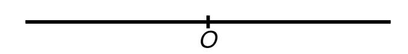

**Figura 2.1**: Recta con origen *O*.

<span id="page-58-6"></span><span id="page-58-0"></span>Elijamos una de las semirectas determinadas por *O* y llamémosla **semirecta positiva** hacia la derecha y **semirecta negativa** hacia la izquierda.

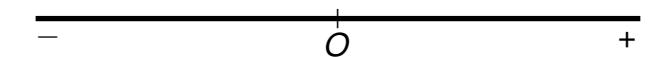

Figura 2.2: Semirecta positiva y semirecta negativa.

<span id="page-58-1"></span>Y elijamos un trazo que llamaremos trazo unitario:

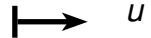

Figura 2.3: Trazo unitario.

Asociamos a cada número racional x un punto  $P_x$  de la recta de la siguiente manera:

<span id="page-58-2"></span>1. Al cero le asignamos el punto O.

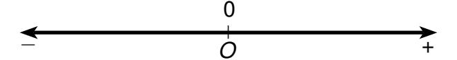

Figura 2.4: Número 0 en el origen.

<span id="page-58-3"></span>2. Para asignar un punto de la recta al número 1 copiamos el trazo unitario desde O en dirección positiva determinando el punto  $P_1$ .

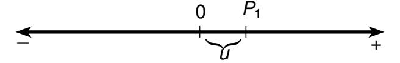

Figura 2.5: Número 1 a una distancia unitaria del origen.

<span id="page-58-4"></span>3. Para asignar un punto al número  $n \in \mathbb{N}$ , copiamos el trazo unitario n veces desde el origen en dirección positiva, obteniéndose el punto  $P_n$ .

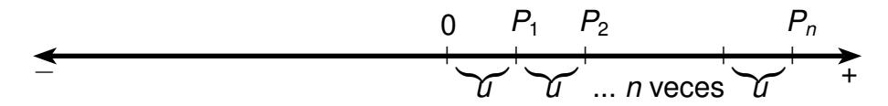

Figura 2.6: Posición del número *n*.

<span id="page-58-5"></span>4. Para asignar un punto de la recta al entero negativo -n, copiamos el trazo  $\overline{OP_n}$  desde O en dirección negativa, determinando el punto  $P_{-n}$ .

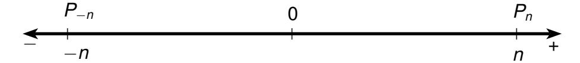

Figura 2.7: Posición del número -n.

2.1. Sistemas Numéricos 39

<span id="page-59-0"></span>5. Para asignar un punto de la recta al racional positivo  $\frac{m}{n}$  (donde m y n son naturales) dividimos el trazo unitario en n trazos iguales y lo copiamos m veces desde O en dirección positiva, determinando el punto  $P_{\frac{m}{n}}$ , y lo denotamos en la recta por  $\frac{m}{n}$ .

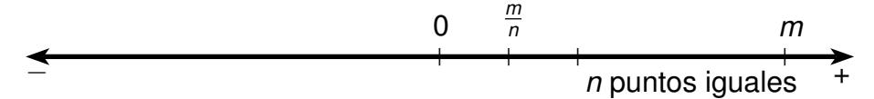

Figura 2.8: Posición del racional positivo m/n.

<span id="page-59-1"></span>6. Para asignar un punto de la recta al racional negativo  $-\frac{m}{n}$  (donde m y n son naturales) copiamos el trazo  $\overline{OP}_{\frac{m}{n}}$  desde O en dirección negativa, determinando el punto  $P_{-\frac{m}{n}}$ .

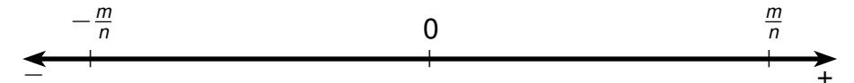

Figura 2.9: Posición del racional negativo -m/n.

<span id="page-59-2"></span>Como ejemplo de esta asignación tenemos:

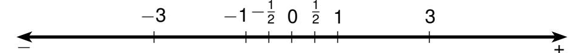

Figura 2.10: Ejemplo de asignaciones.

Observemos que cada número racional x corresponde a la medida del trazo  $\overline{OP}_x$  y entonces por esta construcción podemos concluir que los números racionales efectivamente sirven para medir algunos trazos dirigidos en la recta numérica. Dado que cualquier trazo dirigido puede ser copiado sobre la recta numérica, podemos pensar en asociar medida a trazos arbitrarios, sin embargo, los números racionales no nos bastan para ello como veremos en el siguiente ejemplo:

<span id="page-59-3"></span>La diagonal de un cuadrado de lado uno, no puede ser medida por un número racional, efectivamente supongamos que ésta tiene medida racional q,

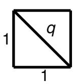

Figura 2.11: Cuadrado de lado unitario.

entonces por el Teorema de Pitágoras tenemos que:  $q^2 = 1^2 + 1^2$ , es decir  $q^2 = 2$ .

<span id="page-60-3"></span>Veremos a continuación que *q* no es un número racional.

Si *q* fuera un número racional, entonces tendría la forma *q* = *m n* donde *m* y *n* son enteros sin divisores comunes, entonces

$$q^2 = \frac{m^2}{n^2} = 2 \, .$$

Por lo tanto, *m*<sup>2</sup> = 2*n* 2 (∗), de donde *<sup>m</sup>*<sup>2</sup> es un número par y por lo tanto *<sup>m</sup>* también es un número par. Sea entonces, *m* = 2*p*, donde *p* es un entero. Reemplazando el valor de *m* en (\*), tenemos que 4*p* <sup>2</sup> = 2*n* <sup>2</sup> y por lo tanto *n* <sup>2</sup> = 2*p* 2 , es decir *n* <sup>2</sup> es un número par, de donde se obtiene que *n* también lo es.

Hemos concluido que *m* y *n* son números pares, luego ambos son divisibles por dos, lo que contradice la elección de *m* y *n*. Con esto hemos demostrado por contradicción que la medida de la diagonal del cuadrado no es un número racional.

Como éste, existe una infinidad de ejemplos de trazos que no pueden ser medidos con números racionales, pero como estos trazos pueden ser copiados sobre la recta numérica determinando puntos de ella que no corresponden a números racionales, nuestra limitación es equivalente a no tener números para todos los puntos de la recta.

Al agregar números para todos los puntos de la recta se obtiene el **conjunto de los números reales**. Los números reales no sólo sirven para medir todos los trazos dirigidos sino también para medir todas las áreas y volúmenes.

<span id="page-60-0"></span>Por ejemplo si *r* es un real y es la medida del trazo:

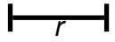

**Figura 2.12**: Trazo de largo *r*.

<span id="page-60-1"></span>también es el área del rectángulo de lados *r* y 1:

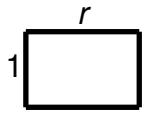

**Figura 2.13**: Rectángulo de lados *r* y 1.

<span id="page-60-2"></span>*A* = *r* · 1 = *r*. También lo es el volumen del paralelepípedo de lados *r*, 1 y 1:

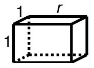

**Figura 2.14**: Volumen del paralelepípedo de arista *r*, 1 y 1.

$$V=r\cdot 1\cdot 1=r.$$

<span id="page-61-2"></span>2.1. Sistemas Numéricos 41

<span id="page-61-0"></span>La **suma** de dos reales está asociada a la suma de trazos dirigidos:

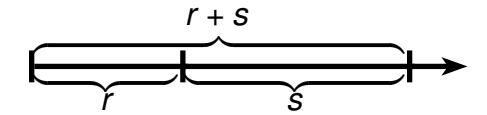

Figura 2.15: Suma de dos reales.

<span id="page-61-1"></span>El **producto** podemos asociarlo al área de un rectángulo:

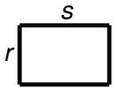

Figura 2.16: Producto de dos números reales.

 $A = r \cdot s$ .

El **cero** corresponde a la medida del trazo *OO* y el **uno** a la medida del trazo unitario.

La relación **menor que** entre números reales está dado por el orden de los puntos en la recta numérica en dirección de la semirecta positiva.

A una colección de números reales la llamamos conjunto de números reales.

Para formular las propiedades básicas de los números reales usamos los símbolos: +, ·, 0, 1, <, para la suma, el producto, el cero, el uno y la relación "menor que", respectivamente.  $\mathbb R$  denota el conjunto de todos los números reales y  $\mathcal P(\mathbb R)$  a la colección de todos los subconjuntos de números reales y se llama el **conjunto potencia** de  $\mathbb R$ .

# <span id="page-62-5"></span><span id="page-62-0"></span>**Operaciones Básicas en los Números Reales: Suma y Producto 2.2**

Las propiedades básicas de la suma y el producto constituyen los **axiomas de campo**, los cuales son verdades evidentes, que no necesitan demostración y que son la base para demostrar todas las demás propiedades.

# **Axioma de Campo**

*Axioma 2.1* R *es cerrado bajo la suma:*

$$\forall x \in \mathbb{R} \ \forall y \in \mathbb{R} \ (x + y \in \mathbb{R}).$$

<span id="page-62-4"></span>*Axioma 2.2 La suma de números reales es conmutativa:*

$$\forall x \in \mathbb{R} \ \forall y \in \mathbb{R} (x + y = y + x).$$

<span id="page-62-2"></span>*Axioma 2.3 La suma de números reales es asociativa:*

$$\forall x \in \mathbb{R} \ \forall y \in \mathbb{R} \ \forall z \in \mathbb{R} (x + (y + z) = (x + y) + z).$$

<span id="page-62-3"></span>*Axioma 2.4 El cero es un número real y es neutro de la suma de números reales:*

$$(0 \in \mathbb{R} \land \forall x \in \mathbb{R} (x + 0 = x)).$$

<span id="page-62-1"></span>*Axioma 2.5 Todo número real tiene un inverso aditivo real:*

$$\forall x \in \mathbb{R} \ \exists y \in \mathbb{R} (x + y = 0).$$

*Axioma 2.6* R *es cerrado bajo el producto:*

$$\forall x \in \mathbb{R} \ \forall y \in \mathbb{R} (x \cdot y \in \mathbb{R}).$$

*Axioma 2.7 El producto de números reales es conmutativo:*

$$\forall x \in \mathbb{R} \ \forall y \in \mathbb{R} (x \cdot y = y \cdot x).$$

*Axioma 2.8 El producto de números reales es asociativo:*

$$\forall x \in \mathbb{R} \ \forall y \in \mathbb{R} \ \forall z \in \mathbb{R} (x \cdot (y \cdot z) = (x \cdot y) \cdot z).$$

*Axioma 2.9 El uno es un número real diferente de cero y es neutro del producto de números reales:*

$$(1 \in \mathbb{R} \land 1 \neq 0 \land \forall x \in \mathbb{R} (x \cdot 1 = x)).$$

*tivo real:*

*Axioma 2.10 Todo número real diferente de cero tiene un inverso multiplica-*

$$\forall x \in \mathbb{R} (x \neq 0 \rightarrow \exists y \in \mathbb{R} (x \cdot y = 1)).$$

*Axioma 2.11 El producto de números reales es distributivo sobre la suma de números reales:*

$$\forall x \in \mathbb{R} \ \forall y \in \mathbb{R} \ \forall z \in \mathbb{R} \ (x \cdot (y + z) = x \cdot y + x \cdot z).$$

Para expresar axiomas o proposiciones podemos omitir el cuantificador <sup>∀</sup>*<sup>x</sup>* <sup>∈</sup> <sup>R</sup> cuando no se preste a confusiones. Así, por ejemplo, la conmutatividad de la suma se puede expresar simplemente por:

$$X + y = y + X.$$

Como ejemplo de propiedades que se pueden demostrar a partir de estos axiomas tenemos el siguiente:

# **Teorema**

<span id="page-63-1"></span><span id="page-63-0"></span>*Teorema 2.1 Las siguientes propiedades se cumplen en* R*:*

*(*I*) Cancelación de la suma:*

$$(X+Z=y+Z\to X=y).$$

*(*II*) Cancelación del producto:*

$$((x \cdot z = y \cdot z \wedge z \neq 0) \rightarrow x = y).$$

(III) El producto de un número real por cero es cero:

$$x \cdot 0 = 0$$
.

(IV) No existen divisores de cero:

$$(x \cdot y = 0 \rightarrow (x = 0 \lor y = 0)).$$

(V) El neutro aditivo es único:

$$(\forall y \in \mathbb{R} (x + y = y) \rightarrow x = 0).$$

(VI) El neutro multiplicativo es único:

$$(\forall y \in \mathbb{R} (x \cdot y = y) \to x = 1).$$

<span id="page-64-0"></span>(VII) El inverso aditivo es único:

$$((x + y = 0 \land x + z = 0) \rightarrow y = z).$$

<span id="page-64-1"></span>(VIII) El inverso multiplicativo es único:

$$((x \cdot y = 1 \land x \cdot z = 1) \rightarrow y = z).$$

# **Demostración**

Demostraremos Teorema 2.1 (1) dejando el resto al lector.

Sean  $x, y, z \in \mathbb{R}$  y supongamos que x + z = y + z. Por Axioma 2.5, existe  $z' \in \mathbb{R}$  tal que z + z' = 0, entonces, (x + z) + z' = (y + z) + z' y por Axioma 2.3, x + (z + z') = y + (z + z'), pero como z + z' = 0, tenemos que x + 0 = y + 0 y por Axioma 2.4 x = y.

En base a estas propiedades y a los conceptos primitivos se pueden definir nuevos conceptos:

# **Definición**

# Definición 2.1 Inverso aditivo

El inverso aditivo de un número real es aquel número real que sumado con él da cero:

$$\forall x \in \mathbb{R} \ \forall y \in \mathbb{R} \ (-x = y \leftrightarrow x + y = 0).$$

Esta definición es correcta dado que hemos establecido la unicidad del inverso aditivo en Teorema 2.1 (VII).

# *Definición 2.2 Resta*

$$\forall x \in \mathbb{R} \ \forall y \in \mathbb{R} (x - y = x + (-y)).$$

*Es decir, restar es sumar el inverso aditivo.*

# <span id="page-65-0"></span>*Definición 2.3 Inverso multiplicativo*

$$\forall x \in \mathbb{R} \ \forall y \in \mathbb{R} \ \Big( x \neq 0 \to \Big( \frac{1}{x} = y \ \leftrightarrow \ x \cdot y = 1 \Big) \Big).$$

*Esta definición es correcta por Teorema [2.1](#page-63-0) (*[VIII](#page-64-1)*).*

# *Definición 2.4 División*

$$\forall x \in \mathbb{R} \ \forall y \in \mathbb{R} \left( y \neq 0 \to \frac{x}{y} = x \cdot \left( \frac{1}{y} \right) \right).$$

*Es decir, dividir es multiplicar por el inverso multiplicativo.*

# *Definición 2.5 Cuadrado*

$$\forall x \in \mathbb{R} (x^2 = x \cdot x).$$

En estas definiciones también se pueden omitir los cuantificadores cuando no se preste a confusión. Por ejemplo la Definición [2.3](#page-65-0) puede expresarse simplemente por:

$$x \neq 0 \rightarrow \left(\frac{1}{x} = y \leftrightarrow x \cdot y = 1\right).$$

Como ejemplos de propiedades de los nuevos conceptos que se pueden demostrar, tenemos:

# **Teorema**

# <span id="page-65-1"></span>*Teorema 2.2 Sean x*, *<sup>y</sup>* <sup>∈</sup> <sup>R</sup>*. Entonces:*

<span id="page-65-2"></span>(I) 
$$-(x + y) = (-x) + (-y)$$
.

(II) 
$$(-1) x = -x$$
.

(III) 
$$(x^2 = 0 \rightarrow x = 0)$$
.

<span id="page-66-3"></span>(IV) 
$$(x + y)^2 = x^2 + 2x \cdot y + y^2$$
.

# **Demostración**

*Demostraremos Teorema [2.2](#page-65-1) (*[I](#page-65-2)*) dejando el resto al lector. Sean x*, *<sup>y</sup>* <sup>∈</sup> <sup>R</sup>. *Por Definición [2.3,](#page-65-0) basta probar que*

$$(x + y) + ((-x) + (-y)) = 0$$
.

$$(x + y) + ((-x) + (-y)) = (x + (-x)) + (y + (-y)), por Axioma 2.2 y 2.3$$
  
= 0 + 0, por Definición 2.3.  
= 0, por Axioma 2.4.

# <span id="page-66-0"></span>**Orden de los Números Reales 2.3**

Las siguientes son verdades evidentes que describen las propiedades básicas de la relación **menor que** en los números reales. Toda otra propiedad del orden se puede demostrar a partir de éstas.

# **Axioma de Orden**

<span id="page-66-1"></span>*Axioma 2.12 El orden de los números reales es lineal:*

$$\forall x \in \mathbb{R} \ \forall y \in \mathbb{R} \ (x \neq y \to (x < y \lor y < x)).$$

*Axioma 2.13 El orden de los números reales es asimétrico:*

$$\forall x \in \mathbb{R} \ \forall y \in \mathbb{R} \ (x < y \rightarrow \neg (y < x)).$$

*Axioma 2.14 El orden de los números reales es transitivo:*

$$\forall x \in \mathbb{R} \ \forall y \in \mathbb{R} \ \forall z \in \mathbb{R} \ ((x < y \land y < z) \rightarrow x < z).$$

<span id="page-66-2"></span>*Axioma 2.15 El orden de los números reales se preserva al sumar un número real:*

$$\forall x \in \mathbb{R} \ \forall y \in \mathbb{R} \ \forall z \in \mathbb{R} \ (x < y \rightarrow x + z < y + z).$$

<span id="page-67-7"></span>*Axioma 2.16 El orden de los números reales se preserva al multiplicar por un número real positivo:*

$$\forall x \in \mathbb{R} \ \forall y \in \mathbb{R} \ \forall z \in \mathbb{R} \ ((x < y \land 0 < z) \rightarrow x \cdot z < y \cdot z).$$

Con estos axiomas se pueden definir los conceptos de **mayor, mayor o igual, menor o igual, positivo y negativo** para números reales.

# **Definición**

# *Definición 2.6 Relaciones de Orden en* R

*Sean x*, *<sup>y</sup>* <sup>∈</sup> <sup>R</sup>*, entonces:*

- <span id="page-67-4"></span>(I) (*x* > *y* ↔ *y* < *x*)*, ( x es mayor que y ).*
- <span id="page-67-5"></span>(II) (*x* ≥ *y* ↔ (*x* > *y* ∨ *x* = *y*))*, ( x es mayor o igual que y ).*
- (III) (*x* ≤ *y* ↔ (*x* < *y* ∨ *x* = *y*))*, ( x es menor o igual que y ).*
- (IV) (*x es positivo* ↔ *x* > 0).
- (V) (*x es negativo* ↔ *x* < 0).

Como ejemplos de propiedades que se puede demostrar a partir de los axiomas tenemos:

# **Teorema**

# <span id="page-67-6"></span><span id="page-67-0"></span>*Teorema 2.3 Sean x*, *<sup>y</sup>*, *<sup>z</sup>* <sup>∈</sup> <sup>R</sup>*, entonces:*

- *(*I*)* ¬ (*x* < *x*).
- <span id="page-67-1"></span>*(*II*)* (¬ (*x* < *y*) ↔ *x* ≥ *y*).
- <span id="page-67-2"></span>*(*III*)* (*x* > 0 ↔ (−*x*) < 0).
- <span id="page-67-3"></span>*(*IV*)* ((*x* > 0 ∧ *y* > 0) → *x* + *y* > 0).
- *(*V*)* ((*x* < *y* ∧ *z* < *u*) → *x* + *z* < *y* + *u*).

<span id="page-68-0"></span>(VI) 
$$(x > y \leftrightarrow x - y > 0)$$
.

(VII) 
$$((x > 0 \land y > 0) \rightarrow x \cdot y > 0)$$
.

(VIII) 
$$1 > 0$$
.

(IX) 
$$(x > 0 \to \frac{1}{x} > 0)$$
.

<span id="page-68-1"></span>(x) 
$$x^2 \ge 0$$
.

(XI) 
$$((x < y \land z < 0) \rightarrow x \cdot z > y \cdot z)$$
.

(XII) 
$$\left( (x > 0 \land x < y) \rightarrow \frac{1}{x} > \frac{1}{y} \right)$$
.

(XIII) 
$$\left(x < y \rightarrow x < \frac{x+y}{2} < y\right)$$
.

(XIV) 
$$x - 1 < x < x + 1$$
.

# **Demostración**

Probaremos (I), (II), (III) y (IV) dejando el resto al lector:

- (i) Sea  $x \in \mathbb{R}$  y supongamos x < x. Entonces por Axioma 2.12,  $\neg$  (x < x) lo cuál es una contradicción. Luego  $\neg$  (x < x).
- (ii) Demostraremos en primer lugar que  $\neg$  (x < y)  $\rightarrow$   $x \ge y$ . Supongamos  $\neg$  (x < y), entonces por Axioma 2.12 tenemos dos casos a considerar
  - Si  $x \neq y$ , se tiene que y < xy por Definición 1, x > y, luego  $x \geq y$ .
  - Si x = y, es inmediato que  $x \ge y$ .

Para el recíproco queremos demostrar que  $x \ge y \to \neg(x < y)$ .

Entonces supongamos que  $x \ge y$  entonces  $x = y \lor x > y$ . Si x = y, por (I) sabemos que  $\neg(x < y)$ . Si x > y, por Definición 1 tenemos que y < x y por Axioma 2.15  $\neg(x < y)$ .

(iii) Para la implicación de izquierda a derecha, supongamos que x > 0. Por Definición 1, 0 < x y por  $(\mathcal{O}4)$ , 0 + (-x) < x + (-x), de donde se obtiene que (-x) < 0.

Para la implicación recíproca, supongamos (-x) < 0, por Axioma 2.15 tenemos que (-x) + x < 0 + x, es decir, 0 < x y por Definición 1 x > 0.

viii) Supongamos que  $\neg$  (1 > 0). Por Definición 2,  $\neg$  (0 < 1) y por la parte (II) de este teorema,  $0 \ge 1$ . Como  $0 \ne 1$  por Axioma 2.15 tenemos que 0 > 1, entonces por la parte (VI) de este teorema, 0 - 1 > 0, es decir, -1 > 0.

Como 0>1 y-1>0 aplicando  $(\mathcal{O}5)$  se obtiene 0(-1)>1(-1), luego 0>-1. Por lo tanto  $-1>0 \land 0>-1$ , es decir  $-1<0 \land 0<-1$ , y por  $(\mathcal{O}3)$ , -1<-1 lo cual contradice la parte (I) de este teorema.

Podemos concluir que la suposición inicial es falsa, es decir que 1 > 0.

En base al orden de los números reales se puede definir el valor absoluto:

# **Definición**

# Definición 2.7 Valor Absoluto

Para  $x \in \mathbb{R}$ , definimos:

$$|x| = \begin{cases} x & \text{si } x \ge 0, \\ -x & \text{si } x < 0. \end{cases}$$

(|x| es el valor absoluto de x).

Por ejemplo, |5| = 5 y |-7| = -(-7) = 7.

Las principales propiedades del valor absoluto vienen dadas por:

# **Teorema**

<span id="page-69-0"></span>**Teorema** 2.4 Sean  $x, y \in \mathbb{R}$ , entonces:

- (1)  $|x| \geq 0$ .
- (II)  $|x| \geq x$ .
- (III)  $(|x| = 0 \leftrightarrow x = 0)$ .
- (IV)  $(y > 0 \rightarrow (|x| = y \leftrightarrow (x = y \lor x = -y)))$ .
- <span id="page-69-1"></span>(V)  $(y > 0 \rightarrow (|x| < y \leftrightarrow (-y < x < y)))$ .

(VI) 
$$(y>0 \rightarrow (|x|>y \leftrightarrow (x>y \lor x<-y))).$$

<span id="page-70-3"></span>(VII) 
$$(y > 0 \rightarrow (|x| \leq y \leftrightarrow (-y \leq x \leq y)))$$
.

(VIII) 
$$(y > 0 \rightarrow (|x| \ge y \leftrightarrow (x \ge y \lor x \le -y))).$$

(IX) 
$$|x \cdot y| = |x| \cdot |y|$$
.

(X) 
$$\left(y\neq 0\rightarrow \left|\frac{x}{y}\right|=\frac{|x|}{|y|}\right)$$
.

<span id="page-70-4"></span>
$$(XI) \mid -X \mid = |X|.$$

<span id="page-70-0"></span>
$$(XII) -|x| \leq x \leq |x|.$$

<span id="page-70-1"></span>(XIII) 
$$|x+y| \leq |x| + |y|$$
.

<span id="page-70-2"></span>(XIV) 
$$||x| - |y|| \le |x - y|$$
.

# **Demostración**

*Demostraremos (*[I](#page-69-0)*), (*[V](#page-69-1)*), (*[XII](#page-70-0)*), (*[XIII](#page-70-1)*) y (*[XIV](#page-70-2)*) dejando el resto al lector.*

- *(i) Sea x* <sup>∈</sup> <sup>R</sup>*, entonces* (*<sup>x</sup>* <sup>≥</sup> <sup>0</sup> <sup>∨</sup> *<sup>x</sup>* <sup>&</sup>lt; 0). *Si x* ≥ 0, |*x*| = *x* ≥ 0 *y si x* < 0, |*x*| = −*x* ≥ 0*, luego* |*x*| ≥ 0.
- *(v) Sea y* <sup>&</sup>gt; <sup>0</sup> *y x* <sup>∈</sup> <sup>R</sup>*, entonces*

$$|x| < y \quad \leftrightarrow \quad ((x \ge 0 \land x < y) \lor (x < 0 \land -x < y))$$

$$\leftrightarrow \quad ((x \ge 0 \land x < y) \lor (x < 0 \land x > -y))$$

$$\leftrightarrow \quad (0 \le x < y \lor -y < x < 0).$$

*Demostraremos que*

$$((0 \le x < y \lor -y < x < 0) \leftrightarrow (-y < x < y)).$$

*Para la implicación de izquierda a derecha, suponemos*

$$((0 \le x < y) \lor (-y < x < 0)).$$

- *Si* 0 ≤ *x* < *y, como por hipótesis y* > 0*, entonces* −*y* < 0 *, luego* −*y* < 0 ≤ *x* < *y, de donde se obtiene* −*y* < *x* < *y.*
- *Si* −*y* < *x* < 0*, como y* > 0*, tenemos* −*y* < *x* < 0 < *y, de donde se obtiene* −*y* < *x* < *y.*

*Para la implicación de derecha a izquierda, supongamos* −*y* < *x* < *y.*

Si 
$$x \ge 0$$
, entonces  $0 \le x < y$ .

Si 
$$x < 0$$
, entonces  $-y < x < 0$ .

*Como* (
$$x \ge 0 \lor x < 0$$
), tenemos (( $0 \le x < y$ )  $\lor$  ( $-y < x < 0$ )).

*(xii) Sea x* <sup>∈</sup> <sup>R</sup>*, entonces* (*<sup>x</sup>* <sup>≥</sup> <sup>0</sup> <sup>∨</sup> *<sup>x</sup>* <sup>&</sup>lt; 0).

Si 
$$x \ge 0$$
, entonces  $|x| = x$  y como  $-x \le 0$ ,

$$-|x| = -x \le 0 \le x = |x|$$
,  $|x| \le |x| \le |x|$ .

Si 
$$x < 0$$
, entonces  $|x| = -x$  y como  $-x > 0$ ,

$$-|x| = --x = x < 0 < -x = |x|$$
,  $|x| = -|x| \le x \le |x|$ .

*En ambos casos hemos obtenido la conclusión deseada.*

*(xiii) Como x* ≤ |*x*| *y y* ≤ |*y*| *tenemos x* + *y* ≤ |*x*| + |*y*|*.*

Por otro lado, 
$$x \ge -|x|$$
  $y$   $y \ge -|y|$  de donde  $x + y \ge -(|x| + |y|)$ .

*Tenemos entonces* −(|*x*|+|*y*|) ≤ *x*+*y* ≤ (|*x*|+|*y*|) *y como* |*x*|+|*y*| ≥ 0*, por (*[VII](#page-70-3)*)obtenemos* |*x* + *y*| ≤ |*x*| + |*y*|.

*(xiv) Como x* = *x* − *y* + *y, tenemos que* |*x*| = |*x* − *y* + *y*| ≤ |*x* − *y*| + |*y*| *de donde* |*x*| − |*y*| ≤ |*x* − *y*|*.*

Además 
$$|y| = |y - x + x| \le |y - x| + |x| \text{ por (XIII)}.$$

Luego 
$$|y|-|x|\leq |y-x|$$
.

Por lo tanto 
$$|x| - |y| \ge -|y - x| = -|x - y|$$
 por (XI).

Luego 
$$-|x-y| \le |x| - |y| \le |x-y|$$
 y utilizando (VII)

*se obtiene que* ||*x*| − |*y*|| ≤ |*x* − *y*|*.*

# <span id="page-72-0"></span>**Conjuntos de Números Reales 2.4**

Las siguientes son verdades evidentes que describen las propiedades básicas de los conjuntos de números reales. En base a éstas se pueden definir los conjuntos numéricos más comunes y demostrar sus propiedades.

# **Axioma de conjuntos de números reales**

<span id="page-72-1"></span>*son iguales:*

*Axioma 2.17 Dos conjuntos de números reales con los mismos elementos,*

$$\forall x \in \mathbb{R} (x \in A \leftrightarrow x \in B) \rightarrow A = B.$$

*Axioma 2.18 Dada una propiedad, existe el conjunto de los números reales que la satisfacen:*

$$\exists A \in \mathcal{P}(\mathbb{R}) \ \forall x \in \mathbb{R}(x \in A \leftrightarrow \alpha(x)).$$

*Este conjunto es único por Axioma [2.17](#page-72-1) y se denota por*

$$\{\mathbf{x} \in \mathbb{R} : \alpha(\mathbf{x})\}.$$

A partir de los axiomas anteriores podemos definir los conjuntos de números reales más conocidos:

# **Definición**

*Definición 2.8 Conjunto vacío*

$$\phi = \{ \mathbf{X} \in \mathbb{R} : \mathbf{X} \neq \mathbf{X} \},\$$

*Definición 2.9 Conjunto de los reales positivos*

$$\mathbb{R}^+ = \{x \in \mathbb{R} : x > 0\},\$$

*Definición 2.10 Conjunto de los reales negativos*

$$\mathbb{R}^- = \{x \in \mathbb{R} : x < 0\},\$$

# *Definición 2.11 Singleton de a*

$$\{a\}=\{x\in\mathbb{R}:x=a\},$$

# *Definición 2.12 Par de números reales a y b)*

$$\{a,b\} = \{x \in \mathbb{R} : (x = a \lor x = b)\},$$

# *Definición 2.13 Trío de números reales a*, *b y c*

$$\{a, b, c\} = \{x \in \mathbb{R} : (x = a \lor x = b \lor x = c)\},\$$

# *Definición 2.14 Intervalo cerrado de extremos a y b*

$$[a,b] = \{x \in \mathbb{R} : a \leq x \leq b\},\$$

# *Definición 2.15 Intervalo abierto de extremos a y b*

$$]a, b[= \{x \in \mathbb{R} : a < x < b\},\$$

# *Definición 2.16 Intervalo, de extremos a y b, cerrado en a y abierto en b*

$$[a, b[= \{x \in \mathbb{R} : a \le x < b\},$$

# *Definición 2.17 Intervalo, de extremos a y b, abierto en a y cerrado en b*

$$[a, b] = \{x \in \mathbb{R} : a < x \le b\},$$

# *Definición 2.18 Intervalo infinito por la izquierda, de extremo b y abierto en b*

$$]-\infty,b[=\{x\in\mathbb{R}:x< b\},$$

# *Definición 2.19 Intervalo infinito por la izquierda, de extremo b y cerrado en b*

$$]-\infty,b]=\{x\in\mathbb{R}:x\leq b\},$$

# *Definición 2.20 Intervalo infinito por laderecha, de extremo a y abierto en a*

$$]a,\infty[=\{x\in\mathbb{R}:a< x\},$$

# *Definición 2.21 Intervalo infinito por la derecha, de extremo a y cerrado en a*

$$[a,\infty[=\{\in\mathbb{R}:a\leq x\},$$

] − ∞,∞[ se usa también para denotar el conjunto <sup>R</sup>.

También podemos definir las relaciones y operaciones básicas de conjuntos. Si *A* y *B* son conjuntos de números reales entonces:

# **Definición**

# *Definición 2.22 A es subconjunto de B*

*<sup>A</sup>* <sup>⊆</sup> *<sup>B</sup>* ↔ ∀*<sup>x</sup>* <sup>∈</sup> <sup>R</sup> (*<sup>x</sup>* <sup>∈</sup> *<sup>A</sup>* <sup>→</sup> *<sup>x</sup>* <sup>∈</sup> *<sup>B</sup>*),

# *Definición 2.23 A unión B*

*<sup>A</sup>* <sup>∪</sup> *<sup>B</sup>* <sup>=</sup> {*<sup>x</sup>* <sup>∈</sup> <sup>R</sup> : (*<sup>x</sup>* <sup>∈</sup> *<sup>A</sup>* <sup>∨</sup> *<sup>x</sup>* <sup>∈</sup> *<sup>B</sup>*)},

# *Definición 2.24 A intersección B*

*<sup>A</sup>* <sup>∩</sup> *<sup>B</sup>* <sup>=</sup> {*<sup>x</sup>* <sup>∈</sup> <sup>R</sup> : (*<sup>x</sup>* <sup>∈</sup> *<sup>A</sup>* <sup>∧</sup> *<sup>x</sup>* <sup>∈</sup> *<sup>B</sup>*)},

# *Definición 2.25 A menos B*

*<sup>A</sup>* <sup>−</sup> *<sup>B</sup>* <sup>=</sup> {*<sup>x</sup>* <sup>∈</sup> <sup>R</sup> : (*<sup>x</sup>* <sup>∈</sup> *<sup>A</sup>* <sup>∧</sup> *<sup>x</sup>* 6∈ *<sup>B</sup>*)},

# *Ejemplos*

# *Ejemplo 2.1*

R = R <sup>+</sup> ∪ {0} ∪ <sup>R</sup> <sup>−</sup> .

# *Ejemplo 2.2*

<sup>R</sup> <sup>−</sup> [*a*, *<sup>b</sup>*] = ] − ∞, *<sup>a</sup>*[ <sup>∪</sup> ]*b*,∞[.

# *Ejemplo 2.3*

[−2, 1] ∩ ]0, 15] =]0, 1].

# *Ejemplo 2.4*

[−2, 0] ⊆ [−2, 1] ⊆ ] − ∞, 1].

# Ejemplo 2.5

$$\mathbb{R}-\{2\}=]-\infty,2[\ \cup\ ]2,\infty[.$$

# Ejemplo 2.6

$$([1,3[ \cup ]4,6]) \cap ]2,5[=]2,3[ \cup ]4,5[.$$

Definimos provisoriamente el conjunto de los números naturales por:

# <span id="page-75-0"></span>**Definición**

# Definición 2.26 Conjunto de los números naturales

$$\mathbb{N} = \{ x \in \mathbb{R} : x = 1 + 1 + \cdots + 1 \},$$

Esta definición será reemplazada en el capítulo 5 por otra que no contenga puntos suspensivos y en base a la cual demostraremos las propiedades de los números naturales. Por ahora podemos decir que en  $\mathbb N$  se puede sumar y multiplicar; pero no se puede restar ni dividir. A partir de  $\mathbb N$  se puede definir el conjunto de los números enteros:

# **Definición**

# Definición 2.27 Conjunto de los números enteros

$$\mathbb{Z} = \{ x \in \mathbb{R} : (x \in \mathbb{N} \lor x = 0 \lor (-x) \in \mathbb{N}) \} ,$$

Las propiedades de los números enteros se basan en las propiedades de los números naturales. En todo caso, podemos decir que en  $\mathbb Z$  se puede sumar, restar y multiplicar pero no se puede dividir. A partir de los enteros pueden ser definidos los números racionales:

# **Definición**

# Definición 2.28 Conjunto de los números racionales

$$\mathbb{Q} = \left\{ x \in \mathbb{R} : \exists p \in \mathbb{Z} \ \exists q \in \mathbb{N} \left( x = \frac{p}{q} \right) \right\}$$

<span id="page-76-1"></span>Las propiedades de los números racionales dependen de las propiedades de los naturales y de los enteros. En todo caso, podemos decir que en © se pueden efectuar las cuatro operaciones.

Podemos observar que si 
$$x = \frac{p}{q}$$
, también  $x = \frac{2p}{2q}$  y que por lo tanto,  $p$  y  $q$  no

son únicos; pero pueden ser elegidos primos relativos, es decir, sin factores comunes diferentes de 1.

También se pueden definir los conjuntos de enteros y racionales positivos y negativos:

# **Definición**

# Definición 2.29

Conjunto de Racionales Positivos

 $\mathbb{O}^+ = \mathbb{O} \cap \mathbb{R}^+.$ 

**Definición 2.30** Conjunto de Racionales Negativos

 $\mathbb{Q}^- = \mathbb{Q} \cap \mathbb{R}^-$ .

# Definición 2.31

Conjunto de Enteros Positivos

 $\mathbb{Z}^+ = \mathbb{Z} \cap \mathbb{R}^+ = \mathbb{N}.$ 

# Definición 2.32

Conjunto de Enteros Negativos

 $\mathbb{Z}^- = \mathbb{Z} \cap \mathbb{R}^-$ .

# <span id="page-76-0"></span>Completud de los Números Reales

Hasta ahora tenemos como propiedades básicas de los números reales los los axiomas de cuerpo ordenado.

Como hemos visto, los números racionales también satisfacen estos axiomas aunque no constituyen todos los puntos de la recta numérica.

El axioma que garantiza que a todo punto de la recta le corresponde un número real, se llama Axioma del supremo y en base a él se puede demostrar la existencia de las raíces cuadradas de los números reales positivos. Esta última propiedad no es cierta en  $\mathbb{Q}$  pues como hemos visto,  $\sqrt{2} \notin \mathbb{Q}$ .

El axioma del supremo será desarrollado en el capítulo [10](#page-369-0) y por el momento adoptaremos el siguiente axioma provisorio que nos permitirá trabajar con raíces:

# <span id="page-77-0"></span>**Axioma**

*Axioma 2.19 Todo número real positivo es un cuadrado:*

$$\forall x \in \mathbb{R}^+ \ \exists ! y \in \mathbb{R}^+ (y^2 = x).$$

Definimos la raíz cuadrada de un número mayor o igual que cero por:

# **Definición**

*Definición 2.33 Raiz cuadrada de 0*

$$\sqrt{0} = 0$$
.

# *Definición 2.34 Raíz cuadrada positiva*

$$\forall x \in \mathbb{R}^+(\sqrt{x} = y \leftrightarrow y \in \mathbb{R}^+ \land y^2 = x).$$

*(* √ *x se llama* **raíz cuadrada positiva** *de x ).*

Del axioma provisorio [2.19](#page-77-0) se obtiene que <sup>R</sup> <sup>6</sup><sup>=</sup> <sup>Q</sup>, lo que justifica la siguiente definición:

# **Definición**

*Definición 2.35 Conjunto de los números irracionales*

$$\Pi = \mathbb{R} - \mathbb{Q}.$$

# <span id="page-78-3"></span><span id="page-78-1"></span><span id="page-78-0"></span>**Ecuaciones e Inecuaciones 2.6**

# **Ecuaciones en una variable 2.6.1**

Una **ecuación** en la variable *x* es una igualdad entre dos expresiones que contienen dicha variable.

Por ejemplo:

$$2x^2 - 5 = \left(x + \frac{1}{2}\right)^2$$
 y  $|x - 3| = \sqrt{x + 1}$ .

Diremos que *<sup>a</sup>* <sup>∈</sup> <sup>R</sup> es **solución** de una ecuación si al reemplazar *<sup>x</sup>* por *<sup>a</sup>* en la ecuación, se obtiene una igualdad.

Por ejemplo 2 es solución de la ecuación

$$|x^2-3x+1|=1$$

pues 
$$|2^2 - 3 \cdot 2 + 1| = 1$$
.

Se llama **conjunto solución de una ecuación** al conjunto de todas las soluciones de la ecuación y se considera resuelta la ecuación cuando este conjunto se expresa por extensión o como unión de intervalos disjuntos.

# <span id="page-78-2"></span>*Ejemplo 2.7*

*Resolver la ecuación*

$$|2 - x| + |x - 7| = 5.$$

# *Solución*

*Como* |2 − *x*| = |*x* − 2| *entonces la ecuación es equivalente a:*

$$|x-2| + |x-7| = 5.$$

Además 
$$|x-2| = x-2 \leftrightarrow x-2 \ge 0 \leftrightarrow x \ge 2$$
  
 $y \qquad |x-2| = -(x-2) \leftrightarrow x-2 < 0 \leftrightarrow x < 2.$ 

También 
$$|x-7| = x-7 \leftrightarrow x-7 \ge 0 \leftrightarrow x \ge 7$$
  
 $y \qquad |x-7| = -(x-7) \leftrightarrow x-7 < 0 \leftrightarrow x < 7.$ 

*Por lo tanto podemos considerar los siguientes casos:*

<span id="page-79-2"></span>(a) Si 
$$x \ge 7$$
, entonces,  $|x-2| + |x-7| = 5 \leftrightarrow x-2+x-7 = 5 \leftrightarrow x = 7$ .

*(b) Si* 2 ≤ *x* < 7*, entonces,*

$$|x-2| + |x-7| = 5 \leftrightarrow x-2-x+7=5 \leftrightarrow 5=5.$$

*(c) Si x* < 2*, entonces,*

$$|x-2| + |x-7| = 5 \leftrightarrow -x + 2 - x + 7 = 5 \leftrightarrow x = 2.$$

*Tenemos entonces que x es solución de la ecuación dada si y sólo si*

$$((x \ge 7 \land x = 7) \lor (2 \le x < 7 \land 5 = 5) \lor (x < 2 \land x = 2)) \quad \leftrightarrow$$
$$(x = 7 \lor 2 \le x < 7) \quad \leftrightarrow$$
$$2 \le x \le 7.$$

<span id="page-79-0"></span>*Por lo tanto, el conjunto solución de la ecuación planteada es el intervalo [2,7].*

# **La ecuación de primer grado 2.6.2**

La ecuación de la forma *ax* <sup>+</sup> *<sup>b</sup>* = 0, con *<sup>a</sup>*, *<sup>b</sup>*, *<sup>c</sup>* <sup>∈</sup> <sup>R</sup> <sup>y</sup> *<sup>a</sup>* <sup>6</sup>= 0 se llama **ecuación lineal o de primer grado**.

Como *a* 6= 0, se tiene que *ax* + *b* = 0 ↔ *x* = − *b a* , de donde ésta ecuación tiene siempre una única solución − *b a* .

# <span id="page-79-1"></span>**La ecuación de segundo grado 2.6.3**

La ecuación de la forma *ax* <sup>2</sup> <sup>+</sup> *bx* <sup>+</sup> *<sup>c</sup>* = 0, con *<sup>a</sup>*, *<sup>b</sup>*, *<sup>c</sup>* <sup>∈</sup> <sup>R</sup> <sup>y</sup> *<sup>a</sup>* <sup>6</sup>= 0 se llama **ecuación de segundo grado**.

Consideremos la siguiente igualdad (método de completación de cuadrados):

$$ax^{2} + bx + c = a\left[\left(x + \frac{b}{2a}\right)^{2} - \left(\frac{b^{2} - 4ac}{4a^{2}}\right)\right]$$

y sea 4 = *b* <sup>2</sup> <sup>−</sup> <sup>4</sup>*ac*.

Si 
$$\triangle \geq 0$$
,

$$ax^{2} + bx + c = a\left[\left(x + \frac{b}{2a}\right)^{2} - \left(\frac{\sqrt{\triangle}}{2a}\right)^{2}\right]$$
$$= a\left(x + \frac{b}{2a} - \frac{\sqrt{\triangle}}{2a}\right) \cdot \left(x + \frac{b}{2a} + \frac{\sqrt{\triangle}}{2a}\right).$$

Si 
$$x_1 = \frac{-b + \sqrt{\Delta}}{2a}$$
 y  $x_2 = \frac{-b - \sqrt{\Delta}}{2a}$ , entonces

$$ax^2 + bx + c = a(x - x_1)(x - x_2),$$

luego

$$(ax^2 + bx + c = 0 \leftrightarrow (x = x_1 \lor x = x_2)).$$

Cuando  $\Delta = 0$ , tenemos que  $x_1 = x_2 = -\frac{b}{2a}$ .

Si 
$$\Delta < 0$$
, entonces  $-\frac{\Delta}{4a^2} > 0$ , luego  $\left[ (x + \frac{b}{2a})^2 - \frac{\Delta}{4a^2} \right] > 0$ .

Por lo tanto, si a > 0,

$$ax^2 + bx + c = a\left((x + \frac{b}{2a})^2 - \frac{\Delta}{4a^2}\right) > 0,$$

y si 
$$a < 0$$
,  $ax^2 + bx + c = a\left((x + \frac{b}{2a})^2 - \frac{\Delta}{4a^2}\right) < 0$ .

Luego en este caso,  $ax^2 + bx + c \neq 0$  para todo  $x \in \mathbb{R}$ .

Resumimos los resultados anteriores en el siguiente teorema:

# **Teorema**

# <span id="page-80-0"></span>**Teorema** 2.5 Sean $a, b, c \in \mathbb{R}$ , $\triangle = b^2 - 4ac$ y $a \neq 0$ .

<span id="page-80-1"></span>(I)  $Si \triangle \ge 0$ , entonces las soluciones de la ecuación  $ax^2 + bx + c = 0$  son  $x_1 = -\frac{b}{2a} + \frac{\sqrt{\triangle}}{2a}$   $y \ x_2 = -\frac{b}{2a} - \frac{\sqrt{\triangle}}{2a}$ .

En este caso se tiene que  $ax^2 + bx + c = a(x - x_1)(x - x_2)$ .

<span id="page-80-2"></span>(II)  $Si \triangle < 0$ , entonces la ecuación  $ax^2 + bx + c = 0$  no tiene soluciones reales.

# <span id="page-81-1"></span><span id="page-81-0"></span>**Inecuaciones en una variable 2.6.4**

Una **inecuación** en la variable *x* es una desigualdad entre dos expresiones que contienen dicha variable. Por ejemplo:

$$\sqrt{x^2+1} > 2$$
,  $|x+5|+|x+2| \ge 1$ ,  $x^2-3 < \frac{1}{2}$ .

Diremos que *<sup>a</sup>* <sup>∈</sup> <sup>R</sup> es **solución** de una inecuación si al reemplazar *<sup>x</sup>* por *<sup>a</sup>* en la inecuación, resulta una desigualdad verdadera.

Así, por ejemplo, 3 es solución de 
$$\sqrt{x^2 + 1} > 2$$
 porque  $\sqrt{3^2 + 1} > 2$ .

**Resolver** una inecuación es encontrar todas sus soluciones reales. El conjunto de todas las soluciones de una inecuación se llama **conjunto solución de la inecuación**. Al igual que en el caso de las ecuaciones, se considera resuelta una inecuación cuando este conjunto se expresa por extensión o como unión de intervalos disjuntos.

# *Ejemplo 2.8*

*Resolver la inecuación*

$$|2-x|+|x-7|\leq 10.$$

# *Solución*

*Considerando los mismos casos que en el Ejemplo [2.7,](#page-78-2) tenemos:*

(a) Si 
$$x \ge 7$$
, entonces,  $|x-2| + |x-7| \le 10 \leftrightarrow x-2+x-7 \le 10 \leftrightarrow 2x \le 19 \leftrightarrow x \le 19/2$ .

*(b) Si* 2 ≤ *x* < 7*, entonces,*

$$|x-2| + |x-7| \le 10 \leftrightarrow x-2-x+7 \le 10 \leftrightarrow 5 \le 10.$$

*(c) Si x* < 2*, entonces,*

$$|x-2| + |x-7| = 5 \leftrightarrow -x + 2 - x + 7 \le 10 \leftrightarrow -2x \le 1 \leftrightarrow x \ge -1/2.$$

*Tenemos entonces que x es solución de la inecuación si y sólo si*

$$((x \ge 7 \land x \le 19/2) \lor (2 \le x < 7 \land 5 \le 10) \lor (x < 2 \land x \ge -1/2)) \quad \leftrightarrow$$

$$(7 \le x \le 19/2) \lor (2 \le x < 7) \lor (-1/2 \le x < 2) \quad \leftrightarrow$$

$$-1/2 \le x \le 19/2.$$

*Por lo tanto, el conjunto solución de la inecuación planteada es el intervalo [-1/2,19/2].*

# <span id="page-82-5"></span><span id="page-82-0"></span>Inecuación de primer grado

2.6.5

Una inecuación de la forma ax + b > 0 con  $a, b \in \mathbb{R}$  y  $a \neq 0$ , ( o reemplazando > por  $\geq$ , < o  $\leq$ ), se llama **inecuación lineal o de primer grado**.

Como  $a \neq 0$ ,se tiene que  $ax+b>0 \leftrightarrow x>-b/a$  y por lo tanto el conjunto solución de ésta inecuación es  $]-b/a, \infty[$ . Al reemplazar > por  $\geq$ , < o  $\leq$ , se obtienen las soluciones:  $[-b/a, \infty[$ ,  $]-\infty, -b/a[$  y  $]-\infty, -b/a[$  respectivamente.

# <span id="page-82-1"></span>Inecuación de segundo grado

2.6.6

Una inecuación de la forma  $ax^2 + bx + c > 0$  con  $a, b, c \in \mathbb{R}$  y  $a \neq 0$ , ( o reemplazando  $> \text{por} \geq$ ,  $< o \leq$ ), se llama **inecuación de segundo grado** y el siguiente teorema resume las posibles soluciones para ella.

### **Teorema**

<span id="page-82-2"></span>**Teorema** 

Sean  $a, b, c \in \mathbb{R}$ ,  $\triangle = b^2 - 4ac$  y  $a \neq 0$ .

- (I)  $Si \triangle \ge 0$  y  $x_1, x_2$  son las soluciones de la ecuación  $ax^2 + bx + c = 0$  y  $x_1 \le x_2$  entonces:
  - a) Si a > 0,  $ax^2 + bx + c > 0 \leftrightarrow (x > x_2 \lor x < x_1)$ .
  - b) Si a < 0,  $ax^2 + bx + c > 0 \leftrightarrow x_1 < x < x_2$ .
- <span id="page-82-4"></span><span id="page-82-3"></span>(II)  $Si \triangle < 0$ , entonces:
  - a)  $Si \ a > 0$ ,  $\forall x \in \mathbb{R}(ax^2 + bx + x > 0)$ .
  - b) Si a < 0,  $\forall x \in \mathbb{R}(ax^2 + bx + c < 0)$ .

# Demostración

(i) a) como  $\triangle \geq$  0, por Teorema 2.5 (I), tenemos que:

$$ax^2 + bx + c = a(x - x_1)(x - x_2),$$

*luego*

$$\begin{array}{lll} ax^2 + bx + c > 0 & \leftrightarrow & a(x - x_1)(x - x_2) > 0 \\ & \leftrightarrow & ((x - x_1) > 0 \land (x - x_2) > 0) \lor ((x - x_1) < 0 \land (x - x_2) < 0) \\ & \leftrightarrow & (x > x_1 \land x > x_2) \lor (x < x_1 \land x < x_2) \\ & \leftrightarrow & (x > x_2) \lor (x < x_1). \end{array}$$

*En forma análoga se demuestra (i) b).*

*(ii) Por Teorema [2.5](#page-80-0) (*[II](#page-80-2)*) tenemos que para* ∆ < 0*:*

$$si~a>0~,~~\forall x\in\mathbb{R}~(ax^2+bx+c>0)$$
  $y~si~a<0~,~~\forall x\in\mathbb{R}~(ax^2+bx+c<0).$ 

# <span id="page-83-0"></span>**Problemas Resueltos 2.7**

# **Problema 2.1**

Demostrar que si *<sup>x</sup>* <sup>e</sup> *<sup>y</sup>* son reales positivos, entonces *<sup>x</sup> y* + *y x* ≥ 2.

# *Solución*

*Tenemos que*

$$\frac{x}{y} + \frac{y}{x} \ge 2 \quad \leftrightarrow \quad \frac{x^2 + y^2}{xy} \ge 2 \quad \leftrightarrow \quad x^2 + y^2 \ge 2xy$$
$$\leftrightarrow \quad x^2 + y^2 - 2xy \ge 0 \quad \leftrightarrow \quad (x - y)^2 \ge 0.$$

*y esta última propiedad es verdadera por Teorema [2.3](#page-67-6) (*[X](#page-68-1)*).*

# **Problema 2.2**

Demostrar que si *x* es real positivo, entonces

$$x^3+\frac{1}{x^3}\geq x+\frac{1}{x}.$$

# Solución

$$(x^{3} + \frac{1}{x^{3}}) - (x + \frac{1}{x}) = (x^{3} - x) + (\frac{1}{x^{3}} - \frac{1}{x})$$

$$= x(x^{2} - 1) + \frac{(1 - x^{2})}{x^{3}}$$

$$= (x^{2} - 1)(x - \frac{1}{x^{3}})$$

$$= \frac{x^{2} - 1}{x^{3}}(x^{4} - 1)$$

$$= \frac{(x^{2} - 1)^{2}(x^{2} + 1)}{x^{3}}.$$

Dado que, 
$$(x^2 - 1)^2 \ge 0$$
 por teorema [2.3.3 (x)] y  $x^2 + 1 > 0$  porque  $x^2 > 0$ , y  $x^3 > 0$  porque  $x > 0$ ,

entonces

$$\frac{(x^2-1)^2(x^2+1)}{x^3} \ge 0, \ luego\ (x^3+\frac{1}{x^3})-(x+\frac{1}{x}) \ge 0, \ de\ donde$$
 
$$x^3+\frac{1}{x^3} \ge x+\frac{1}{x}.$$

# Problema 2.3

Resolver la inecuación:  $(x^2 + 3x - 4)(2x^2 + 4) > 0$ .

# Solución

La ecuación  $2x^2 + 4 = 0$  no tiene soluciones reales y = 2 > 0 luego  $\forall x \in \mathbb{R} (2x^2 + 4 > 0)$ .

Entonces:

$$(x^2 + 3x - 4)(2x^2 + 4) > 0$$
  $\leftrightarrow$   $(x^2 + 3x - 4) > 0$   
  $\leftrightarrow$   $(x + 4)(x - 1) > 0$   
  $\leftrightarrow$   $(x > 1 \lor x < -4).$ 

Luego la solución de la inecuación dada es ]  $-\infty$ ,  $-4[~\cup~]1,\infty[$ .

# <span id="page-85-0"></span>Problema 2.4

Resolver la inecuación:

$$\frac{x^4 - 56x + 95}{x^2 - 7x + 10} > 8.$$

# Solución

En primer lugar notemos que esta expresión está definida para  $x \in \mathbb{R}$  tal que  $x^2 - 7x + 10 \neq 0$  y cualquier solución deberá cumplir este requisito.

 $x^2 - 7x + 10 = 0 \leftrightarrow (x = 2 \lor x = 5)$ ; es decir, cualquier solución x deberá ser tal que  $x \neq 2 \land x \neq 5$ .

Además.

$$\frac{x^4 - 56x + 95}{x^2 - 7x + 10} > 8 \qquad \leftrightarrow \qquad \frac{x^4 - 56x + 95}{x^2 - 7x + 10} - 8 > 0$$

$$\leftrightarrow \qquad \frac{x^4 - 8x^2 + 15}{x^2 - 7x + 10} > 0$$

$$\leftrightarrow \qquad \frac{(x^2 - 3)(x^2 - 5)}{(x - 2)(x - 5)} > 0$$

$$\leftrightarrow \qquad \frac{(x - \sqrt{3})(x + \sqrt{3})(x - \sqrt{5})(x + \sqrt{5})}{(x - 2)(x - 5)} > 0.$$

Como el signo de esta expresión depende del signo de cada uno de los factores, entonces estudiaremos los signos de éstos ordenándolos de menor a mayor:

$$x-5$$
,  $x-\sqrt{5}$ ,  $x-2$ ,  $x-\sqrt{3}$ ,  $x+\sqrt{3}$ ,  $x+\sqrt{5}$ .

Si x > 5, entonces todos los factores son positivos y por lo tanto la expresión es positiva. Luego x es solución en este caso.

Si  $\sqrt{5}$  < x < 5, el primer factor es negativo y el resto positivo , por lo tanto la expresión es negativa. Luego x no es solución en este caso.

Análogamente se obtiene que:

$$si \ 2 < x < \sqrt{5}, \quad x \ es \ solución,$$

$$si \sqrt{3} < x < 2$$
, x no es solución,

$$si - \sqrt{3} < x < \sqrt{3}$$
, x es solución,

$$si - \sqrt{5} < x < -\sqrt{3}$$
, x no es solución y

si 
$$x < -\sqrt{5}$$
, x es solución.

Además, si  $x = \sqrt{3} \lor x = -\sqrt{3} \lor x = \sqrt{5} \lor x = -\sqrt{5}$  la expresión es cero y entonces x no es solución.

Luego el conjunto solución de la inecuación es

$$]-\infty, -\sqrt{5}[\ \cup\ ]-\sqrt{3}, \sqrt{3}[\ \cup\ ]2, \sqrt{5}[\ \cup\ ]5, \infty[.$$

<span id="page-86-0"></span>Podemos resumir el argumento anterior en la siguiente figura:

|                | $-\infty$ | $-\sqrt{5}$ |   | $-\sqrt{3}$ |   | $\sqrt{3}$ |   | 2 |   | $\sqrt{5}$ |   | 5 | $\infty$ |
|----------------|-----------|-------------|---|-------------|---|------------|---|---|---|------------|---|---|----------|
| <i>x</i> – 5   | -         |             | - |             | - |            | - |   | - |            | - | 0 | +        |
| $x-\sqrt{5}$   | -         |             | - |             | - |            | - |   | - | 0          | + |   | +        |
| <i>x</i> – 2   | -         |             | - |             | - |            | - | 0 | + |            | + |   | +        |
| $x-\sqrt{3}$   | -         |             | - |             | - | 0          | + |   | + |            | + |   | +        |
| $x + \sqrt{3}$ | -         |             | - | 0           | + |            | + |   | + |            | + |   | +        |
| $x + \sqrt{5}$ | -         | 0           | + |             | + |            | + |   | + |            | + |   | +        |
| Е              | +         | 0           | - | 0           | + | 0          | - | * | + | 0          | - | * | +        |

Figura 2.17: Conjunto solución del problema 2.4.

donde 
$$E = \frac{(x - \sqrt{3})(x + \sqrt{3})(x - \sqrt{5})(x + \sqrt{5})}{(x - 2)(x - 5)}$$
 y (\*) denota que la expresión no está definida.

El conjunto solución es la unión de todos aquellos intervalos donde E es positivo, es decir es

$$]-\infty, -\sqrt{5}[\ \cup\ ]-\sqrt{3}, \sqrt{3}[\ \cup\ ]2, \sqrt{5}[\ \cup\ ]5, \infty[.$$

# Problema 2.5

¿Para qué valores de  $r \in \mathbb{R}$  se tiene que

$$\forall x \in \mathbb{R}(x^2 + 2x + r > 10)$$
?

# Solución

$$x^2 + 2x + r > 10 \leftrightarrow x^2 + 2x + (r - 10) > 0.$$

Por Teorema 2.6 (II) (IIa), esto se cumple si  $\triangle < 0$  y a > 0. En nuestro caso,  $\triangle = 4 - 4(r - 10) < 0$  y a = 1 > 0, luego, la condición pedida es:

$$4-4(r-10) < 0$$

$$\leftrightarrow 4-4r+40 < 0$$

$$\leftrightarrow -4r < -44$$

$$\leftrightarrow r > 11.$$

*Entonces, para r* <sup>&</sup>gt; <sup>11</sup> *se tiene que* <sup>∀</sup>*<sup>x</sup>* <sup>∈</sup> <sup>R</sup> (*<sup>x</sup>* <sup>2</sup> + 2*x* + *r* > 0).

# **Problema 2.6**

Resolver la inecuación

$$\frac{|x+2|}{|x+3|} \le \sqrt{2}.$$

# *Solución*

*Como ambas expresiones son positivas, elevando al cuadrado obtenemos la siguiente inecuación equivalente a la anterior:*

$$\frac{(x+2)^2}{(x+3)^2} \le 2.$$

*Desarrollando, obtenemos*

$$(x+2)^{2} \leq 2(x+3)^{2}$$

$$\leftrightarrow x^{2} + 4x + 4 \leq 2(x^{2} + 6x + 9)$$

$$\leftrightarrow x^{2} + 4x + 4 \leq 2x^{2} + 12x + 18$$

$$\leftrightarrow x^{2} + 8x + 14 \geq 0$$

$$\leftrightarrow (x \geq -4 + \sqrt{2} \quad \lor \quad x \leq -4 - \sqrt{2}).$$

*Por lo tanto el conjunto solución es* ] − ∞, −4 − √ 2] <sup>∪</sup> [−4 + <sup>√</sup> 2,∞[.

# **Problema 2.7**

Resolver la inecuación

$$2x-1>\sqrt{x^2-3x}.$$

# Solución

Notemos en primer lugar que esta expresión está definida si  $x^2 - 3x \ge 0$  y como  $x^2 - 3x \ge 0 \leftrightarrow x(x-3) \ge 0 \leftrightarrow (x \ge 3 \lor x \le 0)$ , entonces cualquier solución deberá cumplir la condición:  $(x \ge 3 \lor x \le 0)$ .

Además 
$$2x-1>0 \leftrightarrow x>\frac{1}{2}$$
.  
Si  $x>\frac{1}{2}$ ,

$$2x - 1 > \sqrt{x^2 - 3x}$$

$$\leftrightarrow (2x - 1)^2 > x^2 - 3x$$

$$\leftrightarrow 4x^2 - 4x + 1 > x^2 - 3x$$

$$\leftrightarrow 3x^2 - x + 1 > 0$$

 $y\ como\ \triangle = 1-4\cdot 3\cdot 1 = -11 < 0\ y\ 3>0$ , tenemos que  $\forall x\in\mathbb{R}(3x^2-x+1>0)$ . Luego la solución para este caso es

$$S_1 = \{x \in \mathbb{R} : x > \frac{1}{2} \land (x \ge 3 \lor x \le 0)\} = ]3, \infty[.$$

Si  $x \le \frac{1}{2}$ , entonces  $2x - 1 \le 0$  y por lo tanto  $2x - 1 \le \sqrt{x^2 - 3x}$  es decir, x no es solución.

La solución de la inecuación será entonces  $S_1$ .

# Problema 2.8

Probar que si a > 0, entonces  $ax^2 + bx + c \ge \frac{4ac - b^2}{4a}$ , y que la igualdad se cumple cuando  $x = -\frac{b}{2a}$ .

# *Solución*

Como 
$$ax^2+bx+c=a\Big[\Big(x+\frac{b}{2a}\Big)^2-\frac{\triangle}{4a^2}\Big]$$
 entonces si  $a>0$ ,  $ax^2+bx+c\geq a\Big(-\frac{\triangle}{4a^2}\Big)=\frac{4ac-b^2}{4a}$ 

y para 
$$x = -\frac{b}{2a}$$
,  $\left(x + \frac{b}{2a}\right)^2 = 0$  de donde

$$ax^2 + bx + c = \frac{4ac - b^2}{4a}$$
.

*Análogamente se puede demostrar que si a* <sup>&</sup>lt; <sup>0</sup>*, entonces ax* <sup>2</sup> <sup>+</sup> *bx* <sup>+</sup> *<sup>c</sup>* <sup>≤</sup> 4*ac* − *b* 2 4*a y que la igualdad se cumple cuando x* = − *b* 2*a .*

# **Problema 2.9**

Determinar las dimensiones del rectángulo de mayor área cuyo perímetro es 8.

# *Solución*

*Sean x e y las dimensiones del rectángulo,entonces x* + *y* = 8 2 = 4 *de donde y* = 4 − *x.*

*El área del rectángulo está dada por*

$$x(4-x) = -x^2 + 4x = -(x^2 - 4x + 4 - 4) = -((x-2)^2 - 4)$$

*y este trinomio toma su mayor valor 4 cuando x* = 2*; es decir, cuando* (*x* = 2∧*y* = 2)*.*

# <span id="page-90-0"></span>**Ejercicios Propuestos 2.8**

- 1. Demuestre las siguientes propiedades de los números reales usando los axiomas de campo y las propiedades ya demostradas:
  - a) *x* + *z* = *y* + *z* → *x* = *y*.
  - b) (*x* · *z* = *y* · *z* ∧ *z* 6= 0) → *x* = *y*.
  - c) *x* · *y* = 0 → (*x* = 0 ∨ *y* = 0).
  - d) <sup>∀</sup>*<sup>y</sup>* <sup>∈</sup> <sup>R</sup>(*<sup>x</sup>* <sup>+</sup> *<sup>y</sup>* <sup>=</sup> *<sup>y</sup>*) <sup>→</sup> *<sup>x</sup>* = 0.
  - e) <sup>∀</sup>*<sup>y</sup>* <sup>∈</sup> <sup>R</sup>(*<sup>x</sup>* · *<sup>y</sup>* <sup>=</sup> *<sup>y</sup>*) <sup>→</sup> *<sup>x</sup>* = 1.
  - f) (*x* + *y* = 0 ∧ *x* + *z* = 0) → *y* = *z*.
  - g) (*x* · *y* = 1 ∧ *x* · *z* = 1) → *y* = *z*.
  - h) *x* · 0 = 0.
- 2. Demuestre las siguientes propiedades de los números reales usando los axiomas, propiedades demostradas y definiciones:
  - a) −(*x* + *y*) = (−*x*) + (−*y*).
  - b) −(−*x*) = *x*.
  - c) −(*x* − *y*) = (−*x*) + *y*.
  - d) (−1)*x* = −*x*.
  - e) *x* <sup>2</sup> = 0 <sup>→</sup> *<sup>x</sup>* = 0.
  - f) −(*x* · *y*) = (−*x*) · *y* = *x* · (−*y*).
  - g) (−*x*)(−*y*) = *xy*.
  - h) (*x* + *y*) <sup>2</sup> = *x* <sup>2</sup> + 2*xy* + *y* 2 .
  - i) (*x* − *y*)(*x* + *y*) = *x* <sup>2</sup> <sup>−</sup> *<sup>y</sup>* 2 .
  - j) *x* <sup>2</sup> = *y* <sup>2</sup> <sup>→</sup> (*<sup>x</sup>* <sup>=</sup> *<sup>y</sup>* <sup>∨</sup> *<sup>x</sup>* <sup>=</sup> <sup>−</sup>*y*).
- 3. Demuestre las siguientes propiedades de los números reales usando las propiedades de campo, los axiomas de orden y las definiciones.
  - a) ¬(*x* < *x*).
  - b) ¬(*x* < *y*) ↔ *x* ≥ *y*.

- c) *x* > 0 ↔ (−*x*) < 0.
- d) (*x* > 0 ∧ *y* > 0) → *x* + *y* > 0.
- e) (*x* < *y* ∧ *z* < *u*) → *x* + *z* < *y* + *u*.
- f) *x* > *y* ↔ *x* − *y* > 0.
- g) (*x* > 0 ∧ *y* > 0) → *x*· > 0.
- h) 1 > 0.
- i) *x* > 0 → 1 *x* > 0.
- j) *x* <sup>2</sup> <sup>≥</sup> <sup>0</sup>.
- k) (*x* < *y* ∧ *z* < 0) → (*xz* > *yz*).
- l) (*x* > 0 ∧ *x* < *y*) → 1 *x* > 1 *y* .
- ll) *x* < *y* →< *x* + *y* 2 < *y*.
- m) *x* − 1 < *x* < *x* + 1.
- n) *x* <sup>2</sup> + *y* <sup>2</sup> <sup>≥</sup> <sup>2</sup>*xy*.
- o) (*x* > 0 ∧ *y* > 0) → *x* + *y* ≥ 2 √ *xy*.
- p) (*x* > *y* > 0 ∧ *u* > *z* > 0) → *xu* > *yz*.
- q) (*x* > 0 ∧ *y* > 0) → (*x* < *y* ↔ *x* <sup>2</sup> < *y* 2 ).
- r) *x* > 0 → *x* + *y* > *y*.
- s) *x* < 0 → *x* + *y* < *y*.
- t) *x* > 1 → (*x* <sup>2</sup> > *x*).
- u) 0 < *x* < 1 → (*x* <sup>2</sup> < *x*).
- v) *x* < 0 → (*x* <sup>2</sup> > 0 > *x*).
- w) (*x* < *y* < *z* < *u*) → (*x* < *u*).
- x) (*x* ≤ *y* ≤ *x*) → *x* = *y*.
- 4. Demuestre las siguientes propiedades del valor absoluto de números reales, usando las propiedades de campo ordenado y las definiciones:
  - a) |*x*| ≥ 0.
  - b) |*x*| ≥ *x*.
  - c) |*x*| = 0 ↔ *x* = 0.

d) 
$$y > 0 \rightarrow (|x| = y \leftrightarrow (x = y \lor x = -y)).$$

e) 
$$y > 0 \rightarrow (|x| < y \leftrightarrow (-y < x < y)).$$

f) 
$$y > 0 \rightarrow (|x| > y \leftrightarrow (x > y \lor x < -y)).$$

g) 
$$|x \cdot y| = |x| \cdot |y|$$
.

h) 
$$y \neq 0 \rightarrow \left| \frac{x}{y} \right| = \frac{|x|}{|y|}$$
.

i) 
$$|-x| = |x|$$
.

j) 
$$|x + y| \le |x| + |y|$$
.

k) 
$$xy > 0 \rightarrow |x + y| = |x| + |y|$$
.

1) 
$$|x| - |y| \ge |x - y|$$
.

m) 
$$|x| = |y| \leftrightarrow (x = y \lor x = -y)$$
.

n) 
$$|x^2| = |x|^2 = x^2$$
.

5. Demuestre las siguientes propiedades de los números reales positivos:

a) 
$$\frac{a}{b} + \frac{b}{a} \ge 2$$
.

b) 
$$(a < b \land c > d) \rightarrow \frac{a}{c} < \frac{b}{d}$$

c) 
$$(a > 1 \land b > 1) \rightarrow ab + 1 > a + b$$
.

d) 
$$(a > 1 \land b > 1) \rightarrow 2(ab+1) > (a+1)(b+1)$$
.

e) 
$$a^3 + b^3 \ge a^2b + ab^2$$
.

f) 
$$a^3b + ab^3 \le a^4 + b^4$$
.

g) 
$$\sqrt{a+b} \le \sqrt{a} + \sqrt{b}$$
.

(h) 
$$\frac{a+b}{2} \geq \sqrt{ab}$$
.

6. Demuestre las siguientes propiedades de los números reales positivos:

a) 
$$(ab + cd)(ac + bd) \ge 4abcd$$
.

b) 
$$(a^2 + b^2 + c^2) > (bc + ca + ab)$$
.

c) 
$$(b+c)(c+a)(a+b) \ge 8abc$$
.

 Efectúe las siguientes operaciones de conjuntos de números reales y grafique el resultado.

a) 
$$(\mathbb{R} - \{2\}) - \{3\}$$
.

b) 
$$\{x \in \mathbb{R} : x > 3 \lor x < 0\} \cap \{x \in \mathbb{R} : -2 < x < 7\}.$$

c) 
$$\{x \in \mathbb{R} : x \neq 1 \land x \neq 2\} \cup \{1\}.$$

d) 
$$(\{1\}\cup]0,1[) \cap ]-\frac{1}{2},\frac{1}{2}[.$$

e) 
$$([-1,5] \cap \mathbb{R}^+) - (]-2,1[ \cap \mathbb{R}^+).$$

f) 
$$[-1,5[ \cup [-2,3[ \cup [-3,2[$$
.

g) 
$$\{x \in \mathbb{R} : (x > 1 \land x \ge 3)\} \cup \{x \in \mathbb{R} : (x < 0 \land x \ge -5) \lor (x \le -1)\}.$$

8. Resuelva las siguientes ecuaciones en  $\mathbb{R}$ .

a) 
$$|x^2 - 5x + 1| = 2$$
.

b) 
$$|x^2 + 1| = |2x|$$
.

c) 
$$|x + 2| + |5 - x| = 0$$
.

d) 
$$|x-2| = -(x^2+1)$$
.

9. Resuelva las siguientes inecuaciones en  $\mathbb{R}$ .

a) 
$$x - |x| > 2$$
.

b) 
$$|x+3| > 2$$
.

c) 
$$|x-4| > x-2$$
.

d) 
$$|x + 2| > |3 - x|$$
.

e) 
$$|x-7| < 5 < |5x-25|$$
.

10. Resuelva las siguientes inecuaciones cuadráticas en  $\mathbb R$ 

(a) 
$$x^2 - 3x + 2 > 0$$

(b) 
$$x^2 + \frac{3}{4}x > 0$$

(c) 
$$2x^2 - 8x + 15 < 0$$

(d) 
$$x^2 - 4x < 0$$

(e) 
$$x^2 - \frac{1}{4} \le 0$$

(f) 
$$x^2 + 4 < 0$$

11. Resuelva los siguientes problemas:

- (a) Encuentre las dimensiones que puede tener una cancha, si no debe pasar de 88 metros de superficie y su largo debe ser tres metros más que su ancho.
- (b) Encuentre el valor que pueden tener dos múltiplos consecutivos de siete, si su producto debe ser mayor que 294.
- c) Una editorial publica un total de no más de 100 títulos cada año. Por lo menos 20 de ellos no son de ficción, pero la casa editorial siempre publica por lo menos tanta ficción como no ficción. Encuentre un sistema de desigualdades que represente las cantidades posibles de libros de ficción y de no ficción que la editorial puede producir cada año de acuerdo con estas políticas. Grafigue el conjunto solución.
- d) Un hombre y su hija fabrican mesas y sillas sin acabado. Cada mesa requiere de 3 horas de aserrado y 1 hora de ensamble. Cada silla requiere de 2 horas de aserrado y 2 horas de ensamble. Entre los dos pueden trabajar aserrando hasta 12 horas y ensamblando 8 horas todos los días. Formule un sistema de desigualdades que describa todas las combinaciones posibles de mesas y sillas que pueden fabricar cada día. Grafique el conjunto solución.
- e) Un fabricante de alimento para gatos utiliza subproductos de pescado y carne de res. El pescado contiene 12 gramos de proteína y 3 gramos de grasa por cada 30 gramos.La carne de res contiene 6 gramos de proteína y 9 gramos de grasa por cada 30 gramos. Cada lata de alimento para gato debe contener por lo menos 60 gramos de proteína y

45 gramos de grasa. Plantee un sistema de desigualdades que describa el número posible de gramos de pescado y carne de res que se pueden usar en cada lata para cumplir con estas condiciones mínimas. Grafique el conjunto solución.

12. Encuentre los valores de  $r \in \mathbb{R}$  tales que

$$\forall x \in \mathbb{R}(rx^2 - r(r-1)x + 2r < 0).$$

- 13. ¿Para qué valores de  $r \in \mathbb{R}$ , la ecuación  $(1-r)x^2 + x + (1-r) = 0$  tiene sus soluciones reales e iguales?.
- 14. ¿Para qué valores de  $r \in \mathbb{R}$  se tiene que:

$$\forall x \in \mathbb{R}((r-1)x^2 + 2(r-3)x + r > 3)$$
?

15. Determine los valores de  $r \in \mathbb{R}$  de modo que el número 3 esté, entre las raíces de la ecuación

$$4x^2 - (r+1)x + 2 - r = 0$$

16. Resuelva las siguientes inecuaciones en  $\mathbb{R}$ .

a) 
$$\frac{x^2-3x+2}{x^2+2x+6} < 3$$
.

b) 
$$\frac{x^2-5x+4}{x-3}<0.$$

c) 
$$\frac{x^2-6x+7}{x-2}<0$$
.

d) 
$$\frac{x^2+1}{x^2-3x+2} > \frac{x}{x^2-3x+2}$$
.

e) 
$$x(x^4 - 7x^2 + 12) > 0$$
.

f) 
$$1 + \frac{6}{x^2 + 3x + 2} > \frac{6}{x + 2}$$
.

g) 
$$\frac{2x-25}{x^2+2x-3} + \frac{2x+11}{x^2-1} > \frac{2}{x+3}$$
.

h) 
$$\frac{x^4 - 49x + 96}{x^2 - 7x + 12} > 7$$
.

i) 
$$|x^2 - x| + x > 1$$
.

$$j) \left| \frac{x+2}{3-x} \right| < 1.$$

$$k) \left| \frac{x^2 - x}{x^2 - 4} \right| < 1.$$

$$|x^2 - 2x + 3| > \frac{1}{5}.$$

II) 
$$\sqrt{x+6} - \sqrt{x+1} > \sqrt{2x-5}$$
.

m) 
$$|3x + 2| \le |x + 1| + |2x + 1|$$
.

n) 
$$2x-1 > \sqrt{x^2-3x+2}$$
.

o) 
$$8x - 3 < \sqrt{(x-6)(x-9)}$$
.

p) 
$$\sqrt{x-1} + \sqrt{x-4} < 3$$
.

q) 
$$\sqrt{x^2+51}-\sqrt{(x-5)(x-7)}>4$$
.

r) 
$$\sqrt{(x-2)} - \sqrt{(x-6)} < 8$$
.

17. Determine cuál de las siguientes expresiones es mayor:

$$(x^3 + 1)$$
 o  $(x^2 + x)$ .

- De todos los triángulos de perímetro constante 2s, determine el de mayor área.
- De todos los triángulos rectángulos de hipotenusa c, determine el de área máxima.
- <span id="page-93-0"></span>20. Determine los coeficientes  $a, b, c \in \mathbb{R}$  del trimonio  $ax^2 + bx + c$  para que él se anule en x = 8 y tenga un máximo igual a 12 en x = 6.

# Autoevaluación

2

1. A partir de los axiomas de cuerpo y de orden de los números reales, demuestre:

$$\forall x \in \mathbb{R} \, \forall y \in \mathbb{R} (x < y \leftrightarrow x^3 < y^3)$$

2. Sean  $a, b \in \mathbb{R}^+$ , demuestre que:

$$\sqrt{ab} > \frac{2}{\frac{1}{a} + \frac{1}{b}}$$

3. Resuelva:

$$4x + 1 < \sqrt{(1-2x)(x+4)}$$

4. Resuelva:

$$\left|\frac{x^2 - 2x + 3}{x^2 - 5x + 6}\right| > \frac{1}{5}$$

5. Resuelva:

$$\sqrt{|x-2|+x^2-1} > |2x-1|-3$$

6. ¿Qué valores debe tomar k para que la(s) solución(es) de la ecuación

$$kx^2 - 2x + k = 0$$

sea(n) número(s) real(es)?

7. Determine el valor de  $m \in \mathbb{R}$  para que la ecuación  $x^2 - 4x - m$  tenga una raíz que sea el triple de la otra.

# <span id="page-95-0"></span>**3 Relaciones y Funciones**

# <span id="page-95-1"></span>**Pares Ordenados y Producto Cartesiano 3.1**

Para estudiar algunos conceptos muy usuales en Matemáticas, tales como el de relación y el de función, es necesario introducir el concepto de par ordenado de dos objetos. Denotamos por (*x*, *y*) al par ordenado de primer elemento *x* y segundo elemento *y*. Las siguientes son las propiedades básicas de los pares ordenados y constituyen sus axiomas.

# **Axioma de pares ordenados.**

<span id="page-95-2"></span>*Axioma 3.1 Dos pares ordenados son iguales si tanto sus primeros elementos como sus segundos elementos son iguales respectivamente:*

$$(x, y) = (z, u) \leftrightarrow (x = z \land y = u).$$

*Notemos que no sólo se pueden formar pares ordenados de números reales sino también de conjuntos y de otros objetos pertenecientes a algún universo.*

*Axioma 3.2 El producto cartesiano de dos conjuntos es un conjunto:*

*Si A y B son conjuntos, existe un conjunto C tal que:*

$$z \in C \leftrightarrow \exists x \in A \exists y \in B(z = (x, y)).$$

Este conjunto es único, se llama producto cartesiano de A y B y se denota por  $A \times B$ .

También se usa la notación:  $A \times B = \{ (x, y) : x \in A \land y \in B \}$  para este producto.

# Ejemplo 3.1

$$Si A = \{2, 4, 6\} \ y \ B = \{3, 4\}, entonces$$

$$A \times B = \{(2,3), (2,4), (4,3), (4,4), (6,3), (6,4)\}.$$

Las propiedades básicas del producto cartesiano son las siguientes:

# **Teorema**

**Teorema** 3.1 Si A, B y C son conjuntos, entonces:

(I) 
$$A \times B = B \times A \leftrightarrow (A = B \vee A = \phi \vee B = \phi)$$
.

<span id="page-96-0"></span>(II) 
$$A \times B = \phi \iff (A = \phi \vee B = \phi).$$

<span id="page-96-1"></span>(III) 
$$A \times (B \cup C) = (A \times B) \cup (A \times C)$$
.

(IV) 
$$(A \cup B) \times C = (A \times C) \cup (B \times C)$$
.

(V) 
$$A \times (B \cap C) = (A \times B) \cap (A \times C)$$
.

(VI) 
$$(A \cap B) \times C = (A \times C) \cap (B \times C)$$
.

(VII) 
$$A \times (B - C) = (A \times B) - (A \times C)$$
.

(VIII) 
$$(A - B) \times C = (A \times C) - (B \times C)$$
.

# **Demostración**

Demostraremos sólo (II) y (III) dejando el resto al lector.

(ii) Supongamos que  $A \times B \neq \phi$  y sea  $z \in A \times B$ . Por Axioma3.1: $\exists x \in A \exists y \in B (z = (x, y))$ . Luego,  $A \neq \phi \land B \neq \phi$ . Por lo tanto  $A \times B \neq \phi \rightarrow (A \neq \phi \land B \neq \phi)$ , que es equivalente por el contrapositivo a:

$$(A = \phi \lor B = \phi) \rightarrow A \times B = \phi.$$

3.2. Relaciones 77

Supongamos ahora que  $A \neq \phi \land B \neq \phi$ . Entonces existen  $x \in A$  e  $y \in B$ , de donde  $z = (x, y) \in A \times B$  y por lo tanto  $A \times B \neq \phi$ . Luego  $(A \neq \phi \land B \neq \phi) \rightarrow A \times B \neq \phi$ , lo cual es equivalente a

$$A \times B = \phi \rightarrow (A = \phi \vee B = \phi).$$

(iii) Basta probar que

$$(x,y) \in A \times (B \cup C) \leftrightarrow (x,y) \in ((A \times B) \cup (A \times C)).$$

$$(x,y) \in A \times (B \cup C) \quad \leftrightarrow \quad (x \in A \land y \in (B \cup C))$$

$$\leftrightarrow \quad (x \in A \land (y \in B \lor y \in C))$$

$$\leftrightarrow \quad ((x \in A \land y \in B) \lor (x \in A \land y \in C))$$

$$\leftrightarrow \quad ((x,y) \in A \times B) \lor (x,y) \in A \times C)$$

$$\leftrightarrow \quad (x,y) \in ((A \times B) \cup (A \times C)).$$

<span id="page-97-0"></span>Relaciones 3.2

<span id="page-97-1"></span>Noción intuitiva 3.2.1

Consideremos el predicado x < y en los números reales. Éste establece una relación entre pares de números reales: 1 < 2, 2 < 5,  $8 < 11, \cdots$ , etc. Podemos identificar la relación **ser menor que** en  $\mathbb R$  con el conjunto de todos aquellos pares de números reales que la satisfacen, esto es,

$$\{(x, y) \in \mathbb{R} \times \mathbb{R} : x < y\}.$$

En este caso diremos que los pares (1,2), (2,5), (8,11),  $\cdots$  etc., son objetos de la relación **ser menor que**. Esto se puede hacer en general como veremos en la siguiente definición:

# <span id="page-98-0"></span>**Definición**

# Definición 3.1 Relación Binaria

*S* es una **relación binaria** si y sólo si existen conjuntos A y B tales que  $S \subseteq A \times B$ .

En este caso también se dice que S es una relación de A en B. Si  $S \subseteq A \times A$  se dice que S es una relación en A. Se usa también la notación xSy para  $(x, y) \in S$ .

# **Ejemplos**

# Ejemplo 3.2

 $S_1 = \{(1, -3), (-2, 5), (\sqrt{2}, -\sqrt{3})\}$  es una relación binaria pues  $S_1 \subseteq \mathbb{R} \times \mathbb{R}$ .

# Ejemplo 3.3

También  $S_2 = \{ (x, y) \in \mathbb{R} \times \mathbb{R} : x + y = 1 \}$  es una relación binaria y en este caso  $(1,0) \in S_2$  pues 1 + 0 = 1, en cambio  $(1,1) \notin S_2$  pues  $1 + 1 \neq 1$ .

Los conceptos de imagen y pre-imagen están dados por:

# **Definición**

# Definición 3.2 Imagen y Preimagen

Sean A, B conjuntos y  $S \subseteq A \times B$  relación. Si  $(x, y) \in S$  decimos que y es **imagen** de x por S y que x es **preimagen** de y por S.

# Ejemplo 3.4

Así, por ejemplo, dada la relación:

$$S = \{(1, -3), (-2, 5), (\sqrt{2}, -\sqrt{3})\},\$$

1, -2 y  $\sqrt{2}$  son preimágenes de -3, 5 y  $-\sqrt{3}$  respectivamente y recíprocamente, -3, 5 y  $-\sqrt{3}$  son imágenes de 1, -2 y  $\sqrt{2}$  respectivamente.

3.2. Relaciones 79

# **Observación**

Como una relación de A en B es cualquier subconjunto de  $A \times B$  (incluyendo el conjunto vacío y el conjunto  $A \times B$ ), entonces no necesariamente todos los elementos de A son primeros elementos de algún par ordenado de la relación y no todos los elementos de B son segundos elementos de algún par ordenado de la relación.

# Ejemplo 3.5

En la relación S en  $\mathbb R$  definida por

$$S = \{(0,1)(0,2)(1,1)(1,2)(2,2)\}$$

solamente 0, 1, 2 son primeros elementos o preimágenes y 1, 2 son segundos elementos o imágenes.

Esto nos lleva a definir dominio y recorrido de una relación. Sean A, B conjuntos y  $S \subset A \times B$ . Se define:

# **Definición**

# **Definición 3.3** Dominio de S

DOM  $S = \{x \in A : \exists y \in B((x, y) \in S)\},.$ 

# **Definición 3.4** Recorrido de S

REC  $S = \{y \in B : \exists x \in A((x, y) \in S)\}$ .

En el ejemplo anterior tenemos que Dom  $S = \{0, 1, 2\}$  y REC  $S = \{1, 2\}$ .

# Ejemplo 3.6

Consideremos la relación real (en  $\mathbb{R}$ ) definida por:

$$S=\{(x,y)\in\mathbb{R}\times\mathbb{R}:x>2\wedge x+y=1\},$$

en ella se tiene que:

DOM 
$$S = \{x \in \mathbb{R} : \exists y \in \mathbb{R}(x > 2 \land x + y = 1)\}$$

$$= \{x \in \mathbb{R} : x > 2 \land \exists y \in \mathbb{R}(y = 1 - x)\}$$

$$= \{x \in \mathbb{R} : x > 2\}$$

$$= [2, \infty[.]$$
REC  $S = \{y \in \mathbb{R} : \exists x \in \mathbb{R}(x > 2 \land x + y = 1)\}$ 

$$= \{y \in \mathbb{R} : \exists x \in \mathbb{R}(x > 2 \land x = 1 - y)\}$$

$$= \{y \in \mathbb{R} : 1 - y > 2\}$$

$$= [-\infty, -1[.]$$

# <span id="page-100-0"></span>Gráfico de Relaciones Reales

3.3

<span id="page-100-1"></span>A cada par ordenado de números reales se le puede asociar un punto del plano de la siguiente manera: Sean  $\ell_1$  y  $\ell_2$  dos rectas perpendiculares y sea O su punto de intersección:

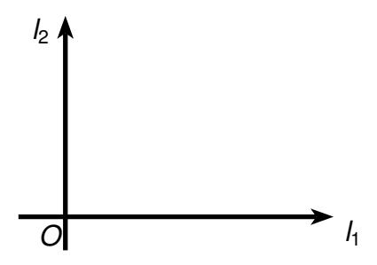

Figura 3.1: Gráfico de las rectas  $\ell_1$  y  $\ell_2$ .

<span id="page-100-2"></span>Sea  $(x, y) \in \mathbb{R} \times \mathbb{R}$  y sean  $P_x$ ,  $P_y$  los puntos asignados a x y a y en  $\ell_1$  y  $\ell_2$  respectivamente:

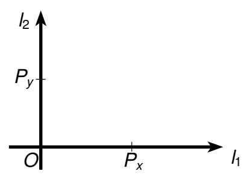

Figura 3.2: Gráfico de  $P_x$ ,  $P_y$ , los puntos asignados a x y a y.

<span id="page-101-2"></span><span id="page-101-0"></span>Sea P(x, y) el punto del plano tal que  $OP_xP(x, y)P_y$  es un rectángulo:

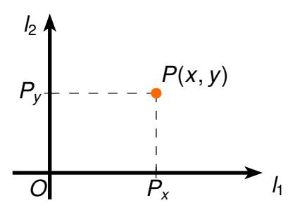

Figura 3.3: Gráfico del rectángulo  $OP_xP(x, y)P_y$ .

Este punto está unívocamente determinado por (x, y).

# **Definición**

# Definición 3.5 grafico

Sea  $S \subseteq \mathbb{R} \times \mathbb{R}$  una relación. Se llama **gráfico** de S al conjunto de todos los puntos del plano asignados a los pares ordenados de S.

Ejemplos sencillos de gráficos son los siguientes:

# **Ejemplos**

# Ejemplo 3.7

<span id="page-101-1"></span>
$$S_0 = \{\; (1,1), (1,2), (2,1), (2,2) \; \}$$

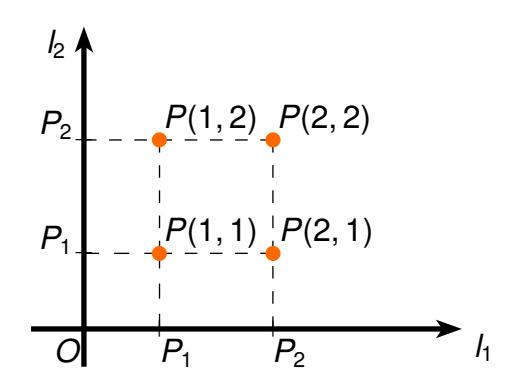

Figura 3.4: Gráfico de  $S_0$ .

# *Ejemplo 3.8*

<span id="page-102-0"></span>
$$S_1 = \mathbb{N} \times \mathbb{N}.$$

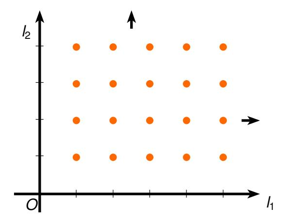

**Figura 3.5**: Gráfico de *S*1.

# *Ejemplo 3.9*

<span id="page-102-1"></span>
$$S_2 = \{(x, y) \in \mathbb{R} \times \mathbb{R} : x > y\}.$$

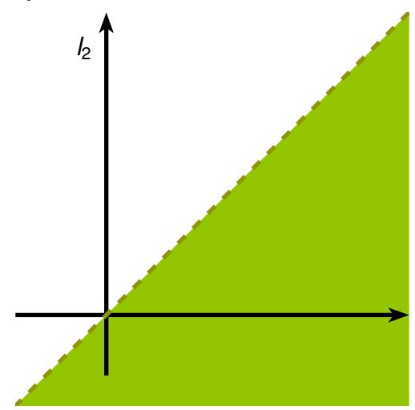

**Figura 3.6**: Gráfico de *S*2.

# *Ejemplo 3.10*

<span id="page-103-1"></span>
$$S_3 = \{(x,y) \in \mathbb{R} \times \mathbb{R} : |x| < 1 \land |y| > 1\}.$$

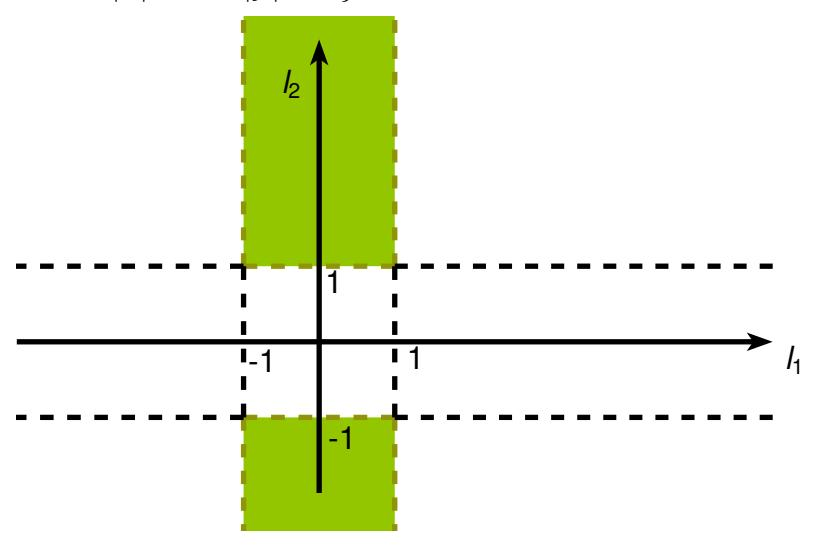

**Figura 3.7**: Gráfico de *S*3.

# <span id="page-103-0"></span>**Ecuación e inecuación de primer grado 3.3.1**

<span id="page-103-2"></span>Sabemos de la geometría analítica que toda ecuación de primer grado en las variables *x* e *y* representa una linea recta y que las inecuaciones correspondientes representan a los semiplanos determinados por dicha recta. Por ejemplo la ecuación 5*x* + 3*y* − 1 = 0 representa una recta y para trazarla basta con determinar dos puntos de ella. Haciendo *x* = 0 se obtiene *y* = 1/3, lo que significa que *P*(0, 1/3) es un punto de la recta. De la misma manera se obtiene que *P*(1/5, 0) también es un punto de la recta, con lo cual podemos trazarla:

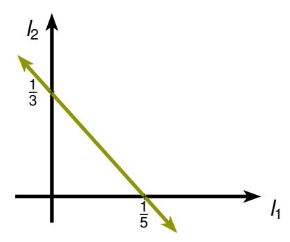

**Figura 3.8**: Gráfico de la ecuación 5*x* + 3*y* − 1 = 0.

<span id="page-104-0"></span>La inecuación 5x + 3y - 1 < 0 representa a uno de los semiplanos determinados por la recta anterior. Como el origen se encuentra en el semiplano inferior determinado por la recta y satisface la inecuación, se puede concluir que el semiplano buscado es el de la siguiente figura:

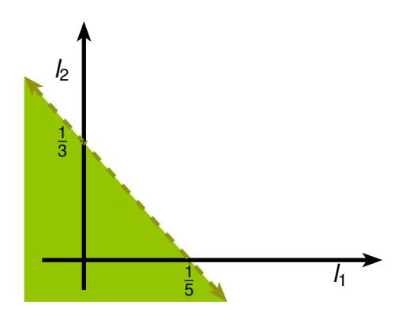

Figura 3.9: Gráfico de la inecuación 5x + 3y - 1 < 0.

En nuestro lenguaje esto significa que si  $a,b,c\in\mathbb{R}$  y  $(a\neq 0\lor b\neq 0)$ , entonces la relación S definida por:

$$S = \{(x, y) : ax + by + c = 0\},\$$

tiene como gráfico una linea recta.

Además, las relaciones definidas por:

$$S_1 = \{(x, y) : ax + by + c > 0\},\$$

y por

$$S_2 = \{(x, y) : ax + by + c < 0\},\$$

tienen como gráficos, los semiplanos superior e inferior, respectivamente, determinados por la recta anterior.

# Ejemplo 3.11

Graficar la relación

$$S = \{(x, y) \in \mathbb{R} \times \mathbb{R} : 2x - 1 = y \land y - 5 < 1\}.$$

En primer lugar, notemos que 2x - 1 = y es la ecuación de una recta que pasa por los puntos  $P_1(0, -1)$  y  $P_2(\frac{1}{2}, 0)$ :

<span id="page-105-0"></span>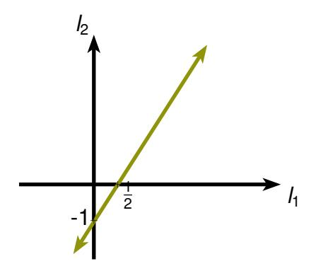

**Figura 3.10**: Gráfico de la ecuación 2*x* − 1 = *y*.

<span id="page-105-1"></span>*La inecuación y* − 5 < 1 *es equivalente a y* < 6*, cuyo gráfico es:*

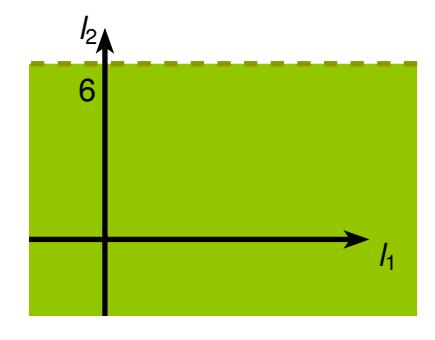

**Figura 3.11**: Gráfico de la inecuación *y* − 5 < 1.

<span id="page-105-2"></span>*El gráfico pedido es la porción de recta que está contenida en el gráfico anterior:*

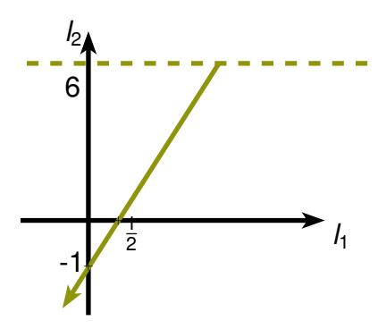

**Figura 3.12**: Gráfico de *<sup>S</sup>* <sup>=</sup> {(*x*, *<sup>y</sup>*) <sup>∈</sup> <sup>R</sup> <sup>×</sup> <sup>R</sup> : 2*<sup>x</sup>* <sup>−</sup> 1 = *<sup>y</sup>* <sup>∧</sup> *<sup>y</sup>* <sup>−</sup> <sup>5</sup> <sup>&</sup>lt; <sup>1</sup>}.

# <span id="page-106-0"></span>Concepto de Función y Propiedades Básicas

3.4

Consideremos la operación **el cuadrado de ...**, la cual hace corresponder a cada número r, su cuadrado  $r^2$ . Esta operación, está determinada por los pares ordenados  $(x, y) \in \mathbb{R} \times \mathbb{R}$  tales que  $y = x^2$  y por lo tanto se puede definir como la siguiente relación:

$$\{(x,y)\in\mathbb{R}\times\mathbb{R}:y=x^2\}$$
.

Notemos que la única diferencia con una relación cualquiera es que en este caso, para cada  $x \in \mathbb{R}$  existe una única imagen  $y \in \mathbb{R}$ . Esto puede definirse en general:

# **Definición**

# Definición 3.6 Función

F es una función si y sólo si F es una relación y  $\forall x \in DOM$  F  $\exists !$   $y \in REC$   $F((x,y) \in F)$ .

# Definición 3.7 Función de A en B

Si A y B son conjuntos entonces F **es función de** A **en** B si y sólo si F es una función tal que DOM F = A y REC  $F \subseteq B$ .

Se usa la notación  $F: A \to B$  cuando F es función de A en B. La única imagen de x por F se denota por y = F(x). Gráficamente, podemos darnos cuenta que una relación es una función, cuando vemos que toda recta vertical, intersecta el gráfico en a lo más, un punto.

# **Ejemplos**

# Ejemplo 3.12

 $F = \{(x, y) \in \mathbb{R} \times \mathbb{R} : x = y^2\}.$  No es función porque

$$(1,1) \in F \land (1,-1) \in F \text{ y } 1 \neq -1$$

.

# <span id="page-107-0"></span>*Ejemplo 3.13*

$$F = \{(x, y) \in \mathbb{R} \times \mathbb{R} : y = x^2\}.$$

*Es función de* R *en* R*.*

*Aquí* DOM *F* = R *y* REC *F* = R <sup>+</sup> ∪ {0}.

# *Ejemplo 3.14*

*Sea A conjunto, entonces la relación ID<sup>A</sup> definida por*

$$ID_A = \{(x, y) \in A \times A : x = y\}$$

*es función con dominio y recorrido iguales a A.*

# **Observación**

*Vemos que de la definición de igualdad de conjuntos de pares ordenados que dos funciones F y G son iguales si y sólo si* DOM *F* = DOM *G y* ∀*x* ∈ DOM *F F*(*x*) = *G*(*x*) *.*

Muchas veces es necesario aplicar una operación unaria al resultado de otra. Esta necesidad da origen al concepto de **composición de funciones**, que definimos a continuación.

# **Definición**

# *Definición 3.8 Composición de funciones*

*Sean F y G funciones, entonces la función G* **compuesta con** *F se define por*

$$G \circ F = \{(x, y) \in \mathsf{DOM}\, F \times \mathsf{REC}\, G : y = G(F(x))\}.$$

*Es decir, para x* ∈ DOM *F con F*(*x*) ∈ DOM *G se tiene G* ◦ *F*(*x*) = *G*(*F*(*x*))*. Vemos entonces que:*

$$\mathsf{Dom}\,(G\circ F)=\{x\in\mathsf{Dom}\,F:F(x)\in\mathsf{Dom}\,G\}.$$

# **Ejemplos**

# Ejemplo 3.15

Sea

$$F = \{(1, -1), (2, 0), (3, 0)\}$$
 y  $G = \{(-1, 20), (0, 20)\}.$ 

Aquí tenemos que:

DOM 
$$F = \{1, 2, 3\}$$
, REC  $F = \{-1, 0\}$ , DOM  $G = \{-1, 0\}$ .

Luego Dom  $(G \circ F) = \{1, 2, 3\}$  y por tanto:

$$G \circ F(1) = G(F(1)) = G(-1) = 20.$$

$$G \circ F(2) = G(F(2)) = G(0) = 20.$$

$$GoF(3) = G(F(3)) = G(0) = 20.$$

De ello se deduce que:

$$G \circ F = \{(1, 20), (2, 20), (3, 20)\}.$$

# Ejemplo 3.16

Sean F y G funciones reales definidas por:

$$F(x) = x^2,$$
  $G(x) = \frac{1}{x}.$ 

$$DOM(G \circ F) = \{x \in DOM \ F : F(x) \in DOM \ G\}$$
$$= \{x \in \mathbb{R} : x^2 \neq 0\}$$
$$= \mathbb{R} - \{0\}.$$

$$G \circ F(x) = G(F(x)) = G(x^2) = \frac{1}{x^2}.$$

También podemos calcular  $F \circ G(x)$ :

$$\begin{array}{lll} \mathsf{DOM}\,(F\circ G) &=& \{x\in \mathsf{DOM}\ G: G(x)\in \mathsf{DOM}\ F\} \\ &=& \{x\in \mathbb{R}-\{0\}: \frac{1}{x}\in \mathbb{R}\} \\ &=& \mathbb{R}-\{0\}. \end{array}$$

$$F \circ G(x) = F(G(x)) = F\left(\frac{1}{x}\right) = \frac{1}{x^2}$$

*En este caso resultó que ambas composiciones dieron la misma función. Esta situación es poco común, en la mayoría de los casos, la composición de funciones no es conmutativa.*

# *Ejemplo 3.17*

*Sean F y G funciones reales definidas por:*

$$F(x) = \frac{1}{x}, \qquad G(x) = x + 1.$$

$$DOM(G \circ F) = \{x \in DOM F : F(x) \in DOM G\}$$
$$= \{x \in \mathbb{R} - \{0\} : \frac{1}{x} \in \mathbb{R}\}$$
$$= \mathbb{R} - \{0\}.$$

*Además tenemos que:*

$$G \circ F(x) = G(F(x)) = G\left(\frac{1}{x}\right) = \frac{1}{x} + 1 = \frac{1+x}{x}.$$

# **Observación**

*Si F es una función de A en B, entonces para x* ∈ *A:*

$$F \circ ID_A(x) = F(ID_A(x)) = F(x)$$

*de donde F* ◦ *ID<sup>A</sup>* = *F y también:*

$$ID_B \circ F(x) = ID_B(F(x)) = F(x),$$

*o sea ID<sup>B</sup>* ◦ *F* = *F.*

Estudiaremos ahora aquellas funciones que determinan una correspondencia uno a uno entre los elementos del dominio y los del recorrido, esto es, no solo cada elemento del dominio tiene una única imagen sino que también cada elemento del recorrido tiene una única preimagen, lo cual inmediatamente sugiere para este tipo de funciones, la posibilidad de definir una función inversa.

<span id="page-110-1"></span>Consideremos por ejemplo la función real definida por  $f(x) = x^2$ . Hay elementos diferentes del dominio de f, tales como 1 y -1, que tienen la misma imagen, o sea f(1) = f(-1) = 1. En cambio, para la función real definida por g(x) = 2x + 1, tenemos que si a y b son elementos diferentes del dominio de g, entonces  $g(a) \neq g(b)$  pues  $2a + 1 \neq 2b + 1$ . En este último caso diremos que la función es **inyectiva** o **uno a uno**, como veremos en la siguiente definición:

# **Definición**

# Definición 3.9 Función Inyectiva

Sea f función. f es inyectiva o uno a uno, si y sólo si

$$\forall x \in \mathsf{Dom}\ f\ \forall y \in \mathsf{Dom}\ f(x \neq y \to f(x) \neq f(y)).$$

Vemos que esta definición es equivalente a que f es invectiva si y sólo si

$$\forall x \in \mathsf{DOM}\, f \ \forall \ y \in \mathsf{DOM}\, f \ (f(x) = f(y) \to x = y).$$

Gráficamente, podemos ver que una función es inyectiva, cuando toda recta horizontal, intersecta el gráfico en a lo más un punto.

# <span id="page-110-0"></span>Ejemplo 3.18

Sea f función real definida por  $f(x) = \frac{x+1}{x-2}$ . Es claro que Dom  $f = \mathbb{R} - \{2\}$ .

Sean  $x, y \in R - \{2\}$  y supongamos que f(x) = f(y), entonces  $\frac{x+1}{x-2} = \frac{y+1}{y-2}$ , de donde (x+1)(y-2) = (y+1)(x-2) es decir, xy - 2x + y - 2 = yx - 2y + x - 2, luego, 3y = 3x o sea x = y, y por lo tanto  $f(x) = \frac{x+1}{x-2}$  es inyectiva.

# **Definición**

# Definición 3.10 Relación Inversa

Sea f función real, la **relación inversa**  $f^{-1}$  de f se define por:

$$f^{-1} = \{(y, x) \in \mathsf{REC}\, f \times \mathsf{DOM}\, f : f(x) = y\}$$

Notemos que si los elementos del dominio de una función tienen imágenes diferentes entonces cada elemento del recorrido tiene una única preimagen (o imagen por la inversa de la función) y entonces la inversa es una función. Pasamos a formalizar este resultado:

# **Teorema**

<span id="page-111-0"></span>Teorema

3.2

Sea f función. Entonces f es inyectiva si y sólo si  $f^{-1}$  es función.

# **Demostración**

■ Supongamos que f es inyectiva.

Sea 
$$f^{-1} = \{(y, x) \in \text{REC } f \times \text{Dom } f : f(x) = y\}.$$

Sean  $(y, x) \in f^{-1} \land (y, x') \in f^{-1}$  entonces,  $f(x) = y \land f(x') = y$ ; es decir, f(x) = f(x') y como f es inyectiva, x = x'.

Por lo tanto  $f^{-1}$  es función.

■ Supongamos ahora que f<sup>-1</sup> es función.

Sean x, x' tales que f(x) = f(x') = y;

entonces  $(y, x) \in f^{-1} \land (y, x') \in f^{-1}$ ; y como  $f^{-1}$  es función, x = x'. Por lo tanto, f es inyectiva.

# **Observación**

Vemos que Dom 
$$f^{-1}$$
 = REC  $f$   
REC  $f^{-1}$  = Dom  $f$ 

y también, si  $x \in \mathsf{DOM}\ f\ e\ y \in \mathsf{REC}\ f\ entonces$ 

$$f(x) = y \leftrightarrow f^{-1}(y) = x$$
.

# <span id="page-112-0"></span>Ejemplo 3.19

Sea f función real definida por  $f(x) = \frac{x+1}{x-2}$ .

Hemos demostrado, en el Ejemplo 3.18, que f es inyectiva, además Dom  $f = \mathbb{R} - \{2\}$  y REC  $f = \mathbb{R} - \{1\}$ .

Entonces para  $y \in \mathbb{R} - \{2\}$ ,

$$f^{-1}(y) = x \qquad \leftrightarrow \qquad f(x) = y$$

$$\leftrightarrow \qquad \frac{x+1}{x-2} = y$$

$$\leftrightarrow \qquad x+1 = y(x-2)$$

$$\leftrightarrow \qquad x(1-y) = -1 - 2y$$

$$\leftrightarrow \qquad x = \frac{2y+1}{y-1} ;$$

luego,  $f^{-1}$  es la función real con dominio  $\mathbb{R}-\{1\}$ , recorrido  $\mathbb{R}-\{2\}$  y definida por  $f^{-1}(y)=\frac{2y+1}{y-1}$ .

Cuando el recorrido de una función de *A* en *B* es *B* decimos que la función es **sobre** *B*. Si agregamos este concepto al anterior obtenemos el de biyección:

# **Definición**

# Definición 3.11 Biyección de A sobre B

Sean A y B conjuntos. f es **biyección de** A **sobre** B si y sólo si f es función inyectiva de A en B y REC f = B.

# **Ejemplos**

# Ejemplo 3.20

Sea  $f: \mathbb{R} \to \mathbb{R}$  definido por f(x) = 2x.

*a) f es uno a uno:*

*Sea f*(*x*) = *f*(*y*)*, entonces* 2*x* = 2*y y por lo tanto x* = *y.*

*b) f es sobre* R*:*

Sea 
$$y \in \mathbb{R}$$
, entonces  $x = \frac{y}{2} \in \mathbb{R}$   $y$   $f(x) = 2\left(\frac{y}{2}\right) = y$ , de donde  $y \in \mathsf{REC}$   $f$ .

*De a) y b) se obtiene que f es biyección de* R *sobre* R*.*

# *Ejemplo 3.21*

*Sea f* : <sup>N</sup> <sup>→</sup> <sup>N</sup> *definida por: f*(*x*) = 3*x*.

*a) f es uno a uno:*

*Sea f*(*x*) = *f*(*y*)*. Entonces* 3*x* = 3*y y por lo tanto x* = *y.*

*b) f no es sobre* N*:*

<sup>2</sup> 6∈ <sup>R</sup>EC *f pues si* 2 = *<sup>f</sup>*(*x*) *para algún x* <sup>∈</sup> <sup>N</sup>*, entonces* 2 = 3*x de donde x* <sup>=</sup> 2 3 6∈ <sup>N</sup>*.*

*De a) y b) se concluye que f no es biyección de* N *sobre* N*.*

# **Teorema**

<span id="page-113-0"></span>*tiva.*

*Teorema 3.3 Si f es función inyectiva, entonces f* <sup>−</sup><sup>1</sup> *también es función inyec-*

# **Demostración**

*Si f es inyectiva, entonces sabemos por Teorema [3.2](#page-111-0) que f* <sup>−</sup><sup>1</sup> *es función. Veamos que también es inyectiva:*

$$f^{-1}(x) = f^{-1}(y) \iff f(f^{-1}(x)) = f(f^{-1}(y)) \iff x = y.$$

# **Teorema**

*sobre A.*

*Teorema 3.4 Si f es biyección de A sobre B entonces f* <sup>−</sup><sup>1</sup> *es biyección de B*

# **Demostración**

Supongamos que f es biyección de A sobre B. Entonces por Teorema 3.3 sabemos que  $f^{-1}$  es función inyectiva. También sabemos que  $DOM(f^{-1}) = REC(f) = B$ . Veamos entonces que  $f^{-1}$  es sobre A. Sea  $y \in A \Longrightarrow \exists x \in B(f(x) = y)$  por que f es sobre G. Luego G0 G1 lo que nos dice que G1 G2 G3. Esto demuestra el teorema.

También se puede demostrar que la composición de biyecciones es biyección:

# **Teorema**

**Teorema** 3.5 Si f es biyección de A sobre B y g es biyección de B sobre C, entonces gof es biyección de A sobre C.

# **Demostración**

$$DOM(gof) = \{x \in DOM \ f : f(x) \in DOM \ g\}$$
$$= \{x \in A : f(x) \in B\}$$
$$= A.$$

Además si  $z \in C$ , como g es sobre, existe  $y \in B$  tal que z = g(y); como f también es sobre, existe  $x \in A$  tal que y = f(x), de donde  $z = g \circ f(x)$ ; es decir,  $z \in REC(g \circ f)$ .

Tenemos entonces que REC  $(g \circ f) = C$ . Para ver que  $g \circ f$  es uno a uno, supongamos que para  $x \ y \ x'$  se tiene:

$$g \circ f(x) = g \circ f(x');$$

entonces

$$g(f(x)) = g(f(x'))$$

y como g es uno a uno, resulta f(x) = f(x') y como f también es uno a uno, se concluye que x = x'.

# Problema 3.1

Dadas las funciones reales f y g definidas por:

$$f(x) = \begin{cases} x^2 - 1 & \text{si } x > 0 \\ 2x - 1 & \text{si } x \le 0 \end{cases}$$

$$g(x) = \begin{cases} x^2 - 1 & \text{si } x > -1 \\ 2x - 1 & \text{si } x \le -1. \end{cases}$$

Demostrar que f es biyección sobre  $\mathbb{R}$ , pero g no lo es y determinar  $g \circ f^{-1}$ .

# Solución

- Veamos primero que f es biyección sobre R.
  Para demostrar que f es inyectiva, dado que está definida por tramos debemos considerar varios casos:
  - i) Sean  $x, y \in \mathbb{R}$ ,  $x \neq y \land x > 0 \land y > 0$ , entonces  $x^2 \neq y^2$  y por lo tanto  $f(x) = x^2 1 \neq y^2 1 = f(y)$ .
  - ii) Sean  $x, y \in \mathbb{R}, x \neq y \land x \leq 0 \land y \leq 0$ , entonces  $2x \neq 2y$  y por lo tanto  $f(x) = 2x 1 \neq 2y 1 = f(y)$ .
  - iii) Sean  $x, y \in \mathbb{R}$ ,  $x \le 0 \land y > 0$ , entonces  $f(x) = 2x 1 \le -1$   $f(y) = y^2 1 > -1$ , luego también en este caso se tiene que  $f(x) \ne f(y)$ .

Por lo tanto de (i), (ii) y (iii) concluimos que f es inyectiva.

■ Además f es sobre  $\mathbb{R}$ , pues si  $y \in \mathbb{R}$ , entonces

$$y \leq -1 \lor y > -1.$$

Buscamos  $x \in \mathbb{R}$  tal que f(x) = y.

- a) Si  $y \le -1$ , sea  $x = \frac{y+1}{2}$ . Tenemos que  $x \le 0$  y por lo tanto  $f(x) = f\left(\frac{y+1}{2}\right) = 2\left(\frac{y+1}{2}\right) 1 = y$ .
- b) Si y > -1, sea  $x = \sqrt{y+1}$ . Tenemos que x > 0 y por lo tanto

$$f(x) = f(\sqrt{y+1}) = (\sqrt{y+1})^2 - 1 = y.$$

De (a) y (b) concluimos que f es sobre  $\mathbb{R}$ .

■ La función g no es una biyección pues no es inyectiva, dado que por ejemplo si tomamos  $x_1 = -\frac{1}{2}$  y  $x_2 = \frac{1}{2}$  entonces

$$g(x_1) = \left(-\frac{1}{2}\right)^2 - 1 = \frac{1}{4} - 1 = -\frac{3}{4} = \left(\frac{1}{2}\right)^2 - 1 = g(x_2)$$

. La función g tampoco es sobre  $\mathbb R$  (no es difícil ver que si por ejemplo y=-2 entonces  $\neg \exists x \in \mathbb R (g(x)=-2)$ .)

■ Dado que f es biyección sobre  $\mathbb{R}$ , sabemos que existe  $f^{-1} : \mathbb{R} \to \mathbb{R}$ . Para determinar la función inversa de f, como sabemos que  $y = f(x) \leftrightarrow f^{-1}(y) = x$ , aprovecharemos el trabajo realizado al demostrar que f es función sobre  $\mathbb{R}$  y obtenemos que:

$$f^{-1}(y) = \begin{cases} \frac{y+1}{2} & si \ y \le -1 \\ \\ \sqrt{y+1} & si \ y > -1. \end{cases}$$

■ Luego, solo nos resta calcular  $g \circ f^{-1}$ ;

$$gof^{-1}(x) = g(f^{-1}(x)) = \begin{cases} (f^{-1}(x))^2 - 1 & si \ f^{-1}(x) > -1 \\ \\ 2(f^{-1}(x)) - 1 & si \ f^{-1}(x) \le -1. \end{cases}$$

Dado que el valor de  $f^{-1}(x)$  depende de si  $x \le -1$  o x > -1, analizaremos ambos casos por separado:

•  $Si \ x > -1$  entonces  $f^{-1}(x) = \sqrt{x+1} > 0$  y por lo tanto  $f^{-1}(x) > -1$ , luego  $gof^{-1}(x) = (\sqrt{x+1})^2 - 1 = x$ .

• Si 
$$x \le -1$$
 entonces  $f^{-1}(x) = \frac{x+1}{2} > -1 \leftrightarrow \frac{x+1}{2} > -1 \leftrightarrow x > -3$ . Luego

$$gof^{-1}(x) = \begin{cases} 2\left(\frac{x+1}{2}\right) - 1 & si \ x \le -3 \\ \left(\frac{x+1}{2}\right)^2 - 1 & si \ x > -3. \end{cases}$$

Tenemos finalmente,

$$gof^{-1}(x) = \begin{cases} x & si \quad x \le -3 \lor x > -1 \\ \left(\frac{x+1}{2}\right)^2 - 1 & si \quad -3 < x \le -1. \end{cases}$$

# <span id="page-117-0"></span>**Gráficos de las Funciones Reales**

3.5

Las funciones reales son también relaciones reales, y se grafican como tales. Ejemplos sencillos de gráficos de funciones son los siguientes:

# **Ejemplos**

# Ejemplo 3.22

Graficar la función F definida por:

$$F(x) = -2x + 5$$
,  $x \in \mathbb{R}$ .

# Solución

<span id="page-117-1"></span>Considerada F como relación tenemos que,  $F = \{(x, y) \in \mathbb{R} \times \mathbb{R} : y = -2x + 5\}$  y la ecuación y = -2x + 5, representa una recta que pasa por los puntos P(0,5) y P(5/2,0) como se muestra en la figura siguiente:

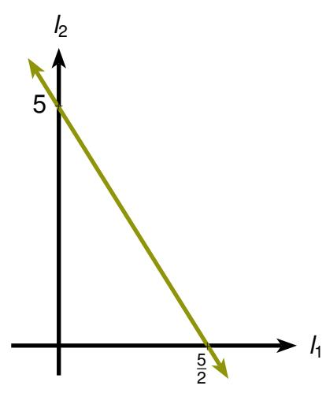

Figura 3.13: Gráfico de F(x) = -2x + 5,  $x \in \mathbb{R}$ .

# *Ejemplo 3.23*

*Graficar la función*

$$F(x) = 2x^2 + 6x - 1.$$

# *Solución*

*Comenzaremos utilizando el método de completación de cuadrados, con lo que:*

$$2x^2 + 6x - 1 = 2\left(x + \frac{3}{2}\right)^2 - \frac{11}{2}$$

*luego*

$$y = F(x) \leftrightarrow y = 2\left(x + \frac{3}{2}\right)^2 - \frac{11}{2} \leftrightarrow (y + \frac{11}{2}) = 2\left(x + \frac{3}{2}\right)^2$$

<span id="page-118-0"></span>*que es la ecuación de una parábola con vértice P* − 3 2 , − 11 2 *e intersección con el eje X en P*−3 + <sup>√</sup> 11 , 0 *y P*−<sup>3</sup> <sup>−</sup> √ 11 , 0 *y que vemos en la figura siguiente:*

2

2

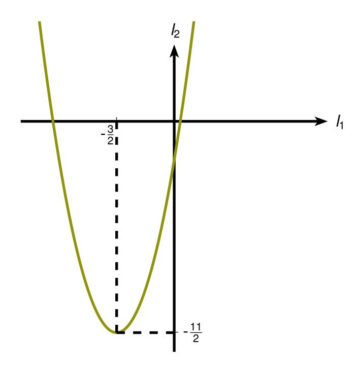

**Figura 3.14**: Gráfico de *F*(*x*) = 2*x* <sup>2</sup> + 6*<sup>x</sup>* <sup>−</sup> 1.

# Ejemplo 3.24

Graficar f(x) = |x|.

# Solución

<span id="page-119-0"></span>Es claro que si  $x \ge 0$ , f(x) = x cuyo gráfico es la recta y = x y si x < 0, f(x) = -x cuyo gráfico es la recta y = -x, como se ve en la figura siguiente:

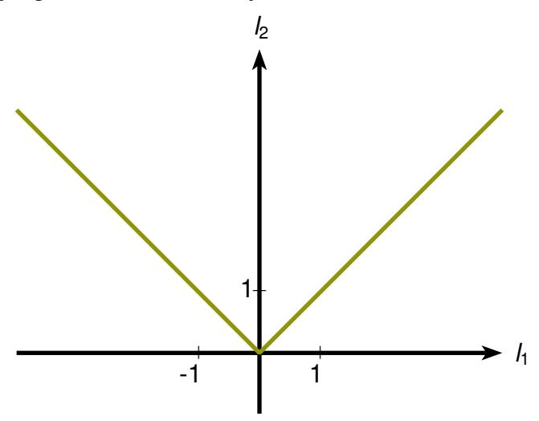

Figura 3.15: Gráfico de f(x) = |x|.

# Ejemplo 3.25

Graficar la función:

$$f(x) = \begin{cases} \sqrt{1 - x^2} &, x \ge 0 \\ \sqrt{1 - \frac{x^2}{9}} &, x < 0. \end{cases}$$

# Solución

Para  $x \ge 0$  tenemos que

$$y = f(x)$$
  $\leftrightarrow$   $y = \sqrt{1 - x^2}$   
  $\leftrightarrow$   $y \ge 0 \land y^2 + x^2 = 1$ 

*y como x* <sup>2</sup> + *y* <sup>2</sup> = 1 *representa una circunferencia, hemos obtenido el cuadrante donde ella se ubica, que es: x* ≥ 0 ∧ *y* ≥ 0*.*

*Para x* < 0 *tenemos que*

$$y = f(x)$$
  $\leftrightarrow$   $y = \sqrt{1 - \frac{x^2}{9}}$   
 $\leftrightarrow$   $y \ge 0 \land y^2 + \frac{x^2}{9} = 1$ 

<span id="page-120-0"></span>*y como x* 2 9 + *y* <sup>2</sup> = 1 *representa una elipse, se obtiene el cuadrante donde ella se ubica, que es x* < 0 ∧ *y* ≥ 0*, como se ve en la figuras siguientes:*

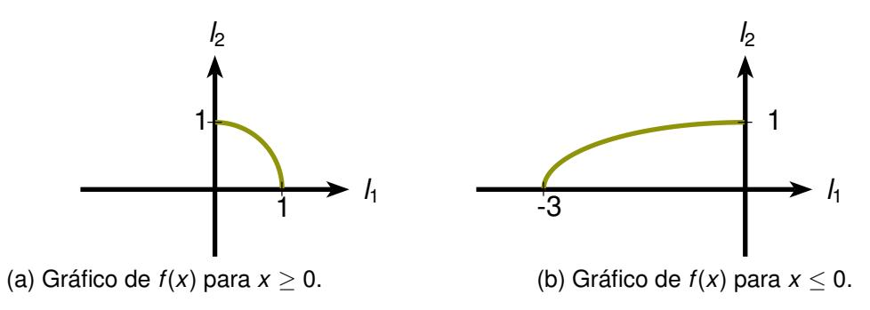

**Figura 3.16**: Gráfico de *f*(*x*)en cada región.

<span id="page-120-1"></span>*El gráfico de f*(*x*) *es el de la figura siguiente:*

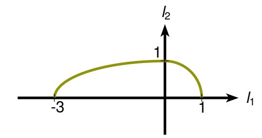

**Figura 3.17**: Gráfico de *f*(*x*).

# <span id="page-121-1"></span><span id="page-121-0"></span>Estudio de una Función Real

3.6

A través de su gráfico, se conoce totalmente una función; pero como no siempre se puede partir por éste, es necesario desarrollar algunos conceptos que nos permitan hacer un estudio algebraico de una función, para terminar con un bosquejo de su gráfico. Los siguientes conceptos determinan la ubicación del gráfico de una función, respecto de los ejes:

# **Definición**

# Definición 3.12 Raíz de una función

Sea f función real. x es raíz o cero de f si y sólo si  $x \in DOM f y f(x) = 0$ .

# **Definición 3.13** Función positiva o negativa

Sea  $A \subseteq \text{Dom } f$ , f es positiva en A si y sólo si  $\forall x \in A (f(x) > 0)$  y f es negativa en A si y sólo si  $\forall x \in A (f(x) < 0)$ .

Notemos que el punto de intersección del gráfico de una función con el eje Y es el punto P(0, f(0)) y los puntos de intersección del mismo con el eje X son los puntos P(x, 0), donde x es raíz de la función.

A continuación veremos algunos ejemplos:

# **Ejemplos**

# Ejemplo 3.26

Sea  $f(x) = \sqrt{1 - x^2}$ . Entonces DOM f = [-1, 1], REC f = [0, 1] y f(0) = 1 con lo cual P(0, 1) es el punto de intersección del gráfico de f con el eje Y.

Por otro lado:

 $f(x) = 0 \leftrightarrow \sqrt{1 - x^2} = 0 \leftrightarrow x^2 = 1 \leftrightarrow x = 1 \lor x = -1$  que son las raíces de f, entonces P(1,0) y P(-1,0) son los puntos de intersección del eje X con el gráfico de f. Para determinar los intervalos en los que f es positiva, tenemos:

 $f(x) > 0 \leftrightarrow \sqrt{1-x^2} > 0$ . Esto es cierto, por la definición de raíz cuadrada, para todo  $x \in \mathsf{DOM}\ f$ , excepto cuando  $x^2 = 1$ . Entonces f es positiva en el intervalo ]-1,1[, y por lo tanto nunca es negativa, como se ve en la figura siguiente:

<span id="page-122-0"></span>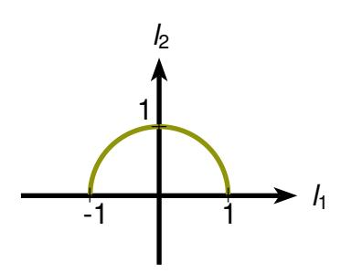

**Figura 3.18**: Gráfico de *<sup>f</sup>*(*x*) = <sup>√</sup> 1 − *x* 2 .

# *Ejemplo 3.27*

*Sea f*(*x*) = −3*x* + 1*.*

*En este caso se tiene que* DOM *f* = R = REC *f.*

*Vemos que f*(0) = 1*, con lo que P*(0, 1) *es el punto de intersección del gráfico con el eje Y .*

*Además:*

$$f(x) = 0 \leftrightarrow -3x + 1 = 0 \leftrightarrow x = \frac{1}{3}$$

*o sea* 1 3 *es raíz de f y P*(1/3, 0) *es el punto de intersección del gráfico con el eje X.*

*Por otro lado,*

$$f(x) > 0 \leftrightarrow -3x+1 > 0 \leftrightarrow x < \frac{1}{3}$$

*y f*(*x*) < 0 ↔ *x* > 1 3 ; *es decir, f es positiva en* ] − ∞, 1 3 [ *y negativa en* ] 1 3 ,∞[*.*

<span id="page-122-1"></span>*El gráfico de f es la recta de la figura siguiente:*

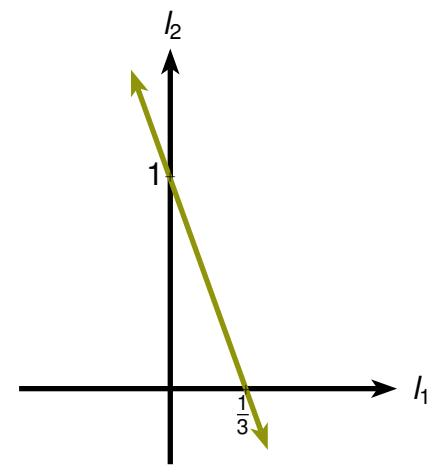

**Figura 3.19**: Gráfico de *f*(*x*) = −3*x* + 1.

<span id="page-123-2"></span>Los siguientes conceptos determinan las simetrías del gráfico respecto de los ejes:

# **Definición**

# Definición 3.14 Función par

Sea f función real. f es par si y sólo si

$$\forall x \in \mathsf{Dom} \ f(-x \in \mathsf{Dom} \ f \land f(-x) = f(x)).$$

# Definición 3.15 Función impar

f es impar si y sólo si

$$\forall x \in \mathsf{Dom} \ f(-x \in \mathsf{Dom} \ f \wedge f(-x) = -f(x)).$$

<span id="page-123-0"></span>Si f es par y P(x, y) está en el gráfico entonces P(-x, y) también lo está con lo cual el gráfico de f será simétrico respecto al eje Y como puede verse en la siguiente figura:

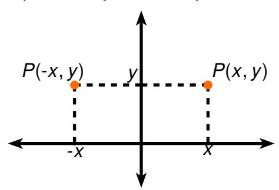

Figura 3.20: Simetría de funciones pares.

<span id="page-123-1"></span>Por otro lado, si f es impar y P(x, y) está en el gráfico entonces P(-x, -y) también lo está, con lo cual el gráfico de f presenta la siguiente simetría:

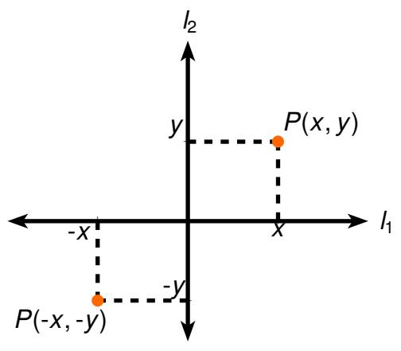

Figura 3.21: Simetría de funciones impares.

<span id="page-124-0"></span>Para que f sea par e impar a la vez, tendría que cumplirse f(-x) = f(x) y f(-x) = -f(x) para todo  $x \in \text{Dom } f$ , luego f(x) = 0 para todo  $x \in \text{Dom } f$ , es decir, la única función par e impar simultáneamente es f(x) = 0 y se conoce como **función cero**.

Un ejemplo de función par es la parábola definida por  $f(x) = x^2 - 1$ , dado que:

$$f(-x) = (-x)^2 - 1 = x^2 - 1 = f(x)$$
.

Un ejemplo de función impar es la recta definida por  $f(x) = \frac{3}{2}x$ , pues

$$f(-x) = \frac{3}{2}(-x) = -\frac{3}{2}x = -f(x).$$

Se observa que si f es impar y  $0 \in DOM$  f entonces f(0) = 0, es decir, el gráfico de f pasa por el origen.

Hay funciones que no tienen ninguna de estas dos propiedades, por ejemplo, f(x) = 2x + 1 en la que vemos que f(1) = 3 y f(-1) = -1; es decir,  $f(-1) \neq \pm f(1)$ .

Sobre el crecimiento de una función definimos:

# **Definición**

# **Definición 3.16** Función estrictamente creciente

Sea f función real e I un intervalo abierto tal que  $I \subseteq \mathsf{DOM}\ f$ . f es estrictamente creciente en I si y sólo si

$$\forall x \in I \, \forall y \in I (x < y \rightarrow f(x) < f(y)).$$

# Definición 3.17 Función estrictamente decreciente

f es estrictamente decreciente en l si y sólo si

$$\forall x \in I \, \forall y \in I (x < y \rightarrow f(x) > f(y)).$$

# **Observaciones**

■ Si f es estrictamente creciente o decreciente en su dominio, entonces f es uno a uno; pues, si  $x \neq y$  entonces  $(x < y \lor x > y)$ , con lo que se tendrá, en cualquiera de estos casos, ya sea f(x) < f(y) ó f(x) > f(y); es decir,  $f(x) \neq f(y)$ .

- Si f es estrictamente creciente, entonces  $f^{-1}$  también lo es, en efecto, supongamos que x < y y que  $f^{-1}(x) \ge f^{-1}(y)$ . Como f es estrictamente creciente resulta  $f(f^{-1}(x)) \ge f(f^{-1}(y))$ ; es decir,  $x \ge y$  lo cual es falso. Análogamente si f es estrictamente decreciente también  $f^{-1}$  lo es.
- Si una función f es par y estrictamente creciente en  $\mathbb{R}^+$  entonces es estrictamente decreciente en  $\mathbb{R}^-$ , efectivamente: Sean  $x, y \in \mathbb{R}^-$ :

$$\begin{array}{lll} x < y & \leftrightarrow & -x > -y \ & \leftrightarrow & f(-x) > f(-y) & (f \ \ \ \ \ \ \ \ \ \ \ \ \ \ \ \ \ \$$

■ Si f es función impar y es estrictamente creciente en  $\mathbb{R}^+$ , entonces es estrictamente creciente en  $\mathbb{R}^-$ .

Este tipo de traspaso de propiedades para funciones pares e impares se puede generalizar a cualquier subconjunto de  $\mathbb{R}^+$ .

# **Ejemplos**

# Ejemplo 3.28

Sea f(x) = 2x - 5, así:

$$f(x) < f(y) \quad \leftrightarrow \quad 2x - 5 < 2y - 5$$
$$\leftrightarrow \quad x < y,$$

por lo tanto, f es estrictamente creciente en  $\mathbb{R}$ .

# Ejemplo 3.29

Sea  $f(x) = x^2 - 1$ , así:

$$f(x) < f(y) \quad \leftrightarrow \quad x^2 - 1 < y^2 - 1$$

$$\leftrightarrow \quad x^2 - y^2 < 0$$

$$\leftrightarrow \quad (x - y)(x + y) < 0. \quad (*)$$

Para  $x, y \in \mathbb{R}^+$ , como x + y > 0, de (\*) se obtiene:

$$f(x) < f(y) \quad \leftrightarrow \quad x - y < 0$$
$$\leftrightarrow \quad x < y.$$

Como  $f(-x) = (-x)^2 - 1 = x^2 - 1 = f(x)$ , tenemos que f es función par y por la observación anterior, tenemos que es estrictamente decreciente en  $\mathbb{R}^-$ .

En resumen, f es estrictamente creciente en  $\mathbb{R}^+$  y estrictamente decreciente en  $\mathbb{R}^-$ .

# Ejemplo 3.30

Sea 
$$f(x) = x + \frac{1}{x}$$
.

Debido a que f es función impar, bastará estudiarla en  $\mathbb{R}^+$ .

$$f(x) < f(y) \qquad \leftrightarrow \qquad x + \frac{1}{x} < y + \frac{1}{y}$$

$$\leftrightarrow \qquad x - y + \frac{1}{x} - \frac{1}{y} < 0$$

$$\leftrightarrow \qquad (x - y)(1 - \frac{1}{xy}) < 0 \qquad (*)$$

como xy > 0, podemos distinguir dos casos:

a) x, y > 1, por lo que xy > 1.

En este caso  $1 - \frac{1}{xy} > 0$ ,

y por (\*):

$$f(x) < f(y) \quad \leftrightarrow \quad x - y < 0$$
 
$$\leftrightarrow \quad x < y.$$

Esto es, f es estrictamente creciente en  $]1,\infty[$  y por ser f impar, también lo es en  $]-\infty,-1[$ .

b) xy < 1.

En este caso  $1 - \frac{1}{xy} < 0$ , y por (\*):

$$f(x) < f(y) \quad \leftrightarrow \quad x - y > 0$$
  
  $\leftrightarrow \quad x > y$ .

Entonces f es estrictamente decreciente en ]0,1[ y por lo tanto también lo es en ] – 1,0[.

# <span id="page-127-0"></span>*Ejemplo 3.31*

*Sea*

$$f(x) = \begin{cases} 1, & si \quad x \ge 0 \\ -1, & si \quad x < 0. \end{cases}$$

*Entonces si x*, *y* ≥ 0 *y x* < *y se tiene que f*(*x*) = 1 = *f*(*y*) *y también si x*, *y* < 0, *f*(*x*) = −1 = *f*(*y*).

*Por otro lado si x* < 0 *y y* ≥ 0 *entonces*

$$f(x) = -1 < 1 = f(y)$$

*con esto vemos que para todo x*, *<sup>y</sup>* <sup>∈</sup> <sup>R</sup> *se tiene que*

$$(*) x < y \to f(x) \le f(y).$$

*Podemos notar que f no es estrictamente creciente, pero cumple la condición mas débil (*∗*), lo que motiva la siguiente definición:*

# **Definición**

# *Definición 3.18 Función creciente*

*Sea f función real y sea I intervalo abierto tal que I* ⊆ DOM *f. f* **es creciente en** *I si y sólo si*

$$\forall x \in I \ \forall y \in I(x < y \to f(x) \le f(y)).$$

# *Definición 3.19 Función decreciente*

*f* **es decreciente en** *I si y sólo si*

$$\forall x \in I \ \forall y \in I(x < y \to f(x) \ge f(y)).$$

También se usa el nombre de **función no decreciente** para creciente y el de **función no creciente** para decreciente. Una función se dice **monótona en** *I* si es creciente o decreciente en *I*.

Observemos que las funciones constantes son crecientes y decrecientes a la vez.

# <span id="page-128-0"></span>*Ejemplo 3.32*

Sea 
$$f(x) = \begin{cases} |x|, & x \in [-1, 1] \\ 1, & x \notin [-1, 1]. \end{cases}$$

*Tenemos entonces que f*(*x*) = *f*(*y*) *para todo x*, *y en* ] − ∞, −1[ *o en* [1,∞[*.*

*Además, para x*, *y* ∈ [−1, 0[, *f*(*x*) = −*x y f*(*y*) = −*y con lo cual x* < *y* → *f*(*x*) > *f*(*y*)*, y para x*, *y* ∈]0, 1[ *se tiene: f*(*x*) = *x y f*(*y*) = *y, por lo tanto, x* < *y* → *f*(*x*) < *f*(*y*)*.*

*En resumen, f es estrictamente creciente en* ]0, 1[ *y estrictamente decreciente en* ]−1, 0[*, creciente y decreciente en* ] − ∞, −1[ *y en* ]1,∞[ *respectivamente.*

*De aquí resulta que f es creciente en* R <sup>+</sup> *y decreciente en* R −*.*

Pasamos a introducir el concepto de función acotada:

# **Definición**

# *Definición 3.20 Cota superior de una función*

*Sean f función real y a* <sup>∈</sup> <sup>R</sup>*. Decimos que a* **es cota superior** *de f si y sólo si* ∀*x* ∈ DOM *f*(*f*(*x*) ≤ *a*)

# *Definición 3.21 Cota inferior de una función*

*Sean f función real y a* <sup>∈</sup> <sup>R</sup>*. Decimos que a* **cota inferior** *de f si y sólo si* ∀*x* ∈ DOM *f*(*f*(*x*) ≥ *a*)*.*

# *Ejemplo 3.33*

*La función f*(*x*) = *x* <sup>2</sup> <sup>−</sup> <sup>1</sup> *tiene como cota inferior a y* <sup>=</sup> <sup>−</sup><sup>1</sup> *y no tiene cotas superiores.*

*La función f*(*x*) = <sup>1</sup> |*x*| *tiene como cotas inferiores a* 0, −1, −5 *y no tiene cotas superiores.* <span id="page-129-0"></span>Las funciones se clasifican según tengan o no cotas superiores o inferiores como veremos a continuación.

# **Definición**

# Definición 3.22 Función acotada superiormente

Sea f función real. f es acotada superiormente si y sólo si f tiene cotas superiores.

# **Definición 3.23** Función acotada inferiormente

f es acotada inferiormente si y sólo si f tiene cotas inferiores.

# Definición 3.24 Función acotada

f es acotada si y sólo si f es acotada superior e inferiormente.

Es fácil ver que f es acotada si y sólo si existe  $a \in \mathbb{R}$  tal que:

$$\forall x \in \mathsf{Dom}\, f(|f(x)| \leq a).$$

# **Ejemplos**

# Ejemplo 3.34

Sea 
$$f(x) = \frac{1}{x}$$
, Dom  $f = \mathbb{R} - \{0\}$ .

f no es acotada superiormente. En efecto, supongamos que  $\frac{1}{x} \le b$  para todo  $x \ne 0$ .

Entonces para 
$$x = \frac{1}{b+1}$$
 se tiene que  $\frac{1}{\frac{1}{b+1}} \le b$  es decir  $b+1 \le b$  lo cual es falso.

Análogamente se puede ver que f no es acotada inferiormente.

# Ejemplo 3.35

Sea 
$$f(x) = x^2 - 1$$
.

Como  $x^2 \ge 0$  tenemos que  $x^2 - 1 \ge -1$  y por lo tanto f es acotada inferiormente. Es claro que f no es acotada superiormente.

<span id="page-130-2"></span>Las funciones periódicas son aquellas que tienen la propiedad de repetir su valor cada cierto intervalo, como veremos en la siguiente definición.

# **Definición**

# Definición 3.25 Función periódica

Sea f función real. f es periódica si y sólo si existe el menor  $p \in \mathbb{R}^+$  tal que:  $\forall x \in \mathsf{DOM}\, f(x \pm p \in \mathsf{DOM}\, f \land f(x \pm p) = f(x))$ . El menor  $p \in \mathbb{R}^+$  que cumple esta propiedad se llama período de la función.

Para clarificar esta definición veamos los siguientes ejemplos:

# **Ejemplos**

# <span id="page-130-0"></span>Ejemplo 3.36

Sea

$$f(x) = \begin{cases} 1 & si \ \exists z \in \mathbb{Z} (x \in [2z, 2z + 1[)\\ -1 & si \ no \end{cases}$$

<span id="page-130-1"></span>Es claro que Dom  $f = \mathbb{R}$ , y su gráfico es el de la figura siguiente:

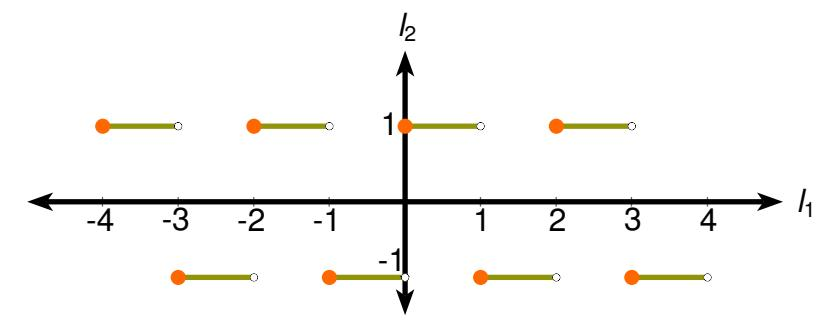

Figura 3.22: Gráfico de la función periódica del Ejemplo 3.36.

Tenemos  $f(x \pm 4) = f(x)$ ,  $x \in \mathbb{R}$ , pero también  $f(x \pm 2) = f(x)$ ,  $x \in \mathbb{R}$ . Demostraremos que f es periódica de período 2.

Supongamos p < 2:

$$si \ 1$$

$$si\ 0$$

Luego en ambos casos no se cumple que

$$\forall x \in \mathbb{R}(f(x \pm p) = f(x)).$$

Por lo tanto, si p < 2, p no es el período.

# Ejemplo 3.37

Sea f(x) = 5.

El claro que  $f(x \pm 4) = 5 = f(x)$  y también  $f(x \pm 2) = 5 = f(x)$ . En este caso no existe el menor p > 0 tal que  $f(x \pm p) = f(x)$ ,  $x \in \mathbb{R}$ , pues todo p real positivo satisface esta propiedad.

Al igual que en el caso de las funciones pares e impares, la periodicidad de una función permite estudiarla en un intervalo más restringido, pudiendo luego aplicar los resultados obtenidos a todo el dominio de la función, como veremos en el siguiente ejemplo.

# <span id="page-131-0"></span>Ejemplo 3.38

Graficar la función f de dominio  $\mathbb{R}$  sabiendo que:

$$f(x) = \begin{cases} x, & si \quad 0 \le x < 1 \\ x - 2, & si \quad 1 \le x \le 2 \end{cases}$$

y que además la función es impar y periódica de período 4.

# Solución

<span id="page-131-1"></span>El gráfico de la función en el intervalo [0, 2] es el de la figura siguiente:

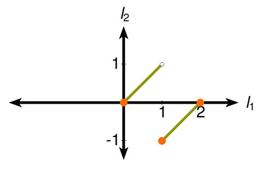

Figura 3.23: Gráfico de la función del Ejemplo 3.38 para el intervalo [0, 2].

Este gráfico puede ser ampliado al intervalo [-2,2] ocupando la propiedad de ser impar, como se ve en la siguiente figura:

<span id="page-132-0"></span>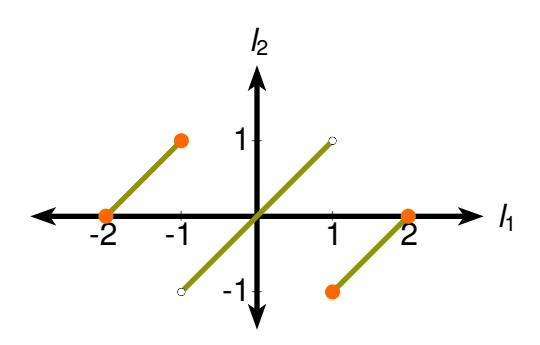

Figura 3.24: Gráfico de la función del Ejemplo 3.38 para el intervalo [-2, 2].

<span id="page-132-1"></span>y este último puede ser ampliado a todo  $\mathbb R$  por ser función periódica de período 4, como vemos en la figura que sigue:

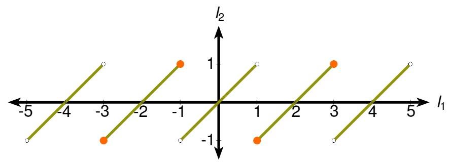

Figura 3.25: Gráfico de la función del Ejemplo 3.38 para todo R.

A continuación estudiaremos algunas funciones de uso frecuente, indicando todas sus propiedades y bosquejando su gráfico.

# **Ejemplos**

# Ejemplo 3.39

Sea  $f(x) = x^2$ . Es claro que DOM  $f = \mathbb{R}$  y que REC  $f = \mathbb{R}^+ \cup \{0\}$ . Por otro lado, f(0) = 0 y  $f(x) = 0 \leftrightarrow x^2 = 0 \leftrightarrow x = 0$ . Con lo cual el único punto de intersección del gráfico de f con los ejes X e Y es O(0,0). Además  $x^2 \geq 0$  para todo x, de donde f es no negativa e inferiormente acotada.

Como  $f(-x) = (-x)^2 = x^2 = f(x)$ , f es par y por lo tanto, basta seguir su estudio en  $[0, \infty[$ . Si x < y,  $x, y \in [0, \infty[$ , entonces  $x^2 < y^2$  con lo cual f es estrictamente creciente en  $[0, \infty[$ .

Por otro lado, si  $x \in [0, \infty[, (x+1)^2 > x^2 \text{ con lo cual } f \text{ no es acotada superiormente en } [0, \infty[.$ 

<span id="page-133-0"></span>*El gráfico de f en* [0,∞[ *está dado por la figura siguiente:*

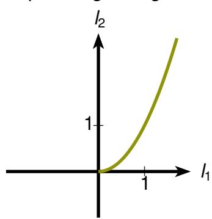

**Figura 3.26**: Gráfico de la función *f*(*x*) = *x* <sup>2</sup> para [0,∞[.

<span id="page-133-1"></span>*El cual puede ser extendido a* R *como se ve en la figura siguiente:*

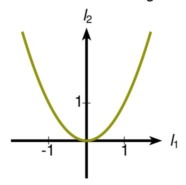

**Figura 3.27**: Gráfico de la función *f*(*x*) = *x* <sup>2</sup> para R.

*Del gráfico podemos inferir que f es estrictamente decreciente en* ] − ∞, 0[*.*

<span id="page-133-2"></span>*La función no es uno a uno en todo* R*, pero si nos restringimos a* R <sup>+</sup> *si lo es. La inversa de la función restringida es f* <sup>−</sup><sup>1</sup> (*x*) = <sup>√</sup> *x*, *x* ≥ 0*, cuyo gráfico se ve en la figura siguiente:*

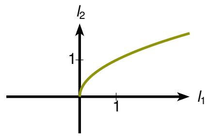

**Figura 3.28**: Gráfico de la función inversa restringida *f* −1 (*x*) = <sup>√</sup> *x*, *x* ≥ 0.

# *Ejemplo 3.40*

*Sea f*(*x*) = *x* 3 . *Es claro que* <sup>D</sup>OM *<sup>f</sup>* = REC *<sup>f</sup>* <sup>=</sup> <sup>R</sup>*. Además como* (−*x*) <sup>3</sup> <sup>=</sup> <sup>−</sup>*<sup>x</sup>* 3 *, la función es impar.*

Para estudiarla en  $[0, \infty[$  tenemos que f(0) = 0 y que

$$f(x) = 0 \leftrightarrow x^3 = 0 \leftrightarrow x = 0$$

con lo cual el único punto de intersección del gráfico con los ejes X e Y es O(0,0).

Además  $x^3 > 0 \leftrightarrow x > 0$  luego f es positiva en  $[0, \infty[$  y negativa en  $]-\infty, 0]$ . Si  $x, y \in [0, \infty[$  y x < y entonces  $x^3 < y^3$  de donde f es creciente en  $[0, \infty[$ . Por lo tanto es creciente también en  $]-\infty, 0]$  y por la imparidad de la función se obtiene que también es creciente en  $]-\infty, 0[$ .

<span id="page-134-0"></span>El gráfico de la función es el de la figura siguiente:

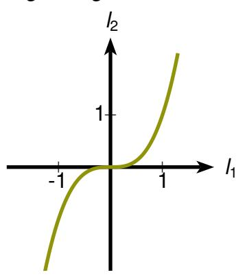

Figura 3.29: Gráfico de la función  $f(x) = x^3$ .

La función es uno a uno pues si  $x^3 = y^3$  tenemos  $(x - y)(x^2 + xy + y^2) = 0$  de donde x = y o bien  $x^2 + xy + y^2 = 0$ .

Si x = y, obtenemos el resultado deseado.

 $Si x^2 + xy + y^2 = 0$ , entonces

 $si\ y=0,\ se\ obtiene\ x=0\ y\ por\ lo\ tanto\ también\ aquí\ x=y.$ 

si y  $\neq$  0, consideramos la ecuación en la variable x, vemos que su discriminante  $\Delta = v^2 - 4v^2 < 0$  y por lo tanto  $x^2 + xy + y^2 \neq 0$ .

<span id="page-134-1"></span>La función inversa es  $f^{-1}(x) = \sqrt[3]{x}$ ,  $x \in \mathbb{R}$  cuyo gráfico puede verse en la figura siguiente:


**Figura 3.30**: Gráfico de la función inversa  $f^{-1}(x) = \sqrt[3]{x}, x \in \mathbb{R}$ .

# *Ejemplo 3.41*

*Sea f*(*x*) = <sup>1</sup> *x* . *Es claro que* <sup>D</sup>OM *<sup>f</sup>* <sup>=</sup> <sup>R</sup> − {0} y REC *<sup>f</sup>* <sup>=</sup> <sup>R</sup> − {0}.

*Por otro lado,* 0 6∈ DOM *f y f*(*x*) 6= 0 *luego el gráfico de f no intersecta los ejes X e Y . Además,*

$$f(x) \ge 0 \quad \leftrightarrow \quad \frac{1}{x} > 0 \quad \leftrightarrow \quad x > 0 \text{ y } yf(x) < 0 \quad \leftrightarrow \quad \frac{1}{x} < 0 \quad \leftrightarrow \quad x < 0$$

*con lo cual f es positiva en* ]0, ∞[ *y negativa en* ] − ∞, 0[ *.*

*Dado que f*(−*x*) = <sup>1</sup> −*x* = − 1 *x* = −*f*(*x*)*, la función es impar y podemos estudiarla sólo en* ]0,∞[*.*

*Si x*, *y* ∈ [0,∞[ *y x* < *y entonces* 1 *x* > 1 *y de donde f es estrictamente decreciente en* [0,∞[*.*

*Si x* <sup>∈</sup> [0,∞[*, sea* <sup>ε</sup> *tal que x* <sup>−</sup> ε > 0, <sup>1</sup> *x* − ε > 1 *x con lo cual f no es acotada superiormente.*

<span id="page-135-0"></span>*El gráfico de f en* [0,∞[ *es el de la figura siguiente:*


**Figura 3.31**: Gráfico de *<sup>f</sup>*(*x*) = <sup>1</sup> *x* en [0,∞[.

*el cual puede extenderse a* R *como puede verse en la figura siguiente:*

<span id="page-136-0"></span>

Figura 3.32: Gráfico de  $f(x) = \frac{1}{x}$  en  $\mathbb{R}$ .

La función es uno a uno y su inversa es  $f^{-1}(x) = \frac{1}{x}$ , es decir la misma función.

Del gráfico podemos agregar que f es estrictamente decreciente en  $]-\infty,0]$  y que no es inferiormente acotada en  $]-\infty,0]$ .

# Ejemplo 3.42

Sea  $f(x) = \frac{1}{x^2}$ . Es claro que Dom  $f = \mathbb{R} - \{0\}$  y que REC  $f = \mathbb{R}^+$ .

Además  $f(-x) = \frac{1}{(-x)^2} = \frac{1}{x^2} = f(x)$  con lo cual f es par.

Estudiaremos f en  $[0, \infty[$ :

 $0 \not\in \mathsf{Dom}\ f\ y\ 0 \not\in \mathsf{Rec}\ f\ luego\ el\ gr\'afico\ de\ f\ no\ intersecta\ los\ ejes\ coordenados.$ 

En  $[0, \infty[$ ,  $f(x) = \frac{1}{x^2} > 0$  luego f es positiva en  $[0, \infty[$ . Si x < y entonces  $\frac{1}{x^2} > \frac{1}{y^2}$  con lo que f es estrictamente decreciente.

Además f no es acotada superiormente pues si x>0, y  $\varepsilon$  es tal que  $x-\varepsilon>0$ 

tenemos 
$$\frac{1}{(x-\varepsilon)^2} > \frac{1}{x^2}$$
 es decir  $f(x-\varepsilon) > f(x)$ .

<span id="page-137-2"></span><span id="page-137-0"></span>

Figura 3.33: Gráfico de  $f(x) = \frac{1}{x^2}$  en  $[0, \infty[$ .

<span id="page-137-1"></span>El cual puede ser extendido a todo  $\mathbb{R}$  como se ve en la figura siguiente:


Figura 3.34: Gráfico de  $f(x) = \frac{1}{x^2}$  en todo  $\mathbb{R}$ .

La función no es uno a uno.

# Ejemplo 3.43

Sea f(x) = [x] donde [x] es el mayor entero p tal que  $p \le x$ .

Esta función se conoce con el nombre de función parte entera de x.

Por ejemplo, [2.5] = 2 y [-2.5] = -3. Notemos que en [0, 1[ la función vale 0, en [1, 2[ vale 1 y, en general, en [n, n + 1[ vale n, para n natural.

En[-1,0[ vale-1, en[-2,-1[ vale-2 y en general en[-[n+1),-n[ vale-(n+1), para n natural.

Entonces su gráfico es el que se muestra en la figura siguiente:

<span id="page-138-0"></span>

Figura 3.35: Gráfico de la función parte entera de x.

Observemos que tal función es creciente en  $\mathbb R$  y no es acotada. Su recorrido es  $\mathbb Z$  y no es invertible.

A través de los siguientes ejemplos introduciremos algunas operaciones sobre funciones que tienen especial interés en relación a su gráfico:

# *Ejemplos*

# *Ejemplo 3.44*

Sea 
$$f(x) = 2x + 5$$
  $y(-f)(x) = -f(x) = -2x - 5$ .

<span id="page-139-0"></span>*Podemos ver los gráficos de f y de* −*f en la siguiente figura:*


**Figura 3.36**: Gráfico de las funciones *f*(*x*) = 2*x* + 5 y (−*f*)(*x*) = −2*x* − 5.

*Notemos que los gráficos son simétricos respecto al eje X, esto es, si* (*x*, *y*) ∈ *f entonces* (*x*, −*y*) ∈ −*f.*

# *Ejemplo 3.45*

Sea 
$$f(x) = x^2$$
, entonces  $(f + 5)(x) = f(x) + 5 = x^2 + 5$ .

*El gráfico de f y de f* + 5 *pueden verse en la figura siguiente:*

<span id="page-140-0"></span>

**Figura 3.37**: Gráfico de *f* y de *f* + 5.

*Notemos que el gráfico de f* + 5 *es el de f desplazado en 5 unidades respecto al eje Y . Es decir,* (*x*, *y*) ∈ *f* → (*x*, *y* + 5) ∈ (*f* + 5)*.*

# *Ejemplo 3.46*

<span id="page-140-1"></span>*Sea f*(*x*) = <sup>√</sup> 1 − *x* 2 , *entonces* (4*f*)(*x*) = 4*f*(*x*) = 4<sup>√</sup> 1 − *x* 2 *. Podemos ver los gráficos de f y de* 4*f en la siguiente figura:*


**Figura 3.38**: Gráfico de *<sup>f</sup>*(*x*) = <sup>√</sup> 1 − *x* <sup>2</sup> y (4*f*)(*x*) = 4<sup>√</sup> 1 − *x* 2 .

*Notemos que el gráfico de* 4*f es el de f ampliado 4 veces respecto al eje Y . Es decir,* (*x*, *y*) ∈ *f* → (*x*, 4*y*) ∈ 4*f.*

# Ejemplo 3.47

Sea f(x) = 2x, entonces |f|(x) = 2|x|

<span id="page-141-0"></span>Los gráficos de f y |f| son los de la figura siguiente:


**Figura 3.39**: Gráfico de f(x) = 2x y |f|(x) = 2|x|.

Podemos observar que en este caso, la parte negativa de f se refleja respecto al eje X, es decir, si  $(x, y) \in f$  entonces  $(x, |y|) \in |f|$ .

# Ejemplo 3.48

<span id="page-141-1"></span>Sea  $f(x) = x^2 y$   $g(x) = f(x - 2) = (x - 2)^2$ . Los gráficos de f y g pueden verse en la figura siguiente:


**Figura 3.40**: Gráfico de  $f(x) = x^2$  y  $f(x - 2) = (x - 2)^2$ 

En este caso el gráfico se traslada hacia la derecha en 2 unidades. Es decir, si  $(x-2, y) \in f$  entonces  $(x, y) \in g$ .

# Ejemplo 3.49

Sean 
$$f(x) = \sqrt{1 - x^2}$$
  $y$   $g(x) = f(2x) = \sqrt{1 - 4x^2}$ .

<span id="page-142-0"></span>Los gráficos de f y g son los de la siguiente figura:


**Figura 3.41**: Gráfico de  $f(x) = \sqrt{1 - x^2}$  y  $g(x) = f(2x) = \sqrt{1 - 4x^2}$ .

En este caso el gráfico se comprime en 2 unidades respecto al eje X. Es decir, si  $(2x, y) \in f$  entonces  $(x, y) \in g$ .

# Ejemplo 3.50

Sean 
$$f(x) = 2x + 5$$
 y  $g(x) = f(-x) = -2x + 5$ .

<span id="page-142-1"></span>Los gráficos de f y g se pueden ver en la figura siguiente:


**Figura 3.42**: Gráfico de f(x) = 2x + 5 y f(-x) = -2x + 5.

En este caso el gráfico se refleja en el eje Y. Es decir, si  $(-x, y) \in f$  entonces  $(x, y) \in g$ .

3.7. Sucesiones

# Ejemplo 3.51

Sea f(x) = 2x - 3, entonces  $f^{-1}(x) = \frac{x + 3}{2}$  y los gráficos de f y  $f^{-1}$  están dados por la figura que sigue, en la cual se puede notar que cada uno se obtiene del otro intercambiando los ejes, es decir

$$(x, y) \in f \leftrightarrow (y, x) \in f^{-1}$$

<span id="page-143-1"></span>

Figura 3.43: Gráfico de f(x) = 2x - 3 y  $f^{-1}(x) = \frac{x+3}{2}$ .

<span id="page-143-0"></span>Sucesiones 3.7

Observemos que si el dominio de una función F es  $\mathbb{N}$ , ésta se puede expresar por:

$$F = \{(1, F(1)), (2, F(2)), (3, F(3))...\}$$

y el recorrido de *F* se puede expresar por:

REC 
$$F = \{F(1), F(2), F(3), ...\}.$$

Esta notación de los elementos del recorrido de manera sucesiva, le da a F el nombre de sucesión:

# <span id="page-144-0"></span>**Definición**

# *Definición 3.26 Sucesión*

*F es una* **sucesión** *si y sólo si F es una función y DomF* <sup>=</sup> <sup>N</sup> *(o* <sup>N</sup> ∪ {0}*).*

*F es una sucesión de números reales si además* <sup>R</sup>EC *<sup>F</sup>* <sup>⊆</sup> <sup>R</sup>*.*

*Una sucesión está determinada por la secuencia de los elementos del recorrido:*

*F*(1), *F*(2), *F*(3), *F*(4), ...

# *Ejemplos*

# *Ejemplo 3.52*

$$1^2, 2^2, 3^2, 4^2, \dots,$$

*corresponde a la función:*

$$F = \{(1, 1^2), (2, 2^2), (3, 3^2), ...\}.$$

*El* **n-ésimo término** *de una sucesión F es F*(*n*) *y se denota por Fn.*

*La sucesión F se denota también por* {*Fn*}*<sup>n</sup>*∈<sup>N</sup>*.*

# *Ejemplo 3.53*

*Sea F* = {*Fn*}*<sup>n</sup>*∈<sup>N</sup> *sucesión de números reales definida por F<sup>n</sup>* = 2*n* + 1, *entonces F corresponde a la sucesión:* 3, 5, 7, 9, ... *y es la función:*

$$F = \{(1,3), (2,5), (3,7), ...\}.$$

# *Ejemplo 3.54*

*Sea F la sucesión de números reales siguiente:*

2, 4, 6, 8, ...

*Entonces el n-ésimo término es F<sup>n</sup>* = 2*n y la función es*

$$F=\{(n,m)\ :\ n\in\mathbb{N}\wedge m=2n\}.$$

3.7. Sucesiones

# Ejemplo 3.55

Sea F la sucesión de conjuntos definida por:

$$F_n = (-n, n)$$

F corresponde a la sucesión:

$$(-1, 1), (-2, 2), (-3, 3), \dots$$

# <span id="page-146-0"></span>**Ejercicios Propuestos**

- 1. Determine cuáles de las siguientes relaciones son funciones:
  - (a)  $R = \{(x, y) \in \mathbb{N} \times \mathbb{N} : y = x^2\}.$
  - (b)  $R = \{(x, y) \in \mathbb{Z} \times \mathbb{Z} : x^2 + y^2 = 1\}.$
  - (c)  $R = \{(x, y) \in \mathbb{Z} \times \mathbb{Z} : x \cdot y > 0\}.$
  - (d)  $R = \{(x, y) \in \mathbb{N} \times \mathbb{N} : y = 2\}.$
  - (e)  $R = \{(1, 1), (1, 2), (1, 3), (1, 3), (1, 3), (1, 3), (1, 3), (1, 3), (1, 3), (1, 3), (1, 3), (1, 3), (1, 3), (1, 3), (1, 3), (1, 3), (1, 3), (1, 3), (1, 3), (1, 3), (1, 3), (1, 3), (1, 3), (1, 3), (1, 3), (1, 3), (1, 3), (1, 3), (1, 3), (1, 3), (1, 3), (1, 3), (1, 3), (1, 3), (1, 3), (1, 3), (1, 3), (1, 3), (1, 3), (1, 3), (1, 3), (1, 3), (1, 3), (1, 3), (1, 3), (1, 3), (1, 3), (1, 3), (1, 3), (1, 3), (1, 3), (1, 3), (1, 3), (1, 3), (1, 3), (1, 3), (1, 3), (1, 3), (1, 3), (1, 3), (1, 3), (1, 3), (1, 3), (1, 3), (1, 3), (1, 3), (1, 3), (1, 3), (1, 3), (1, 3), (1, 3), (1, 3), (1, 3), (1, 3), (1, 3), (1, 3), (1, 3), (1, 3), (1, 3), (1, 3), (1, 3), (1, 3), (1, 3), (1, 3), (1, 3), (1, 3), (1, 3), (1, 3), (1, 3), (1, 3), (1, 3), (1, 3), (1, 3), (1, 3), (1, 3), (1, 3), (1, 3), (1, 3), (1, 3), (1, 3), (1, 3), (1, 3), (1, 3), (1, 3), (1, 3), (1, 3), (1, 3), (1, 3), (1, 3), (1, 3), (1, 3), (1, 3), (1, 3), (1, 3), (1, 3), (1, 3), (1, 3), (1, 3), (1, 3), (1, 3), (1, 3), (1, 3), (1, 3), (1, 3), (1, 3), (1, 3), (1, 3), (1, 3), (1, 3), (1, 3), (1, 3), (1, 3), (1, 3), (1, 3), (1, 3), (1, 3), (1, 3), (1, 3), (1, 3), (1, 3), (1, 3), (1, 3), (1, 3), (1, 3), (1, 3), (1, 3), (1, 3), (1, 3), (1, 3), (1, 3), (1, 3), (1, 3), (1, 3), (1, 3), (1, 3), (1, 3), (1, 3), (1, 3), (1, 3), (1, 3), (1, 3), (1, 3), (1, 3), (1, 3), (1, 3), (1, 3), (1, 3), (1, 3), (1, 3), (1, 3), (1, 3), (1, 3), (1, 3), (1, 3), (1, 3), (1, 3), (1, 3), (1, 3), (1, 3), (1, 3), (1, 3), (1, 3), (1, 3), (1, 3), (1, 3), (1, 3), (1, 3), (1, 3), (1, 3), (1, 3), (1, 3), (1, 3), (1, 3), (1, 3), (1, 3), (1, 3), (1, 3), (1, 3), (1, 3), (1, 3), (1, 3), (1, 3), (1, 3), (1, 3), (1, 3), (1, 3), (1, 3), (1, 3), (1, 3), (1, 3), (1, 3), (1, 3), (1, 3), (1, 3), (1, 3), (1, 3), (1, 3), (1, 3), (1, 3), (1, 3), (1, 3), (1, 3), (1, 3), (1, 3), (1, 3), (1, 3), (1, 3), (1, 3), (1, 3), (1, 3), (1, 3), (1, 3), (1, 3), (1, 3), (1, 3), (1, 3), (1, 3), (1, 3), (1, 3), (1, 3), (1, 3), (1, 3), (1, 3), (1, 3), (1, 3), (1, 3), (1, 3), (1, 3), (1, 3), (1, 3), (1, 3), (1, 3), (1, 3), (1, 3), (1,$ (2, 1), (2, 2), (3, 1).
- 2. Determine cuáles de las siguientes relaciones reales son funciones:
  - (a)  $xRv \leftrightarrow x^2 = 2v$ .
  - (b)  $xRy \leftrightarrow y = 3x 3$ .
  - (c)  $xRy \leftrightarrow xy = 3$ .
  - (d)  $xRy \leftrightarrow |x| + |y| = 1$ .
  - (e)  $xRy \leftrightarrow x + y = 2$ .
  - (f)  $xRy \leftrightarrow y^2 = 2x$ .
  - (g)  $xRy \leftrightarrow y = 0$ .
- 3. De ejemplo de relaciones R y S tales que:
  - (a) R sea función pero  $R^{-1}$  no.
  - (b) R y S sean funciones pero  $R \cup S$  no.
  - (c)  $R \cap S$  sea función pero R y S no.
- 4. Sean  $A = \{1, 2, 3\}$  y  $B = \{4, 5\}$ .

Determine todas las funciones posibles de A en B.

5. Sea  $A = \mathbb{R} - \{0, 1\}$  y definamos las funciones de A en A:

$$f_0(x) = x$$
,  $f_1(x) = \frac{1}{x}$ ,  $f_2(x) = 1 - x$ ,  
 $f_3(x) = \frac{1}{1 - x}$ ,  $f_4(x) = \frac{x - 1}{x}$ ,  $f_5(x) = \frac{x}{x - 1}$   
 $f_6(x) = x(x - 1)$ .

Sea  $I = \{0, 1, 2, 3, 4, 5, 6\}$ . Calcular  $f_i$  o  $f_i$ para cada i y  $j \in I$ .

- 6. Sean f(x) = 2x,  $f_1(x) = \frac{1}{x}$ , g(x) = x,  $g_1(x) = \frac{1}{1-x}$  funciones reales.
  - (a) Calcular f(0), f(1),  $g(\frac{3}{2})$ ,  $g_1(\frac{1}{2} + x)$ ,  $(g \circ f_1)(x), (f \circ g_1)(x).$
  - (b) Determinar dominio y recorrido de  $f \circ f_1$ ,  $f_1 \circ g$ ,  $f_1 \circ f$  y  $g_1 \circ g$ .
- 7. Encuentre los dominios de las siguientes funciones reales:
  - (a)  $f(x) = \sqrt{a^2 x^2}$ ,  $a \in \mathbb{R}$ . (b)  $f(x) = \sqrt{1 \sqrt{1 x^2}}$ .

  - (c)  $f(x) = \frac{1}{\sqrt{x^2 4}}$ .
  - (d)  $f(x) = \sqrt{1-x} + \sqrt{x-2}$ .
  - (e)  $f(x) = \sqrt{4 x^2} + \sqrt{x^2 1}$ .
  - (f)  $f(x) = \frac{1}{x-1} + \frac{1}{x+2}$ .
- 8. Sea  $f: \mathbb{R} \to \mathbb{R}$  definida por

$$f(x) = \begin{cases} 2x + 5 & \text{si } 9 < x \\ x^2 - |x| & \text{si } -9 \le x \le 9 \\ x - 4 & \text{si } x < -9. \end{cases}$$

Determine:

- (a) f(3), f(12), f(9), f(f(5)).
- (b) Dominio y recorrido de f.
- 9. Dadas las funciones reales definidas por:

$$f(x) = \frac{x + |x|}{2}$$

У

$$g(x) = \begin{cases} x, & \text{si } x < 0 \\ x^2, & \text{si } x \ge 0. \end{cases}$$

Demuestre que  $f \circ g = g \circ g$ .

10. Dadas las funciones reales

$$f(x) = 2x^2 + 1$$
 y  $g(x) = x - 3$ .

¿Para qué valores de  $x \in \mathbb{R}$  se tiene que  $(f \circ g)(x) = (g \circ f)(x)$ ?

11. Sean

$$f(x) = \begin{cases} x & , & x < 1 \\ x^2 - 1 & , & x \ge 1 \end{cases}$$

у

$$g(x) = \begin{cases} \sqrt{x+1} & , & 0 \le x \le 1 \\ x+2 & , & x > 1 \lor x < 0 \end{cases}$$

funciones reales. Encuentre  $g \circ f$  y  $f \circ g$ .

- 12. Sea  $f: A \rightarrow B$  y sean  $D_1, D_2 \subseteq B$ . Demostrar que:
  - (a)  $f^{-1*}(D_1 \cap D_2) = f^{-1*}(D_1) \cap f^{-1*}(D_2)$
  - (b)  $f(f^{-1*}(D_1)) \subseteq D_1$  y que la igualdad no es verdad en general.
- Determine si las siguientes funciones son uno a uno. En caso de serlo, calcule la inversa:
  - (a)  $f(x) = x^3$ ,
  - (b)  $f(x) = x^2$ ,
  - (c)  $f(x) = \frac{x^2 1}{x + 1}$ ,
  - (d)  $f(x) = \frac{1}{x},$
  - (e)  $f(x) = \frac{x-3}{2x+1}$ ,
  - (f)  $f(x) = \frac{1}{1 x^2}$ .

14. Sea f definida por:

$$f(x) = \begin{cases} x+2, & x \leq 2 \\ 2x, & x > 2. \end{cases}$$

Probar que f es biyección de  $\mathbb{R}$  en  $\mathbb{R}$  y determinar  $f^{-1}$ .

15. Demostrar que la función real  $f(x) = \frac{ax + b}{cx + d}$  tiene inversa si y sólo si

$$ad - bc \neq 0$$
.

16. Demostrar que las funciones reales: f(x) = 1 - x,  $g(x) = \frac{x}{x - 1}$  y

 $h(x) = \frac{1}{x-1}$  son invertibles y calcular:

$$f^{-1}$$
,  $g^{-1}$ ,  $h^{-1}$ ,  $f \circ g$ ,  $g \circ f$ ,  $f^{-1} \circ g^{-1}$  y  $(f \circ g)^{-1}$ .

- 17. De ejemplo de una función  $f: \mathbb{N} \to \mathbb{N}$  tal que:
  - (a) f sea inyectiva pero no biyectiva.
  - (b) f sea sobre  $\mathbb{N}$  pero no biyectiva.
  - (c) f no sea ni invectiva ni sobre  $\mathbb{N}$ .
  - (d) f sea biyectiva.
- 18. Sean  $f: X \to Y$  y  $g: Y \to X$  tales que  $g \circ f = ID_X$ .

Demuestre que f es uno a uno y g es sobre.

19. Sean  $h: S \rightarrow T$  y  $g: T \rightarrow R$ .

Demuestre que si  $g \circ h$  es sobre entonces g es sobre.

ciones, entonces f, g y h son biyecciones.

20. Sean  $f: A \rightarrow B$ ,  $g: B \rightarrow C$  y  $h: C \rightarrow D$ . Demuestre, que si  $g \circ f$  y  $h \circ g$  son biyec21. Dadas las funciones reales

$$f(x) = \begin{cases} x^3 + 2 & x \ge 0 \\ 3x + 2 & x < 0. \end{cases}$$

$$g(x) = \begin{cases} x^2 - 1 & x > -1 \\ 3x - 2 & x \le -1. \end{cases}$$

Demostrar que f es biyección pero g no lo es. Determinar  $g \circ f^{-1}$ .

22. Sean f y g funciones de  $\mathbb{N} \times \mathbb{N}$  en  $\mathbb{N}$  definidas por:

$$f((x, y)) = x, g((x, y)) = y.$$

Demuestre que f y g son sobre  $\mathbb N$  pero no inyectivas.

23. Demuestre que si f y g son biyecciones, entonces

$$(f \circ g)^{-1} = g^{-1} \circ f^{-1}.$$

24. Sea  $f: \mathbb{R} \times \mathbb{R} \to \mathbb{R} \times \mathbb{R}$  definida por:

$$f((x, y)) = (y, x).$$

Demostrar que f es biyección y calcular  $f^{-1}$ .

25. Graficar las siguientes funciones reales indicando dominio y recorrido. ¿Cuáles son uno a uno?

(a) 
$$f(x) = \frac{1}{2}x^2$$
.

(b) 
$$f(x) = \frac{1}{3}\sqrt{144 - 16x^2}$$
.

- (c)  $f(x) = -\sqrt{1-x^2}$ .
- (d) f(x) = 1 |x|.
- (e)  $f(x) = \sqrt{-6x}$ .
- (f)  $f(x) = \sqrt{16 (x 1)^2} + 1$ .

- (g)  $f(x) = -\sqrt{x} + 5$ .
- (h)  $f(x) = \frac{x + |x|}{2}$ .
- 26. Graficar las siguientes funciones reales definidas por intervalos.

(a) 
$$f(x) = \begin{cases} x, & x < 0 \\ x^2, & x \ge 0. \end{cases}$$

(b) 
$$f(x) = \begin{cases} x, & x < 1 \\ x^2 - 1 & x \ge 1. \end{cases}$$

(c) 
$$f(x) = \begin{cases} \sqrt{x+1} & 0 \ge x \ge 1 \\ x+2, & x < 0 \ \lor \ x > 1. \end{cases}$$

- 27. ¿Cuáles de las siguientes funciones son pares o impares?
  - (a)  $2x^3 x + 1$ .
  - (b) ax + b.
  - (c)  $ax^2 + bx + c.(c \neq 0)$
  - (d)  $\sqrt{1+x+x^2}-\sqrt{1-x+x^2}$ .
- 28. Pruebe que:
  - (a) Si f y g son pares, f + g y  $f \cdot g$  son pares.
  - (b) Si f es par y g es impar, entonces  $f \cdot g$  es impar.
  - (c) La suma de dos impares es impar mientras que su producto es par.
- 29. Sea f función con Dom  $f = \mathbb{R}$ .

Probar que existen dos únicas funciones g y h tales que f = g + h siendo h par y g impar.

- 30. Determine los intervalos de crecimiento y decrecimiento de las siguientes funciones:
  - (a)  $f(x) = x^3 + 3x + 5$ .
  - (b)  $f(x) = x^2$ .
  - (c)  $f(x) = x + \frac{1}{x}$

(d) 
$$f(x) = x^3$$
.

(e) 
$$f(x) = \frac{x}{1 + x^2}$$
.

31. Dadas las funciones:

$$f(x) = \begin{cases} x & , & x \leq 0 \\ x+2 & , & x > 0. \end{cases}$$

У

$$g(x) = \begin{cases} x - 1 & , & x \le 1 \\ 4x & , & x > 1. \end{cases}$$

Determine -f, |f|, f + 3,  $5 \cdot g$ .

- 32. Si el dominio de una función *f* es [0, 1]. Determinar el dominio de las siguientes funciones:
  - (a)  $f_1(x) = f(x-3)$ .
  - (b)  $f_2(x) = f(2x 5)$ .
  - (c)  $f_3(x) = f(|x|)$ .
  - (d)  $f_4(x) = f(3x^2)$ .
- 33. Grafique la función  $f(x) = \sqrt{1 x^2}$  y úselo para obtener los gráficos de:

$$2\sqrt{1-x^2}, \quad \sqrt{1-(x+1)^2}, \quad \sqrt{1-(x/2)^2}, \ \sqrt{1-x^2}-2 \ y \ -\sqrt{1-x^2}.$$

34. Dado el gráfico de la función  $f(x) = x^2$ , dibuje los gráficos de las siguientes funciones:

$$(x-2)^2$$
,  $(2-x)^2$ ,  $(\frac{x}{2})^2$ ,  $1+x^2$ .

- 35. Demostrar que si f es periódica de período P, la función f(ax + b), con  $a \ne 0$  también lo es. Determinar su período teniendo en términos de a.
- 36. Grafique f tal que su dominio es  $\mathbb{R}$  y

$$f(x) = \begin{cases} x & , & 0 \le x < 1 \\ x - 2 & , & 1 \le x \le 2, \end{cases}$$

sabiendo que:

- (a) f es impar y tiene período 4.
- (b) f es par y tiene período 4.
- 37. Averiguar cuáles funciones reales son acotadas.
  - (a)  $f(x) = ax^2$ .  $a \in \mathbb{R}$ .

(b) 
$$f(x) = \frac{1}{1 + x^2}$$
.

(c) 
$$f(x) = \frac{x}{1 + x^2}$$
.

(d) 
$$f(x) = \frac{1}{x^2 - 4}$$
.

(e) 
$$f(x) = 1 - 2x - x^2$$
.

38. Sea f(x) = x - [x], donde [x] es la parte entera de x. Esta función se conoce como parte fraccionaria de x.

Estudie y grafique f(x).

- 39. Bosquejar los gráficos de
  - (a)  $2 \frac{1}{x}$ .
  - (b)  $\left(\frac{1}{x-1}\right)^2$ .
  - (c)  $\frac{2}{x}$ .
  - (d)  $\left| \frac{1}{x} \right|$ .
- <span id="page-149-0"></span>40. Encuentre el término *n*-ésimo en cada una de las siguientes sucesiones:
  - (a)  $\frac{1}{2}$ ,  $\frac{1}{4}$ ,  $\frac{1}{6}$ ,  $\frac{1}{8}$ , ...
  - (b)  $\frac{1}{2}, \frac{2}{3}, \frac{3}{4}, \frac{4}{5}, \dots$
  - (c)  $1 x^2$ ,  $1 2x^2$ ,  $1 3x^2$ , ...

# Autoevaluación

3

1. Considere las funciones  $f(x) = x^2 - 2x - 1$  y g(x) = x - 2|x| con  $x \in \mathbb{R}$ . Se define la función h(x) en todo  $\mathbb{R}$  por:

$$h(x) = \begin{cases} f(x) & \text{si } f(x) \ge g(x) \\ g(x) & \text{si } f(x) < g(x) \end{cases}$$

- a) Identifique y grafique la función h en el intervalo [-6,2]
- b) Decida si h es inyectiva en [-6, 2]. Justifique su respuesta.
- c) Grafique -h(x) en el intervalo [-10, 10].
- 2. a) Dadas las funciones f(x) = [x-1] y  $g(x) = x^2 3x 2$ , con dominio  $\mathbb{R}$ , donde  $[\ ]$  es la función parte entera. Determine todos los  $x \in \mathbb{R}$ , tales que:  $(f \circ g)(x) = 4$ 
  - b) Dadas las funciones  $f(x) = \frac{x}{x-1}$  y  $g(x) = \frac{1}{x-1}$  con dominio  $\mathbb{R} \{1\}$ 
    - 1) Determine el recorrido de f y de g
    - 2) Demuestre que f y g son ambas inyectivas
    - 3) Calcules  $f^{-1} \circ g^{-1}(x)$ .
- 3. a) Demuestre que la siguiente afirmación es falsa: Si f es función creciente en [a, b], y f es creciente en (b, c], entonces f es creciente en [a, c].
  - b) Sean f y g funciones de  $\mathbb{R}$  en  $\mathbb{R}$ , donde f es par y g es impar,demuestre que la función  $h(x) = f(x) \times (g(x))^8$  es función par en  $\mathbb{R}$ . (OBSERVACIÓN:  $(g(x))^8$  significa g(x) elevado a la octava potencia)
  - c) Demuestre que  $\forall x \in \mathbb{R} \left( 0 \le \left( x [x] \right)^{45} < 1 \right)$  donde [ ] es la función parte entera.
- 4. Determine condiciones sobre a y  $b \in \mathbb{R}$  de modo que:

$$f(x) = \begin{cases} x^2 - 4x + 7 & \text{si } x \ge 2\\ ax + b & \text{si } x < 2 \end{cases}$$

sea una biyección sobre  $\mathbb{R}$ . Demuestre que con las condiciones encontradas, f es efectivamente una biyección sobre  $\mathbb{R}$ .

5. Considere las funciones  $f(x) = \frac{x+1}{x-2}$  y

$$g(x) = \begin{cases} 3 - x^2 & \text{si } |x| < 3 \\ x + 1 & \text{si } |x| \ge 3 \end{cases}$$

Calcule  $f^{-1}$  y  $g \circ f^{-1}$ .

- 6. Construya el gráfico de la función  $f(x) = 1 2x^2 + x$ , partiendo del gráfico de la parábola  $y = x^2$  y aplicando a ésta las transformaciones pertinentes (translaciones, dilataciones, etc.).
- 7. Sea  $f: A \longrightarrow \mathbb{R}$ , definida por  $\left[\frac{x}{x-1} 1\right]$ .
  - a) Determine Dom (f) y demuestre que f no es sobre  $\mathbb{R}$ .
  - b) Grafique f(x).
  - c) Resuelva f(x) = 3.

<span id="page-153-0"></span>

# **Trigonometría**

# <span id="page-153-1"></span>**Las Razones Trigonométricas 4.1**

Comenzaremos el capítulo, introduciendo las razones trigonométricas en un triángulo rectángulo. Para medir los ángulos, usaremos indistintamente, tanto grados como radianes, sabiendo que

π radianes = 180 grados

<span id="page-153-2"></span>Dado el siguiente triángulo rectángulo,


**Figura 4.1**: Triángulo rectángulo.

Definimos las siguientes razones:

# **Definición**

# *Definición 4.1 Razones trigonométricas*

$$sen(\alpha) = (a/b)$$
  $cos(\alpha) = (c/b)$   $tan(\alpha) = (a/c)$ 

$$cosec(\alpha) = (b/a)$$
  $sec(\alpha) = (b/c)$   $cot(\alpha) = (c/a)$ 

Podemos notar algunas identidades inmediatas a partir de la definición:

# **Propiedades**

$$1 \quad \operatorname{cosec}(\alpha) = \frac{1}{\operatorname{sen}(\alpha)}$$

*<sup>2</sup>* sec(α) = <sup>1</sup> cos(α)

$$3 \cot(\alpha) = \frac{1}{\tan(\alpha)}$$

4 
$$\tan(\alpha) = \frac{\operatorname{sen}(\alpha)}{\cos(\alpha)}$$

5 
$$sen^2(\alpha) + cos^2(\alpha) = 1$$

6 
$$\tan^2(\alpha) + 1 = \sec^2(\alpha)$$

7 
$$\cot^2(\alpha) + 1 = \csc^2(\alpha)$$

# **Demostración**

*Las primeras cuatro propiedades, salen inmediatamente de la definición de las razones trigonométricas. Para ver que* sen<sup>2</sup> (α) + cos<sup>2</sup> (α) = 1 *notemos que:*

$$\operatorname{sen}^{2}(\alpha) + \cos^{2}(\alpha) = \left(\frac{a}{b}\right)^{2} + \left(\frac{c}{b}\right)^{2} = \frac{a^{2} + c^{2}}{b^{2}}$$

Pero usando el teorema de Pitágoras, tenemos que

$$a^2 + c^2 = b^2$$

Por lo tanto

$$sen^2(\alpha) + cos^2(\alpha) = 1$$

De manera muy similar se demuestran las últimas tres identidades.

<span id="page-155-0"></span>Veamos como deducir algunas razones trigonométricas de algunos ángulos importantes, en particular, de los ángulos de 30, 45 y 60 grados. Tomemos un triángulo equilátero y tracemos su altura desde *C*, como lo muestra la figura:


Figura 4.2: Triángulo equilátero.

Calculando la altura del triángulo ABC obtenemos que ella mide  $\frac{\sqrt{3}}{2}I$ . Luego mirando el triángulo CDB obtenemos que  $sen(30) = \frac{1}{2}$  y  $cos(30) = \frac{\sqrt{3}}{2}$ . Observando ahora el triángulo ACD obtenemos que:

$$sen(60) = \frac{\sqrt{3}}{2} y cos(60) = \frac{1}{2}.$$

Para calcular las razones trigonométricas de 45 grados, dibujamos un triángulo rectángulo isósceles, como se ve en la siguiente figura:

<span id="page-156-1"></span>

**Figura 4.3**: Triángulo rectángulo isósceles.

Entonces en el triángulo *ABC* vemos que el lado *BC* mide *l* √ 2 por lo que se obtiene que:

$$sen(45) = \frac{\sqrt{2}}{2} \text{ y } cos(45) = \frac{\sqrt{2}}{2}.$$

<span id="page-156-0"></span>Podemos resumir esto en la siguiente tabla:

| Grados | 0 | 30           | 45       | 60           | 90 |
|--------|---|--------------|----------|--------------|----|
| sen    | 0 | √<br>1/<br>2 | √<br>2/2 | √<br>3/2     | 1  |
| cos    | 1 | √<br>3/2     | √<br>2/2 | √<br>1/<br>2 | 0  |

**Tabla 4.1**: Valores para el seno y coseno de 0, 30, 45, 60 y 90 grados.

A partir de los pocos valores que acabamos de calcular, podemos notar que

$$sen(\alpha + \beta) \neq sen(\alpha) + sen(\beta)$$

y lo mismo para el coseno de la suma, dado que por ejemplo sen(30 + 60) = sen(90) = 0 pero, sen(30) = 1/2 y sen(60) = <sup>√</sup> 3/2.

Para deducir la fórmula del seno de la suma de dos ángulos, consideremos la siguiente figura:

<span id="page-157-0"></span>

**Figura 4.4**: Diagrama para calcular el seno de la suma de dos ángulos.

# Entonces

$$\operatorname{sen}(\alpha + \beta) = \frac{\overline{PT}}{\overline{OT}} = \frac{\overline{PL} + \overline{LT}}{\overline{OT}} = \frac{\overline{QS}}{\overline{OS}} \frac{\overline{OS}}{\overline{OT}} + \frac{\overline{LT}}{\overline{TS}} \frac{\overline{TS}}{\overline{OT}}$$
$$= \operatorname{sen}(\alpha) \cos(\beta) + \cos(\alpha) \operatorname{sen}(\beta)$$

De igual manera, podemos deducir que:

$$\cos(\alpha + \beta) = \cos(\alpha)\cos(\beta) - \sin(\alpha)\sin(\beta)$$

# **Propiedad**

$$\tan(\alpha + \beta) = \frac{\tan(\alpha) + \tan(\beta)}{1 - \tan(\alpha)\tan(\beta)}$$

# **Demostración**

$$\tan(\alpha + \beta) = \frac{\operatorname{sen}(\alpha + \beta)}{\operatorname{cos}(\alpha + \beta)} = \frac{\operatorname{sen}(\alpha)\operatorname{cos}(\beta) + \operatorname{cos}(\alpha)\operatorname{sen}(\beta)}{\operatorname{cos}(\alpha)\operatorname{cos}(\beta) - \operatorname{sen}(\alpha)\operatorname{sen}(\beta)}$$
$$= \frac{\frac{\operatorname{sen}(\alpha)}{\operatorname{cos}(\alpha)} + \frac{\operatorname{sen}(\beta)}{\operatorname{cos}(\beta)}}{1 - \frac{\operatorname{sen}(\alpha)\operatorname{sen}(\beta)}{\operatorname{cos}(\alpha)\operatorname{cos}(\beta)}} = \frac{\tan(\alpha) + \tan(\beta)}{1 - \tan(\alpha)\tan(\beta)}$$

# <span id="page-158-1"></span>**Problemas**

# Problema 4.1

Demostrar que 
$$\frac{\sec(\alpha) + \csc(\alpha)}{\tan(\alpha) + \cot(\alpha)} = \sec(\alpha) + \cos(\alpha)$$
.

# Demostración

$$\frac{\sec(\alpha) + \csc(\alpha)}{\tan(\alpha) + \cot(\alpha)} = \frac{\frac{1}{\cos(\alpha)} + \frac{1}{\sin(\alpha)}}{\frac{\sin(\alpha)}{\cos(\alpha)} + \frac{\cos(\alpha)}{\sin(\alpha)}} = \frac{\sin(\alpha) + \cos(\alpha)}{\sin^2(\alpha) + \cos^2(\alpha)} = \sin(\alpha) + \cos(\alpha).$$

# Problema 4.2

Demostrar que 
$$\frac{\csc(\alpha)}{1 + \csc(\alpha)} - \frac{1}{\sin(\alpha) - 1} = 2\sec^2(\alpha)$$
.

# Demostración

$$\frac{\operatorname{cosec}(\alpha)}{1 + \operatorname{cosec}(\alpha)} - \frac{1}{\operatorname{sen}(\alpha) - 1} = \frac{\frac{1}{\operatorname{sen}(\alpha)}}{1 + \frac{1}{\operatorname{sen}(\alpha)}} - \frac{1}{\operatorname{sen}(\alpha) - 1} = \frac{1}{\operatorname{sen}(\alpha) + 1} - \frac{1}{\operatorname{sen}(\alpha) - 1}$$
$$= \frac{-2}{\operatorname{sen}^2(\alpha) - 1} = 2\operatorname{sec}^2(\alpha).$$

# <span id="page-158-0"></span>Las Funciones Trigonométricas

4.2

En esta sección introduciremos las funciones trigonométricas. Extenderemos las razones trigonométricas de la sección anterior, que fueron definidas para ángulos entre 0 y 90 grados a funciones reales. Para este estudio es necesario aceptar que así como los reales constituyen las medidas de todos los trazos dirigidos, también constituyen las medidas de todos los ángulos y de todas las longitudes de arco.

Dado  $x \in \mathbb{R}^+ \cup \{0\}$  existe un ángulo que mide x radianes desde el eje X positivo y medido en sentido contrario de los punteros del reloj, donde un **radián** es la medida de aquel ángulo subtendido en una circunferencia de radio 1 por un arco de longitud 1.

El número real  $\pi$  se puede definir como la medida en radianes de un ángulo extendido y por lo tanto la medida de un ángulo recto es  $\frac{\pi}{2}$  radianes y la de un ángulo completo es de  $2\pi$  radianes.

<span id="page-159-1"></span>Si *<sup>x</sup>* <sup>∈</sup> <sup>R</sup> <sup>−</sup>, entonces existe un ángulo que mide *x* radianes desde el eje *X* positivo y medido en el sentido de los punteros del reloj.

<span id="page-159-0"></span>Cada ángulo a su vez determina un único punto *P*(*a<sup>x</sup>* , *b<sup>x</sup>* ) en la circunferencia de centro en el origen y radio 1, como se ve en la figura siguiente:


**Figura 4.5**: Punto *P*(*a<sup>x</sup>* , *b<sup>x</sup>* ) definido por el ángulo que mide *x* radianes en la circunferencia de centro en el origen y radio 1.

# **Definición**

# *Definición 4.2 Funciones trigonométricas*

*Sea x* <sup>∈</sup> <sup>R</sup>*, sea P*(*a<sup>x</sup>* , *<sup>b</sup><sup>x</sup>* ) *el punto de la circunferencia de centro en el origen y radio* 1*, determinado por un ángulo de x radianes. Entonces, se definen las funciones reales* **seno***,* **coseno** *y* **tangente** *como sigue:*

$$sen(x) = b_x$$

$$cos(x) = a_x$$

$$tan(x) = b_x/a_x$$

# <span id="page-160-0"></span>Estudio de la función seno

4.2.1

De la definición es claro que su dominio es  $\mathbb{R}$ . Por otro lado la función seno es periódica de período  $2\pi$ .

En efecto,  $sen(2\pi \pm x) = sen(x)$  pues como  $2\pi$  equivale a un ángulo completo,  $P(a_x, b_x) = P(a_x + 2\pi, b_x + 2\pi)$ .

Además si  $0 < P < 2\pi$  tenemos varios casos:

Si 
$$0 < P < \pi$$
:  $sen(P) > 0 \land sen(0) = 0$  luego  $sen(0) \neq sen(P)$ . es decir  $sen(0) \neq sen(0 + P)$ 

Si 
$$P = \pi$$
: 
$$\operatorname{sen}\left(\frac{\pi}{2}\right) = 1 \, \wedge \, \operatorname{sen}\left(-\frac{\pi}{2}\right) = -1$$
 
$$\operatorname{luego} \operatorname{sen}\left(-\frac{\pi}{2}\right) \neq \operatorname{sen}\left(\frac{\pi}{2}\right)$$
 
$$\operatorname{es decir sen}\left(-\frac{\pi}{2}\right) \neq \operatorname{sen}\left(-\frac{\pi}{2} + P\right)$$

Si 
$$\pi < P < 2\pi$$
:  $sen(P) < 0 \land sen(0) = 0$  luego  $sen(0) \neq sen(0 + P)$ .

Es decir P no es el período de la función seno para  $0 < P < 2\pi$ , por lo tanto su período es  $2\pi$ . Luego nos basta estudiar la función en  $[0, 2\pi[$ .

• 
$$sen(0) = 0$$
 y en  $\left]0, \frac{\pi}{2}\right[$  crece de 0 a 1,

• sen 
$$\left(\frac{\pi}{2}\right)$$
 = 1 y en  $\left[\frac{\pi}{2}, \pi\right]$  decrece de 1 a 0,

■ 
$$sen(\pi) = 0$$
; y en  $]\pi, \frac{3\pi}{2}[$  decrece de 0 a  $-1$  y por último,

■ 
$$\operatorname{sen}\left(\frac{3\pi}{2}\right) = -1 \text{ y en } \left[\frac{3\pi}{2}, \ \pi\right] \text{ crece de } -1 \text{ a } 0.$$

<span id="page-161-0"></span>Su gráfico en  $[0, 2\pi]$  está dado por la figura siguiente:


Figura 4.6: Gráfico de la función seno en  $[0, 2\pi[$ .

<span id="page-161-1"></span>Y por la periodicidad se puede extender a  $\mathbb{R}$  como se ve en la figura siguiente:


**Figura 4.7**: Gráfico de la función seno en  $[-2\pi, 2\pi]$ .

Del gráfico podemos deducir otras propiedades:

- a) Su recorrido es el intervalo [-1, 1]
- b) Es acotada:  $-1 \le sen(x) \le 1$
- c) Es positiva en el primer y segundo cuadrante y es negativa en el tercer y cuarto cuadrante
- d) Es impar: sen(-x) = -sen(x)
- e) Sus raíces son los números reales  $k\pi$ , donde  $k \in \mathbb{Z}$ .
- f) Es creciente en los intervalos de la forma: ]  $-\frac{\pi}{2}$  + 2 $k\pi$ ,  $\frac{\pi}{2}$  + 2 $k\pi$ [ con  $k \in \mathbb{Z}$

# <span id="page-162-0"></span>**La función coseno 4.2.2**

<span id="page-162-2"></span>El estudio de la función coseno es análogo al anterior, obteniéndose el gráfico de la figura siguiente.


**Figura 4.8**: Gráfico de la función coseno.

Del gráfico podemos deducir las siguientes propiedades:

- a) Su recorrido es el intervalo [−1, 1]
- b) Es acotada: −1 ≤ cos(*x*) ≤ 1
- c) Es positiva en el primer y cuarto cuadrante y negativa en el segundo y tercer cuadrante
- d) Es función par: cos(−*x*) = cos(*x*)
- e) Sus raíces son los números reales (2*<sup>k</sup>* + 1)<sup>π</sup> 2 , donde *<sup>k</sup>* <sup>∈</sup> <sup>Z</sup>
- f) Es creciente en los intervalos de la forma: ] <sup>−</sup> <sup>π</sup> + 2*k*π, 2*k*π[ con *<sup>k</sup>* <sup>∈</sup> <sup>Z</sup>.

# <span id="page-162-1"></span>**Las otras funciones trigonométricas 4.2.3**

Sea *<sup>x</sup>* <sup>∈</sup> <sup>R</sup>, se definen las funciones tangente, secante, cotangente y cosecante por:

$$tan(x) = \frac{sen(x)}{cos(x)} \qquad cot(x) = \frac{cos(x)}{sen(x)}$$

$$\sec(x) = \frac{1}{\cos(x)}$$
  $\csc(x) = \frac{1}{\sin(x)}$ 

<span id="page-163-2"></span>Un estudio detallado de la función **tangente** nos conduce al gráfico de la figura siguiente, donde se puede apreciar algunas de sus propiedades:

<span id="page-163-0"></span>

**Figura 4.9**: Gráfico de la función tangente.

- a) El período es π.
- b) Es función impar
- c) El dominio es <sup>R</sup> − {*<sup>x</sup>* <sup>∈</sup> <sup>R</sup> : *<sup>x</sup>* <sup>=</sup> π 2 <sup>+</sup> *<sup>k</sup>*π, con *<sup>k</sup>* <sup>∈</sup> <sup>Z</sup>}.
- d) Es función creciente en su dominio.
- e) No es acotada.

Los gráficos de las funciones cotangente, cosecante y secante se muestran a continuación:

<span id="page-163-1"></span>

**Figura 4.10**: Gráfico de la función cotangente.

<span id="page-164-3"></span><span id="page-164-0"></span>

Figura 4.11: Gráfico de la función cosecante.

<span id="page-164-1"></span>

Figura 4.12: Gráfico de la función secante.

# **Definición**

# **Definición 4.3** Amplitud, periodo, fase y frecuencia

Dadas las funciones  $f(x) = a \operatorname{sen}(kx - b)$  y  $g(x) = a \operatorname{cos}(kx - b)$ , k > 0 se define su amplitud como el valor de |a|, su periodo como  $2\pi/k$ , su desplazamiento de fase como b y su frecuencia como  $\frac{k}{2\pi}$ .

# <span id="page-164-2"></span>Ejemplo 4.1

Dada  $f(x) = 2 \operatorname{sen}(3x + \pi) + 2$ , determine amplitud, período, desplazamiento de fase y grafíquela.

# Solución

Tenemos que 
$$f(x) = 2 \text{sen}(3x + \pi) + 2 = 2 \text{sen} 3\left(x + \frac{\pi}{3}\right) + 2$$
. Sea

$$g(x) = 2 \operatorname{sen} 3\left(x + \frac{\pi}{3}\right),\,$$

<span id="page-165-0"></span>luego la amplitud de g es 2, su período es  $\frac{2\pi}{3}$  y su desplazamiento de fase es  $-\frac{\pi}{3}$ . Si dibujamos la función g entonces sabremos dibujar la función f pues f(x) = g(x) + 2. El gráfico de g es el siguiente:


Figura 4.13: Gráfico de la función  $g(x) = 2 \operatorname{sen} 3\left(x + \frac{\pi}{3}\right)$ .

<span id="page-165-1"></span>Por lo tanto el gráfico de f es:


Figura 4.14: Gráfico de la función  $f(x) = 2 \operatorname{sen}(3x + \pi) + 2$ .

# **Problemas**

# <span id="page-165-2"></span>Problema 4.3

Graficar las siguientes funciones:

- (i) sen(x) + 1
- (ii)  $2 \operatorname{sen}(x)$
- (iii) sen(2x)

# *Solución*

<span id="page-166-0"></span>*Usando las interpretaciones geométricas del Ejemplo [4.1,](#page-164-2)se obtienen los gráficos siguientes:*


**Figura 4.15**: Gráficos de las funciones del problema [4.3.](#page-165-2)

# <span id="page-167-0"></span>**Problema 4.4**

<span id="page-167-1"></span>El gráfico siguiente


**Figura 4.16**: Gráfico de una función de la forma *f*(*x*) = *A* sen (*Bx* + *C*), Problema [4.4.](#page-167-0)

corresponde al período completo de una función de la forma *f*(*x*) = *A* sen (*Bx* + *C*). Determine *A*, *B* y *C*.

# *Solución*

*El periodo completo extraído de la gráfica es:*

$$1-\left(\frac{1}{2}\right)=\frac{3}{2}$$

*por lo tanto la función f*(*x*) *tiene periodo:*

$$\frac{2\pi}{B} = \frac{3}{2} \Longrightarrow B = \frac{4\pi}{3} \,,$$

*por lo tanto f*(*x*) *es de la forma*

$$f(x) = \pm 4 \operatorname{sen}\left(\left(\frac{4\pi}{3}\right)x + C\right)$$

*Como un ciclo completo se obtiene para*

$$-\frac{1}{2} \leq x \leq 1$$

*que es el equivalente a* [0 , 2π]*, luego:*

$$0 \leq \frac{4\pi}{3}x + C \leq 2\pi \Longrightarrow -C \leq \left(\frac{4\pi}{3}\right)x \leq 2\pi - C \Longrightarrow -\frac{3C}{4\pi} \leq x \leq \frac{6\pi - 3C}{4\pi}$$

*De donde, como* − 3*C* 4π = − 1 2 *o su equivalente* <sup>6</sup><sup>π</sup> <sup>−</sup> <sup>3</sup>*<sup>C</sup>* 4π = 1 , *se obtiene C* = 2π 3 , *por lo tanto*

$$f(x) = \pm 4 \operatorname{sen}\left(\left(\frac{4\pi}{3}\right)x + \frac{2\pi}{3}\right)$$

*como f* 1/2 <sup>&</sup>lt; <sup>0</sup>*, y f*(1/2) = <sup>±</sup> 4 sen 4π 3 *<sup>y</sup>* sen 4π 3 < 0 *entonces la amplitud debe ser positiva, es decir A* = 4.

*Por lo tanto,*

$$f(x) = 4 \operatorname{sen}\left(\left(\frac{4\pi}{3}\right)x + \frac{2\pi}{3}\right)$$

Luego 
$$A = 4, B = \frac{4\pi}{3}$$
 y  $C = \frac{2\pi}{3}$ 

# **Problema 4.5**

El desplazamiento de una masa que pende de un resorte está modelado por la función

$$y = 10 \operatorname{sen}(4\pi t)$$

<span id="page-168-0"></span>donde *y* está medido en pulgadas y *t* en segundos, como se ve en la siguiente figura:


**Figura 4.17**: Desplazamiento de una masa atada a un resorte.

- a) Determine amplitud, período y frecuencia del movimiento de la masa.
- b) Grafique el desplazamiento.

# *Solución*

*a) Tenemos que la amplitud es* <sup>|</sup>*a*<sup>|</sup> = 10 *pulgadas. El período es* <sup>2</sup><sup>π</sup> *k* = 2π 4π = 1 2 *segundos*

*La frecuencia está dada por <sup>k</sup>* 2π = 4π 2π = 2 *Hz*

<span id="page-169-0"></span>*b) La gráfica del desplazamiento de la masa en el tiempo t se muestra en la siguiente figura:*


**Figura 4.18**: Gráfico del desplazamiento de la masa en función del tiempo.

# **Problema 4.6**

Un músico toca con una tuba la nota mi y sostiene el sonido durante un tiempo. Para una nota mi pura, la variación en la presión a partir de la presión normal de aire está dada por:

$$V(t) = 0.2 \operatorname{sen}(80\pi t)$$

donde *V* se mide en libras por pulgada cuadrada y *t* en segundos.

- a) Calcule la amplitud, período y frecuencia de *V*.
- b) Grafique *V*.
- c) Si el músico que toca la tuba, aumenta la intensidad de la nota, ¿ qué tanto se modifica la ecuación V?
- c) Si el músico toca la nota incorrectamente y un poco apagada, ¿ en qué cambia la ecuación V?

# Solución

- a) Tenemos que la amplitud |a|=0,2. El período es  $\frac{2\pi}{80\pi}=\frac{1}{40}$  La frecuencia es  $\frac{80\pi}{2\pi}=40$ .
- <span id="page-170-1"></span>b) la gráfica de V se muestra en la siguiente figura:


Figura 4.19: Gráfico de la variación de la presión en función del tiempo.

- c) Si el músico aumenta la intensidad, se incrementa la amplitud. De este modo, el número 0, 2 se reemplaza por uno mayor.
- d) Si la nota es apagada, entonces la frecuencia disminuye. Por lo tanto, el coeficiente t es menor que  $80\pi$ .

# <span id="page-170-0"></span>**Identidades Trigonométricas**

4.3

Algunas de las identidades trigonométricas importantes son las siguientes:

### **Teorema**

**Teorema** 4.1 Identidades trigonométricas que relacionan la suma y diferencia de dos ángulos.

<span id="page-170-2"></span>(I) 
$$sen(x - y) = sen(x)cos(y) - sen(y)cos(x)$$

<span id="page-170-3"></span>(II) 
$$cos(x - y) = cos(x) cos(y) + sen(x) sen(y)$$

<span id="page-171-0"></span>(III) 
$$tan(x - y) = \frac{tan(x) - tan(y)}{1 + tan(x)tan(y)}$$

<span id="page-171-1"></span>(IV) 
$$sen(2x) = 2 sen(x) cos(x)$$

<span id="page-171-2"></span>(V) 
$$cos(2x) = cos^2(x) - sen^2(x)$$

<span id="page-171-3"></span>(VI) 
$$tan(2x) = \frac{2 tan(x)}{1 - tan^2(x)}$$

<span id="page-171-4"></span>(VII) 
$$sen^2(x) = \frac{1 - cos(2x)}{2}$$

(VIII) 
$$\cos^2(x) = \frac{1 + \cos(2x)}{2}$$

(IX) 
$$\tan^2(x) = \frac{1 - \cos(2x)}{1 + \cos(2x)}$$

# **Demostración**

Las propiedades (I), (II) y (III) salen de la fórmula de suma de ángulos ocupando x + (-y) y las propiedades de paridad de la función coseno, de imparidad de la función seno y de la función tangente. Las propiedades (IV), (V) y (VI) salen de la misma fórmula de suma de ángulos tomando 2x como (x + x).

Para la propiedad (VII), tenemos que:

$$cos(2x) = cos^{2}(x) - sen^{2}(x) = 1 - 2 sen^{2}(x)$$

Por lo tanto:

$$\operatorname{sen}^2(x) = \frac{1 - \cos(2x)}{2}$$

Similarmente para la propiedad (VII),

$$cos(2x) = cos^{2}(x) - sen^{2}(x) = 2cos^{2}(x) - 1$$

Por lo tanto:

$$\cos^2(x) = \frac{1 + \cos(2x)}{2}$$

La última propiedad sale dividiendo las dos identidades anteriores.

# **Problemas**

# Problema 4.7

Demostrar que

$$\tan(2x) + \sec(2x) = \frac{\cos(x) + \sin(x)}{\cos(x) - \sin(x)}$$

# Demostración

$$\tan(2x) = \frac{2\tan(x)}{1 - \tan^2(x)} = \frac{2\sin(x)\cos(x)}{\cos^2(x) - \sin^2(x)}.$$
$$\sec(2x) = \frac{1}{\cos(2x)} = \frac{1}{\cos^2(x) - \sin^2(x)}$$

Luego

$$\tan(2x) + \sec(2x) = \frac{2 \operatorname{sen}(x) \cos(x)}{\cos^2(x) - \operatorname{sen}^2(x)} + \frac{1}{\cos^2(x) - \operatorname{sen}^2(x)} = \frac{2 \operatorname{sen}(x) \cos(x) + 1}{\cos^2(x) - \operatorname{sen}^2(x)}$$

$$= \frac{2 \operatorname{sen}(x) \cos(x) + \cos^2(x) + \operatorname{sen}^2(x)}{\cos^2(x) - \operatorname{sen}^2(x)}$$

$$= \frac{(\cos(x) + \operatorname{sen}(x))^2}{(\cos(x) - \operatorname{sen}(x))(\cos(x) + \operatorname{sen}(x))}$$

$$= \frac{\cos(x) + \operatorname{sen}(x)}{\cos(x) - \operatorname{sen}(x)}$$

# Problema 4.8

Demuestre que para todo  $\alpha \neq k\pi$ ,  $k \in \mathbb{Z}$ :

$$\left(\operatorname{sen}\left(\frac{\alpha}{2}\right) + \cos\left(\frac{\alpha}{2}\right)\right)^2 + \frac{1 + \cos(2\alpha)}{1 - \cos(2\alpha)} = 1 + \operatorname{sen}(\alpha) + \cot^2(\alpha)$$

# Demostración

$$\left(\operatorname{sen}\left(\frac{\alpha}{2}\right) + \cos\left(\frac{\alpha}{2}\right)\right)^2 + \frac{1 + \cos(2\alpha)}{1 - \cos(2\alpha)} = \operatorname{sen}^2\left(\frac{\alpha}{2}\right) + \cos^2\left(\frac{\alpha}{2}\right)$$
$$+2\operatorname{sen}\left(\frac{\alpha}{2}\right)\cos\left(\frac{\alpha}{2}\right) + \frac{1 + \cos(2\alpha)}{1 - \cos(2\alpha)}$$

$$= 1 + \operatorname{sen}(\alpha) + \frac{1 + \cos(2\alpha)}{1 - \cos(2\alpha)}$$

$$= 1 + \operatorname{sen}(\alpha) + \cot^2(\alpha)$$

*Por lo tanto:*

$$\left(\operatorname{sen}\left(\frac{\alpha}{2}\right) + \cos\left(\frac{\alpha}{2}\right)\right)^2 + \frac{1 + \cos(2\alpha)}{1 - \cos(2\alpha)} = 1 + \operatorname{sen}(\alpha) + \cot^2(\alpha)$$

# **Problema 4.9**

Demuestre que si tan<sup>2</sup> (α) = 2 tan<sup>2</sup> (β) + 1 entonces:

$$\cos^2(\alpha) + \sin^2(\beta) = \sin^2(\alpha)$$

# *Demostración*

Como 
$$\tan^2(\alpha) = 2 \tan^2(\beta) + 1$$
, entonces  $\tan^2(\beta) = \frac{\tan^2(\alpha) - 1}{2}$ .

*Además* tan<sup>2</sup> (β) = sec<sup>2</sup> (β) − 1 *luego*

$$\sec^2(\beta) = \frac{\tan^2(\alpha) - 1}{2} + 1 = \frac{\tan^2(\alpha) + 1}{2} = \frac{\sec^2(\alpha)}{2}.$$

*Luego:*

$$\cos^2(\beta) = \frac{2}{\sec^2(\alpha)}$$
, con lo cual  $1 - \sec^2(\beta) = 2\cos^2(\alpha)$ .

*Es decir:*

$$\operatorname{sen}^2\beta)=\mathsf{1}-2\cos^2(\alpha)$$

*Con lo cual:*

$$\cos^2(\alpha) + \operatorname{sen}^2(\beta) = \cos^2(\alpha) + (1 - 2\cos^2(\alpha) = \operatorname{sen}^2(\alpha).$$

Las identidades trigonométricas conocidas como **prostaféresis** son las siguientes:

# **Teorema**

*Teorema 4.2 Prostaféresis, identidades que relacionan productos de funciones trigonométricas con sumas.*

(I) 
$$\operatorname{sen}(x) + \operatorname{sen}(y) = 2 \operatorname{sen}\left(\frac{x+y}{2}\right) \cos\left(\frac{x-y}{2}\right)$$

(II) 
$$\operatorname{sen}(x) - \operatorname{sen}(y) = 2 \operatorname{sen}\left(\frac{x-y}{2}\right) \cos\left(\frac{x+y}{2}\right)$$

(III) 
$$\cos(x) + \cos(y) = 2\cos\left(\frac{x+y}{2}\right)\cos\left(\frac{x-y}{2}\right)$$

(IV) 
$$\cos(x) - \cos(y) = -2 \operatorname{sen}\left(\frac{x+y}{2}\right) \operatorname{sen}\left(\frac{x-y}{2}\right)$$

Demostraremos una de ellas y el resto quedan como ejercicios.

# **Demostración**

*Sabemos que:*

<span id="page-174-0"></span>1. 
$$sen(\alpha + \beta) = sen(\alpha)cos(\beta) + sen(\beta)cos(\alpha)$$

<span id="page-174-1"></span>2. 
$$sen(\alpha - \beta) = sen(\alpha) cos(\beta) - sen(\beta) cos(\alpha)$$
  
Si sumamos 1 y 2 obtenemos que:

<span id="page-174-2"></span>3. 
$$sen(\alpha + \beta) + sen(\alpha - \beta) = 2 sen(\alpha) cos(\beta)$$
.

*Sea* α + β = *x y* α − β = *y*. *Sumando y restando nos queda que*

$$\alpha = \frac{x+y}{2}$$

$$\beta = \frac{x - y}{2}$$

*Reemplazando estos valores en [3](#page-174-2)*

$$\operatorname{sen}(x) + \operatorname{sen}(y) = 2 \operatorname{sen}\left(\frac{x+y}{2}\right) \cos\left(\frac{x-y}{2}\right)$$

*De la misma manera se demuestran las otras identidades y son muy útiles cuando requerimos transformar productos en sumas y/o restas o viceversa.*

# **Problemas**

# **Problema 4.10**

Demostrar que cos(20) cos(40) cos(80) = <sup>1</sup> 8 .

# *Demostración*

$$\cos(20)\cos(40)\cos(80) = \frac{1}{2}(\cos(60) + \cos(20))\cos(80)$$

$$= \frac{1}{2}\left(\cos(60)\sin(10) + \cos(20)\sin(10)\right)$$

$$= \frac{1}{4}\left(\sin(70) - \sin(50) + \sin(30) - \sin(10)\right)$$

$$= \frac{1}{4}\left(\sin(70) - \sin(10) - \sin(50) + \frac{1}{2}\right) = \frac{1}{4}\left(2\sin(30)\cos(40) - \sin(50) + \frac{1}{2}\right)$$

$$= \frac{1}{4}\left(\frac{1}{2} + \cos(40) - \sin(50)\right) = \frac{1}{4}\left(\frac{1}{2} + \sin(50) - \sin(50)\right) = \frac{1}{8}.$$

# **Problema 4.11**

Demuestre que si α = β + γ entonces

$$sen(\alpha + \beta + \gamma) + sen(\alpha + \beta - \gamma) + sen(\alpha - \beta + \gamma) = 4 sen(\alpha) cos(\beta) cos(\gamma).$$

# *Demostración*

$$\begin{split} & \operatorname{sen}(\alpha + \beta + \gamma) + \operatorname{sen}(\alpha + \beta - \gamma) + \operatorname{sen}(\alpha - \beta + \gamma) = \operatorname{sen}(2\alpha) + \operatorname{sen}(2\beta) + \operatorname{sen}(2\gamma) \\ & = \operatorname{sen}(2(\beta + \gamma) + 2\operatorname{sen}(\beta + \gamma)\operatorname{cos}(\beta - \gamma) \\ & = 2\operatorname{sen}(\beta + \gamma)\operatorname{cos}(\beta + \gamma) + 2\operatorname{sen}(\beta + \gamma)\operatorname{cos}(\beta - \gamma) \end{split}$$

$$=2\operatorname{sen}(\beta+\gamma)(\cos(\beta+\gamma)+\cos(\beta-\gamma))=2\operatorname{sen}(\alpha)(2\cos(\beta)\cos(\gamma).$$

# <span id="page-176-1"></span><span id="page-176-0"></span>Resolución de Ecuaciones Trigonométricas

4 4

Función seno 4.4.1

Sabemos que la función seno es una función con dominio los números reales y con recorrido el intervalo [-1,1]. Por lo tanto, si queremos encontrar todos los valores reales que satisfacen la ecuación  $sen(x) = a con a \in [-1,1]$ , sabemos que las soluciones serán infinitas. Encontrarlas a todas ellas, es lo que significa resolver la ecuación.

<span id="page-176-2"></span>Para ello, encontremos primero un ángulo  $\alpha \in \left[-\frac{\pi}{2}, \frac{\pi}{2}\right]$  tal que sen $(\alpha) = a$ . Sabemos que existe tal  $\alpha$  porque la función seno en este intervalo es sobre [-1, 1]. Si vemos la figura que está a continuación:


Figura 4.20: Soluciones a la ecuación sen(x) = a.

vemos que la función seno va a tomar el valor a en los siguientes ángulos:

$$\alpha$$
,  $(\pi - \alpha)$ ,  $-(\pi + \alpha)$  y  $-(2\pi - \alpha)$ ,

y como es periódica de período  $2\pi$ , entonces las soluciones serán:

$$\{\alpha + 2k\pi, (\pi - \alpha) + 2k\pi, -(\pi + \alpha) + 2k\pi, -(2\pi - \alpha) + 2k\pi : k \in \mathbb{Z}\}.$$

Si observamos cuando estamos sumando y cuando estamos restando el ángulo  $\alpha$ , podemos llegar a expresar este mismo conjunto solución de forma bastante mas agradable.

# Conjunto Solución de sen(x) = a:

$$\{k\pi + (-1)^k\alpha : k \in \mathbb{Z}\}.$$

<span id="page-177-0"></span>Función coseno 4.4.2

<span id="page-177-2"></span>Similar al caso anterior, buscamos todos los valores reales que satisfacen la ecuación cos(x) = a con  $a \in [-1, 1]$ , Al igual que antes, buscamos primero un ángulo en el intervalo $[0, \pi]$  tal que cumpla con la ecuación. Vemos del dibujo que está a continuación:


Figura 4.21: Soluciones a la ecuación cos(x) = a.

que la función coseno va a tomar el valor a en los siguientes ángulos:

$$\alpha$$
,  $(2\pi - \alpha)$ ,  $-\alpha$  y  $-(2\pi - \alpha)$ ,

y como es periódica de período  $2\pi$ , entonces a los cuatro ángulos encontrados, debemos sumarles  $2k\pi$ .

Nuevamente, observando cuando se suma y cuando se resta  $\alpha$  en esta familia, llegamos a la solución general:

# Conjunto Solución de cos(x) = a:

$$\{2k\pi \pm \alpha : k \in \mathbb{Z}\}.$$

# <span id="page-177-1"></span>Función tangente.

4.4.3

Para resolver la ecuación  $\tan(x) = a$ , con  $a \in \mathbb{R}$ , buscamos un ángulo  $\alpha$ , que esté en el intervalo abierto  $(-\pi/2, \pi/2)$  que cumpla con la ecuación. En este caso, el valor es único y como la función es periódica de período  $\pi$ , entonces las soluciones son:

# Conjunto Solución de tan(x) = a:

$$\{k\pi + \alpha : k \in \mathbb{Z}\}.$$

# **Problemas**

# Problema 4.12

Resolver sen(x) = sen(2x).

# Solución

$$\operatorname{sen}(x) = \operatorname{sen}(2x) \Longleftrightarrow \operatorname{sen}(x) = 2\operatorname{sen}(x)\operatorname{cos}(x) \Longleftrightarrow \operatorname{sen}(x)(1 - 2\operatorname{cos}(x)) = 0$$

$$\Longleftrightarrow \operatorname{sen}(x) = 0 \vee \operatorname{cos}(x) = \frac{1}{2}.$$

Para sen(x)=0, tenemos que el  $\alpha=0$  y por lo tanto, el conjunto solución es  $\{k\pi: k\in\mathbb{Z}\}$  y para  $cos(x)=\frac{1}{2}$  el  $\alpha=\frac{\pi}{3}$ , por lo tanto, para esta ecuación, el conjunto solución es  $\{2k\pi\pm\frac{\pi}{3}: k\in\mathbb{Z}\}$ . Luego, la ecuación original, tiene por solución:

$$\{k\pi, 2k\pi \pm \frac{\pi}{3} : k \in \mathbb{Z}\}$$

# Problema 4.13

Resolver sen(x) = cos(x).

# Solución

Dado que cos(x) = 0 no es solución de la ecuación porque en esos valores  $sen(x) = \pm 1$  entonces la ecuación es equivalente a resolver

$$tan(x) = 1$$

Por lo tanto el conjunto solución es:

$$\{k\pi+\frac{\pi}{4}\ :\ k\in\mathbb{Z}\}.$$

# Problema 4.14

Resolver

$$(1 - \tan(x))(\sin(2x) + 1) = (1 + \tan(x))$$

# Solución

Dado que:

$$sen(2x) = 2 sen(x) cos(x) = 2 tan(x) cos^{2}(x) = \frac{2 tan(x)}{1 + tan^{2}(x)}$$

reemplazando en la ecuación, nos queda:

$$(1 - \tan(x)) \left( \frac{2\tan(x)}{1 + \tan^2(x) + 1} \right) = 1 + \tan(x)$$

lo que equivale a resolver:

$$(1 + \tan(x)) \left( \frac{1 - \tan(x)}{1 + \tan^2(x)} - 1 \right) = 0$$

Esto da como soluciones:

- i)  $1 + \tan(x) = 0$  y
- $ii) \tan(x) = 0$

Entonces:

i) 
$$1 + \tan(x) = 0 \to \tan(x) = -1 \to x = k\pi - \frac{\pi}{4}, k \in \mathbb{Z}$$
 y

*ii*) 
$$tan(x) = 0 \rightarrow x = k\pi, k \in \mathbb{Z}$$

Conjunto solución:

$$\{k\pi, k\pi - \frac{\pi}{4} : k \in \mathbb{Z}\}$$

# <span id="page-179-1"></span><span id="page-179-0"></span>**Funciones Trigonométricas Inversas**

4.5

# Función inversa del seno

4.5.1

La función  $y = \operatorname{sen}(x)$  no es inyectiva en  $\mathbb{R}$  pues, por ejemplo  $\operatorname{sen}(0) = \operatorname{sen}(\pi)$ ; pero restringiendo el dominio a  $\left[-\frac{\pi}{2}, \frac{\pi}{2}\right]$  se obtiene una función uno a uno con el mismo recorrido.

Para ésta se define la función inversa:

$$arcsen(y) = x \leftrightarrow (sen(x) = y \land -\frac{\pi}{2} \le x \le \frac{\pi}{2})$$

<span id="page-180-1"></span>Esta función está definida en el intervalo [-1, 1] y su recorrido es el intervalo  $\left[-\frac{\pi}{2}, \frac{\pi}{2}\right]$  y su gráfico está dado por la figura siguiente:


Figura 4.22: Gráfico de la función arc sen(x).

# <span id="page-180-0"></span>Función inversa del coseno

4.5.2

Para obtener la inversa de la función coseno se restringe el dominio al intervalo  $[0,\pi]$  con lo cual puede definirse

$$arc cos y = x \leftrightarrow (cos (x) = y \land 0 \le x \le \pi)$$

<span id="page-180-2"></span>función definida de [-1,1] en  $[0,\pi]$  cuyo gráfico se ve en la siguiente figura:


Figura 4.23: Gráfico de la función arc  $\cos(x)$ .

# <span id="page-181-0"></span>Función inversa del tangente

4.5.3

Para obtener la inversa, la función tangente se restringe el dominio a  $\left]-\frac{\pi}{2},\frac{\pi}{2}\right[$  con lo cual puede definirse

$$arctan(y) = x \leftrightarrow (tan(x) = y \land -\frac{\pi}{2} < x < \frac{\pi}{2})$$

<span id="page-181-1"></span>función definida de  $\mathbb{R}$  en  $\left]-\frac{\pi}{2},\frac{\pi}{2}\right[$  cuyo gráfico es el de la figura siguiente:


Figura 4.24: Gráfico de la función arctan(x).

Las demás funciones trigonométricas se pueden estudiar en forma similar.

### **Problemas**

# Problema 4.15

Expresar en términos de x la función  $\cos \left( \arctan(x) \right)$ .

# Solución

Sea 
$$y = \arctan(x)$$
 entonces  $\tan(y) = x \land -\frac{\pi}{2} < y < \frac{\pi}{2}$ 

Estamos buscando una expresión para 
$$cos(y)$$
. Dado que  $tan^2(y) + 1 = sec^2(y)$  entonces  $1 + x^2 = sec^2(y) \Longrightarrow cos^2(y) = \frac{1}{1 + x^2}$ .

Con lo cual tenemos que.

$$cos(y) = \pm \frac{1}{\sqrt{1+x^2}} \ pero \ -\frac{\pi}{2} < y < \frac{\pi}{2} \ y \ la función coseno es positiva$$

en este intervalo, por lo tanto

$$cos(y) = \frac{1}{\sqrt{1+x^2}} \Longrightarrow cos\left(arctan(x)\right) = \frac{1}{\sqrt{1+x^2}}$$

# Problema 4.16

Expresar en términos de x la función sen(2 arc cos (x)).

# Solución

Al igual que en el ejercicio anterior, sea arc cos(x) = y entonces

$$cos(y) = x \land 0 \le y \le \pi$$
.

Luego, sen(2y) = 2 sen(y) cos(y) = 2x sen(y).

Dado que:

$$\operatorname{sen}^2(y) + \cos^2(y) = 1 \Longrightarrow \operatorname{sen}^2(y) = 1 - x^2 \Longrightarrow \operatorname{sen}(y) = \pm \sqrt{1 - x^2}$$

Pero  $0 \le y \le \pi$  y en este intervalo la función sen(y) es positiva o cero. Por lo tanto:

$$sen(2 arc cos (x)) = 2x\sqrt{1-x^2}$$
, para  $|x| \le 1$ 

# Problema 4.17

Demostrar que

$$arcsen(x) + arccos(x) = \frac{\pi}{2}$$

# Demostración

Sea 
$$\alpha = \frac{\pi}{2}$$
 – arc sen (x). Entonces:

$$cos(\alpha) = cos\left(\frac{\pi}{2} - arcsen(x)\right) = sen(arcsen(x)) = x.$$

Además, como 
$$-\frac{\pi}{2} \le \arcsin(x) \le \frac{\pi}{2}$$
, entonces  $0 \le \alpha \le \pi$ , por lo tanto

$$cos(\alpha) = x \iff arc cos(x) = \alpha \iff arc cos(x) = \frac{\pi}{2} - arc sen(x)$$

*con lo cual se tiene que:*

$$arcsen(x) + arccos(x) = \frac{\pi}{2}$$

# **Problema 4.18**

Resolver:

$$\arctan(x) + \arctan(2x) = \frac{\pi}{4}$$

# *Solución*

Sea 
$$\arctan(x) = u \iff \tan(u) = x \land -\frac{\pi}{2} < u < \frac{\pi}{2}$$
.

Sea 
$$\arctan(2x) = v \iff \tan(v) = 2x \land -\frac{\pi}{2} < v < \frac{\pi}{2}$$
.

*Entonces tenemos que resolver:*

$$u+v=\frac{\pi}{4}$$

*Aplicando la función tangente, resolver la ecuación dada es equivalente a resolver:*

$$\tan(u+v)=\tan(\frac{\pi}{4})$$

*Esto es equivalente a resolver:*

$$\frac{\tan(u) + \tan(v)}{1 - \tan(u)\tan(v)} = 1 \Longleftrightarrow \frac{x + 2x}{1 - 2x^2} = 1 \Longleftrightarrow 2x^2 + 3x - 1 = 0$$

*Las soluciones a esta ecuación cuadrática son:* ( 3 − √ 17 2 , 3 + <sup>√</sup> 17 2 ) .

*Sin embargo,* <sup>3</sup> <sup>−</sup> √ 17 2 *es un número negativo, lo que no puede ser solución de nuestra ecuación original. Por lo tanto la única solución de la ecuación inicial es*

$$x=\frac{3+\sqrt{17}}{2}.$$

# **Problema 4.19**

Demostrar que:

$$\cos\left(\operatorname{arc}\operatorname{sen}(x)\right) + \operatorname{sen}\left(2\operatorname{arc}\cos(x)\right) = (1+2x)\sqrt{1-x^2}.$$

# *Demostración*

Sea arc sen(x) = 
$$u \iff$$
 sen(u) =  $x \land -\frac{\pi}{2} \le u \le \frac{\pi}{2}$ .(I)

Sea 
$$\operatorname{arc} \operatorname{cos}(x) = v \iff \operatorname{cos}(v) = x \land 0 \le u \le \pi.(II)$$

*Entonces:*

$$\cos(u) + \sin(2v) = \cos(u) + 2\sin(v)\cos(v) = \cos(u) + 2x\sin(v)$$

*Pero ya hemos visto en ejercicios anteriores que a partir de (I), se deduce que* cos(*u*) = <sup>√</sup> 1 − *x* <sup>2</sup> *y a partir de (II) se deduce que* sen(*v*) = <sup>√</sup> 1 − *x* 2 .

*Por lo tanto:*

$$\cos(u) + \sin(2v) = \sqrt{1 - x^2} + 2x\sqrt{1 - x^2} = \sqrt{1 - x^2}(1 + 2x).$$

# <span id="page-185-0"></span>Resolución de Triángulos

4.6

# <span id="page-185-1"></span>Área de un triángulo

4.6.1

<span id="page-185-2"></span>En lo que sigue de ésta sección, se considerará el triángulo *ABC* dado en la siguiente figura:


Figura 4.25: Triángulo ABC.

Sabemos que el área de un triángulo se calcula por medio de la fórmula  $\frac{1}{2}$  base por altura. Si conocemos la longitud de dos lados del triángulo  $(a\ y\ b)$  y el ángulo  $(\gamma)$  incluido entre estos lados tenemos el siguiente:

# **Teorema**

Teorema

4.3

Área del triángulo =  $\frac{1}{2}$  a b sen( $\gamma$ ).

# **Demostración**

Consideraremos dos casos separados:

<span id="page-185-3"></span>i) El ángulo  $\gamma$  es agudo. Esta situación se refleja en la figura siguiente:


Figura 4.26: Caso ángulo  $\gamma$  agudo.

*En este caso tenemos que* sen(γ) = *<sup>h</sup> b* , *con lo cual h* = *b* sen(γ) *y por lo tanto el área es* <sup>1</sup> 2 *a b* sen(γ).

<span id="page-186-1"></span>*ii) El ángulo* γ *no es agudo. La siguiente figura refleja esta situación:*


**Figura 4.27**: Caso ángulo γ no-agudo.

*En este caso, vemos que* sen(<sup>π</sup> <sup>−</sup> <sup>γ</sup>) = *<sup>h</sup> b por lo tanto h* = *b* sen(γ) *y nuevamente el área es* <sup>1</sup> 2 *ab* sen(γ).

<span id="page-186-0"></span>**Teorema del seno 4.6.2**

# **Teorema**

*Teorema 4.4 En todo triángulo ABC se cumple:*

$$\frac{\operatorname{sen}(\alpha)}{a} = \frac{\operatorname{sen}(\beta)}{b} = \frac{\operatorname{sen}(\gamma)}{c}$$

# **Demostración**

*Por el teorema anterior, tenemos que el área del triángulo ABC es* <sup>1</sup> 2 *a b* sen(γ) *pero también es* <sup>1</sup> 2 *a c* sen(β) *y también* <sup>1</sup> 2 *b c* sen(α). *Luego*

$$ab \operatorname{sen}(\gamma) = ac \operatorname{sen}(\beta) = bc \operatorname{sen}(\alpha)$$

*Dividiendo estas igualdades por abc se obtiene el resultado.*

<span id="page-187-0"></span>**Teorema del coseno 4.6.3**

# **Teorema**

<span id="page-187-3"></span><span id="page-187-1"></span>*Teorema 4.5 En todo triángulo ABC se cumple:*

(1) 
$$a^2 = b^2 + c^2 - 2bc \cos(\alpha)$$

(II) 
$$b^2 = a^2 + c^2 - 2ac\cos(\beta)$$

(III) 
$$c^2 = a^2 + b^2 - 2ab\cos(\gamma)$$

# **Demostración**

*Demostraremos (*[I](#page-187-3)*). El resto se hace en forma análoga.*

<span id="page-187-2"></span>*Colocamos el triángulo ABC en el plano, poniendo el vértice A en el origen, tal como lo muestra la siguiente figura:*


**Figura 4.28**: Demostración del Teorema [4.5.](#page-187-1)

*Entonces, calculamos la longitud a como la distancia entre dos puntos:*

$$a^{2} = (b\cos(\alpha) - c)^{2} + (b\sin(\alpha) - 0)^{2} = b^{2}\cos^{2}(\alpha) - 2bc\cos(\alpha) + c^{2} + b^{2}\cos^{2}(\alpha)$$
$$= b^{2} + c^{2} - 2bc\cos(\alpha).$$

# <span id="page-188-2"></span><span id="page-188-0"></span>**Problemas Resueltos 4.6.4**

# <span id="page-188-1"></span>**Problema 4.20**

Demostrar que en todo triángulo *ABC* se cumple:

- *a* = *b* cos(γ) + *c* cos(β)
- *b* = *c* cos(α) + *a* cos(γ)
- *c* = *a* cos(β) + *b* cos(α).

Estas propiedades se conocen como **teorema de las proyecciones**.

# *Solución*

*Demostraremos [4.20,](#page-188-1) el resto se hace de manera similar. Tenemos que:*

$$b^2 = a^2 + c^2 - 2ac\cos(\beta), (I)$$

$$c^2 = a^2 + b^2 - 2ab\cos(\gamma), (II)$$

*Sumando las dos ecuaciones, obtenemos:*

$$b^2 + c^2 = 2a^2 + b^2 + c^2 - 2ac\cos(\beta) - 2ab\cos(\gamma)$$

*Esto implica que*

$$a^2 = ac\cos(\beta) + ab\cos(\gamma) \Longrightarrow a = b\cos(\gamma) + c\cos(\beta).$$

# **Problema 4.21**

Demuestre que en todo triángulo *ABC* se cumple que:

$$\frac{\operatorname{sen}(\alpha-\beta)}{\operatorname{sen}(\alpha+\beta)} = \frac{a^2 - b^2}{c^2}$$

# *Solución*

$$\frac{\operatorname{sen}(\alpha - \beta)}{\operatorname{sen}(\alpha + \beta)} = \frac{(\operatorname{sen}(\alpha) \cos(\beta) - \operatorname{sen}(\beta) \cos(\alpha)}{(\operatorname{sen}(\alpha) \cos(\beta) + \operatorname{sen}(\beta) \cos(\alpha))}$$

<span id="page-189-0"></span>Utilizando el Teorema del Coseno, tenemos que:

$$= \frac{\frac{\text{sen}(\alpha)}{a} \frac{(a^2 + c^2 - b^2)}{2c} - \frac{\text{sen}(\beta)}{b} \frac{(b^2 + c^2 - a^2)}{2c}}{\frac{\text{sen}(\alpha)}{a} \frac{(a^2 + c^2 - b^2)}{2c} + \frac{\text{sen}(\beta)}{b} \frac{(b^2 + c^2 - a^2)}{2c}}$$

Utilizando el Teorema del Seno, nos queda:

$$=\frac{\frac{\mathrm{sen}(\alpha)}{a}\left(\frac{(a^2+c^2-b^2)}{2c}-\frac{(b^2+c^2-a^2)}{2c}\right)}{\frac{\mathrm{sen}(\alpha)}{a}\left(\frac{(a^2+c^2-b^2)}{2c}+\frac{(b^2+c^2-a^2)}{2c}\right)}=\frac{a^2-b^2}{c^2}.$$

# Problema 4.22

Demostrar que el área del triángulo ABC es:

$$A = \sqrt{s(s-a)(s-b)(s-c)}$$

donde s es el semiperímetro del triángulo  $\left(s = \frac{a+b+c}{2}\right)$ 

Esta propiedad es conocida como la **fórmula de Herón**.

# Solución

Sabemos que  $A = \frac{1}{2} ab \operatorname{sen}(\gamma)$ , luego

$$A^{2} = \frac{1}{4} a^{2} b^{2} \operatorname{sen}^{2}(\gamma) = \frac{1}{4} a^{2} b^{2} \left( 1 - \cos^{2}(\gamma) \right)$$
$$= \frac{1}{4} a^{2} b^{2} \left( 1 + \cos(\gamma) \right) \left( 1 - \cos(\gamma) \right) \quad (I)$$

Utilizando del teorema del coseno,  $c^2 = a^2 + b^2 - 2ab \cos(\gamma)$ , obtenemos que:

$$\cos(\gamma) = \frac{a^2 + b^2 - c^2}{2ab}$$
 y por lo tanto:

$$1 + \cos(\gamma) = \frac{2ab + a^2 + b^2 - c^2}{2ab} = \frac{(a+b)^2 - c^2}{2ab} = \frac{(a+b+c)(a+b-c)}{2ab}.$$
 (II)

También:

$$1 - \cos(\gamma) = \frac{2ab - a^2 - b^2 + c^2}{2ab} = \frac{-(a - b)^2 + c^2}{2ab} = \frac{(c + a - b)(c - a + b)}{2ab}.(III)$$

Al reemplazar (II) y (III) en (I), se obtiene el resultado.

# <span id="page-190-0"></span>Problema 4.23

Un piloto parte de un aeropuerto y se dirige en dirección N20°E, volando a 2000 millas por hora. Después de 1 hora, hace corrección de curso y se dirige N40°E. Media hora después, un problema del motor lo obliga a aterrizar. Encuentre la distancia entre el aeropuerto y su punto de aterrizaje final.

# Solución

<span id="page-190-1"></span>La siguiente figura grafica la situación.


Figura 4.29: Diagrama para el Problema 4.23.

Usando el teorema del coseno, tenemos:

$$b^2 = a^2 + c^2 - 2ac\cos(\beta)$$

Además  $\beta = (180 - 40) + 20 = 160^{\circ}$ .

Reemplazando queda que

$$b = \sqrt{200^2 + 100^2 - 4000\cos(160)}$$

4.7

- <span id="page-191-0"></span>1. Si  $tan(\alpha) = \frac{2pq}{p^2 - q^2}$ , exprese  $cos(\alpha)$  y  $cosec(\alpha)$  en términos de p y q.
- 2. Si  $b \tan(\alpha) = a$ , calcule el valor de  $\frac{a \operatorname{sen}(\alpha) b \cos(\alpha)}{a \operatorname{sen}(\alpha) + b \cos(\alpha)}$
- 3. Calcule el valor numérico de

$$\left(\operatorname{sen}\left(\frac{\pi}{3}\right) + \cos\left(\frac{\pi}{6}\right)\right)^2 + \left(\operatorname{sen}\left(\frac{\pi}{3}\right) - \cos\left(\frac{\pi}{6}\right)\right)^2$$

4. Demuestre que

$$\frac{\cot^2(\alpha) \ \, \text{sen}^2(\frac{\pi}{2} - \alpha)}{\cot(\alpha) + \cos \alpha} \quad = \quad \\ \tan(\frac{\pi}{2} \quad - \quad \alpha) - \cos(\alpha)$$

- 5. Demuestre las siguientes identidades:
  - (a)  $tan(\alpha) + cot(\alpha) = sec(\alpha) cosec(\alpha)$
  - (b)  $\left(\tan(\alpha) \, \csc(\alpha)\right)^2 \left(\sin(\alpha) \, \sec(\alpha)\right)^2 = 1$

(c) 
$$\frac{1}{1-\operatorname{sen}(\alpha)} + \frac{1}{1+\operatorname{sen}(\alpha)} = 2\operatorname{sec}^2 \alpha$$

(d) 
$$\frac{1}{1 + \text{sen}^2(\alpha)} + \frac{1}{1 + \text{cosec}^2(\alpha)} = 1$$

- (e)  $\left(\operatorname{sen}(\alpha) + \operatorname{cosec}(\alpha)\right)^2 +$   $\left(\operatorname{cos}(\alpha) + \operatorname{sec}(\alpha)\right)^2$  $= \tan^2(\alpha) + \cot^2(\alpha) + 7$
- (f)  $\sin^4(\alpha) \Big( 3 2 \sin^2(\alpha) \Big) + \cos^4(\alpha \Big( 3 2 \cos^2(\alpha) \Big) = 1$
- (g)  $\csc^6(\alpha) \cot^6(\alpha) =$ 1 + 3  $\csc^2(\alpha) \cot^2(\alpha)$

(h) 
$$\left(\tan(\alpha) + \cot(\alpha)\right)^2 +$$
 
$$\left(\tan(\alpha) - \cot(\alpha)\right)^2 =$$
 
$$\frac{2(\sin^4(\alpha) + \cos^4(\alpha))}{\sin^2(\alpha) \cos^2(\alpha)}$$

- (i)  $\left( \operatorname{sen}(\alpha) \operatorname{cos}(\beta) + \operatorname{cos}(\alpha) \operatorname{sen}(\beta) \right)^2 + \left( \operatorname{cos}(\alpha) \operatorname{cos}(\beta) \operatorname{sen}(\alpha) \operatorname{sen}(\beta) \right)^2 = 1$
- (j)  $\sec^2(\alpha)\csc^2(\beta)+$   $\tan^2(\alpha)\cot^2(\beta)-\sec^2(\alpha)\cot^2(\beta) \tan^2(\alpha)\csc^2(\beta)=1$

(k) 
$$\left(\operatorname{cosec}(\theta) - \cot(\theta)\right)^2 = \frac{1 - \cos(\theta)}{1 + \cos(\theta)}$$

(I) 
$$\frac{\cot^2(\alpha)}{\operatorname{sen}^2(\beta)} - \frac{\cot^2(\beta)}{\operatorname{sen}^2(\alpha)} = \cot^2(\alpha) - \cot^2(\beta)$$

- (m)  $\csc^6(\theta) \cot^6(\theta) =$ 1 + 3  $\csc^2(\theta) \cot^2(\theta)$
- (n)  $sen^4(\theta) = \frac{3}{8} \frac{1}{2} cos(2\theta) + \frac{1}{8} cos(4\theta)$

$$(\tilde{\mathsf{n}}) \cot(2\,\theta) = \frac{\cot^2(\theta) - 1}{2\,\cot(\theta)}$$

(o) 
$$\frac{1 + \operatorname{sen}(2\theta) + \cos(2\theta)}{1 + \operatorname{sen}(2\theta) - \cos(2\theta)} = \cot(\theta)$$

(p) 
$$\cos(4\theta) = 8\cos^4(\theta) - 8\cos^2(\theta) + 1$$

(q) 
$$\frac{\operatorname{sen}(4\,\theta) + \operatorname{sen}(6\,\theta)}{\cos(4\,\theta) - \cos(6\,\theta)} = \cot(\theta)$$

$$\begin{array}{l} \text{(r)} \ \, \frac{\cos(\alpha) - \cos(\beta)}{\cos(\alpha) + \cos(\beta)} = \\ \\ -\tan\left(\frac{\alpha + \beta}{2}\right) \cdot tg\left(\frac{\alpha - \beta}{2}\right) \end{array}$$

(s) 
$$4 \cos(\theta) \cos(2\theta) \sin(3\theta) =$$
  
  $\sin(2\theta) + \sin(4\theta) + \sin(6\theta)$ 

(t) 
$$\frac{\cos(\theta) + \cos(4\theta) + \cos(7\theta)}{\sin(\theta) + \sin(4\theta) + \sin(7\theta)} = \cot(4\theta)$$

- Determine período, amplitud y fase para cada una de las funciones siguientes. Grafique en un período completo.
  - (a)  $f(x) = 2 \operatorname{sen}(x)$
  - (b) f(x) = 2 sen(3x)
  - (c)  $f(x) = 2 \text{ sen}(3x + \pi)$
  - (d)  $f(x) = 2 \text{ sen}(3x + \pi) 3$
  - (e)  $f(x) = 2 \operatorname{sen}(3x + \pi) + 2 \cos\left(3x + \frac{\pi}{2}\right)$
- 7. Exprese  $\cos\left(\frac{\pi}{2} + \alpha\right) + \sin(\pi \alpha) \sin(\pi + \alpha) \sin(-\alpha)$  en términos de  $\sin(\alpha)$ .
- 8. Demuestre que  $\tan(\alpha)$ +  $\tan(\pi \alpha)$ +  $\cot(\frac{\pi}{2} + \alpha) = \tan(2\pi \alpha)$
- 9. Sin usar calculadora, calcule el valor numérico de sen (870°) y de cos (1530°).
- 10. Si  $tan(25^\circ) = a$ , exprese en términos de a:

$$\frac{\tan(205^\circ) - \tan(115^\circ)}{\tan(245^\circ) + \tan(335^\circ)}$$

11. Calcule el valor numérico de sen(15°), sen(75°) y tan(36°).

- 12. Desde la cúspide de un faro de 80 m. de altura, se observan hacia el oeste dos botes según ángulos de depresión de 60° y 30°. Calcule la distancia que separa a los botes.
- 13. Un asta de bandera está enclavada en lo alto de un edificio. Desde un punto situado en el suelo, a 12 m. del edificio, se observa el techo del edificio según un ángulo de elevación de 30° y la punta del asta según un ángulo de elevación de 60°. Calcule la altura del edificio y la longitud del asta.
- 14. Descendiendo por una colina, inclinada en un ángulo  $\alpha$  respecto del plano horizontal, una persona observa una piedra, situada en el plano, según un ángulo de depresión  $\beta$ . A mitad del descenso, el ángulo de depresión es  $\gamma$ . Demuestre que:

$$\cot(\alpha) = 2\cot(\beta) - \cot(\gamma)$$

- 15. Determine cuáles de las siguientes funciones son periódicas, indicando el período de las que lo son:
  - $f(x) = \cos(2x).$
  - $f(x) = \cos(x^2).$
  - $f(x) = x + \operatorname{sen}(x).$
  - $f(x) = \cos(\sin(x))$ .
  - $f(x) = \operatorname{sen}\left(2x + \frac{\pi}{4}\right)$ .
  - $f(x) = \operatorname{sen}(2x) + \cos(x).$
- 16. Dado el gráfico de cos(x), bosquejar el gráfico de cos(2x) y  $cos\left(\frac{x}{2}\right)$ .
- 17. Resuelva las siguientes ecuaciones:

(a) 
$$\operatorname{sen}\left(6x - \frac{\pi}{4}\right) = \operatorname{sen}\left(2x + \frac{\pi}{4}\right)$$

(b) 
$$\operatorname{sen}\left(3x - \frac{\pi}{6}\right) = \cos\left(x + \frac{\pi}{3}\right)$$

(c) 
$$cos(x) + cos(3x) + cos(5x) + cos(7x) = 0$$

(d) 
$$tan^4(x) - 4tan^2(x) + 3 = 0$$

(e) 
$$sen^4(x) + cos^4(x) = \frac{5}{8}$$

(f) 
$$2\cos^2(x) + 4\sin^2(x) = 3$$

(g) 
$$(\tan(x) - 1)(\tan(x) + 3) = 2\tan(x)$$

(h) 
$$4 \operatorname{sen}^3(x) - 2 \operatorname{sen}^2(x) - 2 \operatorname{sen}(x) + 1 = 0$$

(i) 
$$2\cos(x) + 2\sqrt{2} = 3\sec(x)$$

(j) 
$$tan(x) - cot(x) = cosec(x)$$

# 18. Dibuje la gráfica de la función :

$$f(x) = \cos(2x) + \cos(3x)$$

en un período completo y aproxime las raíces de la ecuación f(x) = 0.

### 19. Resuelva la ecuación:

$$\cos(2x) + \cos(3x) = 0$$

### 20. Demuestre que:

(a) sen 
$$(2 \arcsin(x)) = 2x \sqrt{1-x^2}$$

(b) 
$$arc sen(x) + arc cos(x) = \frac{\pi}{2}$$

(c) 
$$\arctan \left(\frac{x}{\sqrt{1-x^2}}\right) = \arcsin(x)$$
,  $|x| < 1$ 

(d) 
$$\cos [\arctan (\cos (\arcsin x))] = \frac{1}{\sqrt{2-x^2}}$$

# 21. Demuestre que en todo $\triangle$ *ABC*, se tiene:

(a) 
$$\frac{c \operatorname{sen}(\alpha - \beta)}{b \operatorname{sen}(\gamma - \alpha)} = \frac{a^2 - b^2}{c^2 - a^2}$$

(b) 
$$\operatorname{sen}\left(\beta + \frac{\gamma}{2}\right) \cos\left(\frac{\gamma}{2}\right) = \frac{a+b}{b+c} \cos\left(\frac{\alpha}{2}\right) \cos\left(\frac{\beta-\gamma}{2}\right)$$

(c) 
$$\frac{\operatorname{sen}(\alpha - \beta)}{\operatorname{sen}(\alpha + \beta)} = \frac{a^2 - b^2}{c^2}$$

(d) 
$$\frac{a+b}{c} = \frac{\cos\left(\frac{\alpha-\beta}{2}\right)}{sen\left(\frac{\gamma}{2}\right)}$$

Fórmula de Mollweide

(e) 
$$\frac{\cos(\alpha)}{a} + \frac{\cos(\beta)}{b} + \frac{\cos(\gamma)}{c} = \frac{a^2 + b^2 + c^2}{2abc}$$

(f) 
$$\frac{1}{h_a} + \frac{1}{h_b} + \frac{1}{h_c} = \frac{s}{\Delta}$$
  
s: semiperímetro y  $\Delta$  es el área del  $\Delta$  *ABC*

(g) 
$$cotg\left(\frac{\alpha}{2}\right) + cotg\left(\frac{\beta}{2}\right) + cotg\left(\frac{\gamma}{2}\right) = \frac{s}{\rho}$$

 $\rho$  es el radio de la circunferencia inscrita al  $\Delta$  *ABC* 

# 22. Demuestre que si en un $\triangle$ ABC se tiene:

(a) 
$$\frac{\cos(\alpha) + 2\cos(\gamma)}{\cos(\alpha) + 2\cos(\beta)} = \frac{\sin(\beta)}{\sin(\gamma)}$$
, entonces el triángulo es isósceles o rectángulo.

$$\begin{split} \text{(b)} \ \left[ \text{sen}(\alpha) + \text{sen}(\beta) + \text{sen}(\gamma) \right] \times \\ \left[ \left( \text{sen}(\alpha) + \text{sen}(\beta) - \text{sen}(\gamma) \right] = \\ 3 \ \text{sen}(\alpha) \ \text{sen}(\beta) \ , \\ \text{entonces} \ \gamma = 60^0 \end{split}$$

(c) 
$$c(a+b)\cos\left(\frac{\beta}{2}\right) = b(a+c)\cos\left(\frac{\gamma}{2}\right)$$
,

entonces el triángulo es isósceles.

- 23. (a) Un avión vuela desde una ciudad *A* a otra ciudad *B*, distantes 150 millas, luego cambia su rumbo en 30° y se dirige a una ciudad *C*, que está a 300 millas de *A*. Determine la distancia entre las ciudades *B* y *C*.
  - (b) El capitán de un buque en el mar divisa dos faros que distan 3 millas entre ellos, a lo largo de una costa recta. El determina que los ángulos formados por las dos visuales a los faros y la perpendicular a la costa son de 15º y 45º. Determine a que distancia está el buque del ambos faros.
  - (c) Para determinar la distancia entre dos casas A y B, un topógrafo ubicado en un punto O, determinó que el  $\angle AOB = 75^{0}$ , sabiendo que la distancia OA = 50 pies y OB = 70 pies, encuentre la distancia entre A y B.
  - (d) Una caja rectangular tiene largo 10 cm, ancho 6 cm y alto 8 cm. Determine el ángulo  $\theta$  que forma la diagonal de la base con la diagonal del lado  $6 \times 8$ .
- 24. Demuestre que en todo triángulo *ABC* se tiene:

(a) 
$$(b+c)\cos(\alpha) + (c+a)\cos(\beta) +$$
  
 $(a+b)\cos(\gamma) = a+b+c$ 

(b) 
$$\frac{1 + \cos(\gamma)\cos(\alpha - \beta)}{1 + \cos(\beta)\cos(\alpha - \gamma)} = \frac{a^2 + b^2}{a^2 + c^2}$$

(c) 
$$\frac{a^2 \operatorname{sen}(\beta - \gamma)}{\operatorname{sen}(\beta) + \operatorname{sen}(\gamma)} + \frac{b^2 \operatorname{sen}(\gamma - \alpha)}{\operatorname{sen}(\gamma) + \operatorname{sen}(\alpha)} + \frac{c^2 \operatorname{sen}(\alpha - \beta)}{\operatorname{sen}(\alpha) + \operatorname{sen}(\gamma)} = 0$$

- 25. Si en un triángulo se tiene  $\cot\left(\frac{\beta}{2}\right) = \frac{a+c}{b}$ , demuestre que el triángulo es rectángulo.
- 26. Si en un triángulo se verifica  $(a^2 + b^2) \operatorname{sen}(\alpha \beta) = (a^2 b^2) \operatorname{sen}(\alpha + \beta)$  demuestre que el triángulo es isósceles o rectángulo.
- 27. Demuestre que si en un triángulo ABC se verifica que  $\alpha$  = 2  $\beta$ , entonces

$$a^2 = b(b+c).$$

28. Demuestre que en todo triángulo se cumple que:

$$b^2 \operatorname{sen}(2\gamma) + c^2 \operatorname{sen}(2\beta) = 2ac \operatorname{sen}(\beta)$$

29. Demuestre que en todo triángulo *ABC*, se tiene que:

(a) 
$$2 \text{ sen}^2 \left( \frac{\alpha}{2} \right) = \frac{(a+b-c)(a-b+c)}{2bc}$$

(b) 
$$\tan \left(\frac{\alpha}{2}\right) = \frac{1}{s-a} \sqrt{\frac{(s-a)(s-b)(s-c)}{s}}$$

donde 
$$s$$
 es el semiperímetro del triángulo  $ABC$   $\left(s = \frac{a+b+c}{2}\right)$ 

<span id="page-194-0"></span>30. Los pistones de un motor de automóvil suben y bajan en forma repetida para hacer girar el cigüeñal como se muestra en la figura. Encuentre la altura del punto P arriba del centro O del cigüeñal en términos del ángulo  $\theta$ .

<span id="page-195-0"></span>

**Figura 4.30**: Diagrama del ejercicio [30.](#page-194-0)

<span id="page-195-1"></span>31. Para medir la altura de un acantilado inaccesible en el lado opuesto de un río, un topógrafo hace las mediciones mostradas en la figura. Encuentre la altura del acantilado.

<span id="page-195-2"></span>

**Figura 4.31**: Diagrama del ejercicio [31.](#page-195-1)

<span id="page-195-3"></span>32. Un topógrafo ha determinado que una montaña mide 2.430 pies de alto. Desde la cima de la montaña mide los ángulos de depresión hasta dos señales en la base de la montaña, y encuentra que son 42<sup>0</sup> y 39<sup>0</sup> . El ángulo entre las líneas de visión y las señales es de 68<sup>0</sup> . Calcule la distancia entre las dos señales. En la siguiente figura se describe la situación.

<span id="page-195-4"></span>

**Figura 4.32**: Diagrama del ejercicio [32.](#page-195-3)

33. Si un proyectil se dispara con velocidad *v*<sup>0</sup> y un ángulo θ, entonces su alcance, es decir la distancia horizontal que recorre en pies está dada por la función

$$r(\theta) = \frac{v_0^2 \operatorname{sen}(2\theta)}{32}$$

Si *v*<sup>0</sup> = 2.200 pies /s¿qué ángulo en grados se debe elegir para que el proyectil dé en el blanco en el suelo a 5.000 pies de distancia?

34. En Filadelfia, la cantidad de horas de luz de día *L*(*t*) en el día *t*, donde *t* es el número de días después del primero de enero, se modela con la función

$$L(t) = 12 + 2.83 \operatorname{sen}\left(\frac{2\pi}{365}(t - 80)\right)$$

- ¿Qué días del año tienen alrededor de 10 horas de luz de día?
- ¿Cuántos días del año tienen más de 10 horas de luz día?
- <span id="page-195-5"></span>35. Una señal de tránsito de 10 pies de ancho está junto a una carretera. A medida que el conductor se aproxima la señal, cambia el ángulo θ de visión.
  - Exprese el ángulo de visión θ en función de la distancia *x* entre el conductor y la señal.
  - La señal es legible cuando el ángulo de visión es de 2<sup>0</sup> o más grande.¿A qué distancia *x* la señal ya se puede leer?

<span id="page-196-0"></span>

**Figura 4.33**: Diagrama del ejercicio [35.](#page-195-5)

# Autoevaluación 4

# 1. Demuestre que

$$\cos(\arccos(x)) + \sin(2\arccos(x)) = (1 + 2x)\sqrt{1 - x^2}$$

2. Demuestre que si α + β + γ = π 2 entonces:

$$sen(2\alpha) + sen(2\beta) + sen(2\gamma) = 4cos(\alpha)cos(\beta)cos(\gamma)$$

3. *a*) Determine todos los *x* ∈ (−1, 0) tales que

$$arc sen(x) = arc cos(x) - arc sen(3x + 2)$$

*b*) Resuelva

$$(1 - \tan(x))(\sin(2x) + 1) = 1 + \tan(x))$$

4. Demostrar :

a) 
$$\left(\operatorname{sen}\left(\frac{\alpha}{2}\right) + \cos\left(\frac{\alpha}{2}\right)\right)^2 + \frac{1 + \cos(2\alpha)}{1 - \cos(2\alpha)} = 1 + \operatorname{sen}(\alpha) + \cot^2(\alpha)$$

*b*)

$$\forall x \in \mathbb{R} \left( \cos(x) + \cos(2x) + \cos(3x) + \cos(4x) \right) = 4\cos\left(\frac{x}{2}\right)\cos(x)\cos\left(\frac{5x}{2}\right) \right)$$

5. Resuelva la ecuación

$$\cos(x) + \cos(2x) + \cos(3x) + \cos(4x) = 0$$

6. Demuestre que en cualquier triángulo ∆ *ABC*, se verifica que:

$$2\left(bc\cos(\alpha) + ac\cos(\beta) + ab\cos(\gamma)\right) = a^2 + b^2 + c^2$$

7. Demuestre que en cualquier triángulo ∆ *ABC*, se verifica que:

$$b\cos(\beta) + c\cos(\gamma) = a\cos(\beta - \gamma)$$

<span id="page-199-0"></span>

# **Números Naturales**

# <span id="page-199-1"></span>Propiedades Básicas de los Números Naturales

5.1

En el Capítulo 2, Definición 2.26, se introducen los números naturales como el conjunto  $\mathbb{N} = \{x \in \mathbb{R} : x = 1 + 1 + ... + 1\}$ , es decir, un número natural es un número real que se obtiene a partir del número 1 reiterando la operación de sumar 1, cero o más veces. Por lo tanto, es claro que  $1 \in \mathbb{N}$  y que si  $x \in \mathbb{N}$  entonces  $x + 1 \in \mathbb{N}$ . Estas dos propiedades son las que caracterizan a los números naturales y nos permiten realizar demostraciones de proposiciones del tipo  $\forall x \in \mathbb{N}$   $\varphi(x)$ .

# **Definición**

# Definición 5.1

Inductivo

Sea  $I \subseteq \mathbb{R}$ , I se dice inductivo si y sólo si:

i)  $1 \in I$ .

$$ii) \ \forall x \in \mathbb{R} \Big( x \in I \to (x+1) \in I \Big).$$

# *Ejemplos*

# *Ejemplo 5.1*

*Los siguientes son conjuntos inductivos:*

$$\mathbb{Z},\ \mathbb{Q},\ \mathbb{R},\ \mathbb{R}^+,\ \{x\in\mathbb{R}:x\geq 1\}$$

*.*

# *Ejemplo 5.2*

N *es inductivo.*

# *Ejemplo 5.3*

*Ningún conjunto finito es inductivo, pues al ser finito, buscamos el número más grande que aparece en él, lo llamamos r, entonces r* +1 *ya no está en el conjunto pues es mayor que el más grande.*

# **Proposición**

*Proposición 5.1 Sea I conjunto inductivo, entonces* <sup>N</sup> <sup>⊆</sup> *I.*

# **Demostración**

*Sea x* <sup>∈</sup> <sup>N</sup>*, entonces* (*<sup>x</sup>* <sup>∈</sup> <sup>R</sup> <sup>∧</sup> *<sup>x</sup>* = 1 + ... + 1). *Dado que I es inductivo, tenemos que* <sup>1</sup> <sup>∈</sup> *I, por lo tanto,* 1 + 1 ∈ *I, luego* 1 + 1 + 1 ∈ *I. Reiterando este proceso, obtenemos que x* ∈ *I.*

Por lo tanto 
$$\mathbb{N} \subseteq I$$
.

**Observación**

*Hemos caracterizado el conjunto de los números naturales como el menor conjunto de números reales que es inductivo.*

Por lo tanto, estamos en condiciones de reemplazar la definición intuitiva utilizada hasta el momento, por la siguiente:

# **Definición**

# Definición 5.2 Conjunto de los números naturales

 $\mathbb{N} = \{x \in \mathbb{R} : x \in I, \text{ para todo conjunto inductivo } I\}.$ 

Dado que los naturales son un subconjunto de los números reales, muchas de las propiedades de  $\mathbb R$  se traspasan automáticamente a  $\mathbb N$ , sin embargo, al ser un subconjunto propio de  $\mathbb R$ , tiene características propias. Algunas de estas propiedades específicas son:

### **Teorema**

# <span id="page-201-1"></span><span id="page-201-0"></span>Teorema

\_\_\_\_

- (I)  $\forall x \in \mathbb{N}(x > 0)$
- <span id="page-201-2"></span>(II)  $\forall x \in \mathbb{N}(x = 1 \vee \exists y \in \mathbb{N}(x = y + 1))$

# **Demostración**

(i) Sea  $I_1 = \{x \in \mathbb{N} : x > 0\}$ 

*I*<sub>1</sub> es inductivo:

- a)  $1 \in I_1$  pues 1 > 0 como se probó por medio de la axiomática de orden en el campo  $\mathbb{R}$ ,
- b) Sea  $x \in I_1$  entonces  $x \in \mathbb{N}$  y x > 0; luego  $x + 1 \in \mathbb{N}$  y como x + 1 > 1 > 0, se tiene que  $x + 1 \in I_1$ . Es decir  $I_1$  es inductivo.

En consecuencia,  $\mathbb{N} \subseteq I_1$ ; es decir:

$$\forall x \in \mathbb{N}(x > 0).$$

(ii) Sea  $I_1 = \{x \in \mathbb{N} : (x \neq 1 \to \exists y \in \mathbb{N}(x = y + 1))\}$ 

Probemos que  $I_1$  es inductivo.

Efectivamente,  $1 \in I_1$  pues  $1 \in \mathbb{N}$  y el antecedente de la implicación es falso; por lo tanto, la implicación es trivialmente verdadera.

Sea ahora  $x \in I_1$  entonces  $x \in \mathbb{N}$   $y (x \neq 1 \rightarrow \exists y \in \mathbb{N}(x = y + 1))$ .

Queremos demostrar que  $x + 1 \in I_1$ . Como  $x + 1 \neq 1$  (por (i)) y como además  $x \in \mathbb{N}$  implica que  $x + 1 \in \mathbb{N}$ , entonces sólo nos resta ver que

$$\exists y \in \mathbb{N} \ (x+1=y+1)$$

lo que es obvio.

Por lo tanto  $I_2$  es inductivo, luego  $\mathbb{N} \subseteq I_1$ .

Es decir, 
$$\forall x \in \mathbb{N}(x \neq 1 \rightarrow \exists y \in \mathbb{N}(x = y + 1)),o$$
 sea:  $\forall x \in \mathbb{N}(x = 1 \lor \exists y \in \mathbb{N}(x = y + 1)).$ 

# <span id="page-202-0"></span>**Inducción Matemática**

5.2

# **Observación**

En la demostración del Teorema 5.1, en las partes (١) y (١١), hemos usado fundamentalmente el mismo método de demostración.

Efectivamente, en ambos casos, queríamos demostrar que  $\forall x \in \mathbb{N}$   $\varphi(x)$ . (Donde  $\varphi(x)$  es la propiedad que dice x > 0 en el caso (i) y es  $(x = 1 \lor \exists y \in \mathbb{N}(x = y + 1))$  en el caso (ii)).

Un esquema del método usado en ambas demostraciones es el siguiente:

(i) Construimos  $I_1 = \{x \in \mathbb{N} : x \text{ cumple con la propiedad } \varphi\}$  lo que denotamos por

$$I_1 = \{x \in \mathbb{N} : \varphi(x)\}.$$

- (ii) Demostramos que  $I_1$  es inductivo, es decir:
  - (ii)<sub>a</sub>  $1 \in I_1$  lo que es equivalente a demostrar que 1 tiene la propiedad  $\varphi$ , es decir,  $\varphi(1)$ .
  - (ii)<sub>b</sub>  $(x \in I_1 \to x + 1 \in I_1)$ , es decir: Si  $x \in \mathbb{N}$  entonces  $(\varphi(x) \to \varphi(x + 1))$ .
- (iii) Concluimos que  $\mathbb{N} \subseteq I_1$ , es decir:

$$\forall x \in \mathbb{N} \quad \varphi(x).$$

<span id="page-203-1"></span>Lo que acabamos de esquematizar es el **Primer Principio de Inducción** Matemática que nos entrega un método para demostrar cualquier propiedad ϕ(*x*) para todos los *x* naturales.

# **Teorema**

# <span id="page-203-0"></span>*Teorema 5.2* **(Primer Principio de Inducción Matemática)**

*Sea* ϕ(*x*) *una fórmula que contiene a x, entonces:*

$$[\varphi(1) \land \forall x \in \mathbb{N}(\varphi(x) \to \varphi(x+1))] \to \forall x \in \mathbb{N} \ \varphi(x).$$

# **Demostración**

*Al tomar como I*<sup>1</sup> <sup>=</sup> {*<sup>x</sup>* <sup>∈</sup> <sup>N</sup> : <sup>ϕ</sup>(*x*)} *se ve que es inmediato, de las hipótesis del teorema, que I*<sup>1</sup> *es inductivo y, por lo tanto,* <sup>N</sup> <sup>⊆</sup> *<sup>I</sup>*1*, es decir:*

$$\forall x \in \mathbb{N} \ \varphi(x).$$

# **Observaciones**

*El Teorema [5.2](#page-203-0) nos dice que si queremos demostrar una propiedad* ϕ(*x*) *para todo x* <sup>∈</sup> <sup>N</sup>*, nos basta con demostrar dos cosas:*

(a) 
$$\varphi(1)$$

(b) 
$$\forall x \in \mathbb{N}(\varphi(x) \to \varphi(x+1))$$

*Una justificación intuitiva de este principio es la siguiente:*

ϕ(1) *es verdad por (a), luego aplicando (b) tenemos que* (ϕ(1) → ϕ(2)) *es verdad, con lo que concluimos que* ϕ(2) *es verdad, nuevamente aplicando (b) tenemos que* (ϕ(2) → ϕ(3)) *es verdad, por lo tanto* ϕ(3) *es verdad.*

*Este procedimiento podemos realizarlo para cada x natural y por lo tanto es claro que* <sup>∀</sup>*<sup>x</sup>* <sup>∈</sup> <sup>N</sup> <sup>ϕ</sup>(*x*) *es verdad.*

# **Problemas**

# Problema 5.1

Demostrar que  $\forall n \in \mathbb{N} (4^n - 1)$  es divisible por 3).

# Demostración

Sea  $\varphi(n)$  la proposición que dice que  $4^n - 1$  es divisible por 3.

Entonces queremos demostrar que  $\forall n \in \mathbb{N} \ \varphi(n)$ ; o sea la tesis del Teorema 5.1 y por lo tanto deberemos probar sus hipótesis; en otras palabras:

- (i)  $\varphi(1)$
- (ii)  $\forall n \in \mathbb{N}(\varphi(n) \to \varphi(n+1))$

Efectivamente,

- (i)  $\varphi(1)$  es verdad porque  $4^1 1 = 3$  es divisible por 3.
- (ii) Sea  $n \in \mathbb{N}$  y supongamos  $\varphi(n)$  verdadero, lo que significa que  $4^n-1$  es divisible por 3, (en general, suponer  $\varphi(n)$  verdadero es lo que se llama hipótesis de inducción que denotaremos por H.I.).

Veamos entonces que, bajo esta H.I.,  $4^{n+1} - 1$  es también divisible por 3.

En efecto:

$$4^{n+1} - 1 = 4^n \cdot 4 - 1 = 4^n (3+1) - 1 = \underbrace{3 \cdot 4^n}_A + \underbrace{4^n - 1}_B$$
,

tenemos que  $4^{n+1}-1$  es A+B donde  $A=3\cdot 4^n$  es múltiplo de 3 y  $B=4^n-1$  es múltiplo de 3 debido a la H.I. Por lo tanto A+B es múltiplo de 3; con lo que queda demostrado que  $4^{n+1}-1$  es múltiplo de 3 y por lo tanto divisible por 3, es decir  $\varphi(n+1)$ .

Luego, 
$$\forall n \in \mathbb{N}(4^n - 1)$$
 es divisible por 3).

# <span id="page-204-0"></span>Problema 5.2

Probar que 
$$\forall n \in \mathbb{N} \left(1 + 2 + \cdots + n = \frac{n(n+1)}{2}\right)$$
.

# Demostración

Siguiendo el mismo esquema del problema anterior, sea:

$$\varphi(n): 1 + 2 + \cdots + n = \frac{n(n+1)}{2}$$

*Entonces*

(i) 
$$\varphi(1)$$
 es verdad porque  $1 = \frac{1 \cdot 2}{2}$ 

*(ii) Sea n* <sup>∈</sup> <sup>N</sup> *y supongamos que* <sup>ϕ</sup>(*n*) *es verdad, es decir:*

H.I.: 
$$1 + 2 + \cdots + n = \frac{n(n+1)}{2}$$

*pero:*

$$1+2+\cdots+n+(n+1)\stackrel{H.I.}{=}\frac{n(n+1)}{2}+(n+1)=\frac{(n+1)}{2}(n+2)$$

*luego,* ϕ(*n* + 1) *es verdad.*

Por lo tanto, 
$$\forall n \in \mathbb{N} \left(1 + 2 + \cdots + n = \frac{n(n+1)}{2}\right)$$
.

Para demostrar que una propiedad ϕ(*x*) es válida a partir de un cierto número natural, tenemos el siguiente principio:

# **Teorema**

*Teorema 5.3 Sea a* <sup>∈</sup> <sup>N</sup>, *y sea* <sup>ϕ</sup>(*x*) *una fórmula que contiene a x, entonces:*

$$[\varphi(a) \land \forall x \in \mathbb{N}((x \geq a \land \varphi(x)) \to \varphi(x+1))] \to \forall x \in \mathbb{N}(x \geq a \to \varphi(x)).$$

Si *a* = 1, se obtiene el principio de inducción del Teorema [5.2](#page-203-0) anteriormente demostrado.

# **Demostración**

*Sea I*<sup>1</sup> <sup>=</sup> {*<sup>x</sup>* <sup>∈</sup> <sup>N</sup> : (*<sup>x</sup>* <sup>≥</sup> *<sup>a</sup>* <sup>→</sup> <sup>ϕ</sup>(*x*))} *para a* <sup>∈</sup> <sup>N</sup>*.*

*Veremos que I*<sup>1</sup> *es inductivo.*

*Tenemos que* 1 ∈ *I*<sup>1</sup> *porque si*

- *(i)* 1 ≥ *a entonces a* = 1 *y por hipótesis se tiene que* ϕ(*a*) *es verdad; luego,* ϕ(1) *es verdad implica* 1 ∈ *I*1*.*
- *(ii)* 1 6≥ *a entonces* (1 ≥ *a* → ϕ(1)) *es verdad trivialmente, pues el antecedente es falso. Luego* 1 ∈ *I*1*.*

*Sea ahora x* <sup>∈</sup> *<sup>I</sup>*1*, entonces x* <sup>∈</sup> <sup>N</sup> *<sup>y</sup>* (*<sup>x</sup>* <sup>≥</sup> *<sup>a</sup>* <sup>→</sup> <sup>ϕ</sup>(*x*))*.*

*Luego x* + 1 <sup>∈</sup> <sup>N</sup>*, y tenemos dos casos:*

*a) Si x* ≥ *a entonces x* + 1 ≥ *a* + 1 > *a; luego,* (*x* ∈ *I*<sup>1</sup> ∧*x* ≥ *a*) *entonces* ϕ(*x*) *es verdad y por la hipótesis del teorema* ϕ(*x* + 1) *es verdad; por lo tanto,*

$$(x+1\geq a\rightarrow \varphi(x+1)).$$

*Luego* (*x* + 1) ∈ *I*1*.*

- *b) Si x* 6≥ *a se tiene que x* < *a y por lo tanto x* + 1 ≤ *a; luego:*
  - *(b.1) si x* + 1 = *a entonces, como* ϕ(*a*) *es verdad por hipótesis, se tendrá que*

$$(x+1\geq a\rightarrow \varphi(x+1))$$

*y por lo tanto x* + 1 ∈ *I*1*.*

*(b.2) si x* + 1 < *a, entonces,* (*x* + 1 ≥ *a* → ϕ(*x* + 1)) *es trivialmente verdadero porque su antecedente es falso; por lo tanto* (*x* + 1) ∈ *I*1*.*

*Luego, hemos demostrado que I*<sup>1</sup> *es inductivo con lo que* <sup>N</sup> <sup>⊆</sup> *<sup>I</sup>*1*, o sea:*

$$\forall x \in \mathbb{N}(x \in I_1),$$

*es decir*

$$\forall x \in \mathbb{N}(x \geq a \to \varphi(x)).$$

# **Problemas**

# **Problema 5.3**

Probar que <sup>∀</sup>*<sup>n</sup>* <sup>∈</sup> <sup>N</sup> (*<sup>n</sup>* <sup>≥</sup> <sup>3</sup> <sup>→</sup> <sup>2</sup>*<sup>n</sup>* + 1 <sup>&</sup>lt; <sup>2</sup> *n* )).

# *Demostración*

*Aquí la propiedad es* ϕ(*n*) : 2*n* + 1 < 2 *n* .

*Veamos entonces: (i)* ϕ(3)

(ii) 
$$(n \ge 3 \land \varphi(n)) \rightarrow \varphi(n+1)$$

*(i)* ϕ(3) *es verdad pues* 7 < 8 = 2<sup>3</sup>

*(ii) Sea n* <sup>∈</sup> <sup>N</sup> *tal que* (*<sup>n</sup>* <sup>≥</sup> <sup>3</sup> <sup>∧</sup> <sup>ϕ</sup>(*n*)); *entonces*

$$2n + 1 < 2^n$$
 (H.I.).

*Como n* ≥ 3*, entonces n* > 1*, y por tanto* 2 *<sup>n</sup>* > 2 <sup>1</sup> = 2.

*Así* 2 *<sup>n</sup>*+1 = 2*<sup>n</sup>* · 2 = 2*<sup>n</sup>* + 2*<sup>n</sup>* <sup>&</sup>gt; <sup>2</sup> *<sup>n</sup>* + 2 *H*.*I*. > 2*n* + 1 + 2 = 2(*n* + 1) + 1*; es decir,* ϕ(*n* + 1) *es verdad.*

*Con lo que hemos demostrado:*

$$\forall n \in \mathbb{N} (n \geq 3 \rightarrow 2n+1) < 2^n).$$

# **Problema 5.4**

Probar que si en una sala de clase hay un número arbitrario *n* de alumnos y al menos uno de ellos tiene los ojos azules, entonces todos ellos tienen los ojos azules.

Es claro que este ejercicio no puede ser correcto; basta con observar una sala de clases. El propósito de desarrollar este problema y dar una demostración por inducción, la que obviamente tendrá una falacia, es enfatizar la importancia de utilizar correctamente el principio de inducción, teniendo en cuenta que al pasar de ϕ(*n*) a ϕ(*n* + 1), la argumentación debe ser válida para cualquier natural *n*. Es recomendable que el lector trate de descubrir la falla de la demostración por si sólo. En caso de que no la encuentre, vea la indicación que se da al final del ejercicio.

# *Demostración*

*Haremos la demostración por inducción sobre el número de alumnos n de la sala de clases.*

*Si en la sala se encuentra un solo alumno (es decir, n* = 1*), entonces, como por hipótesis debe haber alguno con la propiedad, él debe ser el único alumno que tiene los ojos azules, por lo tanto* ϕ(1) *es verdad.*

*H*.*I*. : ϕ(*n*) *: Cada vez que en una sala con n personas hay a lo menos una que tiene los ojos azules, entonces todas las personas tienen los ojos azules.*

*Demostremos entonces* ϕ(*n* + 1)*. Para ello supongamos que tenemos una sala con* (*n* + 1) *alumnos y que hay a lo menos uno de ellos con los ojos azules.*

*Tomemos un subconjunto A de personas de la sala formado por* (*n* − 1) *de ellos arbitrarios y la persona de los ojos azules.*

*Luego A es un conjunto de n personas y una de ellas tiene los ojos azules; por lo tanto, aplicando H*.*I*., *todas las personas de A tienen los ojos azules. Tomemos ahora un subconjunto A*<sup>0</sup> *de la sala de clases formado por* (*n* − 1) *personas de A*

y el alumno que no había sido incluido en el paso anterior. Entonces, nuevamente aplicamos la H.I. y obtenemos que en A' todas las personas tienen los ojos azules, pero nuestro conjunto original es  $A \cup A'$  y todas las personas de A como de A' tienen la propiedad buscada; por lo tanto, todas las (n + 1) personas de la sala tienen los ojos azules.

[Indicación: Considere la argumentación dada para pasar de una a dos personas].

# <span id="page-208-0"></span>**Definiciones Recursivas**

**5.3** 

Para entender el sentido de las definiciones recursivas, analizaremos en primer lugar el siguiente ejemplo:

Supongamos que estamos trabajando con los números reales y con las dos operaciones usuales: suma y multiplicación. Queremos definir la exponenciación natural; es decir para cada  $a \in \mathbb{R}$ ,  $n \in \mathbb{N}$  deseamos obtener correctamente  $a^n$ .

<span id="page-208-1"></span>En realidad, lo que queremos es expresar de alguna manera matemática la siguiente lista infinita de fórmulas:

$$a^{1} = a$$

$$a^{2} = a \cdot a$$

$$a^{3} = a \cdot a \cdot a$$

$$a^{4} = a \cdot a \cdot a \cdot a$$

$$\cdot$$

$$\cdot$$

$$a^{n} = \underbrace{a \cdot a \cdot a \cdot a}_{n \text{ veces}}$$

$$\vdots$$

Figura 5.1: Ejemplo de una definición recursiva.

Por un lado, esta sería una definición que nunca se acabaría. Sin embargo, en este caso los puntos suspensivos significan multiplicar *n* veces *a* por sí misma y habría, en cierta forma, una definición recursiva.

En otros casos, los puntos suspensivos pueden tener un significado ambiguo, como por ejemplo:

Si queremos completar la sucesión:

1, −1, 1, ... ...

no nos queda claro lo que aquí significan los puntos suspensivos, pues la podríamos completar de varias maneras; por ejemplo:

$$1, -1, 1, -1, 1, -1, \dots$$
, o quizás como:

$$1, -1, 1, 2, -1, -2, 1, 2, 3, -1, -2, -3, \dots$$

o también como:

1, −1, 1, 1, −1 − 1, 1, 1, 1, −1, −1, −1, ...

No se trata de eliminar absolutamente las expresiones con puntos suspensivos, sino mas bien evitar aquellas que dan lugar a ambigüedades.

Volviendo al problema de la exponenciación, nos damos cuenta que debemos escribir tantas definiciones como números naturales hay; lo que no terminaríamos jamás de hacer. Esta lista infinita de definiciones se puede reemplazar por una ley clara de formación:

$$a^{1} = a$$
  
 $\forall n \in \mathbb{N} (a^{n+1} = a^{n} \cdot a)$ 

de modo que al introducir valores de *n* en ella, se obtengan las posibles exponenciaciones naturales de *a*.

Esta ley de formación da el valor de *a* <sup>1</sup> y luego el de cada *a <sup>n</sup>*+1 en función del ya obtenido *a n* .

Esta es exactamente la idea de las definiciones por recursión, y su justificación está dada por el siguiente teorema, que nos dice que tales definiciones son correctas en el sentido de existir una única función que cumple con la propiedad de la definición. Daremos sólo una demostración intuitiva.

# **Teorema**

<span id="page-209-0"></span>*Teorema 5.4 Sea a* <sup>∈</sup> <sup>R</sup> *y G una función real, entonces existe una única función F tal que* (*Dom*(*F*) = <sup>N</sup> <sup>∧</sup> *<sup>F</sup>*(1) = *<sup>a</sup>* ∧ ∀*<sup>n</sup>* <sup>∈</sup> <sup>N</sup>(*F*(*<sup>n</sup>* + 1) = *<sup>G</sup>*(*F*(*n*))))*.*

# **Demostración intuitiva**

(i) **Existencia:** La idea de la demostración de la existencia de la función F es construirla paso a paso a partir de la propiedad que queremos que ella cumpla, es decir, queremos una función F cuyo dominio sea  $\mathbb N$  y por lo tanto tenemos que construir F(n), para todo  $n \in \mathbb N$ .

Si n = 1 entonces sea F(1) = a, es decir,  $(1, a) \in F$ 

Si n = 2 entonces sea F(2) = G(F(1)) = G(a), es decir,  $(2, G(a)) \in F$ 

Si n = 3 entonces sea F(3) = G(F(2)) = G(G(a)), o sea  $(3, G(G(a)) \in F$ .

Intuitivamente F es  $\{(1, a), (2, G(a)), (3, G(G(a))), ...\}$ 

La dificultad técnica es que debemos construir F como conjunto de pares ordenados para luego demostrar que tal F es efectivamente la función que cumple con las exigencias del teorema.

(ii) **Unicidad:** La unicidad de F se demuestra sin problemas por inducción. Supongamos que H es otra función que cumple con el teorema, entonces sea

$$I = \{ n \in \mathbb{N} : F(n) = H(n) \}$$

Luego  $1 \in I$  pues F(1) = a = H(1). Además si  $n \in I$ , entonces

$$F(n+1) = G(F(n)) = G(H(n)) = H(n+1)$$

por lo tanto  $(n + 1) \in I$ .

Luego  $\forall n \in \mathbb{N}(F(n) = H(n))$  y como F y H son dos funciones con el mismo dominio  $\mathbb{N}$  que coinciden sobre todos los elementos de su dominio, se concluye que F = H.

# **Observación**

Este teorema puede ser generalizado para obtener distintos tipos de definiciones recursivas. Como veremos en los siguientes ejemplos, también se puede obtener F definiendo F(1) y F(n+1) en términos de F(n) y P(n+1) en términos de P(n) y P(n+1) en términos de P(n) y P(n+1) en términos de P(n) y P(n+1) en términos de P(n) y P(n+1) en términos de P(n) y P(n+1) en términos de P(n) y P(n+1) en términos de P(n) y P(n+1) en términos de P(n) y P(n+1) en términos de P(n) y P(n+1) en términos de P(n) y P(n+1) en términos de P(n) y P(n+1) en términos de P(n) y P(n+1) en términos de P(n) y P(n+1) en términos de P(n) y P(n+1) en términos de P(n) y P(n+1) en términos de P(n) y P(n+1) en términos de P(n) y P(n+1) en términos de P(n) y P(n+1) en términos de P(n) y P(n+1) en términos de P(n) y P(n+1) en términos de P(n) y P(n+1) en términos de P(n) y P(n+1) en términos de P(n) y P(n) en términos de P(n) y P(n) en términos de P(n) en términos de P(n) en términos de P(n) en términos de P(n) en términos de P(n) en términos de P(n) en términos de P(n) en términos de P(n) en términos de P(n) en términos de P(n) en términos de P(n) en términos de P(n) en términos de P(n) en términos de P(n) en términos de P(n) en términos de P(n) en términos de P(n) en términos de P(n) en términos de P(n) en términos de P(n) en términos de P(n) en términos de P(n) en términos de P(n) en términos de P(n) en términos de P(n) en términos de P(n) en términos de P(n) en términos de P(n) en términos de P(n) en términos de P(n) en términos de P(n) en términos de P(n) en términos de P(n) en términos de P(n) en términos de P(n) en términos de P(n) en términos de P(n) en términos de P(n) en términos de P(n) en términos de P(n) en términos de P(n) en términos de P(n) en términos de P(n) en términos de P(n) en términos de P(n) en términos de P(n) en términos de P(n)

$$F(1) = a$$
  
 $F(n+1) = G(F(n), n), \text{ para } n \in \mathbb{N}$ 

# <span id="page-211-2"></span>*Ejemplos*

# <span id="page-211-1"></span>*Ejemplo 5.4*

# **La definición de Factorial.**

*Se define la función factorial como una función con dominio* N *y se denota por n*! *.*

$$1! = 1$$
  
 $(n+1)! = n!(n+1), \text{ para } n \in \mathbb{N}$ 

*Veamos que efectivamente se trata de una definición recursiva.*

*Sea G* : <sup>R</sup> <sup>×</sup> <sup>R</sup> <sup>→</sup> <sup>R</sup> *definida por*

$$G(a,b) = a \cdot b,$$
  $a,b \in \mathbb{R}.$ 

*Entonces,*

1! = 1  

$$(n+1)! = G(n!, n+1), \text{ para } n \in \mathbb{N}$$
 (\*)

*En este caso, la función conocida G es una función binaria que corresponde a la multiplicación de números reales, y así la función factorial se define en forma recursiva a partir de a* = 1 *y la función G según el esquema (*∗*), y corresponde a una generalización del teorema [5.3.1]*

# <span id="page-211-0"></span>*Ejemplo 5.5*

# **La definición de Sumatoria.**

*Sea* {*ai*}*<sup>i</sup>*∈<sup>N</sup> *una sucesión. Se define sumatoria de la siguiente manera:*

$$\left. \begin{array}{l} \sum_{k=1}^{1} a_k = a_1 \\ \sum_{k=1}^{n+1} a_k = \sum_{k=1}^{n} a_k + a_{n+1}, \text{ para } n \in \mathbb{N} \end{array} \right\}$$

*Para entender correctamente esta definición como un ejemplo de definición recursiva, debemos tomar conciencia de que se trata de definir el símbolo* <sup>X</sup>*<sup>n</sup> k*=1 *f*(*k*) *y para ello sea*

$$H(n) = \sum_{k=1}^{n} a_k,$$

*y sea G* : <sup>R</sup> <sup>×</sup> <sup>R</sup> <sup>→</sup> <sup>R</sup> *definida por G*(*a*, *<sup>b</sup>*) = *<sup>a</sup>* <sup>+</sup> *<sup>b</sup>*.

*Entonces*

$$H(1) = \sum_{k=1}^{1} a_k = a_1$$
  
 $H(n+1) = G(H(n), a_{n+1}), \text{ para } n \in \mathbb{N}$  (\*)

*y esto nuevamente corresponde a una generalización del esquema recursivo del Teorema [5.4](#page-209-0) con a* = *a*<sup>1</sup> *y G la función binaria de la suma, en todo caso, esta definición nos está entregando una herramienta para escribir sumas arbitrarias:*

$$\sum_{k=1}^{2} a_k = \sum_{k=1}^{1} a_k + a_2 = a_1 + a_2.$$

$$\sum_{k=1}^{3} a_k = \sum_{k=1}^{2} a_k + a_3 = a_1 + a_2 + a_3.$$

*en general,*

$$\sum_{k=1}^{n} a_k = a_1 + a_2 + a_3 + \cdots + a_n.$$

# <span id="page-213-0"></span>*Ejemplo 5.6*

# **La definición de Productoria.**

*Sea* {*ai*}*<sup>i</sup>*∈*<sup>N</sup>, se define el producto de la siguiente manera:*

$$\left. \begin{array}{l} \displaystyle\prod_{k=1}^1 a_k = a_1 \ . \\[0.2cm] \displaystyle\prod_{k=1}^{n+1} a_k = \left( \prod_{k=1}^n a_k \right) \cdot a_{n+1}, \ \ \mathrm{para} \ \ n \in \mathbb{N} \end{array} \right\}$$

*Este ejemplo es muy similar al [5.5](#page-211-0) y nuevamente nos entrega una herramienta para escribir productos arbitrarios:*

$$\prod_{k=1}^{2} a_{k} = a_{1} \cdot a_{2} .$$

$$\prod_{k=1}^{3} a_{k} = a_{1} \cdot a_{2} \cdot a_{3} .$$

*y en general,*

$$\prod_{k=1}^n a_k = a_1 \cdot a_2 \cdots a_n.$$

# *Ejemplo 5.7*

# **La definición de Unión de Conjuntos.**

*Se define recursivamente la unión de elementos de la familia* {*A<sup>i</sup>* : *<sup>i</sup>* <sup>∈</sup> <sup>N</sup>} *por:*

$$\left. \begin{array}{l} \bigcup\limits_{i=1}^{1}A_{i}=A_{1}\\ \bigcup\limits_{i=1}^{n+1}A_{i}=\left(\bigcup\limits_{i=1}^{n}A_{i}\right)\cup A_{n+1}, \ \, \mathrm{para} \quad n\in\mathbb{N} \end{array} \right\}$$

*En este caso, la definición recursiva del símbolo* ∪ *n <sup>i</sup>*=1 *está basada en la operación binaria G definida sobre subconjuntos de un conjunto:*

$$G(A,B)=A\cup B$$

# <span id="page-214-0"></span>*Ejemplo 5.8*

# **La definición de Intersección de Conjuntos.**

*Se define recursivamente la intersección de elementos de la familia* {*A<sup>i</sup>* : *<sup>i</sup>* <sup>∈</sup> <sup>N</sup>} *por:*

$$\left. \bigcap_{i=1}^{1} A_i = A_1 \right.$$

$$\left. \bigcap_{i=1}^{n+1} A_i = \left( \bigcap_{i=1}^{n} A_i \right) \cap A_{n+1} \text{ para } n \in \mathbb{N} \right.$$

*En forma análoga a [5.4,](#page-211-1) la operación binaria G en este caso es G*(*A*,*B*) = *A* ∩ *B para conjuntos A y B.*

# *Ejemplo 5.9*

# **La definición de Progresión Aritmética.**

*Sea d* <sup>∈</sup> <sup>R</sup>*, a* <sup>∈</sup> <sup>R</sup>*, se define la progresión aritmética (P.A) de primer término a y diferencia d como la sucesión* {*an*}*<sup>n</sup>*∈<sup>N</sup> *tal que:*

$$a_1 = a$$
  
 $a_{n+1} = a_n + d$ , para  $n \in \mathbb{N}$ 

*Es claro de la definición, que la propiedad que caracteriza a una progresión aritmética, es que la diferencia de dos términos consecutivos es constante e igual a d.*

*Por ejemplo,* 1, 3, 5, 7, · · ·

*es una P.A. de primer término 1 y diferencia 2.*

# *Ejemplo 5.10*

# **La definición de Progresión Geométrica.**

*Sea r* <sup>∈</sup> <sup>R</sup> − {0}*, a* <sup>∈</sup> <sup>R</sup>*, se define la progresión geométrica (P.G.) de primer término a y razón r como la sucesión* {*an*}*<sup>n</sup>*∈<sup>N</sup> *tal que:*

$$a_1 = a$$
  
 $a_{n+1} = a_n \cdot r$ , para  $n \in \mathbb{N}$ 

<span id="page-215-0"></span>*En este caso, la característica de las progresiones geométricas es que la razón entre dos términos consecutivos es constante e igual a r.*

*Por ejemplo,*

$$1, \frac{1}{2}, \frac{1}{4}, \frac{1}{8}, \frac{1}{16}, \cdots$$

*es una P.G. de primer término 1 y razón* <sup>1</sup> 2 *.*

# *Ejemplo 5.11*

# **La definición de Progresión Armónica.**

{*an*}*<sup>n</sup>*∈<sup>N</sup> *es una progresión armónica (P.H.) de primer término a si existe d* <sup>∈</sup> <sup>R</sup> *tal que*

$$\left. \begin{array}{l} a_1 = a \\ \\ a_{n+1} = \frac{a_n}{1 + a_n \cdot d}, \ \, \mathrm{para} \ \, n \in \mathbb{N}. \end{array} \right\}$$

*Por ejemplo,*

$$1, \frac{1}{2}, \frac{1}{3}, \frac{1}{4}, \frac{1}{5}, \dots$$

*es una P.H. de primer término 1 (aquí d* = 1*).*

# **Problemas**

# **Problema 5.5**

Sea *<sup>F</sup>* : <sup>N</sup> <sup>→</sup> <sup>R</sup> definida por:

$$F(1) = 1$$
,  $F(n+1) = F(n) + 2$ , para  $n \in \mathbb{N}$ .

Demostrar que *<sup>F</sup>*(*n*) = 2*<sup>n</sup>* <sup>−</sup> 1, para *<sup>n</sup>* <sup>∈</sup> <sup>N</sup>.

# *Demostración*

*En este caso se definió F recursivamente según el Teorema [5.4](#page-209-0) (aquí G*(*x*) = *x* + 2)*, y nos piden demostrar que F puede también ser definida en forma directa por la fórmula F*(*n*) = 2*<sup>n</sup>* <sup>−</sup> <sup>1</sup> *para n* <sup>∈</sup> <sup>N</sup>.

*Efectivamente:*

$$F(1) = 1 = 2 \cdot 1 - 1.$$

*Además si H.I. : F*(*n*) = 2*n* − 1 *entonces*

$$F(n+1) = F(n) + 2 = 2n - 1 + 2 = 2n + 1 = 2(n+1) - 1.$$

*Luego* <sup>∀</sup> *<sup>n</sup>* <sup>∈</sup> <sup>N</sup> (*F*(*n*) = 2*<sup>n</sup>* <sup>−</sup> 1).

# **Problema 5.6**

Dar una definición recursiva para la siguiente sucesión:

0, 3, 6, 9, 12, 15, · · ·

# *Demostración*

*Estamos buscando una función F con dominio* N *tal que*

$$F(1) = 0$$
  
 $F(n+1) = G(F(n)), \text{ para } n \in \mathbb{N}.$ 

Luego queremos que 
$$3 = F(2) = G(F(1)) = G(0)$$
,

6 = 
$$F(3) = G(F(2)) = G(3)$$
,

9 = 
$$F(4) = G(F(3)) = G(6)$$
,

12 = 
$$F(5) = G(F(4)) = G(9)$$
.

*Vemos que G*(*r*) = *r* + 3*.*

Por lo tanto, 
$$F(1)=0$$
 
$$F(n+1)=F(n)+3, \ \ \text{para} \ \ n\in\mathbb{N} \ \, \right\} \qquad \text{es la definición buscada}.$$

# **Problema 5.7**

Sea {*an*}*<sup>n</sup>*∈<sup>N</sup> definida por *a*(*n*) = *n* 2 . Demuestre que

$$\forall n \in \mathbb{N} \left( \sum_{k=1}^{n} a_k = \frac{n(n+1)(2n+1)}{6} \right).$$

# *Demostración*

*Sea* <sup>ϕ</sup>(*n*) *la proposición* <sup>X</sup>*<sup>n</sup> k*=1 *a<sup>k</sup>* = *n*(*n* + 1)(2*n* + 1) 6 *. Entonces* ϕ(1) *es verdad pues*

$$\sum_{k=1}^{1} a_k = a_1 = 1^2 = 1 = \frac{1 \cdot 2 \cdot 3}{6}.$$

Supongamos que 
$$\sum_{k=1}^{n} a_k = \frac{n(n+1)(2n+1)}{6}$$
 como H.I.

*Entonces:*

$$\sum_{k=1}^{n+1} a_k = \left(\sum_{k=1}^n a_k\right) + a_{n+1} \text{ (Por definición)}$$

$$= \frac{n(n+1)(2n+1)}{6} + (n+1)^2$$

$$= \frac{(n+1)}{6} [n(2n+1+6(n+1))]$$

$$= \frac{(n+1)}{6} [2n^2 + n + 6 + n + 6] = \frac{(n+1)}{6} [2n^2 + 7n + 6]$$

$$= \frac{(n+1)}{6} [(2n+3)(n+2)] = \frac{(n+1)(n+2)(2n+3)}{6}.$$

*Con lo cual* ϕ(*n* + 1) *es verdad.*

*Luego hemos demostrado*

$$1 + 2^2 + 3^2 + \dots + n^2 = \frac{n(n+1)(2n+1)}{6}.$$

# **Nota:**

*Si* {*an*}*<sup>n</sup>*∈<sup>N</sup> *está definida por a<sup>n</sup>* = *n entonces en el problema [5.2](#page-204-0) se demostró que*

$$1 + 2 + \cdots + n = \sum_{k=1}^{n} a_k = \frac{n(n+1)}{2}.$$

# **Problema 5.8**

Sea {*Ai*}*<sup>i</sup>*∈<sup>N</sup> una familia de subconjuntos de un conjunto *X*.

Demostrar que

$$B \cap \left(\bigcup_{i=1}^n A_i\right) = \bigcup_{i=1}^n \left(B \cap A_i\right)$$
 para todo  $n \in \mathbb{N}$ .

# *Demostración*

*Por inducción sobre n.*

(i) Sea 
$$n = 1$$
, entonces  $B \cap \left(\bigcup_{i=1}^{1} A_i\right) = B \cap A_1 = \bigcup_{i=1}^{1} (B \cap A_i)$ .

(ii) Supongamos que se cumple 
$$B \cap \left(\bigcup_{i=1}^{n} A_{i}\right) = \bigcup_{i=1}^{n} (B \cap A_{i})$$
 (H.I.).

*Entonces*

$$\bigcup_{i=1}^{n+1} \left( B \cap A_i \right) = \left( \bigcup_{i=1}^{n} (B \cap A_i) \right) \cup (B \cap A_{n+1}) \text{ (Por definición)}$$

$$\stackrel{H.I.}{=} \left( B \cap \left( \bigcup_{i=1}^{n} A_i \right) \right) \cup (B \cap A_{n+1})$$

$$= B \cap \left( \left( \bigcup_{i=1}^{n} A_i \right) \cup A_{n+1} \right) \text{(Distributividad)}$$

$$= B \cap \left( \bigcup_{i=1}^{n+1} A_i \right) \text{ (Por definición de unión)}.$$

# **Problema 5.9**

Sea {*A<sup>i</sup>* : *<sup>i</sup>* <sup>∈</sup> <sup>N</sup>} familia de conjuntos de números reales.

Demostrar que

(i) 
$$\bigcup_{k=1}^{n} A_k = \{x \in \mathbb{R} : \exists k \in \mathbb{N} (k \leq n \land x \in A_k)\}$$

(ii) 
$$\bigcap_{k=1}^n A_k = \{x \in \mathbb{R} : \forall k \in \mathbb{N} (k \le n \to x \in A_k)\}$$

# *Demostración*

*La demostración de ambos es muy parecida y se hace por inducción. Veremos solamente (i):*

$$Si n = 1$$

$$\bigcup_{k=1}^{1} A_{k} = A_{1} = \{x \in \mathbb{R} : x \in A_{1}\} = \{x \in \mathbb{R} : \exists k \in \mathbb{N} (k \leq 1)(x \in A_{k})\}.$$

*Supongamos que*

$$\bigcup_{k=1}^{n} A_k = \{ x \in \mathbb{R} : (\exists k \in \mathbb{N}) (k \le n \land x \in A_k) \}.$$
 (H.I.)

*Entonces*

$$\bigcup_{k=1}^{n+1} A_k = \bigcup_{k=1}^n A_k \cup A_{n+1} \text{ (Por definición)}$$

$$\stackrel{H.I.}{=} \{x \in \mathbb{R} : (\exists k \in \mathbb{N})(k \leq n)(x \in A_k)\} \cup A_{n+1}$$

$$= \{x \in \mathbb{R}(\exists k \in \mathbb{N})(k \leq n+1)(x \in A_k)\}.$$

# **Problema 5.10**

Demostrar que si {*an*}*<sup>n</sup>*∈<sup>N</sup> es una P.A. de primer término *a* y diferencia *d*, entonces,

$$a_n = a + (n-1) \cdot d$$
, para todo  $n \in \mathbb{N}$ .

# *Demostración*

*Demostraremos la propiedad por inducción sobre n.*

*Si n* = 1*, entonces por ser P.A. de primer término a se tiene que:*

$$a_1 = a = a + (1 - 1)$$

*Supongamos que*

$$a_n = a + (n-1) \cdot d$$
. (H.I.)

*Entonces*

$$a_{n+1} = a_n + d$$
 (Por definición)  
=  $(a + (n-1) \cdot d) + d$  (Por H.I.)  
=  $a + n \cdot d$ .

# **Problema 5.11**

Demostrar que si {*an*}*<sup>n</sup>*∈<sup>N</sup> es una P.G. de primer términos *a* y razón *r*, entonces

$$a_n = a \cdot r^{n-1}$$
, para todo  $n \in \mathbb{N}$ .

# *Demostración*

*Demostraremos la propiedad por inducción sobre n. Si n* = 1*, entonces por ser P.G. de primer término a se tiene que:*

$$a_1 = a = a \cdot r^{1-1}$$

*Supongamos que*

$$a_n = a \cdot r^{n-1}$$
. H.I.

*Entonces*

$$a_{n+1} = a_n \cdot r$$
 (Por definición)  
=  $(a \cdot r^{n-1}) \cdot r$  (Por H.I.)  
=  $a \cdot r^n$ .

# **Problema 5.12**

Demostrar que si {*an*}*<sup>n</sup>*∈<sup>N</sup> es una P.H. de primer término *a* tal que

$$a_{n+1} = \frac{a_n}{1 + a_n \cdot d} ,$$

entonces, <sup>n</sup> <sup>1</sup> *an* o *<sup>n</sup>*∈<sup>N</sup> es una P.A. de primer término <sup>1</sup> *a* y diferencia *d*.

# *Demostración*

*Demostraremos directamente que* <sup>n</sup> <sup>1</sup> *an* o *<sup>n</sup>*∈<sup>N</sup> *es P.A.*

*Dado que el primer término de* {*an*}*<sup>n</sup>*∈<sup>N</sup> *es a, entonces el primer término de*

$$\left\{\frac{1}{a_n}\right\}_{n\in\mathbb{N}}$$
 es  $\frac{1}{a}$ .

*Según la definición, para demostrar que se trata de una P.A. de diferencia d debemos verificar que:*

$$\frac{1}{a_{n+1}}=\frac{1}{a_n}+d\ .$$

*Efectivamente:*

$$\frac{1}{a_{n+1}} = \frac{1 + a_n \cdot d}{a_n} = \frac{1}{a_n} + d.$$

# **Observaciones**

*Siempre hemos considerado que los números naturales comienzan en el* 1*; sin embargo, podríamos haber hecho todo este desarrollo partiendo del* 0*; de hecho, en muchos textos matemáticos se opta por tomar este camino. En todo caso, todos nuestros principios de Inducción y Recursión pueden extenderse partiendo del cero y la mayor parte de las definiciones recursivas que se darán desde ahora partirán del cero.*

*Por ejemplo:*

- *1. La función factorial se extiende definiendo* 0! = 1*.*
- *2. La función sumatoria como:*

$$i) \sum_{k=0}^{0} a_k = a_0$$

ii) 
$$\sum_{k=0}^{n+1} a_k = \sum_{k=0}^{n} a_k + a_{n+1}$$

# <span id="page-221-0"></span>**La Exponenciación 5.4**

# **Definición**

# *Definición 5.3 Exponenciación*

*Sea a* <sup>∈</sup> <sup>R</sup> − {0} *se define recursivamente a<sup>n</sup> , para n* <sup>∈</sup> <sup>N</sup> ∪ {0}

$$a^0 = 1$$

$$a^1 = a$$

$$a^{n+1} = a^n \cdot a$$
, para  $n \in \mathbb{N}$ .

El siguiente teorema resume las propiedades más importantes de la exponenciación natural en relación a las operaciones de suma y producto y a la relación de orden de < de los números reales.

# **Teorema**

<span id="page-222-0"></span>*Teorema 5.5 Sean a*, *<sup>b</sup>* <sup>∈</sup> <sup>R</sup> + *, entonces para todo n*, *<sup>m</sup>* <sup>∈</sup> <sup>N</sup>*,*

- *(*I*) a <sup>n</sup>*+*<sup>m</sup>* = *a n* · *a m*.
- *(*II*)* (*a n* ) *<sup>m</sup>* = *a <sup>n</sup>*·*<sup>m</sup>*.
- <span id="page-222-1"></span>*(*III*) a n* · *b <sup>n</sup>* = (*<sup>a</sup>* · *<sup>b</sup>*) *n* .
- <span id="page-222-2"></span>*(*IV*) a* < *b* ↔ *a <sup>n</sup>* < *b n* .
- *(*V*) a* < *b* ↔ √ *a* < √ *b*

# **Demostración**

*Las propiedades (*[I](#page-222-0)*) - (*[III](#page-222-1)*) se demuestran por inducción y se dejan como ejercicios para el lector. Veamos la parte (*[IV](#page-222-2)*) del Teorema:*

*(a) Supongamos que a* < *b; demostraremos por inducción sobre n que a<sup>n</sup>* < *b n .*

*Si n* = 1 *se tiene que a<sup>n</sup>* = *a* < *b* = *b n* .

*Supongamos que a<sup>n</sup>* < *b n (H.I.).*

$$a^{n+1} = a^n \cdot a < b^n \cdot a < b^n \cdot b = b^{n+1}.$$

*Por lo tanto, si a* < *b, entonces, a<sup>n</sup>* < *b <sup>n</sup>* para *<sup>n</sup>* <sup>∈</sup> <sup>N</sup> <sup>y</sup> *<sup>a</sup>*, *<sup>b</sup>* <sup>∈</sup> <sup>R</sup> + *.*

*(b) Supongamos que a<sup>n</sup>* < *b n , entonces, como a*, *<sup>b</sup>* <sup>∈</sup> <sup>R</sup> + *, se tiene que*

$$a < b \lor b < a \lor a = b$$
.

*Pero si a* = *b entonces a<sup>n</sup>* = *b n , lo que contradice que a<sup>n</sup>* < *b n .*

*Si b* < *a entonces b<sup>n</sup>* < *a <sup>n</sup> por la parte (a) de la demostración; lo que también contradice que a<sup>n</sup>* < *b n .*

*Por lo tanto, a* < *b.*

$$(v) \ \sqrt{a} < \sqrt{b} \stackrel{iv}{\longleftrightarrow} (\sqrt{a})^2 < (\sqrt{b})^2 \longleftrightarrow a < b.$$

La siguiente definición extiende el concepto de potencia para exponentes enteros y racionales.

# **Definición**

# Definición 5.4

Sea  $a \in \mathbb{R}^+$ . Se define

(i) 
$$a^{-n} = \left(\frac{1}{a}\right)^n para \ n \in \mathbb{N}.$$

(II) 
$$a^{\frac{1}{n}} = b \leftrightarrow b^n = a \ para \ n \in \mathbb{N}$$
. Usamos  $\sqrt[n]{a} \ para \ denotar \ a^{\frac{1}{n}}$ .

(III) 
$$a^{\frac{p}{n}} = \left(a^{\frac{1}{n}}\right)^p para p \in \mathbb{Z} \ y \ n \in \mathbb{N}.$$

# **Ejemplos**

# Ejemplo 5.12

Sean  $a, b \in \mathbb{R}^+$ , entonces

$$\forall \ n \in \mathbb{N} \left( a < b \ \leftrightarrow \ \sqrt[n]{a} < \sqrt[n]{b} \right), \qquad \text{ya que}$$
  $\sqrt[n]{a} < \sqrt[n]{b} \leftrightarrow (\sqrt[n]{a})^n < (\sqrt[n]{b})^n \leftrightarrow a < b$ 

# Ejemplo 5.13

Sea a > -1, entonces  $\forall n \in \mathbb{N}((1 + a)^n > 1 + na)$ 

# Demostración

Hacemos inducción sobre n.

El caso n = 1, es obvio pues  $1 + a \ge 1 + a$ 

Supongamos que  $(1 + a)^n \ge (1 + na)$  (H.I.).

Entonces:

$$(1+a)^{n+1} = (1+a)^n(1+a)$$
 pero  $a > -1$  implica  $1+a > 0$ .

Por lo tanto,

$$(1+a)^{n+1} > (1+na)(1+a) = 1+na+a+na^2$$
  
=  $1+(n+1)a+na^2 \ge 1+(n+1)a$ .

# <span id="page-224-0"></span>**Ejercicios Propuestos**

5.5

- 1. Demuestre que  $5m^3 + 7m$  es múltiplo de seis, para todo  $m \in \mathbb{N}$ .
- 2. Demuestre que  $2^{4n}-1$  es divisible por 15, para  $n \in \mathbb{N}$ .
- 3. Demuestre que  $n^3 + 2n$  es divisible por 3, para  $n \in \mathbb{N}$
- 4. Demuestre que  $3^{2n} 1$  es divisible por 8, para  $n \in \mathbb{N}$ .
- 5. Demuestre que  $2^{n+2} + 3^{2n+1}$  es múltiplo de 7, para  $n \in \mathbb{N}$ .
- 6. Demuestre que  $8^n 6^n$  es un múltiplo de 7 para todos los valores pares de  $n \in \mathbb{N}$ .
- 7. Demuestre que  $8^n + 6^n$  es un múltiplo de 7 para todos los valores pares de  $n \in \mathbb{N}$ .
- 8. Demuestre que  $2^{2n+1} 9n^2 + 3n 2$  es divisible por 54, para  $n \in \mathbb{N}$ .
- 9. Demuestre que  $83^{4n} 2 \cdot 97^{2n} + 1$  es divisible por 16, para  $n \in \mathbb{N}$ .
- 10. Demuestre que  $7^{2n} 48n 1$  es divisible por 2304, para  $n \in \mathbb{N}$ .
- 11. Demuestre que a-b es factor de  $a^n-b^n$ , para  $n \in \mathbb{N}$ .
- 12. Demuestre que a + b es factor de  $a^{2n-1} + b^{2n-1}$  para  $n \in \mathbb{N}$ .
- 13. Demuestre que si  $n \in \mathbb{N}$  es impar, entonces 24 divide  $a n(n^2 1)$ .
- 14. Demuestre por inducción las siguientes propiedades de los números naturales:
  - (a)  $n + m \neq n$ .
  - (b)  $n \ge 1$ .
  - (c)  $n < m \to n + p < m + p$ .
  - (d)  $n^2 > 2n + 1$ , para n > 3.

- (e)  $n^2 < 2^n$ , para n > 5.
- (f)  $2^n \ge 1 + n$ .
- 15. Al intentar demostrar por inducción, las siguientes proposiciones, el método falla en alguna de sus partes. Señale donde se produce el problema.
  - (a)  $\forall n \in \mathbb{N}(4+8+\cdots+4n=3n^2-n+2).$
  - (b)  $\forall n \in \mathbb{N}(2+4+6+\cdots+2n=n^2+n+2).$
  - (c)  $\forall n \in \mathbb{N} (n^2 n + 41 \text{ es número primo}).$
- 16. Demuestre que  $1+2+3+\cdots+n = \frac{n(n+1)}{2}$ , para  $n \in \mathbb{N}$ .
- 17. Demuestre que  $2 + 5 + 8 + \cdots + (3n 1) = \frac{1}{2} n(3n + 1)$ , para  $n \in \mathbb{N}$ .
- 18. Demuestre que  $1+2+4+\cdots+2^{n-1}=2^n-1$ , para  $n \in \mathbb{N}$ .
- 19. Demuestre que la suma de los primeros n números impares es  $n^2$ , para  $n \in \mathbb{N}$ .
- 20. Demuestre que

$$\frac{1}{1 \cdot 3} + \frac{1}{3 \cdot 5} + \frac{1}{5 \cdot 7} + \dots + \frac{1}{(2n-1)(2n+1)} = \frac{n}{2n+1}, \text{ para } n \in \mathbb{N}.$$

- 21. Demuestre que  $1^3 + 2^3 + 3^3 + \cdots + n^3 = \left(\frac{n(n+1)}{2}\right)^2$ , para  $n \in \mathbb{N}$ .
- 22. Demuestre que  $a+ar+ar^2+\cdots+ar^{n-1}=\frac{a(1-r^n)}{1-r}$   $(r \neq 1)$ , para  $n \in \mathbb{N}$ .
- 23. Demuestre que  $1 \cdot 2 + 2 \cdot 3 + \cdots + n \cdot (n+1) = \frac{n(n+1)(n+2)}{3}$ , para  $n \in \mathbb{N}$ .
- 24. Demuestre que  $\frac{1}{n+1}+\frac{1}{n+2}+\cdots+\frac{1}{2n+1}\leq \frac{5}{6}$ , para  $n\in\mathbb{N}$ .

- 25. Demuestre que  $\frac{1}{4} \frac{1}{4^2} + \frac{1}{4^3} \cdots + (-1)^{n+1} \frac{1}{4^n} = \frac{1}{5} \left( 1 \frac{1}{(-4)^n} \right)$ , para  $n \in \mathbb{N}$ .
- 26. Demuestre que si  $n \in \mathbb{N}$  y n > 2, entonces

$$\frac{3}{2} - \frac{1}{n} + \frac{1}{n^2} < \frac{1}{1^2} + \frac{1}{2^2} + \dots + \frac{1}{n^2} < 2 - \frac{1}{n}$$

- 27. Demuestre que  $\frac{1}{1+x^2} + \frac{1}{(1+x^2)^2} + \cdots + \frac{1}{(1+x^2)^n} = \frac{1}{x^2} \frac{1}{x^2(1+x^2)^n}$ , para  $n \in \mathbb{N}$ .
- 28. Si  $s_{n+1} = \frac{12}{1 + s_n} \text{ con } 0 < s_1 < 3$ , demuestre que

$$s_1 < s_3 < s_5 < s_7 < \cdots$$
 y que

$$s_2 > s_4 > s_6 > s_8 > \cdots$$

Examine el caso en que  $s_1 > 3$ .

- 29. Si  $s_{n+1} = \sqrt{6 + s_n}$  con  $s_1 > 0$ , demuestre que  $s_n$  es monótona. Examine los casos  $s_1 < 3$  y  $s_1 > 3$ .
- 30. Sea  $a_1 = 1$ ,  $a_2 = 1$ ,  $a_{n+1} = a_{n-1} + a_n$ , para  $n \in \mathbb{N}$ .

Encuentre  $a_2$ ,  $a_3$ ,  $a_7$  y demuestre que

$$(a_{n+1})^2 - a_n \cdot a_{n+2} = (-1)^{n+1}$$
, para  $n \in \mathbb{N}$ .

31. Sea  $a_1 = 0$ ,  $a_{n+1} = (1 + x)a_n - nx$ , para  $n \in \mathbb{N}$ .

Demuestre que  $\forall n \in \mathbb{N}(a_n = \frac{1}{x} [1 + nx - (1 + x)^n].$ 

32. Sea  $a_1 = 1$ ,  $a_{n+1} = a_n \cdot (n+1)$ , para  $n \in \mathbb{N}$ . Demuestre que:

$$\forall n \in \mathbb{N} (a_n = 1 \cdot 2 \cdot 3 \cdot \dots \cdot n).$$

- 33. Sea  $a_{n+1}=2a_n+1$ , para  $n\in\mathbb{N}$ . Demuestre que  $\forall n\in\mathbb{N}$   $(a_n+1=2^{n-1}(a_1+1))$ .
- 34. Sea  $a_1 = 5$ ,  $a_{n+1} = 5 \cdot a_n$ , para  $n \in \mathbb{N}$ . Demuestre que  $a_n = 5^n$ , para  $n \in \mathbb{N}$ . Demuestre que

$$a_n<\Big(\frac{1+\sqrt{5}}{2}\Big)^n, \ \text{para} \ n\in\mathbb{N}.$$

- 35. Pruebe que  $\frac{3n+1}{5n-2} < \frac{8}{9}$ , si  $n \ge 2$  y que  $s_n = \frac{4 \cdot 7 \cdot 10 \cdot ... \cdot (3n+1)}{3 \cdot 8 \cdot 13 \cdot ... \cdot (5n-2)} < \frac{4}{3} \left(\frac{8}{9}\right)^{n-1},$  para  $n \in \mathbb{N}$ .
- 36. Si  $u_n 4u_{n-1} + 4u_{n-2} = 0$ , para  $n \in \mathbb{N}$  y  $u_0 = 1$ ,  $u_1 = 4$ , demuestre que  $u_n = (n+1)2^n$ , para  $n \in \mathbb{N}$ .
- 37. Pruebe que:

$$\frac{1 \cdot 2 \cdot 3 \cdot \dots \cdot n}{3 \cdot 5 \cdot 7 \cdot \dots \cdot (2n+1)} < \left(\frac{1}{2}\right)^n, \text{ para } n \in \mathbb{N}.$$

38. Pruebe que:

$$\frac{1}{\sqrt{1+n^2}+n} > \frac{1}{3n}, \text{ para } n \in \mathbb{N}$$

39. Pruebe que:

$$\frac{2^n \cdot 1 \cdot 2 \cdot 3 \cdot \ldots \cdot n}{5 \cdot 8 \cdot \ldots \cdot (3n+2)} < \left(\frac{2}{3}\right)^n, \quad \text{para } n \in \mathbb{N}.$$

- 40. Demuestre que:  $\frac{1}{1 \cdot 4 \cdot 7} + \frac{1}{4 \cdot 7 \cdot 10} + \frac{1}{7 \cdot 10 \cdot 13} + \dots + \frac{1}{(3n-2)(3n+1)(3n+4)} = \frac{1}{6} \left[ \frac{1}{1 \cdot 4} \frac{1}{(3n+1)(3n+4)} \right],$  para  $n \in \mathbb{N}$ .
- 41. Demuestre que:

$$2 \cdot +5 \cdot 8 + 8 \cdot 11 + ...$$
  
  $+(3n-1)(3n-2) = 3n^3 + 6n^2 + n,$   
para  $n \in \mathbb{N}$ .

42. Demuestre que:

$$\frac{2}{3 \cdot 7 \cdot 11} + \frac{5}{7 \cdot 11 \cdot 15} + \frac{3n-1}{(4n-1)(4n+3)(4n+7)} = \frac{17}{672} - \frac{24n+17}{32(4n+3)(4n+7)},$$

para  $n \in \mathbb{N}$ .

43. Demuestre para  $n \in \mathbb{N}$ :

$$\frac{3}{1 \cdot 2 \cdot 4} + \frac{4}{2 \cdot 3 \cdot 5} + \dots + \frac{n+2}{n(n+1)(n+3)} = \frac{29}{36} - \frac{6n^2 + 27n + 29}{6(n+1)(n+2)(n+3)}$$

44. Demuestre que:

$$\frac{1}{2 \cdot 4 \cdot 6} + \frac{2}{3 \cdot 5 \cdot 7} + \dots + \frac{n}{(n-1)(n+3)(n+5)} = \frac{17}{96} + \frac{1}{8} \left( \frac{1}{n+2} + \frac{1}{n+3} - \frac{5}{n+4} - \frac{5}{n+5} \right),$$
para  $n \in \mathbb{N}$ .

45. Demuestre para  $n \in \mathbb{N}$ :

$$\frac{4}{5} + \frac{4 \cdot 7}{5 \cdot 8} + \cdots + \frac{4 \cdot 7 \cdot 10 \cdot \dots \cdot (3n+1)}{5 \cdot 8 \cdot 11 \cdot \dots \cdot (3n+2)} = \frac{4 \cdot 7 \cdot \dots \cdot (3n+1)(3n+4)}{2 \cdot 5 \cdot \dots \cdot (3n-1)(3n+2)} - 2$$

46. Demuestre que:

$$\frac{4}{1 \cdot 2 \cdot 3} \cdot \left(\frac{1}{3}\right) + \frac{5}{2 \cdot 3 \cdot 4} \cdot \left(\frac{1}{3}\right)^{2} + \dots + \frac{n+3}{n(n+1)(n+2)} \left(\frac{1}{3}\right)^{n} = \frac{1}{4} \frac{1}{2(n+1)(n+2)} \left(\frac{1}{3}\right)^{n},$$

para  $n \in \mathbb{N}$ .

47. Demuestre que

$$\frac{1}{x+1} + \frac{1!}{(x+1)(x+2)} + \frac{2!}{(x+1)(x+2)(x+3)} + \dots (n \text{ términos}) = \frac{1}{x} - \frac{n!}{x(x+1)\dots(x+n)},$$
para  $n \in \mathbb{N}$ .

48. Pruebe que:

$$(1^3 + 3 \cdot 1^5) + (2^3 + 3 \cdot 2^5) + \cdots + (n^3 + 3n^5) = 4(1 + 2 + 3 + \cdots + n)^3,$$
  
para  $n \in \mathbb{N}$ .

49. Si  $4 = \frac{3}{u_1} = u_1 + \frac{3}{u_2} = u_2 + \frac{3}{u_3} = \dots$  pruebe que:

$$u_n = \frac{3^{n+1} - 3}{3^{n+1} - 1},$$
 para  $n \in \mathbb{N}$ .

- 50. Demuestre que si  $h \ge -1$ , entonces  $(1 + h)^n \ge 1 + nh$ , para  $n \in \mathbb{N}$ .
- 51. Demuestre que  $(1 + h)^n \ge 1 + nh + \frac{n(n-1)}{2}h^2$ , para  $n \in \mathbb{N}$ .
- 52. Demuestre que: n(n+1)(n+2)...(n+p-1) es divisible por  $p_0$ , para  $n \in \mathbb{N}$ .
- 53. Encuentre tres números que están simultáneamente en P.A., P.G. y P.H.
- 54. Si los términos *p*, *q*, *r* de una P.A. son *a*, *b* y *c* respectivamente, demuestre que:

$$(q-r) \cdot a + (r-p) \cdot b + (p-q) \cdot c = 0.$$

- 55. La suma de cuatro números en P.A. es 24 y la suma de sus cuadrados es 164. Encuentre los números.
- 56. Si los números x, y, z están en P.G. y son distintos, demuestre que:

$$\frac{1}{y-x}$$
,  $\frac{1}{2y}$ ,  $\frac{1}{y-z}$  están en P.G..

57. Si los términos de lugar *p*, *q*, *r* de una P.G. son *a*, *b* y *c* respectivamente, demuestre que:

$$a^{q-r} \cdot b^{r-p} \cdot c^{p-q} = 1$$

58. Si a, b, c es una P.H., demuestre:

$$\frac{1}{b-a} + \frac{1}{b-c} + \frac{1}{-a} + \frac{1}{c}$$
.

- 59. Pruebe que el número de rectas que pasan por 2 puntos cualesquiera de un conjunto de n puntos donde no hay 3 colineales es  $\frac{n(n-1)}{2}$ .
- 60. Pruebe que el número de triángulos que se pueden formar con n puntos donde no hay 3 colineales es  $\frac{n(n-1)(n-2)}{6}.$
- 61. En el plano se dan 2*n*+1 puntos. Construya un polígono de 2*n*+1 lados para el cual los puntos dados sean los puntos medios de los lados. ¿Qué pasa si se toman 2*n* puntos para 2*n* lados?.
- 62. Demuestre que si *A* y *B* son dos conjuntos disjuntos con *m* y *n* elementos, su unión tiene *m*+*n* elementos (Inducción sobre *n*).
- 63. Demuestre que si A y B son dos conjuntos con m y n elementos, entonces  $A \times B$  tiene  $m \cdot n$  elementos.

- 64. Demuestre que si A tiene n elementos,  $\mathcal{P}(A)$  ( el conjunto potencia de A ) tiene  $2^n$  elementos.
- 65. Sea  $X = \{f : f \text{ es función de } A \text{ en } B\}.$

Demuestre que si A y B tienen m y n elementos respectivamente, entonces X tiene  $n^m$  elementos.

(Inducción sobre m).

66. Demuestre que

(a) 
$$a^r \cdot a^s = a^{r+s}, r, s \in \mathbb{O}$$

(b) 
$$(a^r - b^r) = (a - b)(a^{r-1} + a^{r-2}b + \cdots + ab^{r-2} + b^{r-1}), r, s \in \mathbb{Q}$$

<span id="page-227-0"></span>67. Demuestre que:

$$B - \bigcup_{i=1}^n A_i = \bigcap_{i=1}^n (B - A_i)$$

y que

$$B-\bigcap_{i=1}^nA_i=\bigcup_{i=1}^n(B-A_i).$$

# Autoevaluación

5

- 1. Demuestre por inducción la veracidad o refute mediante un contraejemplo las siguientes proposiciones:
  - a)  $\forall n \in \mathbb{N} (3^{2n} 1)$  es divisible por 8
  - b)  $\forall n \in \mathbb{N} (6^{n+1} + 4)$  es divisible por 5
  - c) Si n es un natural impar, entonces n(n-1) es divisible por 24.
- 2. Si los términos de lugares *p*, *q*, *r* de una P.G. son *a*, *b* y *c* respectivamente, demuestre que:

$$a^{q-r} \cdot b^{r-p} \cdot c^{p-q} = 1$$

3. Sea  $\{a_n\}_{n=1}^{\infty}$  una sucesión de números reales definida por

$$a_1 = 4$$

$$a_{n+1} = 5a_n - 4 \cdot 3^n + 3 \cdot 2^n$$
.

Demuestre por inducción que

$$a_n = 2 \cdot 3^n - 2^n$$
; para todo  $n \in \mathbb{N}$ .

4. Demuestre que

$$\frac{1}{3} + \frac{1}{15} + \dots + \frac{1}{4n^2 - 1} = \frac{n}{2n + 1}$$

5. Demuestre que

$$\forall n \in \mathbb{N} (2n \leq 2^n)$$

6. Demuestre que

$$\forall n \in \mathbb{N} (n \geq 4 \rightarrow n! \geq 2^n)$$

7. Demuestre que existen exactamente  $2^n$  subconjuntos de un conjunto que contiene n elementos ( $n \in \mathbb{N}$ ).

<span id="page-229-0"></span>

# **6 Aplicaciones de Inducción**

<span id="page-229-1"></span>**Sumatoria 6.1**

En el capítulo [5](#page-199-0) hemos definido recursivamente el símbolo de sumatoria P y hemos demostrado por inducción algunos ejercicios, como ser:

$$\sum_{k=1}^{n} k = \frac{n(n+1)}{2} \qquad \text{y} \qquad \sum_{k=1}^{n} k^{2} = \frac{n(n+1)(2n+1)}{6}$$

En esta sección nos dedicaremos a estudiar propiedades que nos ayudarán a calcular algunas otras sumatorias importantes.

# **Proposición**

*Proposición 6.1 Sean* {*an*}*<sup>n</sup>*∈<sup>N</sup> y {*bn*}*<sup>n</sup>*∈<sup>N</sup> *dos sucesiones de números reales y n* <sup>∈</sup> <sup>N</sup>*. Entonces:*

(I) 
$$\sum_{k=1}^{n} (a_k + b_k) = \sum_{k=1}^{n} a_k + \sum_{k=1}^{n} b_k$$
.

(II) 
$$\sum_{k=1}^{n} r \cdot a_k = r \sum_{k=1}^{n} a_k$$
, donde  $r$  es un número real fijo.

(III) 
$$\sum_{k=1}^{n} r = n \cdot r$$
, donde  $r$  es un número real fijo.

(IV) 
$$\sum_{k=1}^{n} (a_k - b_k) = \sum_{k=1}^{n} = a_k - \sum_{k=1}^{n} b_k$$
.

(V) 
$$\sum_{k=1}^{n} a_k = \sum_{i=1}^{n} a_i = \sum_{j=1}^{n} a_j$$
.

# **Demostración**

*(i) Sea* ϕ(*n*) *la proposición*

$$\sum_{k=1}^{n} (a_k + b_k) = \sum_{k=1}^{n} a_k + \sum_{k=1}^{n} b_k.$$

*Haremos inducción sobre n.*

ϕ(1) *es verdad pues*

$$\sum_{k=1}^{1} (a_k + b_k) = a_1 + b_1 \quad (Definición de sumatoria)$$

$$= \sum_{k=1}^{1} a_k + \sum_{k=1}^{1} b_k \quad (Definición de sumatoria) .$$

*Supongamos como hipótesis de inducción que* ϕ(*n*) *es verdad, entonces*

$$\sum_{k=1}^{n+1} (a_k + b_k) = \sum_{k=1}^{n} (a_k + b_k) + (a_{n+1} + b_{n+1}) \quad (Definición de sumatoria)$$

$$= \sum_{k=1}^{n} a_k + \sum_{k=1}^{n} b_k + a_{n+1} + b_{n+1} \quad (H.I.)$$

$$= \sum_{k=1}^{n} a_k + a_{n+1} + \sum_{k=1}^{n} b_k + b_{n+1} \quad (Definición de sumatoria)$$

$$= \sum_{k=1}^{n+1} a_k + \sum_{k=1}^{n+1} b_k \quad (Definición de sumatoria)$$

*(ii) Se hace por inducción sobre n, en forma análoga a (i).*

6.1. Sumatoria 211

*(iii) Sea* <sup>ϕ</sup>(*n*) *la proposición* <sup>X</sup>*<sup>n</sup> k*=1 *r* = *n* · *r entonces*

$$\varphi(1)$$
 es verdad pues  $\sum_{k=1}^{1} r = r = 1 \cdot r$ .

*Supongamos como hipótesis de inducción :*

$$\sum_{k=1}^{n} r = n \cdot r \ .$$

*Entonces*

$$\sum_{k=1}^{n+1} r = \sum_{k=1}^{n} r + r$$
 (Definición de sumatoria)  
=  $n \cdot r + r$  (H.I.)  
=  $(n+1)r$ .

*Por lo tanto,* <sup>∀</sup>*<sup>n</sup>* <sup>∈</sup> <sup>N</sup> X*<sup>n</sup> k*=1 *r* = *n* · *r* .

*(iv)*

$$\sum_{k=1}^{n} (a_k - b_k) = \sum_{k=1}^{n} (a_k + (-1)b_k) = \sum_{k=1}^{n} a_k + \sum_{k=1}^{n} (-1)b_k \quad (Aplicando (i))$$

$$= \sum_{k=1}^{n} a_k - \sum_{k=1}^{n} b_k \quad (Aplicando (ii))$$

*(v) La demostración se hace por inducción sobre n aunque resulta obvio por la definición de sumatoria que la variable inferior es una variable muda, y por lo tanto da lo mismo la letra que se utiliza para nombrarla.*

# **Problemas**

# **Problema 6.1**

Calcular 
$$\sum_{k=1}^{10} 2k(k+1).$$

# *Solución*

$$\sum_{k=1}^{10} 2k(k+1) = \sum_{k=1}^{10} 2k^2 + 2k = 2\sum_{k=1}^{10} k^2 + 2\sum_{k=1}^{10} k.$$

como 
$$\sum_{k=1}^{n} k^2 = \frac{n(n+1)(2n+1)}{6}$$
 tenemos que  $\sum_{k=1}^{10} k^2 = \frac{10 \cdot 11 \cdot 21}{6}$  y

$$\sum_{k=1}^{n} k = \frac{n(n+1)}{2}, luego \sum_{k=1}^{10} k = \frac{10 \cdot 11}{2}.$$

*Entonces la suma pedida queda*

$$2 \cdot \frac{10 \cdot 11 \cdot 21}{6} + 2 \cdot \frac{10 \cdot 11}{2} = 880$$

# <span id="page-232-0"></span>**Problema 6.2**

Sean {*an*}*<sup>n</sup>*∈<sup>N</sup> <sup>y</sup> {*bn*}*<sup>n</sup>*∈<sup>N</sup> dos sucesiones, demostrar que para *<sup>n</sup>*, *<sup>m</sup>* <sup>∈</sup> <sup>N</sup> :

$$\left(\sum_{i=1}^n a_i\right) \cdot \left(\sum_{j=1}^m b_j\right) = \sum_{i=1}^n \left(\sum_{j=1}^m a_i \cdot b_j\right)$$

# *Demostración*

$$\sum_{i=1}^{n} \left( \sum_{j=1}^{m} a_{i} \cdot b_{j} \right) = \sum_{i=1}^{n} \left( a_{i} \cdot \sum_{j=1}^{m} b_{j} \right) \left( a_{i} \text{ no depende de } j \right)$$

$$= \sum_{j=1}^{m} b_{j} \cdot \sum_{i=1}^{n} a_{i} \quad \left( \sum_{j=1}^{n} b_{j} \text{ no depende de } i \right)$$

$$= \left( \sum_{i=1}^{n} a_{i} \right) \cdot \left( \sum_{j=1}^{m} b_{j} \right) \left( \text{Conmutatividad de } \cdot \text{en } \mathbb{R} \right)$$

# **Problema 6.3**

Calcular 
$$\sum_{i=1}^{5} \sum_{j=1}^{3} \frac{f}{f}$$

6.1. Sumatoria 213

# *Solución*

$$\sum_{i=1}^{5} \sum_{j=1}^{3} \frac{i}{j} = \sum_{i=1}^{5} \left( \sum_{j=1}^{3} \left( i \cdot \frac{1}{j} \right) \right) = \sum_{i=1}^{5} i \sum_{j=1}^{3} \frac{1}{j} \qquad (Por problema 6.2)$$
$$= \left( \frac{5 \cdot 6}{2} \right) \left( 1 + \frac{1}{2} + \frac{1}{3} \right) = \frac{15 \cdot 11}{6} = \frac{55}{2}$$

# **Proposición**

*Proposición 6.2 Propiedad telescópica. Sea* {*an*}*<sup>n</sup>*∈<sup>N</sup> *sucesión de números reales, entonces para todo o n* <sup>∈</sup> <sup>N</sup> :

$$\sum_{k=1}^{n} (a_{k+1} - a_k) = a_{n+1} - a_1.$$

# **Demostración**

*Sea* <sup>ϕ</sup>(*n*) *la proposición* <sup>X</sup>*<sup>n</sup> k*=1 (*a<sup>k</sup>*+1 − *a<sup>k</sup>* ) = *a<sup>n</sup>*+1 − *a*<sup>1</sup> *entonces* ϕ(1) *es verdad pues*

$$\sum_{k=1}^{1} a_{k+1} - a_k = a_2 - a_1.$$

*Si suponemos que* ϕ(*n*) *es verdad, entonces*

$$\sum_{k=1}^{n+1} (a_{k+1} - a_k) = \sum_{k=1}^{n} (a_{k+1} - a_k) + (a_{n+2} - a_{n+1})$$

$$= a_{n+1} - a_1 + a_{n+2} - a_{n+1} \quad \text{(por H.I.)}$$

$$= a_{n+2} - a_1.$$

*Por lo tanto,* <sup>∀</sup>*<sup>n</sup>* <sup>∈</sup> <sup>N</sup> <sup>ϕ</sup>(*n*) *es verdad.*

# **Problemas**

# **Problema 6.4**

Calcular <sup>X</sup>*<sup>n</sup>*

$$\sum_{k=1}^{n} k^3.$$

# *Solución*

*Notemos que* (*<sup>k</sup>* + 1)<sup>4</sup> <sup>−</sup> *<sup>k</sup>* <sup>4</sup> = 4*k* <sup>3</sup> + 6*k* <sup>2</sup> + 4*k* + 1.

Por lo tanto, 
$$\sum_{k=1}^{n} (k+1)^4 - k^4 = \sum_{k=1}^{n} (4k^3 + 6k^2 + 4k + 1).$$

*Por telescopía la primera sumatoria es* (*<sup>n</sup>* + 1)<sup>4</sup> <sup>−</sup> <sup>1</sup>*, luego*

$$(n+1)^4 - 1 = 4\sum_{k=1}^n k^3 + 6\sum_{k=1}^n k^2 + 4\sum_{k=1}^n k + \sum_{k=1}^n 1.$$

*Aprovechando los resultados anteriores, obtenemos:*

$$\sum_{k=1}^{n} k^{3} = \frac{1}{4} \left( (n+1)^{4} - 1 - 6 \frac{n(n+1)(2n+1)}{6} - 4 \frac{n(n+1)}{2} - n \right)$$

*luego*

$$\sum_{k=1}^{n} k^3 = \frac{(n+1)(n^3+n^2)}{4} = \frac{(n+1)^2 n^2}{4} = \left(\frac{n(n+1)}{2}\right)^2.$$

# <span id="page-234-0"></span>**Problema 6.5**

Calcular la suma de *n* términos de:

$$\frac{1}{2\cdot 4} + \frac{1}{4\cdot 6} + \frac{1}{6\cdot 8} + \cdots + \frac{1}{(2n)(2n+2)}.$$

# *Solución*

*En términos de sumatoria, se nos pide calcular la expresión* <sup>X</sup>*<sup>n</sup> k*=1 1 (2*k*)(2*<sup>k</sup>* + 2). 6.1. Sumatoria 215

Tal como se presenta el problema, no tenemos ninguna herramienta para calcularla, sin embargo, podríamos tratar de transformar la fracción  $\frac{1}{(2k)(2k+2)}$  en una resta de dos términos consecutivos de alguna sucesión, en cuyo caso podríamos usar la propiedad telescópica.

Notemos que el denominador, es el producto de dos términos consecutivos de la sucesión  $b_k = 2k$ , por lo tanto, sea  $a_k = \frac{A}{2k}$ , luego, si encontramos un número real A tal que  $a_{k+1} - a_k = \frac{1}{(2k)(2k+2)}$  tendríamos resuelto el problema.

Entonces, el problema se reduce a encontrar  $A \in \mathbb{R}$  tal que

$$\frac{A}{2k+2} - \frac{A}{2k} = \frac{1}{(2k)(2k+2)}$$
 para todo  $k = 1, ..., n$ 

es decir:

$$\frac{2kA - A(2k+2)}{(2k)(2k+2)} = \frac{1}{(2k)(2k+2)}$$
 para todo  $k = 1, ..., n$ .

Como ambos denominadores son iguales, necesitamos igualar los numeradores para todos los valores de la variable k, es decir

$$k(2A - 2A) - 2A = 1$$
 para  $k = 1, 2, ..., n$ 

es decir

$$A=-\frac{1}{2}.$$

Por lo tanto:

$$\sum_{k=1}^{n} \frac{1}{(2k)(2k+2)} = \sum_{k=1}^{n} \left( \frac{-\frac{1}{2}}{2k+2} - \frac{-\frac{1}{2}}{2k} \right) = -\frac{1}{2} \sum_{k=1}^{n} \left( \frac{1}{2k+2} - \frac{1}{2k} \right)$$
$$= -\frac{1}{2} \left( \frac{1}{2n+2} - \frac{1}{2} \right) = \frac{1}{4} \left( 1 - \frac{1}{n+1} \right) = \frac{1}{4} \left( \frac{n}{n+1} \right).$$

# **Definición**

# Definición 6.1

Sea  $\{a_n\}_{n\in\mathbb{N}}$  sucesión y sean  $m, n\in\mathbb{N}$  tales que  $n\geq m>1$  entonces:

$$\sum_{k=m}^{n} a_k = \sum_{k=1}^{n} a_k - \sum_{k=1}^{m-1} a_k.$$

# *Ejemplo 6.1*

$$\sum_{k=5}^{25} k(k-5) = \sum_{k=1}^{25} k(k-5) - \sum_{k=1}^{4} k(k-5)$$

$$= \sum_{k=1}^{25} k^2 - 5 \sum_{k=1}^{25} k - \sum_{k=1}^{4} k^2 + 5 \sum_{k=1}^{4} k$$

$$= \frac{25 \cdot 26 \cdot 51}{6} - \frac{5}{2} (25)(26) - \frac{4 \cdot 5 \cdot 9}{6} + \frac{5 \cdot 4 \cdot 5}{2} = 3.920.$$

# **Teorema**

<span id="page-236-0"></span>*Teorema 6.1 Sea* {*an*}*<sup>n</sup>*∈N∪{0} *sucesión, entonces si n* <sup>≥</sup> *m y m*, *n y p* <sup>∈</sup> <sup>N</sup>

(I) 
$$\sum_{k=m}^{n} a_k = \sum_{k=m+p}^{n+p} a_{k-p}$$

<span id="page-236-1"></span>(II) 
$$\sum_{k=m}^{n} a_k = \sum_{k=m-p}^{n-p} a_{k+p}, \quad p \leq m$$

Para demostrar tanto ([I](#page-236-0)) como ([II](#page-236-1)) se necesitan las siguientes propiedades previas:

# **Lema**

<span id="page-236-3"></span><span id="page-236-2"></span>*Lema 6.1 Sean m*, *<sup>n</sup>* <sup>∈</sup> <sup>N</sup> *tales que m* <sup>≤</sup> *<sup>n</sup>*

(I) 
$$\sum_{k=m}^{m} a_k = a_m, \quad m \in \mathbb{N}.$$

(II) 
$$\sum_{k=m}^{n+1} a_k = \left(\sum_{k=m}^n a_k\right) + a_{n+1}, \quad n+1 > m > 1.$$

6.1. Sumatoria 217

# **Demostración**

*(i) Sea* <sup>ϕ</sup>(*n*) *la proposición* <sup>X</sup>*<sup>n</sup> k*=*n a<sup>k</sup>* = *an*.

*Entonces* ϕ(1) *es verdad pues* X 1 *k*=1 *a<sup>k</sup>* = *a*1.

*Además si* ϕ(*n*) *es verdad entonces:*

$$\sum_{k=n+1}^{n+1} a_k = \sum_{k=1}^{n+1} a_k - \sum_{k=1}^{n} a_k$$
$$= \sum_{k=1}^{n} a_k + a_{n+1} - \sum_{k=1}^{n} a_k$$
$$= a_{n+1}.$$

*(i)*

$$\sum_{k=m}^{n+1} a_k = \sum_{k=1}^{n+1} a_k - \sum_{k=1}^{m-1} a_k$$

$$= \sum_{k=1}^{n} a_k - \left(\sum_{k=1}^{m-1} a_k\right) + a_{n+1}$$

$$= \left(\sum_{k=m}^{n} a_k\right) + a_{n+1}.$$

# **Demostración del teorema.**

*Demostraremos solo la parte (*[I](#page-236-0)*) pues (*[II](#page-236-1)*) se hace en forma totalmente análoga. Sea* ϕ(*n*) *la proposición*

$$\sum_{k=m}^{n} a_k = \sum_{k=m+p}^{n+p} a_{k-p}, \quad \text{para} \quad n \ge m.$$

*Demostraremos por inducción que* <sup>∀</sup>*<sup>n</sup>* <sup>∈</sup> <sup>N</sup>(*<sup>n</sup>* <sup>≥</sup> *<sup>m</sup>* <sup>→</sup> <sup>ϕ</sup>(*n*)). ϕ(*m*) *es verdad pues:*

$$\sum_{k=m}^{m} a_{k} = a_{m} \quad (Por \, lema \, 6.1 \, (I))$$

$$= a_{m+p-p}$$

$$= \sum_{k=m+p}^{m+p} a_{k-p} \quad (Por \, lema \, 6.1 \, (I))$$

*Supongamos que se cumple* ϕ(*n*) *para n* ≥ *m, entonces*

$$\sum_{k=m}^{n+1} a_k = \sum_{k=m}^n a_k + a_{n+1} = \left(\sum_{k=m+p}^{n+p} a_{k-p}\right) + a_{n+1}$$

$$= \left(\sum_{k=m+p}^{n+p} a_{k-p}\right) + a_{(n+1+p)-p}$$

$$= \sum_{k=m+p}^{n+1+p} a_{k-p}$$

# **Propiedad**

*Propiedad telescópica generalizada Sea* {*an*}*<sup>n</sup>*∈<sup>N</sup> *una sucesión, n*, *<sup>m</sup>* <sup>∈</sup> <sup>N</sup>, *<sup>m</sup>* <sup>≤</sup> *<sup>n</sup>*, *entonces*

$$\sum_{k=m}^{n} (a_{k+1} - a_k) = a_{n+1} - a_m$$

# **Demostración**

$$\sum_{k=m}^{n} (a_{k+1} - a_k) = \sum_{k=0}^{n-m} (a_{k+m+1} - a_{k+m})$$
 Usando 6.1.7 (ii)

*Sea ahora* {*bn*}*<sup>n</sup>*∈<sup>N</sup> *sucesión definida por*

$$b_k = a_{k+m}$$
 para todo  $k \in \mathbb{N}$ , entonces

6.1. Sumatoria 219

$$\sum_{k=0}^{n-m} (a_{k+m+1} - a_{k+m}) = \sum_{k=0}^{n-m} (b_{k+1} - b_k) \text{ y usando 1.3 se tiene}$$

$$= b_{n-m+1} - b_0$$

$$= a_{(n-m+1+m)} - a_m$$

$$= a_{n+1} - a_m.$$

# **Problemas**

# **Problema 6.6**

Calcular 
$$\sum_{k=5}^{20} \frac{1}{(2k-1)(2k+1)}$$

# *Solución*

*Siguiendo la idea del problema [6.5](#page-234-0) buscamos A* <sup>∈</sup> <sup>R</sup> *tal que*

$$\frac{1}{(2k-1)(2k+1)} = \frac{A}{2k+1} - \frac{A}{2k-1} .$$

*Esto es, k*(2*A* − 2*A*) − 2*A* = 1 *para k* = 5, 6, ... , 20*.*

*Obtenemos A* = − 1 2 , *con lo cual:*

$$\sum_{k=5}^{20} \frac{1}{(2k-1)(2k+1)} = -\frac{1}{2} \sum_{k=5}^{20} \left( \frac{1}{2k+1} - \frac{1}{2k-1} \right)$$
 y utilizando 6.1.9 nos queda

$$\sum_{k=5}^{20} \frac{1}{(2k-1)(2k+1)} = -\frac{1}{2} \left( \frac{1}{41} - \frac{1}{9} \right) = \frac{16}{369}.$$

# **Problema 6.7**

Calcule la siguiente suma: 
$$\sum_{k=10}^{100} [(2k+1) \cdot 3^k]$$

# *Solución*

$$\sum_{k=10}^{100} \left[ (2k+1) \cdot 3^k \right] = 2 \sum_{k=10}^{100} k \cdot 3^k + \sum_{k=10}^{100} 3^k.$$

*Sea S* = X 100 *k*=10 *k* ·3 *<sup>k</sup> entonces* 3*S* = X 100 *k*=10 *k* ·3 *<sup>k</sup>*+1 *y restando las dos últimas sumatorias, nos queda que*

$$2S = \sum_{k=10}^{100} (k \cdot 3^{k+1} - k \cdot 3^k) = \sum_{k=10}^{100} ((k+1) \cdot 3^{k+1} - k \cdot 3^k) - \sum_{k=10}^{100} 3^{k+1}$$
$$= (101)3^{101} - (10)3^{10} - 3\sum_{k=10}^{100} 3^k.$$

*Por lo tanto:*

$$\sum_{k=10}^{100} \left[ (2k+1) \cdot 3^k \right] = (101)3^{101} - (10)3^{10} - 2\sum_{k=10}^{100} 3^k$$
$$= (101)3^{101} - (10)3^{10} - 2 \cdot 3^{10} \left( \frac{1-3^{91}}{1-3} \right) = (100)3^{101} - 3^{12}.$$

# <span id="page-240-0"></span>**Problema 6.8**

Dada *<sup>a</sup><sup>n</sup>* <sup>=</sup> *<sup>a</sup>*<sup>1</sup> + (*<sup>n</sup>* <sup>−</sup> 1)*d*, una P.A., entonces para todo *<sup>n</sup>* <sup>∈</sup> <sup>N</sup> :

$$\sum_{k=1}^{n} a_k = \frac{n}{2}(a_1 + a_n) = \frac{n}{2}(2a_1 + (n-1)d)$$

.

# *Demostración*

$$\sum_{k=1}^{n} a_{k} = \sum_{k=1}^{n} \left( a_{1} + (k-1)d \right) = \sum_{k=1}^{n} a_{1} + d \left( \sum_{k=1}^{n} k - \sum_{k=1}^{n} 1 \right)$$

$$= n a_{1} + d \frac{n(n+1)}{2} - dn$$

$$= \frac{n}{2} (2a_{1} + d(n+1-2))$$

$$= \frac{n}{2} (2a_{1} + (n-1)d).$$

6.1. Sumatoria 221

*Además* 2*a*<sup>1</sup> + (*n* − 1) *d* = *a*<sup>1</sup> + (*a*<sup>1</sup> + (*n* − 1) *d*) = *a*<sup>1</sup> + *an*.

Por lo tanto 
$$\sum_{k=1}^{n} a_k = \frac{n}{2} (a_1 + a_n).$$

# <span id="page-241-0"></span>**Problema 6.9**

Dada *a<sup>n</sup>* = *a*<sup>1</sup> · *r n*−1 , una P.G., entonces para todo *<sup>n</sup>* <sup>∈</sup> <sup>N</sup> :

$$\sum_{k=1}^n a_k = a_1 \left( \frac{1-r^n}{1-r} \right).$$

# *Demostración*

*Llamemos S<sup>n</sup> a la suma buscada, es decir*

$$S_n = \sum_{k=1}^n a_k = \sum_{k=1}^n a_1 r^{k-1}.$$

*Entonces*

$$r S_n = r \sum_{k=1}^n a_1 r^{k-1} = \sum_{k=1}^n a_1 r^k,$$

*luego*

$$r S_n - S_n = \sum_{k=1}^n a_1 r^k - \sum_{k=1}^n a_1 r^{k-1},$$

*es decir, Sn*(*r* − 1) = *a*<sup>1</sup> X*n k*=1 (*r <sup>k</sup>* <sup>−</sup> *<sup>r</sup> k*−1 ) *y aplicando la propiedad telescópica tenemos:*

$$S_n(r-1) = a_1(r^n-1),$$

*luego*

$$S_n = a_1 \left( \frac{1 - r^n}{1 - r} \right),$$

*con lo que obtenemos:*

$$\sum_{k=1}^{n} a_k = \sum_{k=1}^{n} a_1 r^{k-1} = a_1 \left( \frac{1 - r^n}{1 - r} \right).$$

# **Problema 6.10**

Calcular la suma de los primeros *n* términos de la sucesión 1, 3, 5, 7, 9, 11, ...

# *Solución*

*La sucesión dada es de la forma a<sup>k</sup>* = 2*<sup>k</sup>* <sup>−</sup> 1, *<sup>k</sup>* <sup>∈</sup> <sup>N</sup>*. Además a<sup>k</sup>*+1 <sup>−</sup> *<sup>a</sup><sup>k</sup>* = 2*, lo que nos dice que se trata de una P.A. de diferencia d* = 2*.*

*Luego haciendo uso del problema [6.8](#page-240-0) ,tenemos que*

$$\sum_{k=1}^{n} a_k = \frac{n}{2} \Big( 2 + (n-1)2 \Big) = n^2.$$

# **Problema 6.11**

Calcular la suma de *n* términos de la sucesión

$$\frac{1}{2}$$
,  $-\frac{1}{4}$ ,  $\frac{1}{8}$ ,  $-\frac{1}{16}$ ,  $\frac{1}{32}$ ,  $-\frac{1}{64}$ , ...

# *Solución*

*La sucesión dada es de la forma a<sup>k</sup>* = ( <sup>1</sup> 2 ) *k* (−1)*<sup>k</sup>*−<sup>1</sup> *para k* <sup>∈</sup> <sup>N</sup>*, luego*

$$\frac{a_{k+1}}{a_k} = \frac{\left(\frac{1}{2}\right)^{k+1}(-1)^k}{\left(\frac{1}{2}\right)^k(-1)^{k-1}} = -\frac{1}{2},$$

*con lo cuál vemos que se trata de una P.G. de razón* − 1 2 *, por lo tanto, utilizando el problema [6.9,](#page-241-0) tenemos que*

$$\sum_{k=1}^{n} a_k = \frac{1}{2} \left( \frac{1 - \left( -\frac{1}{2} \right)^n}{1 - \left( -\frac{1}{2} \right)} \right) = \frac{1}{3} \left( 1 - \left( -\frac{1}{2} \right)^n \right).$$

# <span id="page-243-1"></span><span id="page-243-0"></span>**Una Desigualdad Importante 6.2**

# **Definición**

# *Definición 6.2 Promedio aritmético*

*Sean a*1, ... , *<sup>a</sup><sup>n</sup>* <sup>∈</sup> <sup>R</sup> + *, se define el promedio aritmético de a*1, ... , *a<sup>n</sup> como el número real A tal que*

$$A=\frac{a_1+\cdots+a_n}{n}.$$

# *Definición 6.3 Promedio geométrico*

*Sean a*1, ... , *<sup>a</sup><sup>n</sup>* <sup>∈</sup> <sup>R</sup> + *, se define el promedio geométrico de a*1, ... , *a<sup>n</sup> como el número real G tal que*

$$G=\sqrt[n]{a_1\ldots a_n}.$$

# *Definición 6.4 Promedio armónico*

*Sean a*1, ... , *<sup>a</sup><sup>n</sup>* <sup>∈</sup> <sup>R</sup> + *, se define el promedio armónico de a*1, ... , *a<sup>n</sup> como el número real H tal que*

$$H=\frac{n}{\frac{1}{a_1}+\cdots+\frac{1}{a_n}}.$$

# **Observación**

Si n = 2,  $A = \frac{a_1 + a_2}{2}$ , de donde

$$a_1 - A = a_1 - \frac{(a_1 + a_2)}{2} = \frac{a_1 - a_2}{2}$$

y 
$$A - a_2 = \frac{a_1 + a_2}{2} - a_2 = \frac{a_1 - a_2}{2}$$

luego  $a_1$ , A,  $a_2$  forman una P.A. lo que justifica que A se llame medio o promedio aritmético entre  $a_1$  y  $a_2$ .

Análogamente  $G = \sqrt{a_1, a_2}$ ,  $H = \frac{2}{\frac{1}{a_1} + \frac{1}{a_2}}$  justifican sus nombres de manera

análoga.

# **Proposición**

**Proposición** 6.3 Sean  $n \in \mathbb{N}$ , n > 1 y sean  $a_1, ..., a_n \in \mathbb{R}^+$  no todos iguales a 1 tales que  $a_1 \cdot ... \cdot a_n = 1$ . Entonces  $a_1 + \cdots + a_n > n$ .

# **Demostración**

Por inducción sobre  $n \geq 2$ .

Si n=2, tenemos  $a_1, a_2 \in \mathbb{R}^+$  no todos iguales a 1 tales que  $a_1 \cdot a_2 = 1$ . Como al menos uno de ellos no es 1, podemos suponer sin pérdida de generalidad que  $a_1 \neq 1$  y como  $a_2 = \frac{1}{a_1}$  se tiene también que  $a_2 \neq 1$ .

Dado que ambos son positivos y diferentes de 1, debe haber uno de ellos mayor que 1 y el otro menor que 1; pues si ambos fueron menores que 1 su producto también sería menor que 1 (argumento similar en el caso que ambos sean mayores que 1).

Supongamos entonces que  $a_1 < 1$  y  $a_2 > 1$ . Así:

$$(a_2-1)>0$$
 y  $(1-a_1)>0$ .

Luego,

$$(a_2-1)(1-a_1)>0$$
.

Por lo tanto, 
$$a_2 + a_1 - 1 - a_1 \cdot a_2 > 0$$
 (\*)

*Es decir, a*<sup>2</sup> + *a*<sup>1</sup> > 1 + *a*<sup>1</sup> · *a*<sup>2</sup> = 2*.*

*Supongamos ahora que la proposición es verdadera para n y sean a*1, ... , *an*, *a<sup>n</sup>*+1, (*n* + 1) *números reales positivos que cumplen con las hipótesis de la proposición.*

*Queremos demostrar que:*

$$a_1 + \cdots + a_n + a_{n+1} > n + 1$$

*Como no todos ellos son iguales a* 1 *y el producto de todos ellos es* 1*, debe haber alguno mayor que* 1 *y otro menor que* 1*. Sin pérdida de generalidad podemos suponer a*<sup>1</sup> > 1 *y a*<sup>2</sup> < 1*; sea a* = *a*<sup>1</sup> · *a*<sup>2</sup> *y consideremos los siguientes n números reales positivos: a*, *a*3, *a*4, ... , *an*, *a<sup>n</sup>*+1*. Tenemos dos casos:*

*Caso (i) Si todos ellos fueran iguales a* 1 *tendríamos:*

$$a+a_3+\cdots+a_{n+1}=n$$

Pero 
$$a = a_1 \cdot a_2 < a_1 + a_2 - 1$$
, por (\*)  
luego  $n = a + a_3 + \dots + a_{n+1} < a_1 + a_2 - 1 + a_3 + \dots + a_{n+1}$   
y por tanto:  $n + 1 < a_1 + a_2 + \dots + a_n + a_{n+1}$ .

*Caso (ii) No todos son iguales a* 1 *entonces por H.I. se tendría que:*

$$a + a_3 + \cdots + a_n + a_{n+1} > n$$

*y al usar nuevamente (\*) se llega a que*

$$a_1 + a_2 + \cdots + a_n + a_{n+1} > (n+1),$$

*con lo cual queda demostrada la proposición.*

# **Teorema**

<span id="page-245-0"></span>*Teorema 6.2 Sea n* <sup>∈</sup> <sup>N</sup>, *<sup>n</sup>* <sup>&</sup>gt; <sup>1</sup> *y sean a*1, ... , *<sup>a</sup>n*, *números reales positivos no todos iguales entre sí. Sea A su promedio aritmético, G su promedio geométrico y H su promedio armónico, entonces*

$$A > G > H$$
 .

*(sólo en el caso de ser todos iguales entre sí se tiene A* = *G* = *H).*

# **Demostración**

*Veamos primero que A* > *G.*

Sean, 
$$b_i = \frac{a_i}{G}$$
 para  $i = 1, ..., n$ .

*Como G* > 0 *y a<sup>i</sup>* > 0 *resulta b<sup>i</sup>* > 0*; además no son todos iguales entre sí, pues los a<sup>i</sup> no lo son, luego, no pueden ser todos iguales al* 1 *en particular.*

*Además:*

$$b_1 b_2 \dots b_n = \frac{a_1 \dots a_n}{G^n} = \frac{a_1 \dots a_n}{a_1 \dots a_n} = 1,$$

*luego por la proposición anterior*

$$b_1 + ... + b_n > n$$
,

por tanto 
$$A = \frac{a_1 + \cdots + a_n}{n} > G$$
.

*Veamos ahora que G* > *H.*

Sean 
$$b_i = \frac{1}{a_i}$$
  $i = 1, ..., n$ .

*Entonces como b<sup>i</sup>* <sup>∈</sup> <sup>R</sup> <sup>+</sup> *y no todos son iguales entre si resulta, por la primera parte de la demostración que A* > *G, es decir:*

$$\frac{b_1+\cdots+b_n}{n}>\sqrt[n]{b_1\dots b_n},$$

*o sea*

$$\frac{\frac{1}{a_1}+\ldots+\frac{1}{a_n}}{n}>\frac{1}{\sqrt[n]{a_1\ldots a_n}},$$

*Luego*

$$G = \sqrt[n]{a_1 \dots a_n} > \frac{n}{\frac{1}{a_1} + \dots + \frac{1}{a_n}} = H.$$

# **Problemas**

# **Problema 6.12**

Demostrar que *n*! < 1 + *n* 2 *<sup>n</sup>* , para *<sup>n</sup>* <sup>∈</sup> <sup>N</sup>.

# *Demostración*

*Sean a*<sup>1</sup> = 1, *a*<sup>2</sup> = 2, ... , *a<sup>n</sup>* = *n*. *De A* > *G, se obtiene:*

$$\frac{1+2+\cdots+n}{n} > \sqrt[n]{1\cdot 2 \dots n}.$$

Pero 1 + 2 + · · · + 
$$n = \frac{n(n+1)}{2}$$
  $y$  1 · ... ·  $n = n!$ 

*luego*

$$\frac{n+1}{2} > \sqrt[n]{n!}.$$

*Por lo tanto*

$$n! < \left(\frac{1+n}{2}\right)^n.$$

# <span id="page-247-0"></span>**Problema 6.13**

Demostrar que

$$\left(1+\frac{1}{n}\right)^n<\left(1+\frac{1}{n+1}\right)^{n+1}$$
 para  $n\in\mathbb{N}$ .

(O sea la sucesión *a<sup>n</sup>* = 1 + <sup>1</sup> *n <sup>n</sup>* es creciente, o bien la función

*<sup>f</sup>* : <sup>N</sup> <sup>→</sup> <sup>R</sup> definida por *<sup>f</sup>*(*n*) = 1 + <sup>1</sup> *n <sup>n</sup>* es una función estrictamente creciente).

# *Demostración*

*Sean a*<sup>1</sup> = 1, *a*<sup>2</sup> = *a*<sup>3</sup> = ... = *a<sup>n</sup>* = *a<sup>n</sup>*+1 = 1 + <sup>1</sup> *n y como a*<sup>1</sup> *es distinto de los demás se tiene A* > *G o equivalentemente:*

$$\frac{1+n\left(1+\frac{1}{n}\right)}{n+1} > \sqrt[n+1]{\left(1+\frac{1}{n}\right)^n} ,$$

$$luego \qquad \frac{n+2}{n+1} > \sqrt[n+1]{\left(1+\frac{1}{n}\right)^n} ,$$

$$entonces \qquad 1+\frac{1}{n+1} > \sqrt[n+1]{\left(1+\frac{1}{n}\right)^n} ,$$

$$por lo tanto \qquad \left(1+\frac{1}{n+1}\right)^{n+1} > \left(1+\frac{1}{n}\right)^n .$$

# Problema 6.14

Demostrar por inducción el Teorema 6.2.

# Demostración

Sea  $A_n$  el promedio aritmético de n números reales positivos (no necesariamente distintos) y  $G_n$  es su promedio geométrico. Entonces demostramos que:

$$A_n \geq G_n$$
 para todo  $n \in \mathbb{N}$ .

Si 
$$n = 1$$
, entonces  $A_1 = \frac{a_1}{1} \ge \sqrt[1]{a_1} = a_1$ .

Si 
$$n = 2$$
, entonces  $(\sqrt{a_1} - \sqrt{a_2})^2 \ge 0$  por ser un cuadrado, luego

$$a_1 - 2\sqrt{a_1 a_2} + a_2 \ge 0$$
, es decir

$$\frac{a_1+a_2}{2} \ge \sqrt{a_1a_2}, \quad \text{por lo tanto}$$

$$\textit{A}_2 \geq \textit{G}_2.$$

Supongamos ahora que  $A_n \ge G_n$  y sean

$$b_1 = a_{n+1}, b_2 = b_3 = \dots = b_n = A_{n+1},$$

luego tenemos n números reales positivos y para ellos vale la hipótesis de inducción, es decir:

$$\frac{b_1+\cdots+b_n}{n}\geq \sqrt[n]{b_1\cdot...\cdot b_n},\quad \text{luego}$$

$$\frac{a_{n+1}+(n-1)\left(\frac{(a_1+\cdots+a_n+a_{n+1})}{n+1}\right)}{n} \geq \sqrt[n]{a_{n+1}\cdot A_{n+1}^{n-1}} = \left(a_{n+1}\cdot A_{n+1}^{n-1}\right)^{\frac{1}{n}}, \ (*)$$

además utilizado el caso ya demostrado para n = 2, para los números

$$c = \frac{a_{n+1} + (n-1)A_{n+1}}{n}$$
 y d = A<sub>n</sub> tenemos que

$$\frac{c+d}{2}\geq \sqrt{c\cdot d},$$

luego,

$$\frac{a_{n+1} + (n-1)A_{n+1}}{n} + A_{n} \ge \sqrt{A_{n} \cdot \left(\frac{a_{n+1} + (n-1)A_{n+1}}{n}\right)} = \left(A_{n} \cdot \left(\frac{a_{n+1} + (n-1)A_{n+1}}{n}\right)\right)^{\frac{1}{2}}$$

$$\ge G_{n}^{\frac{1}{2}} \cdot (a_{n+1} \cdot A_{n+1}^{n-1})^{\frac{1}{2n}} \quad (utilizando \, (*) \, y \, la \, H.I.)$$

$$= (a_{1} \cdots a_{n})^{\frac{1}{2n}} \cdot a_{n+1}^{\frac{1}{2n}} \cdot (A_{n+1}^{n-1})^{\frac{1}{2n}}$$

$$= \left(\left(\frac{n+1}{n}A_{n+1}^{n-1}\right)^{\frac{1}{2n}} \cdot A_{n+1}^{n-1}\right)^{\frac{1}{2n}}$$

$$= \left(G_{n+1}^{n+1} \cdot A_{n+1}^{n-1}\right)^{\frac{1}{2n}}.$$

Pero como

$$\frac{a_{n+1} + (n-1)A_{n+1}}{n} + A_n = \frac{a_{n+1} + (n-1)\left(\frac{a_1 + \dots + a_{n+1}}{n+1}\right) + n\left(\frac{a_1 + \dots + a_n}{n}\right)}{2n}$$

$$= \frac{a_1 + \dots + a_n + a_{n+1} + \frac{(n-1)}{(n+1)}\left(a_1 + \dots + a_{n+1}\right)}{2n}$$

$$= \left(\frac{a_1 + \dots + a_{n+1}}{n+1}\right) \left(\frac{(n+1) + (n-1)}{2n}\right) = A_{n+1}.$$

Entonces hemos demostrado que:

$$A_{n+1} \geq \left(G_{n+1}^{n+1} \cdot A_{n+1}^{n-1}\right)^{\frac{1}{2n}},$$

luego

$$A_{n+1}^{2n} \geq G_{n+1}^{n+1} \cdot A_{n+1}^{n-1},$$

*es decir*

$$A_{n+1}^{n+1} \geq G_{n+1}^{n+1}$$
, por lo tanto

*A<sup>n</sup>*+1 ≥ *G<sup>n</sup>*+1.

# <span id="page-250-0"></span>**Teorema del Binomio 6.3**

# **Definición**

# *Definición 6.5 Coeficientes binomiales*

*Sea n* <sup>∈</sup> <sup>N</sup>*, sea k* <sup>∈</sup> <sup>N</sup> ∪ {0}*, se define el coeficiente binomial n k de la siguiente manera:*

$$\binom{n}{k} = \begin{cases} \frac{n!}{k!(n-k)!} & \text{si } n \ge k \\ 0 & \text{si } n < k. \end{cases}$$

# *Ejemplos*

# *Ejemplo 6.2*

$$\binom{5}{2} = \frac{5!}{2!(5-2)!} = 10.$$

# <span id="page-250-1"></span>*Ejemplo 6.3*

$$\binom{n}{n} = \frac{n!}{n!(n-n)!} = 1.$$

# <span id="page-250-2"></span>*Ejemplo 6.4*

$$\binom{n}{0} = \frac{n!}{0!(n-0)!} = 1.$$

# <span id="page-251-3"></span>*Ejemplo 6.5*

$$\binom{n}{1} = \frac{n!}{1!(n-1)!} = n.$$

# **Proposición**

# <span id="page-251-2"></span><span id="page-251-0"></span>*Proposición 6.4 Sean n*, *<sup>k</sup>* <sup>∈</sup> <sup>N</sup> *entonces:*

(I) 
$$\binom{n}{k} = \binom{n}{n-k}$$
  $(n \ge k)$ .

<span id="page-251-1"></span>(II) 
$$\binom{n}{k} + \binom{n}{k+1} = \binom{n+1}{k+1}$$
.

# **Demostración**

(i) 
$$\binom{n}{n-k} = \frac{n!}{(n-k)\cdot(n-(n-k))!} = \frac{n!}{(n-k)!k!} = \binom{n}{k}$$
.

(ii) 
$$\binom{n}{k} + \binom{n}{k+1} = \frac{n!}{k!(n-k)!} + \frac{n!}{(k+1)!(n-k-1)!}$$
  

$$= \frac{n!}{k!(n-k-1)!} \left(\frac{1}{(n-k)} + \frac{1}{k+1}\right)$$

$$= \frac{n!}{k!(n-k-1)!} \left(\frac{n+1}{(n-k)(k+1)}\right)$$

$$= \frac{(n+1)!}{(k+1)!(n-k)!} = \binom{n+1}{k+1}.$$

# **Observaciones**

<span id="page-252-0"></span>1. A partir de las propiedades (I) y (II) de 6.4 y de los ejemplos 6.3, 6.4 y 6.5 podemos construir la tabla de todos los valores de  $\binom{n}{k}$  para  $n \ge k$  conocida como triángulo de Pascal.

|   |   |   |    | ļ  | <  |    |   |   |
|---|---|---|----|----|----|----|---|---|
| n | 0 | 1 | 2  | 3  | 4  | 5  | 6 | 7 |
| 1 | 1 | 1 |    |    |    |    |   |   |
| 2 | 1 | 2 | 1  |    |    |    |   |   |
| 3 | 1 | 3 | 3  | 1  |    |    |   |   |
| 4 | 1 | 4 | 6  | 4  | 1  |    |   |   |
| 5 | 1 | 5 | 10 | 10 | 5  | 1  |   |   |
| 6 | 1 | 6 | 15 | 20 | 15 | 6  | 1 |   |
| 7 | 1 | 7 | 21 | 35 | 35 | 21 | 7 | 1 |

Tabla 6.1: Triángulo de Pascal.

La primera columna la obtenemos del ejemplo 6.4.

La segunda columna la obtenemos del ejemplo 6.5.

Los últimos números de cada fila los obtenemos del ejemplo 6.3.

El resto de los números los calculamos aplicando las propiedades 6.4 (I) y (II), por ejemplo:

$$\begin{pmatrix} 3 \\ 2 \end{pmatrix} = \begin{pmatrix} 3 \\ 3 - 2 \end{pmatrix} = \begin{pmatrix} 3 \\ 1 \end{pmatrix} = 3$$

$$\begin{pmatrix} 4 \\ 2 \end{pmatrix} = \begin{pmatrix} 3 \\ 1 \end{pmatrix} + \begin{pmatrix} 3 \\ 2 \end{pmatrix} = 3 + 3 = 6$$

$$\begin{pmatrix} 4 \\ 3 \end{pmatrix} = \begin{pmatrix} 4 \\ 4 - 3 \end{pmatrix} = \begin{pmatrix} 4 \\ 1 \end{pmatrix} = 4$$

2. Antes de enunciar el Teorema del Binomio , veamos algunos casos particulares del desarrollo de  $(a + b)^n$ , para  $a, b \in \mathbb{R}$ .

$$(a+b)^{1} = 1 \cdot a + 1 \cdot b = {1 \choose 0} a^{1} + {1 \choose 1} b^{1} = \sum_{k=0}^{1} {1 \choose k} a^{1-k} b^{k},$$
  

$$(a+b)^{2} = a^{2} + 2a \cdot b + b^{2} = {2 \choose 0} a^{2} + {2 \choose 1} a^{1} \cdot b^{1} + {2 \choose 2} b^{2} = \sum_{k=0}^{2} {2 \choose k} a^{2-k} b^{k} \quad y$$

$$(a+b)^3 = a^3 + 3a^2b + 3ab^2 + b^3 = {3 \choose 0}a^3 + {3 \choose 1}a^2b + {3 \choose 2}ab^2 + {3 \choose 3}b^3$$
$$= \sum_{k=0}^3 {3 \choose k}a^{3-k}b^k.$$

Lo que acabamos de desarrollar para las potencia de *n* = 1, 2 y 3, es exactamente lo que se generaliza para toda potencia natural *n* en el siguiente teorema:

# **Teorema**

*Teorema 6.3 Teorema del Binomio: Sea a*, *<sup>b</sup>* <sup>∈</sup> <sup>R</sup>, *<sup>n</sup>* <sup>∈</sup> <sup>N</sup>*, entonces*

$$(a+b)^n = \sum_{k=0}^n \binom{n}{k} a^{n-k} b^k.$$

# **Demostración**

*Por inducción sobre n.*

*Si n* = 1*, ya vimos el resultado en el ejemplo anterior.*

*Por hipótesis de Inducción tenemos que vale para n:*

$$(a+b)^n = \sum_{k=0}^n \binom{n}{k} a^{n-k} b^k.$$

*Probaremos el teorema para n* + 1*.*

*Efectivamente:*

$$(a+b)^{n+1} = (a+b)^{n}(a+b) \stackrel{H.I.}{=} (a+b) \left( \sum_{k=0}^{n} \binom{n}{k} a^{n-k} = b^{k} \right)$$

$$= \sum_{k=0}^{n} \binom{n}{k} a^{n+1-k} b^{k} + \sum_{k=0}^{n} \binom{n}{k} a^{n-k} b^{k+1} \quad (separando en 2 sumatorias)$$

$$= a^{n+1} + \sum_{k=1}^{n} \binom{n}{k} a^{n+1-k} b^{k} + \sum_{k=0}^{n-1} \binom{n}{k} a^{n-k} b^{k+1} + b^{n+1}$$

*(separando el primer término de la primera sumatoria y el último de la segunda ).*

$$=a^{n+1}+\sum_{k=1}^{n}\binom{n}{k}a^{n+1-k}b^{k}+\sum_{k=1}^{n}\binom{n}{k-1}a^{n-(k-1)}b^{k}+b^{n+1}$$

*(haciendo cambio de índices en la segunda sumatoria).*

$$= a^{n+1} + \sum_{k=1}^{n} a^{n+1-k} b^{k} (\binom{n}{k} + \binom{n}{k-1}) + b^{n+1}$$

*(juntando ambas sumatorias)*

$$= a^{n+1} + \sum_{k=1}^{n} a^{n+1-k} b^{k} \binom{n+1}{k} + b^{n+1}$$

*(usando prop. [6.4](#page-251-2) (*[II](#page-251-1)*))*

$$= \sum_{k=0}^{n} \binom{n+1}{k} a^{n+1-k} b^{k} + b^{n+1}$$

*(incluyendo a<sup>n</sup>*+1 *dentro de la sumatoria).*

$$= \sum_{k=0}^{n+1} \binom{n+1}{k} a^{n+1-k} b^k$$

*(incluyendo b<sup>n</sup>*+1 *dentro de la sumatoria).*

# **Corolario**

# <span id="page-254-0"></span>*Corolario 6.1*

(1) 
$$(a-b)^n = \sum_{k=0}^n \binom{n}{k} (-1)^k a^{n-k} b^k$$
.

(II) 
$$\sum_{k=0}^{n} \binom{n}{k} = 2^{n}.$$

(III) 
$$\sum_{k=0}^{n} (-1)^k \binom{n}{k} = 0.$$

# **Demostración**

(i)

$$(a-b)^{n} = (a+(-b))^{n} = \sum_{k=0}^{n} \binom{n}{k} a^{n-k} (-b)^{k}$$
$$= \sum_{k=0}^{n} \binom{n}{k} (-1)^{k} a^{n-k} b^{k}.$$

(ii)

$$(1+1)^n = \sum_{k=0}^n \binom{n}{k} 1^{n-k} 1^k, \quad luego$$
$$2^n = \sum_{k=0}^n \binom{n}{k}.$$

(iii) 
$$0 = (1-1)^n = \sum_{k=0}^n \binom{n}{k} (-1)^k 1^{n-k} 1^k = \sum_{k=0}^n (-1)^k \binom{n}{k}$$
.

# **Problemas**

# Problema 6.15

Escribir el desarrollo de  $\left(y^2 + \frac{1}{\nu}\right)^6$ .

# Solución

Utilizando el teorema del binomio tenemos que:

$$\left(y^2 + \frac{1}{y}\right)^6 = \sum_{k=0}^6 \binom{6}{k} (y^2)^{6-k} \left(\frac{1}{y}\right)^k = \sum_{k=0}^6 \binom{6}{k} y^{12-2k} y^{-k}$$

$$= \sum_{k=0}^6 \binom{6}{k} y^{12-3k} = y^{12} + 6y^9 + 15y^6 + 20y^4 + 15y^0 + 6y^{-3} + y^{-5}$$

$$= y^{12} + 6y^9 + 15y^6 + 20y^4 + 15 + 6\frac{1}{y^3} + \frac{1}{y^5}.$$

# <span id="page-256-0"></span>Problema 6.16

Encontrar el coeficiente de  $x^n$  en  $(1 + x)^{2n}$ .

# Solución

Usando el teorema del binomio tenemos que

$$(1+x)^{2n} = \sum_{k=0}^{2n} {2n \choose k} 1^{2n-k} x^k = \sum_{k=0}^{2n} {2n \choose k} x^k.$$

Por lo tanto  $x^n$  aparecerá en el desarrollo solamente cuando k = n y dado que n es uno de los valores que está en el rango de variación de la sumatoria

(k = 0, 1, ..., n, n + 1, ..., 2n) tenemos entonces que el coeficiente de  $x^n$  será  $\binom{2n}{n}$ , es decir

 $\frac{(2n)!}{(n!)^2}.$ 

# Problema 6.17

Determine el coeficiente de  $\frac{1}{x^{31}}$  en el desarrollo de  $\left(x-1+\frac{1}{x^2}\right)^{20}$ .

# Solución

$$\left(x - 1 + \frac{1}{x^2}\right)^{20} = \frac{1}{x^{40}} \left( \left(x^3 - x^2\right) + 1\right)^{20} = \frac{1}{x^{40}} \sum_{k=0}^{20} {20 \choose k} \left(x^3 - x^2\right)^k$$

$$= \sum_{k=0}^{20} {20 \choose k} \sum_{j=0}^k {k \choose j} (-1)^j \left(x^3\right)^{k-j} \left(x^2\right)^j = \sum_{k=0}^{20} \sum_{j=0}^k {20 \choose k} {k \choose j} (-1)^j x^{3k-j}$$

Por lo tanto, el coeficiente de  $\frac{1}{x^{31}}$  en este desarrollo, se encuentra cuando:

$$3k - j - 40 = -31$$
,  $con 0 \le k \le 20$  y  $0 \le j \le k$ 

Esto se cumple cuando k = 3 y j = 0 y también cuando k = 4 y j = 3.

Por lo tanto el coeficiente de  $\frac{1}{x^{31}}$  es:

$$\binom{20}{3}-4\binom{20}{4}.$$

# Problema 6.18

Use la identidad  $(1 + x)^{2n} = (1 + x)^n (1 + x)^n$  para demostrar que

$$\binom{n}{0}^2 + \binom{n}{1}^2 + \cdots + \binom{n}{n}^2 = \frac{(2n)!}{(n!)^2}.$$

# Demostración

En el ejercicio 6.16 demostramos que el coeficiente de  $x^n$  en el desarrollo de  $(1+x)^{2n}$  es  $\frac{2n!}{(n!)^2}$ , y dado que  $(1+x)^{2n} = (1+x)^n(1+x)^n$ , buscaremos el coeficiente de  $x^n$  en el desarrollo de  $(1+x)^n(1+x)^n$  sabiendo que debe ser igual a  $\frac{2n!}{(n!)^2}$ .

$$(1+x)^{n}(1+x)^{n} = \sum_{i=0}^{n} \binom{n}{i} 1^{n-i} x^{i} \cdot \sum_{j=0}^{n} \binom{n}{j} 1^{n-j} x^{j}$$

$$= \sum_{i=0}^{n} \binom{n}{i} x^{i} \cdot \sum_{j=0}^{n} \binom{n}{j} x^{j}$$

$$= \sum_{i=0}^{n} \sum_{j=0}^{n} \binom{n}{i} \binom{n}{j} x^{i+j}$$

Por lo tanto,  $x^n$  aparecerá en este desarrollo cuando i + j = n. Dado que i varía desde 0 hasta n y j también, las posibilidades de que i + j = n son las siguientes:

| i            | j            |
|--------------|--------------|
| 0            | n            |
| 1            | <i>n</i> – 1 |
| 2            | n – 2        |
| :            | :            |
| <i>n</i> – 1 | 1            |
| n            | 0            |

*Luego x <sup>n</sup> aparece con el siguiente coeficiente:*

$$\binom{n}{0}\binom{n}{n}+\binom{n}{1}\binom{n}{n-1}+\binom{n}{2}\binom{n}{n-2}+\cdots+\binom{n}{n-1}\binom{n}{1}+\binom{n}{n}\binom{n}{0}.$$

*Usando la propiedad que n k* = *n n* − *k , nos queda el coeficiente de x <sup>n</sup> de la siguiente manera:*

$$\binom{n}{0}\binom{n}{0} + \binom{n}{1}\binom{n}{1} + \binom{n}{2}\binom{n}{2} + \dots + \binom{n}{n}\binom{n}{n}$$

*y como ya sabíamos que este coeficiente era igual a* <sup>2</sup>*n*! (*n*!)<sup>2</sup> *, hemos demostrado entonces que:*

$$\binom{n}{0}^2 + \binom{n}{1}^2 + \cdots + \binom{n}{n}^2 = \frac{2n!}{(n!)^2}.$$

# **Problema 6.19**

Calcular

$$\sum_{k=0}^{n} \quad \frac{\binom{n}{k}}{k+1} \, .$$

# *Solución*

*Aprovechando las propiedades de estos coeficientes, obtenemos*

$$\frac{\binom{n}{k}}{k+1} = \frac{n!}{k!(n-k)!(k+1)} = \frac{n!}{(k+1)!(n-k)!} = \frac{1}{(n+1)} \frac{(n+1)!}{(k+1)!(n-k)!}$$
$$= \frac{1}{n+1} \binom{n+1}{k+1}.$$

*Luego*

$$\sum_{k=0}^{n} \frac{\binom{n}{k}}{k+1} = \sum_{k=0}^{n} \frac{1}{n+1} \binom{n+1}{k+1} = \frac{1}{n+1} \sum_{k=0}^{n} \binom{n+1}{k+1}$$

$$= \frac{1}{n+1} \left( \sum_{k=1}^{n+1} \binom{n+1}{k} \right), \quad (haciendo cambio de índices)$$

$$= \frac{1}{n+1} \left( \sum_{k=0}^{n+1} \binom{n+1}{k} - \binom{n+1}{0} \right),$$
(sumando y restando el término para  $k = 0$ ).

Ahora nos queda la suma de (n + 1) coeficientes binomiales, y esta sumatoria la conocemos (Corolario 6.1), por lo tanto:

$$\sum_{k=0}^{n} \frac{\binom{n}{k}}{k+1} = \frac{1}{n+1} \left( 2^{n+1} - 1 \right) .$$

# <span id="page-260-0"></span>**Ejercicios Propuestos**

6.4

1. Encuentre el término general  $a_n$  en cada una de las siguientes sucesiones y calcu-

le 
$$\sum_{i=1}^{n} a_i$$

- (a)  $1 \cdot 2$ ,  $2 \cdot 3$ ,  $3 \cdot 4$ ,  $4 \cdot 5$ , ...
- (b)  $1^2, 3^2, 5^2, 7^2, \dots$
- (c)  $1 \cdot 2^2$ ,  $2 \cdot 3^2$ ,  $3 \cdot 4^2$ ,  $4 \cdot 5^2$ , ...
- 2. Calcule:

(a) 
$$\sum_{i=1}^{n} i(i+1)(i+3)$$

(b) 
$$\sum_{i=1}^{n} \frac{1}{i(i+1)}$$

(c) 
$$\sum_{i=0}^{2n} (-1)^i i^2$$

(d) 
$$\sum_{i=0}^{n} (m+k)^2$$

- 3. Sea  $\{a_n\}$  sucesión. Si  $\sum_{i=1}^n a_i = 2n^2 + 3n$  para cada  $n \in \mathbb{N}$ , determine el término general  $a_k$  y calcule  $\sum_{k=n}^{2p} a_k$ .
- 4. Determine el valor de *n* de modo que se cumpla

$$\sum_{i=1}^{2n} (i^2 - 48i) = 2 \sum_{i=1}^{n} (i^2 - 48i).$$

- 5. Calcule:
  - (a)  $S = 1^2 + (1^2 + 2^2) + (1^2 + 2^2 + 3^2) + \cdots$  hasta *n* términos.
  - (b)  $S = \frac{1}{1 \cdot 3} + \frac{1}{3 \cdot 5} + \frac{1}{5 \cdot 7} + \cdots$  hasta *n* términos.

6. Calcule:

(a) 
$$\sum_{i=1}^{n} \left( \frac{i^3 + i^2 + 1}{i(i+1)} \right)$$
.

(b)  $1^2 \cdot 3 + 2^2 \cdot 4 + 3^2 \cdot 5 + \cdots$  hasta *n* términos .

(c) 
$$\frac{1}{n(n+1)} + \frac{1}{(n+1)(n+2)} + \frac{1}{(n+2)(n+3)} + \cdots$$
 hasta *n* términos.

- (d)  $1 \cdot n^2 + 2(n-1)^2 + 3(n-2)^2 + \cdots$  hasta n términos.
- (e)  $1^2 2^2 + 3^2 4^2 + \cdots$  hasta n términos cuando n es par y cuando n es impar.
- (f)  $n(n+1)+(n+1)(n+2)+(n+2)(n+3)+\cdots$  hasta n términos.
- 7. Demuestre por inducción

(a) 
$$\sum_{k=1}^{n} \frac{1}{4k^2 - 1} = \frac{n}{2n+1}$$
.

(b) 
$$\sum_{k=1}^{n} (k^2 + 1) \cdot k! = n(n+1)!$$

(c) 
$$\sum_{k=1}^{n} \frac{k \cdot 2^{k}}{(k+2)!} = 1 - \frac{2^{n+1}}{(n+2)!}$$
.

8. Calcule:

(a) 
$$\sum_{k=1}^{n} \frac{k+2}{k(k+1)2^k}$$

(b) 
$$\sum_{k=1}^{n} \frac{k}{(k+1)!}$$
.

(c) 
$$\sum_{k=1}^{n} \frac{2k-1}{k(k+1)(k+2)}$$
.

(d) 
$$\sum_{k=1}^{n} \frac{k^2 + 3k + 6}{k(k+1)(k+2)(k+3)}.$$

9. Calcule la suma de 2n términos de

$$1^2 + 2^3 + 3^2 + 4^3 + 5^2 + 6^3 + \cdots$$

10. A partir de  $a_r = r^2(r-1)^2(2r-1), r \in \mathbb{N}$ , simplifique  $a_{r+1} - a_r$  y calcule

$$\sum_{r=1}^{n} r^4.$$

11. Encuentre la suma de *n* términos de

$$1 + (3 + 5 + 7) + (9 + 11 + 13 + 15 + 17) + \cdots$$

12. Calcule:

$$\sum_{i=1}^{n} \sum_{i=1}^{i} \left(\frac{2^{j}}{3^{i}}\right).$$

13. Calcule:

$$\sum_{i=1}^{10} \sum_{j=1}^{20} 2^{j-1}.$$

- Calcule la suma de todos los múltiplos de 7 que están comprendidos entre 100 y 400.
- 15. Se canceló una deuda de modo que el primer pago fue de \$ 50.000 y cada pago siguiente aumentó en \$ 15.000. El último pago fue de \$ 230.000 ¿Cuál era la deuda y en cuantos pagos se canceló?.
- La suma de cuatro números en P.A. es 24 y la suma de sus cuadrados es 164. Encuentre los números.
- Demuestre que la suma de un número impar de términos consecutivos de una P.A. es igual al término central multiplicada por el número de términos.

18. Sea  $\{a_n\}_{n\in\mathbb{N}}$  una sucesión de números que satisface

$$\sum_{k=1}^{n} a_k = 2n + 3n^2$$

Demuestre que es una P.A. y encuentre una expresión para  $a_n$  en términos de n.

- 19. Dados  $a_1, ..., a_n$  números en P.A. cuya suma es  $S_n$ , se interpolan m medios aritméticos entre cada par de términos consecutivos. Demuestre que la suma de todos los números interpolados es  $S = \frac{m(n-1)}{n} S_n$ .
- 20. Sea  $n \in \mathbb{N}$ , demuestre que

(a) 
$$\left(1+\frac{1}{n}\right)^n < \left(1+\frac{1}{n+1}\right)^{n+1}$$
.

(b) 
$$(n+1)^{n+1} < 2^{n+1}n^n$$
, si  $n > 1$ .

(c) 
$$n! < \left(\frac{n+1}{2}\right)^n$$
, si  $n > 1$ .

(d) 
$$2^{n+4} > (n+4)^2$$
.

(e) 
$$n^n > 1 \cdot 3 \cdot 5 \cdot \dots (2n-1)$$
.

(f) 
$$2^n > 1 + n\sqrt{2^{n-1}}$$
.

(g) 
$$(n!)^3 < n^n \left(\frac{n+1}{2}\right)^{2n}$$
.

(h) 
$$\frac{1}{2}(n+1) <$$
  
 $(1^1 \cdot 2^2 \cdot 3^3 \dots n^n)^{\frac{2}{n^2+n}} < \frac{1}{3}(2n+1).$ 

21. Demuestre:

(a) 
$$\frac{(2n)!}{n!} = 2^n (1 \cdot 3 \cdot 5 \dots (2n-1)).$$

(b) 
$$r \binom{n}{r} = n \binom{n-1}{r-1}$$
.

(c) 
$$\binom{n}{r+1} = \frac{n-r}{r+1} \binom{n}{r}$$
.

22. Encuentre el término independiente de *x* en el desarrollo de

$$(2x+1)\left(1+\frac{2}{x}\right)^{15}$$
.

- 23. Encuentre el valor de *a* para que los coeficientes de  $x^7$  y  $x^6$  en el desarrollo de  $(x + a)^5 \cdot (x 2a)^3$  sean iguales.
- 24. Encuentre el mayor coeficiente numérico en el desarrollo de

$$(1+5x)^{13}$$
.

25. Encuentre el coeficiente de  $x^4$  en el desarrollo de

$$\left(1+2x+3x^2\right)^5.$$

26. Encuentre el coeficiente de  $x^7$  en el desarrollo de

$$(1-x^2-x^3)^{10}$$
.

27. Encuentre el coeficiente de  $x^{25}$  en el desarrollo de

$$(1-x)^{50}(x^{-1}+1+x^2)$$
.

- 28. Encuentre la suma y el producto entre  $(2 + \sqrt{3})$  y  $(2 \sqrt{3})$ . Pruebe que la parte entera de  $(2 + \sqrt{3})$  es 10.083.
- 29. Encuentre el coeficiente de  $x^n$  en el desarrollo de

$$(1 + (n+1)x) \cdot (1+x)^{2n-1}$$

y pruebe que

$$\binom{n}{0}^{2} + 2\binom{n}{1}^{2} + \dots + (n+1)\binom{n}{n}^{2} = \frac{(n+2)(2n-1)!}{n!(n-1)!}.$$

30. Encuentre el coeficiente de  $x^n$  en

(a) 
$$\left(1 + \frac{1}{4}x\right)^{2n}$$
.

(b) 
$$\left(x^2 + \frac{1}{x}\right)^{2n}$$
.

31. Demuestre:

$$\binom{n}{0}\binom{n}{1} + \frac{n}{1}\binom{n}{2} + \cdots + \binom{n}{n-1}\binom{n}{n} = \frac{(2n)!}{(n+1)!(n-1)!}.$$

32. Demuestre que

$$\frac{\binom{n}{1}}{\binom{n}{0}} + \frac{2\binom{n}{2}}{\binom{n}{1}} + \dots + \frac{n\binom{n}{n}}{\binom{n}{n-1}} = \frac{1}{2}n(n+1).$$

33. Si *n* es par, demuestre que:

$$\binom{n}{1} + \binom{n}{2} + \dots + \binom{n}{n} = \binom{n}{1} + \binom{n}{3} + \dots + \binom{n}{n-1}.$$

34. Demuestre que

$$\binom{n}{1}+2\binom{n}{2}+3\binom{n}{3}+\cdots+n\binom{n}{n}=n\cdot 2^{n-1}.$$

35. Demuestre por inducción que:

(a) 
$$\sum_{k=0}^{n} {r+k \choose k} = {r+n+1 \choose n}, r \in \mathbb{N}.$$

(b) 
$$\sum_{k=0}^{n} {k \choose m} = {n+1 \choose m+1}, m \in \mathbb{N}.$$

(c) 
$$\sum_{\substack{r=0\\r\in\mathbb{N}}}^{n} \binom{r}{k} (-1)^{k} = (-1)^{n} \binom{r-1}{n},$$

36. Calcule:

(a) 
$$\sum_{k=0}^{n} k \binom{n}{k} x^k$$
.

(b) 
$$\sum_{k=0}^{n} k^2 \binom{n}{k} x^k.$$

.

(c) 
$$\sum_{k=0}^{n} {n \choose k} x^{n-k} (x-1)^{n-k} (x+1)^k$$
.

(d) 
$$\sum_{k=0}^{n} (-1)^{k-1} k \binom{n}{k}$$
.

(e) 
$$\sum_{k=0}^{n} \binom{n}{k} (a+kd)$$
,  $a, d \in \mathbb{R}$ .

(f) 
$$\sum_{k=0}^{n} \binom{n}{k} aq^k$$
,  $a, q \in \mathbb{R}$ .

37. Calcule la suma de n-términos de 1, 3*x*, 6*x* 2 , 10*x* 3 , · · · .

38. Calcule 
$$\sum_{k=0}^{n} 2^k \binom{n}{k}$$

39. Pruebe que

$$(1+x)^{2n} - 2nx(1+x)^{2n-1} + \frac{2n(2n-2)}{2!}x^2(1+x)^{2n-2} - \dots \text{ (hasta } 2n \text{ términos)} = \left(1-x^2\right)^n$$

.

<span id="page-263-0"></span>40. Demuestre que:

$$\binom{n}{0}x + \binom{n}{1}\frac{x^2}{2} + \binom{n}{2}\frac{x^3}{3} + \cdots + \binom{n}{n}\frac{x^{n+1}}{n+1} = \frac{1}{n+1}((1+x)^{n+1} - 1).$$

# Autoevaluación 6

1. Demuestre que

$$\forall n \in \mathbb{N} \left( n! < \left( \frac{n+1}{2} \right)^n, \ n \geq 2 \right)$$

2. Sea {*xn*} ∞ *<sup>n</sup>*=1 una progresión aritmética de primer término *x*<sup>1</sup> = 5 y diferencia *d* = 7.

Calcule

$$\sum_{k=1}^{n} \binom{n}{k} x_k.$$

- 3. *a*) Calcule la suma de los cuadrados de los primeros 50 números impares.
  - *b*) Calcule la siguiente suma: *n* X*n k*=2 *n* − 1 *k* − 1 (−1)*<sup>k</sup>* <sup>3</sup> *k k* .
- 4. Calcule

$$\sum_{k=3}^{n+1} \sum_{i=2}^{k} (-1)^{i} \binom{k}{i-1} 2^{k-i}.$$

5. Encuentre el coeficiente de *x* <sup>25</sup> en el desarrollo de

$$(1-x)^{50} (x^{-1}+1+x^2)$$
.

- 6. Encuentre en el desarrollo del binomio (3*x* + 2)<sup>19</sup> dos coeficientes de potencias consecutivas de *x* que sean iguales.
- 7. Calcule <sup>X</sup>*<sup>n</sup> k*=1 *n k* 1 + 2 + ... + *k k* .

# <span id="page-265-0"></span>7

# Polinomios y Números Complejos

<span id="page-265-2"></span><span id="page-265-1"></span>

| Números Complejos | 7.1   |  |  |
|-------------------|-------|--|--|
|                   |       |  |  |
| Introducción      | 7.1.1 |  |  |
| introduccion      | 7.1.1 |  |  |

El propósito de esta sección es extender nuestro sistema numérico para admitir soluciones de ciertas ecuaciones que en los reales no existen, por ejemplo:

$$x^2+1=0.$$

Hemos extendido el conjunto de los naturales al conjunto de los enteros para que la operación de resta siempre sea posible. Desde el punto de vista algebraico,  $\mathbb{N} \subset \mathbb{Z}$ , y como estructuras, las operaciones de suma, producto y el orden de los naturales coincide con el de los enteros, salvo que ahora tenemos además la operación de resta, el neutro aditivo y un inverso aditivo para cada número entero. De manera análoga, se expandió el conjunto de los enteros al conjunto de los racionales, para que la división sea siempre posible (salvo por cero). Nuevamente en este caso  $\mathbb{Z} \subset \mathbb{Q}$  y las propiedades algebraicas se traspasan, salvo que ahora tenemos división e inverso multiplicativo para cada número racional distinto de cero. Finalmente, se introdujeron las raíces, y para ello extendimos los racionales a los reales. En el capítulo 9 veremos que esta última extensión se realizó en realidad, para que ciertas sucesiones tengan límites. Ahora nos gustaría continuar con el procedimiento y extender  $\mathbb R$  para que ciertas ecuaciones tengan soluciones en el nuevo conjunto. Desafortunadamente, es imposible obtener un sistema numérico que amplíe a  $\mathbb R$  en cuanto a estructura y que tenga la propiedad que buscamos, es decir, que toda ecuación tenga al menos una solución. El sistema de los números complejos  $\mathbb C$  que

introduciremos a continuación, será una extensión de  $\mathbb{R}$  en relación a las operaciones, pero no con respecto al orden.

Intuitivamente, queremos tener un número  $i \in \mathbb{C}$  tal que sea solución de la ecuación  $x^2 + 1 = 0$ , por lo tanto, debe cumplirse que  $i^2 = -1$ ; también queremos mantener una estructura de campo que extienda a la de  $\mathbb{R}$ , por lo tanto necesitamos que :

- 1.  $\forall r \in \mathbb{R} (r \cdot i \in \mathbb{C})$ .
- 2.  $\forall r \in \mathbb{R} \, \forall s \in \mathbb{R} \, (r \cdot i + s \in \mathbb{C}).$
- 3. La suma y producto de dos números de la forma  $r \cdot i + s$  debe darnos como resultado un número de la misma forma.

Teniendo estas consideraciones en mente, podemos definir

$$\mathbb{C} = \{a + bi : a, b \in \mathbb{R}\}\$$

donde subyacen dos unidades de medición:

- 1. La unidad real: 1
- 2. La nueva unidad: i.

Como es fácil ver, podemos identificar cada número de la forma a + bi con el par ordenado de números reales (a, b) en donde la primera coordenada mide la unidad real y la segunda mide la nueva unidad, introduciremos a continuación los números complejos como pares ordenados.

# <span id="page-266-0"></span>El sistema de los números complejos

7.1.2

# **Definición**

# **Definición 7.1** Conjunto ℂ

Se denota por  $\mathbb C$  al conjunto de los pares ordenados de  $\mathbb R \times \mathbb R$  provisto de las siguientes operaciones:

- (a, b) + (c, d) = (a + c, b + d), para todo  $a, b, c, d \in \mathbb{R}$ .
- $(a,b)\cdot(c,d)=(a\cdot c-b\cdot d,a\cdot d+b\cdot c)$  para todo  $a,b,c,d\in\mathbb{R}$ .

*A los elementos de* C *los llamamos números complejos y se denotan por z*, *u*, *v*, *w etc., y utilizamos z* + *u y z* · *u para denotar la suma y producto que acabamos de definir.*

# **Observación**

*Dado que hemos definido un número complejo como un par ordenado de números reales,entonces se cumple que:*

$$(a,b)=(c,d)\leftrightarrow a=c\wedge b=d.$$

# *Ejemplos*

# *Ejemplo 7.1*

$$(-1,2) \cdot [(2,-1) + (3,-2)] = (1,13).$$

# *Ejemplo 7.2*

$$(0,1)\cdot(a,b)=(-b,a).$$

# *Ejemplo 7.3*

$$(1,0)\cdot(a,b)=(a,b)$$

El siguiente teorema establece las propiedades de campo de los números complejos.

# **Teorema**

# *Teorema 7.1*

- *Las operaciones de suma y producto en* C *son asociativas y conmutativas.*
- *El* (0, 0) *es el neutro de la suma y todo número complejo* (*a*, *b*) *tiene un único inverso aditivo,* (−*a*, −*b*).

<span id="page-268-0"></span>*El* (1, 0) *es el neutro multiplicativo y todo número complejo* (*a*, *b*) *distinto de* (0, 0) *tiene un único inverso multiplicativo,*

$$\left(\frac{a}{a^2+b^2},\frac{-b}{a^2+b^2}\right).$$

*El producto se distribuye sobre la suma de números complejos.*

# **Demostración**

*Todas las propiedades resultan directamente de las definiciones de suma y producto en* C.

# **Definición**

# *Definición 7.2 Inverso aditivo*

*Sean u* = (*a*, *b*) *y z* = (*c*, *d*) *dos números complejos, entonces* −*u* = (−*a*, −*b*).

# *Definición 7.3 Operación de resta en* C

$$Z-u=Z+(-u).$$

# *Definición 7.4 Inverso multiplicativo*

$$u^{-1} = \left(\frac{a}{a^2 + b^2}, \frac{-b}{a^2 + b^2}\right).$$

# *Definición 7.5 Operación de división en* C

Si 
$$u \neq (0,0)$$
 entonces  $\frac{z}{u} = z \cdot u^{-1}$ .

# *Definición 7.6 Parte real del complejo*

*Re*(*u*) = *a y se llama* **la parte real del complejo** *u*.

# *Definición 7.7 Parte imaginaria del complejo*

*Im*(*u*) = *b y se llama* **la parte imaginaria del complejo** *u*.

# *Ejemplos*

# *Ejemplo 7.4*

*Calcular*

$$\frac{(1,-1)-(2,3)}{(2,-1)}$$

# *Solución*

*Aplicando las definiciones obtenemos:*

$$\frac{(1,-1)-(2,3)}{(2,-1)}=\frac{(-1,-4)}{(2,1)}=(-1,-4)\cdot\left(\frac{2}{5},-\frac{1}{5}\right)=\left(-\frac{6}{5},-\frac{7}{5}\right).$$

# *Ejemplo 7.5*

*Sean z*, *<sup>w</sup>* <sup>∈</sup> <sup>C</sup>. *Probar que:*

- *i) Re*(*w* · *z*) = *Re*(*w*)*Re*(*z*) − *Im*(*w*)*Im*(*z*).
- *ii) Im*(*w* · *z*) = *Im*(*w*)*Re*(*z*) + *Re*(*w*)*Im*(*z*).

# *Demostración*

*i) Sea w* = (*a*, *b*) *y z* = (*c*, *d*)*, entonces w* · *z* = (*ac* − *bd*, *ad* + *bc*). *Luego, por definición, tenemos que:*

$$Re(w \cdot z) = ac - bd = Re(w)Re(z) - Im(w)Im(z).$$

*En forma análoga se demuestra ii).*

# <span id="page-270-0"></span>**Observación**

*Si definimos* <sup>C</sup><sup>0</sup> <sup>=</sup> {*<sup>z</sup>* <sup>∈</sup> <sup>C</sup> : *Im*(*z*) = 0}*, es decir, el conjunto de números complejos cuya parte imaginaria es cero; podemos fácilmente ver que se trata de un conjunto cerrado bajo la suma y el producto, además sus elementos tienen inverso aditivo y si Re*(*z*) 6= 0 *entonces tienen inverso multiplicativo también.*

*Identificamos al conjunto* C<sup>0</sup> *con* R*, es decir, al número real r lo identificamos con el número complejo* (*r*, 0). *También al número complejo* (0, 1) *lo denotamos por i y con estas convenciones vemos que:*

$$i^2 = i \cdot i = (0, 1) \cdot (0, 1) = (-1, 0) = -1.$$

*Es decir, el número complejo i no puede ser identificado con un número real pues al elevarlo al cuadrado, da como resultado un número real negativo.*

*Basándonos en la identificación que acabamos de hacer, y dado que:*

$$(a,b) = (a,0) \cdot (1,0) + (b,0) \cdot (0,1),$$

*podemos entonces escribir el número complejo z* = (*a*, *b*) *de la siguiente manera:*

$$z = a + bi$$
.

*Esta forma aditiva de escribir un número complejo se llama la* **forma canónica.**

# *Ejemplos*

# *Ejemplo 7.6*

*Calcular*

$$\frac{2-i}{1+i}-\frac{1-2i}{2i}$$

# *Solución*

$$\frac{2-i}{1+i} - \frac{1-2i}{2i} = (2-i)(1+i)^{-1} - (1-2i)(2i)^{-1}$$

$$= (2-i)\left(\frac{1}{2} - \frac{1}{2}i\right) - (1-2i)\left(-\frac{1}{2}i\right)$$

$$= \left(\frac{1}{2} - \frac{3}{2}i\right) - \left(-\frac{1}{2}i - 1\right)$$

$$= \frac{3}{2} - i.$$

# <span id="page-271-0"></span>*Ejemplo 7.7*

*Calcular*

$$\frac{(3-2i)^2}{(1-i)}$$

# *Solución*

$$\frac{(3-2i)^2}{(1-i)} = (5-12i)(1-i)^{-1}$$
$$= (5-12i)\left(\frac{1}{2} + \frac{1}{2}i\right)$$
$$= \frac{17}{2} - \frac{7}{2}i.$$

# **Definición**

# *Definición 7.8 Complejo conjugado*

*Sea z* = *a* + *bi, se define:*

*z* = *a* − *bi.*

*z se llama* **el conjugado de** *z*.

# *Definición 7.9 Modulo de un complejo*

$$|z|=\sqrt{a^2+b^2}.$$

|*z*| *se llama el* **módulo de** *z*.

A continuación veremos las propiedades más importantes del conjugado y el módulo de un número complejo.

# **Teorema**

# <span id="page-272-1"></span>**Teorema** 7.2 Sean $z, u \in \mathbb{C}$ , entonces:

(I) 
$$\overline{\overline{Z}} = Z$$
.

(II) 
$$\overline{Z+U} = \overline{Z} + \overline{U}$$
.

(III) 
$$\overline{Z \cdot U} = \overline{Z} \cdot \overline{U}$$
.

(IV) 
$$\overline{\left(\frac{z}{u}\right)} = \frac{\overline{z}}{\overline{u}}$$
 siempre que  $z \neq (0,0)$ 

(V) 
$$z + \overline{z} = 2 \operatorname{Re}(z) y z - \overline{z} = 2 \operatorname{Im}(z) i$$
.

(VI) 
$$z \in \mathbb{R} \leftrightarrow z = \overline{z}$$
.

<span id="page-272-0"></span>(VII) 
$$Z \cdot \overline{Z} = |Z|^2$$
.

(VIII) 
$$z = 0 \leftrightarrow |z| = 0 \leftrightarrow \overline{z} = 0$$
.

(IX) 
$$|-Z| = |\overline{Z}| = |Z|$$
.

(x) 
$$\left|\frac{z}{u}\right| = \frac{|z|}{|u|}$$
 siempre que  $u \neq (0,0)$ .

(XI) 
$$|z \cdot u| = |z| \cdot |u|$$
.

# **Demostración**

Demostraremos solamente VII dejando el resto como ejercicio para el lector. Sea z = a + bi, entonces:

$$z \cdot \overline{z} = (a + bi)(a - bi)$$
$$= a^2 + b^2$$
$$= |z|^2.$$

# **Problemas**

# Problema 7.1

Probar que:

$$Re\left(\frac{Z}{Z+V}\right) + Re\left(\frac{V}{Z+V}\right) = 1.$$

# Demostración

Sea u = (a, b) y w = (c, d) entonces,

$$Re(u + w) = Re(a + c, b + d) = a + c = Re(u) + Re(w)$$

Por lo tanto.

$$Re\left(\frac{Z}{Z+V}\right) + Re\left(\frac{V}{Z+V}\right) = Re\left(\frac{Z+V}{Z+V}\right) = Re(1) = 1.$$

# Problema 7.2

Probar que si  $\left(z + \frac{1}{z}\right)$  es un número real, entonces Im(z) = 0 ó |z| = 1.

# Demostración

Sea z = (a, b), entonces,

$$Z + \frac{1}{Z} = (a, b) + \left(\frac{a}{a^2 + b^2}, \frac{-b}{a^2 + b^2}\right)$$
$$= \left(\frac{a^3 + ab^2 + a}{a^2 + b^2}, \frac{a^2b + b^3 - b}{a^2 + b^2}\right).$$

$$z + \frac{1}{z} \in \mathbb{R} \quad \leftrightarrow \quad a^{2}b + b^{3} - b = 0$$

# **Problema 7.3**

Encontrar las raíces de la ecuación:

$$x^2 - 6x + 13 = 0$$

# *Solución*

*Dado que x* = 6 ± √ 36 − 52 2 *y como* <sup>√</sup> −16 = ±4*i, se obtienen las raíces:*

$$x=\frac{6\pm4i}{2}=3\pm2i.$$

# **Problema 7.4**

Dado *<sup>z</sup>* <sup>∈</sup> <sup>C</sup>, determine un número complejo *<sup>w</sup>* tal que *<sup>w</sup>* <sup>2</sup> = *z*

# *Solución*

*Sean z* = *a* + *bi y w* = *x* + *yi. El problema consiste en encontrar los números reales x e y de tal manera que* (*x* + *yi*) <sup>2</sup> = (*a* + *bi*). *Esto significa que debe cumplirse:*

$$x^2 - y^2 = a$$
 y  $2xy = b$ . (\*).

*Utilizando la identidad:*

$$(x^2 + y^2)^2 = (x^2 - y^2)^2 + 4x^2y^2$$
 (\*\*)

*la que es muy fácil de comprobar, y combinándola con* (∗) *tenemos:*

$$x^2 + y^2 = \sqrt{a^2 + b^2}.$$

*Utilizando nuevamente* (∗)*, tenemos:*

$$x^2 = \frac{\sqrt{a^2 + b^2} + a}{2}$$
,  $y^2 = \frac{\sqrt{a^2 + b^2} - a}{2}$ 

*Al extraer las raíces cuadradas, obtenemos dos valores para x y dos para y, los cuales al combinarlos nos arrojan cuatro posibles soluciones. Sin embargo, no todas ellas son soluciones a nuestro problema, pues debemos considerar que* (∗) *nos restringe, al decir que* 2*xy* = *b.*

- *Caso 1: Si b* > 0*, entonces debemos tomar x e y ambos con el mismo signo.*
- *Caso 2: Si b* < 0*, entonces debemos tomar x e y con signo contrario.*

<span id="page-275-2"></span>Es decir:

$$w = \pm \left(\frac{\sqrt{a^2 + b^2} + a}{2} + \frac{\sqrt{a^2 + b^2} - a}{2}i\right)$$
 si  $b > 0$ 

У

$$w = \pm \left(\frac{\sqrt{a^2 + b^2} + a}{2} - \frac{\sqrt{a^2 + b^2} - a}{2}i\right)$$
 si  $b < 0$ .

Si b=0, se obtiene que  $x^2=a$ ,  $y^2=0$  lo que nos da para w las soluciones  $\pm \sqrt{a}$ . Si  $a\geq 0$ , entonces w es un número real, pero si a<0, entonces w es un número imaginario puro, es decir, su parte real es cero.

# Observación

Es imposible definir en  $\mathbb C$  un orden < que extienda el de los números reales. Efectivamente, si suponemos que es posible, entonces debe cumplirse que:

$$i < 0 \ \lor \ i > 0$$

Veamos que cualquiera de las dos posibilidades nos conduce a una contradicción.

Si i < 0, entonces sumando -i a ambos lados de la desigualdad, obtenemos que 0 < -i y multiplicando por -i que es un número positivo, nos queda 0 < -1 lo que es contradictorio.

Si i > 0, entonces multiplicamos por i y nos queda que -1 > 0, lo que constituye una contradicción.

# <span id="page-275-1"></span><span id="page-275-0"></span>Forma Polar de un Número Complejo

7 2

# Gráfico de números complejos

7.2.1

Dado que los números complejos tienen una parte real y una parte imaginaria, es fácil visualizar que para graficar, debemos tener dos ejes coordenados, uno, **el eje real** y otro que será el **eje imaginario**. El plano determinado por estos dos ejes perpendiculares, se llama el **plano complejo**.

# <span id="page-276-1"></span>Ejemplo 7.8

Sean  $z_1 = 1 + 2i$  y  $z_2 = 2 - i$ . Grafique  $z_1$ ,  $z_2$  y  $z_1 + z_2$ .

# <span id="page-276-0"></span>Solución


Figura 7.1: Gráfico de  $z_1 = 1 + 2i$  y  $z_2 = 2 - i$ .

# **Definición**

# Definición 7.10 Forma polar

La forma polar del número complejo z = a + bi está dada por :

$$z = r(\cos(\theta) + i \sin(\theta))$$

donde 
$$r = |z|$$
 y  $tan(\theta) = \frac{b}{a}$  si  $a \neq 0$ .

En caso que a = 0 entonces su forma polar es:  $r\left(\cos(\frac{\pi}{2}) + i \operatorname{sen}(\frac{\pi}{2})\right)$ .

A r se le dice el **módulo** de z y al ángulo  $\theta$  se le llama el **argumento** de z.

Es claro que el argumento de z no es único, pero la diferencia entre dos argumentos de z es  $2\pi$ . Es tradicional escoger el ángulo en el intervalo  $\left]-\frac{\pi}{2},\frac{\pi}{2}\right[$  que es donde está definida la función arctan .

# <span id="page-277-0"></span>Ejemplo 7.9

Escriba los siguientes números complejos en forma polar y grafíquelos:

a) 
$$z_1 = 1 + i$$
, b)  $z_2 = -1 + \sqrt{3}i$ , c)  $z_3 = -4\sqrt{3} - 4i$ 

# Solución

a) 
$$|z_1| = \sqrt{2}$$
 y  $tan(\theta) = 1$ . Por lo tanto  $\theta = \frac{\pi}{4}$  Luego:

$$z_1 = \sqrt{2} \left( \cos \left( \frac{\pi}{2} \right) + i \operatorname{sen} \left( \frac{\pi}{2} \right) \right)$$

b) 
$$|z_2| = \sqrt{4} = 2$$
 y  $tan(\theta) = -\frac{\sqrt{3}}{1}$ . Por lo tanto  $\theta = arctan(-\sqrt{3}) = \frac{2\pi}{3}$ . Luego:

$$z_2 = 2 \left( \cos \left( \frac{2\pi}{3} \right) + i \operatorname{sen} \left( \frac{2\pi}{3} \right) \right)$$

c) 
$$|z_3| = \sqrt{48 + 16} = 8$$
 y  $tan(\theta) = -\frac{\sqrt{3}}{3}$ . Por lo tanto  $\theta = -\frac{5\pi}{6}$ . Luego:

$$Z_3 = 8 \left( \cos \left( -\frac{5\pi}{6} \right) + i \operatorname{sen} \left( -\frac{5\pi}{6} \right) \right)$$

<span id="page-277-1"></span>

(a) Gráfico de  $z_1 = 1 + i$ 

(b) Gráfico de  $z_2 = -1 + \sqrt{3}i$ 

Figura 7.2: Gráfico de los números complejos del Ejemplo 7.9.

<span id="page-278-0"></span>

Figura 7.2: Gráfico de los números complejos del Ejemplo 7.9 (cont.).

# **Notación**

Abreviamos la expresión  $cos(\theta) + i sen(\theta)$  por  $cis(\theta)$ .

# **Proposición**

# Proposición

Sean  $z_1 = r_1 \operatorname{cis}(\theta_1)$  y  $z_2 = r_2 \operatorname{cis}(\theta_2)$ . Entonces:

<span id="page-278-1"></span>(I) 
$$z_1 z_2 = r_1 r_2 cis(\theta_1 + \theta_2)$$

<span id="page-278-2"></span>(II) 
$$\frac{z_1}{z_2} = \frac{r_1}{r_2} cis(\theta_1 - \theta_2), \quad z_2 \neq 0.$$

# **Demostración**

Demostraremos la parte (I) y la (II) queda como ejercicio.

$$z_1 z_2 = r_1 \, cis(\theta_1) r_2 \, cis(\theta_2) = r_1 r_2 ((\cos(\theta_1) \cos(\theta_2) - \sin(\theta_1) \sin(\theta_2)) + i(\sin(\theta_1) \cos(\theta_2) + \sin(\theta_2) \cos(\theta_1))) = r_1 r_2 (\, cis(\theta_1 + \theta_2).$$

# <span id="page-279-0"></span>**Teorema de DeMoivre 7.2.2**

Dado *<sup>z</sup>* <sup>=</sup> *<sup>r</sup>* cis (θ) entonces para todo *<sup>n</sup>* <sup>∈</sup> <sup>N</sup> se tiene

$$z^n = r^n \operatorname{cis}(n\theta).$$

# **Demostración**

*El teorema se demuestra por inducción sobre n*.

*Si n* = 1 *es inmediato.*

*Supongamos que la H.I. es:*

$$z^n = r^n \operatorname{cis}(n\theta).$$

*Entonces:*

$$z^{n+1} = z^n z = r^n \operatorname{cis}(n\theta) r \operatorname{cis}(\theta)$$
 por H.I.

*Utilizando la proposición anterior, esto es*

$$z^{n+1} = r^{n+1} cis ((n+1)\theta)$$

*que es lo que queríamos demostrar.*

# **Problema 7.5**

Calcular *z* <sup>10</sup> donde *z* = 1 + *i*.

# *Solución*

*Dado que z* = √ <sup>2</sup> *cis* <sup>π</sup> 4 *entonces utilizando el teorema de DeMoivre tenemos que*

$$z^{10} = 2^5 cis\left(\frac{5\pi}{2}\right) = 2^5 i.$$

# **Definición**

# *Definición 7.11 Raíz n-ésima*

*La* **raíz n-ésima** *de un número complejo z es un número complejo w tal que w <sup>n</sup>* = *z*.

# **Teorema**

*Teorema 7.3 Sea z* = *r cis* (θ). *Entonces z tiene n raíces n-ésimas distintas y ellas están dadas por:*

$$w_k = \sqrt[n]{r} cis\left(\frac{\theta + 2k\pi}{n}\right)$$
, para  $k = 0, 1, 2 ... (n-1)$ .

# **Demostración**

*Tenemos que encontrar un número complejo w tal que w<sup>n</sup>* = *z*.

*Una raíz n-ésima de z es w*<sup>0</sup> = √*n r cis* θ *n* , porque *w n* <sup>0</sup> = *z por el teorema de DeMoivre.*

*Pero el argumento* θ *de z se puede reemplazar por* θ + 2*k*π *para cualquier entero k*. *Luego obtendremos para esta expresión, valores distintos para k* = 0, 1, 2 ... (*n* − 1). *Con lo que queda demostrado el teorema.*

# **Problemas**

# **Problema 7.6**

Encontrar las raíces cúbicas de *z* = *i*.

# *Solución*

*Tenemos aquí que z* = *i* = *cis* ( π 2 ).

*Luego por el teorema anterior se tiene que:*

$$w_k = cis\left(\frac{\frac{\pi}{2} + 2k\pi}{3}\right)$$
, para  $k = 0, 1 \text{ y } 2$ .

*Luego las raíces cúbicas de i son:*

$$w_0 = cis\left(\frac{\pi}{6}\right) = \frac{\sqrt{3}}{2} + i\frac{1}{2}, \ w_1 = cis\left(\frac{5\pi}{6}\right) = -\frac{\sqrt{3}}{2} + i\frac{1}{2} \text{ y } w_2 = cis\left(\frac{3\pi}{2}\right) = -i.$$

<span id="page-281-0"></span>*Gráficamente podemos observar donde se sitúan estas raíces dentro del círculo.*


**Figura 7.3**: Gráfico de las raíces cúbicas de *z* = *i*.

# **Problema 7.7**

Encontrar las raíces cúbicas de la unidad.

# *Solución*

*Tenemos aquí que z* = 1 = *cis* (0). *Luego por el teorema anterior tenemos que*

$$w_k = cis\left(\frac{2k\pi}{4}\right)$$
, para  $k = 0, 1 \text{ y } 2$ 

*Esto es:*

$$w_0 = 1$$
,  $w_1 = cis\left(\frac{2\pi}{3}\right) = -\frac{1}{2} + i\frac{\sqrt{3}}{2}$  y  $w_2 = cis\left(\frac{4\pi}{3}\right) = -\frac{1}{2} - i\frac{\sqrt{3}}{2}$ .

# **Problema 7.8**

Sea *w* una raíz cúbica de la unidad distinta de 1. Demostrar que:

i) 
$$W^2 = \overline{W}$$

ii) 
$$1 + w + w^2 = 0$$

# *Demostración*

*i) Si w* <sup>6</sup>= 1 *y es una raíz cúbica de la unidad, entonces w* <sup>=</sup> *cis* 2π 3 o *<sup>w</sup>* <sup>=</sup> *cis* 4π 3 .

$$Si \ w = cis\left(\frac{2\pi}{3}\right) = -\frac{1}{2} + i\frac{\sqrt{3}}{2} \Longrightarrow w^2 = cis\left(\frac{4\pi}{3}\right) = -\frac{1}{2} - i\frac{\sqrt{3}}{2} = \overline{w}.$$

$$Si \ w = cis\left(\frac{4\pi}{3}\right) = -\frac{1}{2} - i\frac{\sqrt{3}}{2} \Longrightarrow w^2 = cis\left(\frac{8\pi}{3}\right) = -\frac{1}{2} + i\frac{\sqrt{3}}{2} = \overline{w}.$$

*En ambos casos se cumple que:*

$$w^2 = \overline{w}$$
.

*ii)* 
$$1 + w + w^2 = 1 + w + \overline{w} = 1 + 2Re(w) = 1 + 2 \cdot \frac{-1}{2} = 0$$

# **Problema 7.9**

Resolver la ecuación

$$z^3 + 27 = 0$$

# *Solución*

*Tenemos que z*<sup>3</sup> + 27 = 0 ⇐⇒ *<sup>z</sup>* <sup>3</sup> <sup>=</sup> <sup>−</sup><sup>27</sup> ⇐⇒ *<sup>z</sup>* <sup>=</sup> <sup>√</sup><sup>3</sup> <sup>−</sup>27.

*Por lo tanto z* = 27 *cis* (π).

*Luego sus raíces cúbicas son:*

$$z_k = \sqrt[3]{27} \ cis \left(\frac{\pi + 2k\pi}{3}\right)$$
, para  $k = 0, 1 \text{ y } 2$ 

*Luego las soluciones de la ecuación son:*

$$z_0 = \frac{3}{2} + i\frac{\sqrt{3}}{2}, -3 \text{ y } \frac{1}{2} - i\frac{\sqrt{3}}{2}.$$

# **Problema 7.10**

Sea *z* = (sen(α) − sen(β)) − *i* (cos(α) − cos(β)) , demuestre que:

$$z^{40} = 2^{40} \operatorname{sen}^{40} \left( \frac{\alpha - \beta}{2} \right) \operatorname{cis} (20\alpha + 20\beta)$$

# *Demostración*

*Como z* = (sen(α) − sen(β)) − *i* (cos(α) − cos(β))*. Usando prostaféresis tenemos que:*

$$z = \operatorname{sen}(\frac{\alpha - \beta}{2}) \cos(\frac{\alpha + \beta}{2}) + 2i \operatorname{sen}(\frac{\alpha + \beta}{2}) \operatorname{sen}(\frac{\alpha - \beta}{2})$$

*Luego el módulo de z es* 2 sen(<sup>α</sup>−<sup>β</sup> 2 ) *y*

$$z = 2 \operatorname{sen}\left(\frac{\alpha - \beta}{2}\right) \operatorname{cis}\left(\frac{\alpha + \beta}{2}\right)$$

*Por lo tanto*

$$z^{40} = 2^{40} \operatorname{sen}^{40} \left( \frac{\alpha - \beta}{2} \right) \operatorname{cis} (20\alpha + 20\beta)$$

# **Problema 7.11**

Sean

$$z_1 = 2(\cos(\pi/7) + i \sin(\pi/7)), \qquad z_2 = 1 - i, \qquad z_3 = 1 + i \sqrt{3}.$$

Evaluar *<sup>z</sup>* 21 1 *z* 6 2 *z* 7 3 y expresar el resultado en la forma *a* + *i b*.

# *Solución*

$$z_1 = 2 cis(\pi/7), \quad z_1 = \sqrt{2} cis(-\pi/4) \quad y \quad z_3 = 2 cis(\pi/3).$$

*Entonces,*

$$\begin{split} \frac{Z_1^{21}Z_2^6}{Z_3^7} &= \frac{2^{21} \, cis \, (21 \cdot \pi/7) \cdot (\sqrt{2})^6 \, cis \, (-6 \cdot \pi/4)}{2^7 \, cis \, (7 \cdot \pi/3)} \\ &= \frac{2^{21+3-7} \, cis \, (3\pi) \cdot \, cis \, (-3\pi/2)}{cis \, (7\pi/3)} \\ &= 2^{17} \, cis \, (3\pi - 3\pi/2 - 7\pi/3) \\ &= 2^{17} \, cis \, (-5\pi/6) \\ &= 2^{17} \big[ \cos(\pi/6 - \pi) + i \, \text{sen}(\pi/6 - \pi) \big] \\ &= 2^{17} \big[ -\cos(\pi/6) - i \, \text{sen}(\pi/6) \big] \\ &= 2^{17} (-\sqrt{3}/2 - i/2) \\ &= -2^{16} \sqrt{3} - 2^{16} i. \end{split}$$

<span id="page-284-0"></span>**Polinomios 7.3**

# **Definición**

# *Definición 7.12 Polinomio*

*Se llama* **polinomio** *en x a cualquier función P definida para todo x mediante una expresión de la forma:*

$$P(x) = a_0 + a_1 x + a_2 x^2 + \cdots + a_n x^n; \quad n \in \mathbb{N} \cup \{0\}$$

*donde los a<sup>i</sup>* , *i* = 0, · · · , *n son constantes llamadas* **coeficientes** *del polinomio.*

*Si a<sup>n</sup>* 6= 0 *y n* 6= 0*, n es el* **grado** *del polinomio P*.

*Si a<sup>n</sup>* = 0 *y n* = 0*, P no tiene grado.*

# **Proposición**

*mios.*

*Proposición 7.2 La suma, resta y producto de polinomios sólo produce polino-*

7.3. Polinomios 265

# **Demostración**

Sean  $P(x) = a_0 + a_1 x + a_2 x^2 + \cdots + a_n x^n y Q(x) = b_0 + b_1 x + b_2 x^2 + \cdots + b_m x^m$  dos polinomios. Sin pérdida de generalidad, podemos suponer que  $n \le m$  y definimos  $a_{n+k} = 0$ , entonces es claro que:

$$P(x) + Q(x) = (a_0 + b_0) + (a_1 + b_1)x + (a_2 + b_2)x^2 + \dots + (a_m + b_m)x^m$$

es un polinomio .El caso de la resta se hace igual. Además,

$$P(x) \cdot Q(x) = (a_0 + a_1 x + a_2 x^2 + \dots + a_n x^n)(b_0 + b_1 x + b_2 x^2 + \dots + b_m x^m)$$
  
=  $c_0 + c_1 x + c_2 x^2 + \dots + c_{n+m} x^{n+m}$ .

Donde:

$$c_{o} = a_{0}b_{0}$$
 $c_{1} = a_{0}b_{1} + a_{1}b_{0}$ 
 $c_{2} = a_{0}b_{2} + a_{1}b_{1} + a_{2}b_{0}$ 
 $\vdots$ 
 $\vdots$ 
 $c_{k} = \sum_{i+j=k} a_{i}b_{j}$ 
 $\vdots$ 
 $\vdots$ 
 $\vdots$ 
 $\vdots$ 
 $\vdots$ 
 $\vdots$ 
 $\vdots$ 
 $\vdots$ 

Es claro entonces, que  $P(x) \cdot Q(x)$  es un polinomio.

# **Ejemplos**

# Ejemplo 7.10

- a)  $P(x) = 1 x^3 + (1 i)x^5$  es polinomio de grado 5 con coeficientes complejos.
- b)  $P(x) = 3x^3$  es polinomio de grado 3 con coeficientes enteros.
- c) P(x) = 0 es polinomio pero no tiene grado.
- d) P(x) = 3 es polinomio de grado 0.

# <span id="page-286-1"></span>Ejemplo 7.11

Sean 
$$P(x) = 3 + x - x^2$$
 y  $Q(x) = 5 + x^2$ , entonces:  
 $P(x) + Q(x) = 8 + x$   
 $P(x) - Q(x) = -2 + x - 2x^2$   
 $P(x) \cdot Q(x) = 15 + 5x - 2x^2 + x^3 - x^4$ .

# **Definición**

# Definición 7.13 Raíz de un polinomio

Si  $\alpha$  es un número para el cual  $P(\alpha) = 0$ , se dice que  $\alpha$  es una **raíz** del polinomio P.

# <span id="page-286-0"></span>**Observaciones**

- 1. Es claro de la demostración anterior y de los ejemplos, que el grado del polinomio suma de dos polinomios es menor o igual al grado del mayor de ellos. En el caso del grado del polinomio producto, resulta la suma de los grados de los polinomios originales.
- 2. Como  $P(0) = a_0$ , se deduce que, si 0 es una raíz de P(y) sólo en ese caso),  $a_0 = 0$  y el polinomio puede expresarse en la forma:

$$P(x) = a_1 x + a_2 x^2 + \dots + a_n x^n)$$
  
=  $x(a_1 + a_2 x + \dots + a_n x^{n-1}).$ 

Es decir,P(x) = xQ(x), donde Q es un polinomio de menor grado que P. Luego, en el caso general, vemos que el polinomio

$$P(x) = a_0 + a_1 x + a_2 x^2 + \cdots + a_n x^n$$

puede escribirse en la forma:

$$P(x) = a_0 + a_1(\alpha + (x - \alpha)) + a_2(\alpha + (x - \alpha))^2 + \dots + a_n(\alpha + (x - \alpha))^n.$$

Esto es, si desarrollamos las potencias de  $(\alpha + (x - \alpha))$  mediante el Teorema del Binomio, podemos escribir P en la forma:

$$P(x) = b_0 + b_1(x - \alpha) + b_2(x - \alpha)^2 + \cdots + b_n(x - \alpha)^n$$

<span id="page-287-0"></span>7.3. Polinomios 267

*Observamos que P*(α) = *b*<sup>0</sup> *y, por lo tanto,* α *es una raíz de P si y solamente si b*<sup>0</sup> = 0*, en cuyo caso:*

$$P(x) = b_1(x - \alpha) + b_2(x - \alpha) + b_3(x - \alpha)^2 + \cdots + b_n(x - \alpha)^{n-1},$$

*lo que es equivalente, si utilizamos nuevamente el Teorema del Binomio y reordenamos, a la expresión:*

$$P(x) = (x - \alpha)(c_1 + c_2x + c_3x^2 + \cdots + c_nx^{n-1}).$$

*En general, si* α *es una raíz de P, entonces el polinomio es* **divisible** *por* (*x* − α)*, es decir, expresable en la forma:*

$$P(x) = (x - \alpha)Q(x)$$

*donde Q es un polinomio de menor grado que P. Es obvio que si P*(*x*) *es expresable en dicha forma, entonces* α *es raíz de P, de modo que podemos asegurar que* α **es raíz de** *P* **si y solo si éste es divisible por** (*x* − α).

# **Teorema**

*Teorema 7.4 Si un polinomio P*(*x*) = *a*<sup>0</sup> + *a*1*x* + *a*2*x* <sup>2</sup> <sup>+</sup> · · · <sup>+</sup> *<sup>a</sup>n<sup>x</sup> <sup>n</sup> con a<sup>n</sup>* <sup>6</sup>= 0 *tiene más de n raíces diferentes, necesariamente todos los coeficientes del polinomio son nulos,(es decir, P*(*x*) = 0 *para todo x*.*)*

# **Demostración**

*Si* α *es una raíz de P, ya establecimos en la Observación [1](#page-286-0) que podemos escribir el polinomio P como sigue:*

$$P(x) = (x - \alpha)Q(x)$$

*donde Q es un polinomio de menor grado que P*. *Por lo tanto, si* β *es cualquier número distinto de* α*, tenemos:*

$$P(\beta) = (\beta - \alpha)Q(\beta)$$

*luego,* β *es raíz de P si y solamente si,* β *es raíz de Q y en tal caso, tenemos que:*

$$Q(x)=(x-\beta)S(x),$$

*donde S es un polinomio de grado menor que Q*. *Por lo tanto:*

$$P(x) = (x - \alpha)(x - \beta)S(x).$$

*Si continuamos con este razonamiento, podemos demostrar por inducción que si* α1*,* α2*,* · · · *,* α*<sup>n</sup> son raíces todas distintas del polinomio P, entonces:*

$$P(x) = (x - \alpha_1)(x - \alpha_2) \cdots (x - \alpha_n)k$$

*donde k es una constante.*

*Luego, si P tuviera otra raíz distinta de las anteriores, tendría que ser k* = 0*, pero entonces, desarrollando el producto, todos los coeficientes resultan nulos y el polinomio P*(*x*) *sería cero para todo x.*

# **Corolario**

*Corolario 7.1 Dos polinomios tienen los mismos valores para cada x si y solamente si sus coeficientes homólogos son iguales.*

# **Demostración**

*Si dos polinomios valen lo mismo en cada x, entonces el polinomio diferencia de ambos tiene un exceso de raíces reales y, por lo tanto, todos sus coeficientes son nulos. El recíproco es obvio.*

# <span id="page-288-0"></span>**División de un polinomio por un polinomio de grado uno 7.3.1**

Sea *P*(*x*) = *a*0+*a*1*x* +*a*2*x* <sup>2</sup>+· · ·+*an<sup>x</sup> <sup>n</sup>* polinomio de grado *n*. En la Observación [1](#page-286-0) vimos que si α es un número, entonces podemos también escribir *P* de la siguiente manera:

$$P(x) = b_n(x - \alpha)^n + b_{n-1}(x - \alpha)^{n-1} + \dots + b_1(x - \alpha) + b_0 \quad (*)$$

por lo tanto,

$$\frac{P(x)}{(x-\alpha)} = b_n(x-\alpha)^{n-1} + b_{n-1}(x-\alpha)^{n-2} + \cdots + b_1 + \frac{b_0}{(x-\alpha)}.$$

Si desarrollamos con el Teorema del Binomio la última expresión, obtenemos:

<span id="page-289-0"></span>7.3. Polinomios 269

$$\frac{P(x)}{(x-\alpha)} = c_n x^{n-1} + c_{n-1} x^{n-2} + \cdots + c_1 + \frac{b_0}{(x-\alpha)}$$

El polinomio  $c_n x^{n-1} + c_{n-1} x^{n-2} + \cdots + c_1$  se llama el **cuociente** y la constante  $b_0$  el **resto** de la división de P(x) por el binomio  $(x - \alpha)$ .

Es importante notar que (\*) implica que el resto de la división de P(x) por  $(x - \alpha)$  es el valor de P para  $x = \alpha$ .

Este método, conocido como el de coeficientes indeterminados, permite calcular los coeficientes del polinomio cuociente y también el resto de la división, sin efectuar los desarrollos anteriores, sino resolviendo un sistema de ecuaciones, a saber, el que se plantea igualando los coeficientes homólogos de ambos miembros en:

$$P(x) = (x - \alpha)(c_n x^{n-1} + c_{n-1} x^{n-2} + \cdots + c_2 x + c_1) + b_0$$

es decir:

$$C_{n} = a_{n}$$

$$C_{n-1} = a_{n-1} + \alpha C_{n}$$

$$C_{n-2} = a_{n-2} + \alpha C_{n-1}$$

$$\vdots \qquad \vdots$$

$$C_{1} = a_{1} + \alpha C_{2}$$

$$b_{0} = a_{0} + \alpha C_{1}$$

Hemos demostrado entonces el siguiente teorema:

### **Teorema**

**Teorema** 7.5 **Teorema del Resto** Para cualquier número  $\alpha$  y polinomio P, el resto de la división de P(x) por  $(x - \alpha)$  es  $P(\alpha)$ . Esto es, si

$$P(x) = Q(x)(x - \alpha) + R$$

con grado de R menor que 1, entonces  $P(\alpha) = R$ .

# Ejemplo 7.12

Dividir 
$$P(x) = 2x^4 - x^3 + 3x + 4 por(x + 1)$$
.

# *Solución*

*Comenzamos ordenando los coeficientes del polinomio P en orden decreciente de potencias de x (si una potencia no aparece, colocamos* 0*).En este ejemplo, queremos dividir por el binomio* (*x* + 1) *es decir,* α = −1*. Sabemos que:*

$$\frac{P(x)}{(x+1)} = c_4 x^3 + c_3 x^2 + c_2 x + c_1 + \frac{b_0}{(x+1)}$$

*donde*

$$c_4 = a_4 = 2$$
  
 $c_3 = a_3 + (-1)c_4 = -1 - 2 = -3$   
 $c_2 = a_2 + (-1)c_3 = 0 + 3 = 3$   
 $c_1 = a_1 + (-1)c_2 = 3 - 3 = 0$   
 $b_0 = a_0 + (-1)c_1 = 4 + 0 = 4$ 

*Podemos resumir lo que acabamos de hacer en el siguiente cuadro:*

$$\begin{array}{c|ccccccccccccccccccccccccccccccccccc$$

*Cabe destacar, que b*<sup>0</sup> = *P*(−1) = 4 *Por lo tanto:*

$$\frac{P(x)}{(x+1)} = 3x - 3x^2 + 2x^3 + \frac{4}{(x+1)}$$

El siguiente teorema nos entrega un algoritmo de división entre dos polinomios arbitrarios:

7.3. Polinomios 271

# **Teorema**

*Teorema 7.6 Sean P y S dos polinomios, donde S es distinto del polinomio* 0*. Entonces existen dos únicos polinomios Q y R tales que:*

- *(*I*) P*(*x*) = *Q*(*x*) · *S*(*x*) + *R*(*x*),
- *(*II*) El grado de R es menor que el grado de S ó R es el polinomio* 0.

# **Demostración**

- *i) Demostraremos primero la existencia. Debemos considerar dos casos:*
- *Caso (1) Supongamos que el grado de S es mayor que el grado de P. En este caso, podemos escribir el polinomio P como sigue:*

$$P(x) = 0 \cdot S(x) + P(x)$$

*y es claro que se cumplen las conclusiones del teorema.*

*Caso (2) Supongamos ahora que el grado de S es menor o igual que el grado de P. Haremos la demostración utilizando el Segundo Principio de Inducción sobre el grado n de P. Supondremos como Hipótesis de Inducción que el teorema es verdadero para todo polinomio de grado menor que n*.

*Supongamos que P tiene grado n, entonces:*

$$P(x) = a_0 + a_1 x + a_2 x^2 + \dots + a_n x^n$$
, con  $a_n \neq 0$ 

*Sea*

$$S(x) = b_0 + b_1 x + b_2 x^2 + \dots + b_m x^m$$
, con  $b_m \neq 0$  y  $m \leq n$ 

*y sea*

$$P_1(x) = P(x) - \frac{a_n}{b_m} x^{n-m} S(x).$$

*Entonces P*<sup>1</sup> *es un polinomio de grado menor o igual que n porque el término de grado n de P* : *anx <sup>n</sup> se canceló con el término de grado n de a<sup>m</sup> b<sup>m</sup> x <sup>n</sup>*−*<sup>m</sup> S*(*x*) *que es:*

$$\frac{a_n}{b_m} x^{n-m} b_m x^m = a_n x^n.$$

Utilizando la hipótesis de inducción aplicada a P<sub>1</sub>, tenemos:

$$P_1(x) = Q_1(x) \cdot S(x) + R(x),$$

donde el grado de R es menor que el de S. Luego

$$P(x) = P_{1}(x) + \frac{a_{n}}{b_{m}} x^{n-m} S(x)$$

$$= Q_{1}(x) \cdot S(x) + \frac{a_{n}}{b_{m}} x^{n-m} S(x) + R(x)$$

$$= (Q_{1}(x) + \frac{a_{n}}{b_{m}} x^{n-m}) S(x) + R(x)$$

$$= Q(x) \cdot S(x) + R(x).$$

Por lo tanto,

$$Q(x) = Q_1(x) + \frac{a_n}{b_m} x^{n-m}.$$

Con lo cual queda demostrada la existencia

ii) Ahora demostraremos la unicidad. Sea

$$P(x) = Q_1(x) \cdot S(x) + R_1(x)$$
  
=  $Q_2(x) \cdot S(x) + R_2(x)$ ,

con grado de R<sub>1</sub> y grado de R<sub>2</sub> ambos menores que el grado de S. Entonces

$$S(x)(Q_1(x) - Q_2(x)) = R_1(x) - R_2(x),$$

Por lo tanto , como el grado de  $S(Q_1-Q_2)$  es igual al grado de S más el grado de  $(Q_1-Q_2)$  (observación [7.3.5]) y el grado de  $(R_1-R_2)$  es menor o igual que el máximo de los grados de  $R_1$  y  $R_2$ , y ambos son menores que el grado de S, tenemos que el grado de S más el grado de S de S menor que el grado de S. La única forma que esto pueda cumplirse es que S0 no tenga grado, es decir, que sea el polinomio S1, con lo cual S2. Por lo tanto:

$$R_1(x) = P(x) - Q_1(x) \cdot S(x) = P(x) - Q_2(x) \cdot S(x) = R_2(x).$$

7.3. Polinomios 273

# *Ejemplo 7.13*

*Sea P*(*x*) = 2*x* <sup>3</sup> + 3*x* <sup>2</sup> <sup>−</sup> <sup>4</sup>*<sup>x</sup>* + 1 *y S*(*x*) = *<sup>x</sup>* <sup>2</sup> + *x* + 1 *Encontrar el resto (R) y el cuociente (Q) de la división de P por S*.

# *Solución*

*Dado que el grado de P es mayor que el grado de S, aplicaremos el procedimiento de la demostración del teorema anterior en el caso (2).*

- *i) Escribimos los polinomios P y S en orden decreciente de sus potencias.*
- *ii) El término de mayor grado de P es* 2*x* <sup>3</sup> *y el de S es x* <sup>2</sup> *.Buscamos entonces el factor que multiplicado por x* <sup>2</sup> *nos da* 2*x* 3 *, en este caso es* 2*x*.
- *iii) Calculamos P*1(*x*) *definido en la demostración anterior:*

$$P_1(x) = P(x) - \frac{a_n}{b_m} x^{n-m} S(x)$$

*En nuestro caso nos queda:*

$$P_1(x) = x^2 - 6x + 1.$$

- *iv) Si el grado de P*<sup>1</sup> *es menor que el grado de S, el proceso termina y P*<sup>1</sup> *es el resto, si no, se comienza nuevamente el proceso, pero ahora con el polinomio P*1*. En nuestro caso, el grado de P*<sup>1</sup> *es* 2 *y es igual al grado de S, luego debemos repetir el procedimiento con el polinomio P*1. *Así, en este caso, obtenemos el polinomio P*2(*x*) = −7*x, cuyo grado es menor que el grado de S, lo cual nos dice que el proceso ha finalizado.*
- *v) El polinomio cuociente Q se obtiene sumando los factores que aparecen en el punto ii) y el resto R es el polinomio que se obtiene al finalizar el proceso del punto iv). En este caso resulta Q*(*x*) = 2*x* + 1 *y R*(*x*) = *P*2(*x*) = −7*x*.

*Podemos resumir el procedimiento de la siguiente manera:*

$$2x^{3} + 3x^{2} - 4x + 1 : x^{2} + x + 1 = 2x + 1$$

$$2x^{3} + 2x^{2} + 2x$$

$$x^{2} - 6x + 1$$

$$- 7x + 0$$

# **Proposición**

*enteros que tiene*

*Proposición 7.3 Si P*(*x*) = *a*<sup>0</sup> +*a*1*x* +· · ·+*anx <sup>n</sup> es un polinomio con coeficientes*

*una raíz racional de la forma <sup>p</sup> q , donde p y q son enteros primos relativos (es decir, no tienen factores comunes distintos del* 1*), entonces p divide a a*<sup>0</sup> *y q divide a an*.

# **Demostración**

*Dado que <sup>p</sup> q es raíz de P, se tiene que:*

$$a_0 + a_1 \left(\frac{p}{q}\right) + \cdots + a_n \left(\frac{p}{q}\right)^n = 0.$$

*Luego*

$$a_0q^n + a_1pq^{n-1} + \cdots + a_np^n = 0.$$

*Por lo tanto*

$$a_0q^n + a_1pq^{n-1} + \cdots + a_{n-1}p^{n-1}q = -a_np^n.$$

*Como el número q es un factor del lado izquierdo de la identidad anterior, tenemos entonces,que debe dividir el lado derecho, es decir, q divide a anp n , pero por hipótesis p y q son primos relativos, por lo tanto q divide a an*. *Similarmente*

$$a_1pq^{n-1}+\cdots+a_np^n=-a_0q^n,$$

*por lo que p divide a a*0*q n* . *Como p no divide a q<sup>n</sup> , divide entonces a a*0.

# *Ejemplo 7.14*

*Encontrar las raíces racionales de P*(*x*) = *x* <sup>3</sup> <sup>−</sup> <sup>2</sup>*<sup>x</sup>* <sup>2</sup> <sup>−</sup> <sup>25</sup>*<sup>x</sup>* + 50.

# *Solución*

*Aplicando la proposición anterior, sabemos que si P*(*x*) *tiene alguna raíz racional <sup>p</sup> q* , *entonces p divide a* <sup>50</sup> *y q divide a* <sup>1</sup>*. Por lo tanto los posibles valores de <sup>p</sup> q son:*

$$\pm 1, \pm 2, \pm 5, \pm 10, \pm 25, \pm 50.$$

<span id="page-295-1"></span>7.3. Polinomios 275

*Verificando cada uno de los números, obtenemos que P*(2) = 0*, luego* 2 *es una raíz racional. Además*

$$\frac{P(x)}{x-2}=x^2-25.$$

*Luego*

$$P(x) = (x-2)(x-5)(x+5).$$

*Por lo tanto las raíces racionales de P*(*x*) *son:*2, 5, −5.

# **Observación**

*Cuando definimos polinomios al inicio de esta sección, hablamos de los coeficientes diciendo que son números constantes, pero no nos pronunciamos sobre que tipo de números pueden ser. Diremos que un polinomio es* **real** *si todos sus coeficientes son números reales y diremos que es* **complejo** *si sus coeficientes son números complejos.*

Aceptaremos el siguiente teorema sin demostración dado que ella es demasiado complicada para este texto.

# <span id="page-295-0"></span>**Teorema Fundamental del Álgebra 7.3.2**

Todo polinomio complejo no constante tiene al menos una raíz compleja.

# **Teorema**

*Teorema 7.7 Si P es un polinomio real y* α *es una raíz compleja de P, entonces* α *también es raíz de P*.

# **Demostración**

*Sea*

$$P(x) = a_0 + a_1 x + \cdots + a_n x^n,$$

*con sus coeficientes reales. Tenemos que:*

$$0 = P(\alpha) = a_0 + a_1 \alpha + \cdots + a_n \alpha^n.$$

*Como el conjugado de un número real es el mismo número real y utilizando las propiedades del conjugado vistas en el teorema [7.2,](#page-272-1) tenemos:*

$$0 = \overline{P(\alpha)} = a_0 + a_1 \overline{\alpha} + \cdots + a_n \overline{\alpha^n} = P(\overline{\alpha}).$$

**Definición**

# *Definición 7.14 Polinomio irreducible*

*Un polinomio P real no constante es* **irreducible** *si y sólo si no existen polinomios reales Q*, *R de grado mayor o igual a uno y menor que el grado de P tales que:*

$$P(x) = Q(x)R(x),$$

*para todo x* <sup>∈</sup> <sup>R</sup>.

# **Teorema**

*Teorema 7.8 Todo polinomio real P no constante puede escribirse como producto de polinomios reales irreducibles, es decir:*

$$P(x) = P_1(x)P_2(x)\cdots P_m(x),$$

*donde P*1,*P*2, · · · ,*P<sup>m</sup> son irreducibles.*

# **Demostración**

*La demostración es por inducción sobre el grado de P. Sea n el grado de P, como P no es constante, tenemos n* ≥ 1*.*

*Si n* = 1*, entonces P es irreducible.*

*Supongamos como H.I. que todo polinomio de grado menor que n cumple con el teorema. Entonces tenemos dos casos para P de grado n* :

*i) Si P es irreducible, entonces el resultado es claro.*

7.3. Polinomios 277

ii) Si P no es irreducible, tenemos que:

$$P(x) = Q(x)R(x),$$

con el grado de Q y de R mayores o iguales que 1 y menores que n. Luego, aplicando la H.I. a los polinomios Q y R obtenemos el resultado.

**Teorema** 

**Teorema** 7.9 Los polinomios reales irreducibles son los polinomios de primer grado y los de segundo grado con discriminante negativo.

# Demostración

Sea P un polinomio de grado mayor que 2. Demostraremos que es reducible. Por el teorema fundamental del álgebra, P tiene por lo menos una raíz  $\alpha$ . Entonces:

$$P(x) = (x - \alpha)Q(x).$$

Si  $\alpha$  es real, entonces  $(x - \alpha)$  también lo es, y por lo tanto Q debe ser polinomio real. Luego, P(x) es reducible pues el grado de  $(x - \alpha)$  es 1 que es menor que el grado de P(x) y el grado de P(x) es menor que P(x) es menor que P(x) es menor que P(x) es menor que P(x) es menor que P(x) es menor que P(x) es menor que P(x) es menor que P(x) es menor que P(x) es menor que P(x) es menor que P(x) es menor que P(x) es menor que P(x) es menor que P(x) es menor que P(x) es menor que P(x) es menor que P(x) es menor que P(x) es menor que P(x) es menor que P(x) es menor que P(x) es menor que P(x) es menor que P(x) es menor que P(x) es menor que P(x) es menor que P(x) es menor que P(x) es menor que P(x) es menor que P(x) es menor que P(x) es menor que P(x) es menor que P(x) es menor que P(x) es menor que P(x) es menor que P(x) es menor que P(x) es menor que P(x) es menor que P(x) es menor que P(x) es menor que P(x) es menor que P(x) es menor que P(x) es menor que P(x) es menor que P(x) es menor que P(x) es menor que P(x) es menor que P(x) es menor que P(x) es menor que P(x) es menor que P(x) es menor que P(x) es menor que P(x) es menor que P(x) es menor que P(x) es menor que P(x) es menor que P(x) es menor que P(x) es menor que P(x) es menor que P(x) es menor que P(x) es menor que P(x) es menor que P(x) es menor que P(x) es menor que P(x) es menor que P(x) es menor que P(x) es menor que P(x) es menor que P(x) es menor que P(x) es menor que P(x) es menor que P(x) es menor que P(x) es menor que P(x) es menor que P(x) es menor que P(x) es menor que P(x) es menor que P(x) es menor que P(x) es menor que P(x) es menor que P(x) es menor que P(x) es menor que P(x) es menor que P(x) es menor que P(x) es menor que P(x) es menor que P(x) es menor que P(x) es menor que P(x) es menor que P(x) es menor que P(x) es menor que P(x) es menor que P(x

Si  $\alpha$  no es real, entonces  $\overline{\alpha}$  es también raíz de P y son números distintos. Por lo tanto tenemos que:

$$P(x) = (x - \alpha)(x - \overline{\alpha})Q_1(x).$$

Dado que

$$(X - \alpha)(X - \overline{\alpha}) = X^2 - (\alpha + \overline{\alpha})X + \alpha \overline{\alpha},$$

es un polinomio real, entonces  $Q_1$  también lo es y el grado de  $Q_1$  es n-2 que es mayor o igual que 1 y menor que n. Por lo tanto P no es irreducible.

Hemos demostrado entonces, que los polinomios irreducibles son de grado 1 ó 2. Es claro que los de grado 1 son irreducibles. Además los polinomios de grado 2 con discriminante no negativo tienen raíces reales, por lo que no son irreducibles. Sea ahora,  $P(x) = ax^2 + bx + c$  un polinomio real de grado 2 con discriminante negativo. Si fuera reducible tendríamos:

$$P(x) = (c_1x + d_1)(c_2x + d_2),$$

con  $c_1, c_2 \neq 0$ . Entonces,  $\frac{-d_1}{c_1} y \frac{-d_2}{c_2}$  serían raíces reales de P, lo que es imposible por ser el discriminante negativo. Por lo tanto P es irreducible.

# **Teorema**

**Teorema** 7.10 real.

Todo polinomio real de grado impar tiene por lo menos una raíz

# Demostración

Sea P polinomio de grado n impar. Sabemos que P puede escribirse como producto de factores irreducibles:

$$P(x) = Q_1(x)Q_2(x)\cdots Q_m(x).$$

Si todos los factores fueran de segundo grado, se tendría que:

$$n = 2m$$

lo que es una contradicción. Entonces, por lo menos uno de los factores es de grado 1, digamos que  $Q_1(x) = ax + b$ , con  $a \ne 0$ . Entonces  $\frac{-b}{a}$  es una raíz real de P.

# Ejemplo 7.15

Factorizar  $P(x) = x^4 - 2x^3 + 6x^2 + 22x + 13$  como producto de polinomios irreducibles sabiendo que 2 + 3i es una raíz compleja de P.

# Solución

Sabemos entonces que 2 – 3i es raíz de P, por lo tanto P es divisible por (x - (2 + 3i)) y por (x - (2 - 3i)), luego P es divisible por el producto, es decir:

$$(x - (2+3i))(x - (2-3i)) = x^2 - 4x + 13.$$

es un factor irreducible de P (su discriminante es negativo).Dividamos ahora P por esta factor y obtenemos:

$$\frac{x^4 - 2x^3 + 6x^2 + 22x + 13}{x^2 - 4x + 13} = x^2 + 2x + 1.$$

7.3. Polinomios 279

*Es decir, el polinomio x* <sup>2</sup> + 2*x* + 1 *es un factor también de P, sin embargo no es irreducible pues es de grado* 2 *y su discriminante es positivo. Claramente*

$$x^2 + 2x + 1 = (x + 1)^2$$

*Por lo tanto los factores primos de P son* (*x* <sup>2</sup> <sup>−</sup> <sup>4</sup>*<sup>x</sup>* + 13) *<sup>y</sup>* (*<sup>x</sup>* + 1)*, luego:*

$$P(x) = x^4 - 2x^3 + 6x^2 + 22x + 13 = (x^2 - 4x + 13)(x + 1)(x + 1).$$

# <span id="page-300-0"></span>**Ejercicios Propuestos**

- 1. Exprese el número complejo  $\frac{1}{3+4i}$  en forma canónica.
- 2. Encuentre las partes reales e imaginarias del número complejo:  $\frac{3+i}{2-3i}$ .
- 3. Encuentre las partes reales e imaginarias del número complejo:  $\frac{(1-i)(2+3i)}{(2-3i)}$ .
- 4. Resuelva la ecuación  $x^2 6x + 10 = 0$ .
- 5. Encuentre la ecuación cuyas raíces son 5 = 1 + 4i
- 6. Si z = 1 + i, exprese  $\frac{z}{\overline{z}}$  en su forma canónica.
- 7. Si  $z = \frac{1}{2 3i}$ , evalúe  $z \cdot \overline{z}$ .
- 8. Si  $x + yi = \frac{3-i}{2+i}$ , encuentre  $x \in y$ .
- 9. Si x + yi = (a + bi)(c + di), demuestre que x yi = (a bi)(c di).
- 10. Dados

$$z = 3 - 2i$$
,  $u = 2i - 4$ ,

calcule:

- (a) z + u
- (b)  $z \cdot u$
- (c)  $\frac{Z}{II}$
- (d) |(z u)|.
- Calcule los módulos de los siguientes números complejos:

(a) 
$$\frac{(2-i)^2 \cdot (1+i)^3}{(2+i)}$$

(b) 
$$(1+i) \cdot \sqrt{1-i}$$

12. Resuelva las ecuaciones:

(a) 
$$ix^2 + ix + 1 + i = 0$$

(b) 
$$(\frac{1}{x} + 2)/x = 1 + i$$

13. Demuestre que si ad - bc = 0 entonces

$$\frac{a+bi}{c+di}\in\mathbb{R}.$$

14. Encuentre un número complejo z tal que

$$|z| = \frac{1}{|z|} = |1 - z|.$$

15. Resuelva las siguientes ecuaciones:

- (a) |z| z = 1 + 2i
- (b) |z| + z = 2 + i.
- 16. Demuestre que para todo número complejo  $z \neq -1$  existe un número real t tal que:

$$Z = \frac{1 + ti}{1 - ti}.$$

 Halle la forma polar de los siguientes complejos

- (a)  $i \sqrt{3}$
- (b)  $1 + i\sqrt{3}$
- (c)  $\sqrt{2} i$
- (d)  $1 + i\sqrt{2}$
- (e) 5*i*
- (f) -20
- (g) 3 4i
- (h) -7i
- 18. (a) Pruebe la siguiente identidad

$$\cos(5\theta) = 16\cos^5(\theta) - 20\cos^3(\theta) + 5\cos(\theta)$$

7.4

- (b) Demuestre que las soluciones de  $z^4 3z^2 + 1 = 0$  están dadas por  $z = 2\cos(36)$ ;  $2\cos(72)$ ;  $2\cos(216)$ ;  $2\cos(256)$ .
- 19. Calcule  $z^{2010}$  sabiendo que  $z = \frac{i + \sqrt{3}}{1 i}$ .
- 20. Para todo  $n \in \mathbb{N}$  demuestre que

$$Z_n = \left(\frac{-1+i\sqrt{3}}{2}\right)^n + \left(\frac{-1-i\sqrt{3}}{2}\right)^n$$

es un número real y determine explícitamente su valor.

- 21. (a) Determine las raíces de  $z^6+1=i\sqrt{3}$ .
  - (b) Resuelva la ecuación  $(z + i)^n (z i)^n = 0$
- 22. Demuestre que  $(x + 1)^n x^n 1$  es divisible por  $x^2 + x + 1$  si y solo si n es un natural no múltiplo de 3.
- 23. Sea  $w \neq 1$  una raíz cúbica de la unidad. Determine el valor de

$$(1+w)^n + (1+w^2)^n$$
.

24. Dado el número complejo  $z = (\sin(\alpha) - \sin(\beta)) + i(\cos(\alpha) - \cos(\beta))$ , demuestre que

$$z^{10} = 2^{10} \sin^{10} \left( \frac{\alpha - \beta}{2} \right) e^{5i(\alpha + \beta)}$$

- 25. Dé un ejemplo de dos polinomios *P* y *Q* no constantes tales que :
  - (a) El grado del polinomio suma es estrictamente menor que el grado de *P*.
  - (b) El grado del polinomio suma es estrictamente menor que el grado de Q.
- 26. Demuestre que  $x^2 + x + 1$  es polinomio irreducible.

- 27. Pruebe que  $x^4 + 3x^3 + 3x^2 + 3x + 2$  es divisible por x + 2.
- 28. Divida:

(a) 
$$x^7 + 3x^6 + 2x^3 + 3x^2 - x + 1$$
 por  $x^4 - x + 1$ .

(b) 
$$x^5 - 3x^2 + 6x - 1$$
 por  $x^2 + x + 1$ .

(c) 
$$(x-1)^7 - x^7 - 1$$
 por  $(x^2 + x + 1)^2$ .

- 29. Pruebe que  $(x + 1)^n x^n 1$  es divisible por  $x^2 + x + 1$  si y sólo si n es impar no múltiplo de 3.
- 30. Encuentre el cuociente y el resto al dividir:

(a) 
$$2x^4 - 6x^3 + 7x^2 - 5x$$
 por  $x + 2$ .

(b) 
$$-x^4 + 7x^3 - 4x^2$$
 por  $x - 3$ .

(c) 
$$(n-1)x^n - nx^{n-1} + 1$$
 por  $(x-1)^2$ .

- 31. Si al dividir  $x^4 + px^3 + qx^2 16x 12$  por  $(x^2 + 1)(x + 3)$ , el resto es  $5x^2 18x 9$ , encuentre p y q.
- 32. Pruebe que  $x^5 3x^4 x^2 2x 3$  es divisible por x 3.
- 33. Encuentre a y b tales que: $3x^3-4x^2+ax+b$  sea divisible por  $x^2-1$ .
- 34. Pruebe que las raíces de  $x^2 + x + 1$  satisfacen la ecuación:

$$x^6 + 4x^5 + 3x^4 + 2x^3 + x + 1 = 0.$$

- 35. Factorice en factores irreducibles  $P(x) = 20x^3 30x^2 + 12x 1$ .
- 36. Encuentre todas las raíces de  $P(x) = x^3 2(1+i)x^2 (1-2i)x + 2(1+2i)$  sabiendo que 1+2i es una raíz.
- 37. Encuentre todas las raíces de  $P(x) = x^4 2x^3 + 6x^2 + 22x + 13$  sabiendo que 2 + 3i es una raíz.
- 38. Encuentre las raíces racionales de:

(a) 
$$P(x) = 3x^3 - 26x^2 + 34x - 12$$
.

(b) 
$$P(x) = 2x^3 + x^2 + 1$$
.

(c) 
$$P(x) = 6x^3 - x^2 + x - 2$$
.

39. En cada uno de los siguientes casos, determine si *Q* es factor de *P*:

(a) 
$$P(x) = x^4 + 3x^3 - 5x^2 + 2x - 24$$
,  
 $Q(x) = x - 2$ .

(b) 
$$P(x) = x^3 - 4x^2 - 18x + 19$$
,  $Q(x) = x + 3$ .

(c) 
$$P(x) = 2x^4 + 5x^3 + 3x^2 + 8x + 12$$
,  
 $Q(x) = 2x + 3$ .

- 40. Demuestre que x y es factor de  $x^5 y^5$ ,  $x^6 y^6$ ,  $x^7 y^7$ , y  $x^8 y^8$ . Encuentre el cuociente en cada caso.
- 41. Demuestre que x + y es factor de  $x^5 + y^5$  y de  $x^7 + y^7$ . Encuentre el cuociente en cada caso.
- 42. Indique todas las raíces de los siguientes polinomios:

(a) 
$$(x-2)(x-3)^2(x+4)^3$$
.

(b) 
$$(x+7)(2x-3)^3$$
.

(c) 
$$(x^2 - 4x + 4)(x^2 + 3x - 10)$$
.

(d) 
$$(x + 1)^2(x - 2)^3$$
.

(e) 
$$(3x + 5)(x^2 - 6x + 9)^2$$
.

43. En cada uno de los siguientes casos, encuentre un polinomio de tercer grado con coeficientes enteros cuyas raíces son:

(a) 
$$3, 2 - i$$
.

(b) 
$$-4, 6i$$
.

(c) 
$$-(1/3), 3 + \sqrt{2}i$$
.

(d) 
$$(2/3)$$
,  $((-3 + \sqrt{5}i)/2)$ .

- 44. Demuestre que si  $ax^3 + bx^2 + cx + d$  tiene a  $(x-1)^2$  como factor, entonces b = d-2a y c = a 2d.
- 45. Encuentre el valor de *k* para el cual las raíces del polinomio

$$P(x) = 2x^3 + 6x^2 + 5x + 5k$$

estén en progresión aritmética.

<span id="page-302-0"></span>46. Encuentre *a* y *b* de modo que el polinomio:

$$P(x) = anx^{n} - b(n+1)x^{n-1} + x + 2$$

sea divisible por  $x^2 - 3x + 2$ .

# Autoevaluación

7

1. a) Resuelva la siguiente ecuación compleja en la incógnita z:

$$\frac{3-i}{\overline{Z}+i}+4-3i=1+i$$

y escriba las soluciones en la forma a + bi.

b) Determine todos los  $z \in \mathbb{C}$  que satisfacen :

$$|z+i| = \frac{1}{|z+i|} = |\overline{1+z}|.$$

- 2. Sea p(x) un polinomio de grado 2009, tal que p(1) = 1, p(-1) = 3, p(0) = 4. Determine el resto que resulta al dividir p(x) por el polinomio  $q(x) = x^3 x$ .
- 3. a) Sea  $p(x) = x^3 + ax^2 + bx + c$  un polinomio con coeficientes reales. Si se tiene que 1 + i es raíz de p(x) y que el polinomio  $q(x) = p(x^2)$  tiene a x = -2 como una raíz, determine los coeficientes de p(x).
  - b) Pruebe que las raíces de  $x^2 + x + 1$  satisfacen la ecuación

$$x^6 + 4x^5 + 3x^4 + 2x^3 + x + 1 = 0.$$

4. a) Utilizando la forma polar de los números complejos, demuestre que:

$$(1+i)^{4n}-(1-i)^{4n}=0, n\in\mathbb{N}.$$

- b) Sea  $z_k = i^{2k} + i^{-1000k} + \overline{(i^{-19})} + |1 i|^2 \text{ con } k \in \mathbb{Z}$ . Determine para cada  $k \in \mathbb{Z}$  la parte imaginaria y la parte real de  $z_k$ .
- 5. Determine  $c \in \mathbb{R}$  si se sabe que al dividir el polinomio

$$p(x) = x^4 - 3x^3 + 11x^2 + 15 \text{ por } x - c,$$

el resto de la división es  $3c^3 + 12c - 3$ 

6. *a*) Sea  $z^5 = 1$  ( $z \ne 1$ ). Sean:  $\alpha_1 = z - z^4$ ,  $\alpha_2 = z^2 - z^3$ , demuestre que  $\alpha_1^2 \cdot \alpha_2^2 = 5$ .

*b*) Sea *z* = (sen(α) − sen(β)) − *i*(cos(α) − cos(β)), demuestre que:

$$z^{40} = 2^{40} \operatorname{sen}^{40}(\frac{\alpha - \beta}{2}) \operatorname{cis}(20\alpha + 20\beta)$$

- 7. Dado el polinomio *p*(*x*) = *x* <sup>3</sup> <sup>−</sup> <sup>6</sup>*<sup>x</sup>* <sup>2</sup> + (*b* <sup>2</sup> + 12)*<sup>x</sup>* <sup>−</sup> <sup>2</sup>*<sup>a</sup>* con *<sup>a</sup>*, *<sup>b</sup>* <sup>∈</sup> <sup>R</sup> :
  - *a*) Determine *a* y *b* si se sabe que el resto al dividir *p*(*x*) por el polinomio *x* <sup>2</sup> <sup>−</sup> <sup>1</sup> es 16*x* − 6.
  - *b*) Encuentre la raíz real del polinomio si se sabe que α = 2 − √ 3 *i* es una raíz compleja de *p*(*x*).

# <span id="page-305-0"></span>**8 Logaritmo y Exponencial**

<span id="page-305-1"></span>**Introducción 8.1**

En este capítulo introduciremos las funciones logaritmo y exponencial. Tendremos que saltarnos algo de la formalidad que hemos utilizado hasta ahora en las definiciones, por falta de herramientas matemáticas. En un curso formal de cálculo, se volverán a introducir formalmente estas funciones, sin embargo es muy útil poder utilizarlas lo antes posible, porque ellas modelan un gran número de situaciones de la vida real.

<span id="page-305-2"></span>**La Función Exponencial 8.2**

**Definición**

*Definición 8.1 Función exponencial*

*La función exponencial con base a*, *<sup>a</sup>* <sup>&</sup>gt; <sup>0</sup> *y a* <sup>6</sup>= 1 *se define para todo x* <sup>∈</sup> <sup>R</sup> *por:*

$$f(x)=a^x.$$

Su gráfica puede verse en la siguiente figura.

<span id="page-306-2"></span><span id="page-306-0"></span>

Figura 8.1: Gráfico de la función exponencial.

# Ejemplo 8.1

<span id="page-306-1"></span>La gráfica de  $f_1(x) = 2^x$ ,  $f_2(x) = 3^x$  y  $f_3(x) = \left(\frac{1}{2}\right)^x$  se muestran en la siguiente figura.


Figura 8.2: Gráfico de  $f_1(x) = 2^x$ ,  $f_2(x) = 3^x$ , y  $f_3(x) = \left(\frac{1}{2}\right)^x$ .

# **Observaciones**

- i) El dominio de la función exponencial es  $\mathbb R$  y su recorrido es  $\mathbb R^+$ .
- ii) Dada la sucesión  $a_n = \left(1 + \frac{1}{n}\right)^n$ , veremos en el capítulo 10 que para valores muy grandes de  $n \in \mathbb{N}$  esta función se acerca muchísimo a un número irracional que se define como e y su valor aproximado es de 2,718281828.... La función exponencial con base e se llama la función exponencial natural  $f(x) = e^x$ .

# <span id="page-307-0"></span>**Ejemplos de modelamiento con la función exponencial natural 8.2.1**

# *Ejemplo 8.2*

*Propagación de un rumor.*

*Se ha modelado el número n de personas en una comunidad que escucha un rumor mediante la fórmula:*

$$n = p \left(1 - e^{-0.15d}\right)$$

*donde p es la población total de la comunidad y d es el número de días que se cuentan a partir del comienzo del rumor.*

*Si la comunidad estudiantil de un cierto ramo de cálculo en la universidad cuenta con* 750 *personas, ¿cuántos de ellos han escuchado el rumor al cabo de 3 días? ¿y al cabo de 5 días?*

# *Solución*

*Tenemos que al cabo de 3 días, según la fórmula que modela esta situación es:*

$$n = 750(1 - e^{-0.45}) \simeq 272$$
 personas

*y al cabo de 5 días es:*

$$n = 750(1 - e^{-0.75}) \simeq 396$$
 personas.

# *Ejemplo 8.3*

*La presión atmosférica p decrece cuando aumenta la altura h*. *Esta presión medida en milímetros de mercurio, depende de los kilómetros en que se mide la altura sobre el nivel del mar y la relación es:*

$$p(h) = 760e^{-0.145h}$$

*¿Cuál es la presión atmosférica a* 10 *km. de altura sobre el nivel del mar?*

# *Solución*

*Tenemos que a* 10 *km. de altura la relación es:*

$$p(10) = 760e^{-1.45} \simeq 178,273$$
 milmetros de mercurio.

# *Ejemplo 8.4*

*Se ha descubierto que el porcentaje P de personas que responde a una propaganda en el periódico después de t días es:*

$$P(t) = 50 - 100e^{-0.3t}$$

- *a) ¿Qué porcentaje responde después de 5 días?*
- *b) ¿Qué porcentaje responde después de 10 días?*
- *c) ¿Cuál es el porcentaje más alto que se espera que responda?*

# *Solución*

*a) Para 5 días tenemos :*

$$P(5) = 50 - 100e^{-1.5} \simeq 27,68983\%.$$

*b) Para 10 días tenemos:*

$$P(10) = 50 - 100e^{-3} \simeq 45,02129 \%.$$

*c) Es claro que el valor de P va a ser más grande cuando e*−0,3*<sup>t</sup> sea más chico, y esto se produce para valores muy, muy grandes de t*, *de forma que e*−0,3*<sup>t</sup>es muy, muy pequeño; luego el valor máximo esperado es de* 50 %.

# *Ejemplo 8.5*

*Modelo del decaimiento radiactivo.*

*Si m*<sup>0</sup> *es la masa inicial de una substancia radiactiva con vida media h ( esto es, el tiempo requerido para que se desintegre la mitad de su masa), entonces la masa restante en el tiempo t se modela por:*

$$m(t) = m_0 e^{-rt}$$
 donde  $r = \frac{0,693}{h}$ .

*Si el polonio 210 tiene una vida media de 140 días y si una muestra de este elemento tiene una masa de 300 mg, calcule la masa que queda después de 1 año. ¿Cuánto tarda en desintegrarse hasta llegar a una masa de 200 mg.?*

# *Solución*

Aquí tenemos que 
$$r = \frac{0,693}{140} \simeq 0,00495.$$

*Luego*

$$m(t) = 300e^{-0.00495t}$$

*con t está medido en días, luego*

$$m(365) = 300e^{-0.00495 \cdot 365} \simeq 49,256 \text{ mg.}$$

*Además, si queremos llegar a una masa de 200 mg., tenemos que:*

$$200 = 300e^{-0.00495t_0}$$

*Esto da como resultado aproximadamente 82 días. La solución a esta ecuación la tendremos en la próxima sección, cuando introduzcamos la función logaritmo.*

# *Ejemplo 8.6*

*Interés Compuesto.*

*Sean*

- *i) C el capital inicial*
- *ii) i la tasa de interés por año*
- *iii) n número de veces que se capitaliza el interés por año*
- *iv) t número de años.*

*Entonces, el interés compuesto A*(*t*) *se modela mediante la fórmula:*

$$A(t) = C\left(1 + \frac{i}{n}\right)^{nt}.$$

*Si se invierte* \$10.000 *a una tasa de interés del* 12 % *anual, calcule cuanto tiene en la cuenta después de 3 años si el interés se capitaliza anualmente, semestralmente o trimestralmente.*

# *Solución*

- *Anualmente: A*(3) = 10.<sup>000</sup> 1 + 0, 12 1 <sup>3</sup> = \$14.049, 3.
- *Semestralmente: A*(3) = 10.<sup>000</sup> 1 + 0, 12 2 <sup>6</sup> = \$14.185, 2.
- *Trimestralmente: A*(3) = 10.<sup>000</sup> 1 + 0, 12 4 <sup>12</sup> = \$14.307, 7.

# <span id="page-310-0"></span>La Función Logaritmo

8.3

A partir de los gráficos de la función exponencial, se puede notar (**y esto no es demostración**) que es función inyectiva en su dominio, por lo tanto es invertible. La función inversa de la exponencial es la que definiremos como función logaritmo.

# **Definición**

# **Definición 8.2** Función logaritmo

Sea  $a \in \mathbb{R}^+$ ,  $a \neq 1$ . La función logaritmo en base a denotada por  $f(x) = \log_a(x)$  se define por:

$$y = \log_a(x) \iff a^y = x$$
.

En particular

- $Si\ a = e\ entonces\ denotamos\ \log_e(x)\ por\ \ln(x)$ .
- $Si\ a = 10$  entonces denotamos  $\log_{10}(x)$  por  $\log(x)$ .

<span id="page-310-1"></span>A continuación vemos el gráfico de la función logaritmo, como la inversa de la función exponencial.


Figura 8.3: Gráfico de la función logaritmo.

# **Propiedades**

<span id="page-311-0"></span>
$$\log_a(a^x) = x, \ x \in \mathbb{R}$$

<span id="page-311-1"></span>2 
$$a^{\log_a(x)} = x, x > 0$$

<span id="page-311-2"></span>3 DOM (
$$\log_a$$
) =  $\mathbb{R}^+$ 

<span id="page-311-3"></span>
$$4 \log_a(1) = 0$$

<span id="page-311-4"></span>
$$\log_a(a) = 1$$

*6* log*<sup>a</sup>* (*xy*) = log*<sup>a</sup>* (*x*) + log*<sup>a</sup>* (*y*)

*7* log*<sup>a</sup> x y* = log*<sup>a</sup>* (*x*) − log*<sup>a</sup>* (*y*)

$$8 \quad \log_a(x^y) = y \log_a(x)$$

# **Demostración**

*Las propiedades [\(1\)](#page-311-0), [\(2\)](#page-311-1), [\(3\)](#page-311-2), [\(4\)](#page-311-3) y [\(5\)](#page-311-4) salen de la definición de la función logaritmo.*

*6. Sean:*

$$\log_a(x) = u \Longleftrightarrow a^u = x$$

*y*

$$\log_a(y) = v \Longleftrightarrow a^v = y$$

*Luego*

$$\log_a(xy) = \log_a(a^u a^v) = \log_a(a^{u+v}) = u + v = \log_a(x) + \log_a(y)$$

*7.*

$$\log_a(x) = \log_a\left(\frac{x}{y} \cdot y\right) \stackrel{\text{(6)}}{=} \log_a\left(\frac{x}{y}\right) + \log_a(y)$$

*Despejando:*

$$\log_a\left(\frac{x}{y}\right) = \log_a(x) - \log_a(y).$$

*8. Sea*

$$\log_a(x) = u \iff a^u = x$$

*Entonces:*

$$\log_a(x^y) = \log_a(a^u)^y) = \log_a(a^{uy}) = uy = y \log_a(x).$$

<span id="page-312-0"></span>**Cambio de base 8.3.1**

Dado *y* = log*<sup>a</sup>* (*x*) nos interesa encontrar log*<sup>b</sup>* (*x*), es decir, hacer un cambio de base. Veamos como:

$$y = \log_b(x) \iff b^y = x \iff \log_a(b^y) = \log_a(x)$$

$$\iff y \log_a(b) = \log_a(x) \iff \log_b(x) = \frac{\log_a(x)}{\log_a(b)}.$$

**Observación**

*Dado que con lo que acabamos de demostrar, podemos utilizar cualquier base en la función logaritmo, siempre trataremos de utilizar la más conveniente y en general el logaritmo natural*

# **Problemas**

# **Problema 8.1**

Resolver la ecuación:

$$3^{x+2}=7$$

*Solución*

$$3^{x+2} = 7 \iff \ln(3^{x+2}) = \ln(7) \iff (x+2)\ln(3) = \ln(7) \iff x = \frac{\ln(7)}{\ln(3)} - 2$$

# **Problema 8.2**

Resolver la ecuación:

$$e^{2x}=\frac{5}{2}$$

# *Solución*

$$e^{2x} = \frac{5}{2} \iff \ln(e^{2x}) = \ln\left(\frac{5}{2}\right) \iff x = \frac{\ln(5/2)}{2}.$$

# **Problema 8.3**

Resolver la ecuación:

$$3xe^x + x^2e^x = 0$$

# *Solución*

$$3xe^x + x^2e^x = 0 \Longleftrightarrow xe^x(3+x) = 0$$

*Dado que e<sup>x</sup>* <sup>6</sup>= 0, *se tiene que*

$$x(3+x)=0 \Longleftrightarrow x=0 \ \lor \ x=-3.$$

*Luego las soluciones son* {0, −3}.

# **Problema 8.4**

Resolver la ecuación:

$$\log(3x + 2) = \log(x - 4) + 1.$$

# *Solución*

$$\log(3x+2) - \log(x-4) = 1 \iff \log\left(\frac{3x+2}{x-4}\right) = 1 \iff 10^{\log\left(\frac{3x+2}{x-4}\right)} = 10^{1}$$
$$\iff \frac{3x+2}{x-4} = 10 \iff x = \frac{42}{7}.$$

# **Problema 8.5**

Resolver

$$e^x + e^{-x} = 2.$$

# *Solución*

$$e^{x} + e^{-x} = 2 \iff e^{x} + \frac{1}{e^{x}} = 2 \iff e^{2x} - 2e^{x} + 1 = 0 \iff (e^{x} - 1)^{2} = 0$$
  
$$\iff e^{x} = 1 \iff x = 0.$$

# **Problema 8.6**

Sea *f*(*x*) = log<sup>2</sup> (3 log(10*x*) − 2) . Asumiendo que *f* es inyectiva, determine su función inversa.

# *Solución*

$$y = \log_2 (3 \log(10x) - 2) \iff 2^y = 3 \log(10x) - 2 \iff \frac{2^y + 2}{3} = \log(10x)$$
$$\iff 10^{(2^y + 2)/3} = (10x) \iff x = 10^{(2^y - 1)/3}.$$

*Luego*

$$f^{-1}(y) = 10^{(2^y-1)/3}$$
.

# **Problema 8.7**

La población de un país aumenta según el modelo exponencial *y* = *y*0*e kt* siendo *y* el número de habitantes en el instante *t* y *k* es una constante (*y*<sup>0</sup> es la población inicial). Si en el año 1997 la población del país era de 12 millones de habitantes y en el año 2007 era de 16 millones ¿qué población se estima para el año 2012?

# *Solución*

*Elegimos t* = 0 *en el año 1997. Por lo tanto, la población t años después viene dada por*

$$y(t) = 12 e^{kt}$$
 millones.

*El año 2007 corresponde a t* = 10 *y sabemos que*

$$y(10) = 16 = 12 e^{10k}$$
  $\Rightarrow$   $k = \frac{1}{10} \ln \left(\frac{4}{3}\right)$ ,

de modo que 
$$y(t) = 12e^{\frac{1}{10}} \ln \left(\frac{4}{3}\right) t$$
.

*El año 2012 corresponde a t* = 15 *y la población es, entonces*

$$y(15) = 12e^{\frac{15}{10}} \ln{\left(\frac{4}{3}\right)} = 12\left(\frac{4}{3}\right)^{3/2} = \frac{32}{\sqrt{3}} \approx 18,5$$
 millones.

# **Problema 8.8**

Sea *<sup>g</sup>* : <sup>R</sup> −→ (−∞, 0] una función inyectiva. Demuestre que la función

$$f(x) = \begin{cases} e^{g(x)} - 1, & \text{si } x \le 0 \\ \ln(2 - g(x)), & \text{si } x > 0 \end{cases}$$

también es inyectiva.

# *Solución*

*Como la función e<sup>x</sup> es inyectiva, tenemos que f*(*x*) *es inyectiva en* (−∞, 0 ] *pues*

$$x_1, x_2 \le 0 \quad \land \quad f(x_1) = f(x_2) \quad \Rightarrow \quad e^{g(x_1)} - 1 = e^{g(x_2)} - 1$$

$$\Rightarrow \quad e^{g(x_1)} = e^{g(x_2)} \quad \Rightarrow \quad g(x_1) = g(x_2)$$

*y esto último implica que x*<sup>1</sup> = *x*<sup>2</sup> *por la inyectividad de la función g*.

*Por otra parte, la inyectividad de la función* ln *implica la inyectividad de f*(*x*) *en* (0, ∞ ) *pues*

$$x_1, x_2 > 0$$
  $\land$   $f(x_1) = f(x_2)$   $\Rightarrow \ln(2 - g(x_1)) = \ln(2 - g(x_2))$   $\Rightarrow$   $2 - g(x_1) = 2 - g(x_2)$   $\Rightarrow$   $g(x_1) = g(x_2)$ 

*y nuevamente obtenemos que x*<sup>1</sup> = *x*<sup>2</sup> *por la inyectividad de la función g*. *Por último notamos que si x*<sup>1</sup> ≤ 0 < *x*<sup>2</sup> *entonces f*(*x*1) 6= *f*(*x*2) *pues, como g*(*x*) ≤ 0,

$$f(x_2) = \ln(2 - g(x_2)) \ge \ln(2) > 0 \ge e^{g(x)} - 1 = f(x_1)$$

*con lo cual tenemos que f en inyectiva en todo* R.

# <span id="page-316-0"></span>**Ejercicios Propuestos**

8.4

- 1. ¿Para qué valores de  $n \in \mathbb{N}$  se verifican:
  - $\log_{a^n} b^n = \log_a b$
  - $\log_{a^n} b = \log_{a^n} b^{1/n}$
- 2. Sabiendo que  $a^2 + b^2 = 7 a b$ , demuestre que:

$$\log ((1/3) \cdot |a + b|) = (1/2). (\log |a| + \log |b|)$$

3. Resuelva la ecuación

$$\ln\left((x^2 - 5x + 6)(x^2 - 5x + 5)\right) = \ln(x - 2) + \ln(x - 3)$$

- 4. Dada la función  $h(x) = \frac{e^x e^{-x}}{2}$ , determine  $x \in \mathbb{R}$  tal que  $h(x) = 2\sqrt{2}$ .
- 5. A partir de la solución de la inecuación:  $e^x \le 1$  resuelva la inecuación:

$$x e^x \leq x$$

6. Resuelva las ecuaciones siguientes:

(a) 
$$\left(\frac{1}{2}\right)^{x+2} = 16$$

(b) 
$$9^{2x} \cdot \left(\frac{1}{3}\right)^{x+2} = 27 \cdot (3^x)^{-2}$$

(c) 
$$8^{3x-5} = \sqrt{2}$$

- (d) ln(2 + x) = 1
- (e)  $2 \log(x) = \log(2) + \log(3x 4)$
- (f)  $\log_2(x^2 x 2) = 2$
- (g)  $\log_x \left( \sqrt[3]{7} \right) = \frac{2}{3}$
- (h)  $2 \log(x) = 1 + \log(x 0.9)$

(i) 
$$\frac{\ln(35-x^3)}{\ln(5-x)} = 3$$

- 7. Si  $f(x) = 3^x$ , calcule  $\frac{f(x+2) f(x)}{2}$ , en función de f.
- 8. Dada las funciones  $f(x) = e^{3x-1}$ ,  $g(x) = 5 + \log(x 1)$ 
  - Grafíquelas y determine el dominio y el recorrido.
  - Determine donde sea posible la inversa.
- 9. Dada la función  $f(x) = a^x \cos a > 0$ ,  $a \ne 1$ , demuestre que  $\forall x, z \in \mathbb{R}$ :
  - $f(x+z) = f(x) \cdot f(z)$
  - $f(-x) = \frac{1}{f(x)}$
  - $f(bx) = (f(x))^b$
- Determine cuáles de las funciones siguientes, satisfacen la condición

$$f\left(\frac{x+y}{2}\right) = \frac{1}{2} \left(f(x) + f(x)\right)$$

- = ln(x)
- 2 x
- 2<sup>x</sup>
- 11. Resuelva los sistemas:

(a) 
$$2^{x} - 4^{2y} = 0$$
$$x - y = 15$$

(b) 
$$\log(x) + \log(y^3) = 5$$

$$\log\left(\frac{x}{y}\right) = 1$$

- 12. Grafique las siguientes funciones, indique el dominio y el recorrido.
  - (a)  $f(x) = \ln(|x 1|)$
  - (b)  $f(x) = |\ln(x-1)|$
  - (c)  $f(x) = \ln(|x| + 1) 1$
  - (d)  $f(x) = \log([x]), [x]$  denota la parte entera de x
  - (e)  $f(x) = [\log(x)], [x]$  denota la parte entera de x
- 13. La población de cierta isla como función del tiempo t que está dada por:

$$f(t) = \frac{20000}{1 + 6 \cdot 2^{-0.1 \, t}}$$

Halle el incremento entre t = 10 y t = 20.

14. Las estrellas se clasifican en categorías de brillo llamadas magnitudes. A las estrellas más débiles (con flujo luminoso L<sub>0</sub>) se les asigna magnitud 6. A las estrellas más brillantes se le asigna magnitud conforme a la fórmula:

$$m(L) = 6 - 2, 5 \cdot \log\left(\frac{L}{L_0}\right)$$

en donde L es el flujo luminoso de la estrella.

- (a) Determine  $m \text{ si } L = 10^{0.4} \cdot L_0.$
- (b) Resuelva la fórmula para evaluar L en términos de m y de  $L_0$ .
- 15. Si se detuviera de repente la contaminación del Lago Erie, se ha estimado que el nivel de contaminantes decrecería de acuerdo con la fórmula

$$y(t) = y_0 \cdot e^{-0;3821 t}$$

en la que t está en años e  $y_0$  es el nivel de contaminantes cuando se dejó de contaminar. ¿Cuántos años tomará eliminar el 50 % de los contaminantes?

16. Los sismólogos miden la magnitud de los terremotos mediante la escala de *Richter*. Esta escala define la magnitud *R* de un terremoto como:

$$R = \log\left(\frac{I}{I_0}\right)$$

donde I es la intensidad media del terremoto e  $I_0$  es la intensidad de un terremoto de *nivel cero*.

- (a) Determine la medida en escala de Richter de un terremoto que es 1000 veces más intenso que un terremoto de nivel cero.
- (b) El gran terremoto de San Francisco en 1906 tuvo una medida aproximada en escala de Richter de 8,3. compare la intensidad de este terremoto con respecto de un terremoto de nivel cero.
- 17. En los ejercicios siguientes suponga que una población o sustancia crece a una razón continua r por unidad de tiempo. Si A<sub>0</sub> corresponde a la cantidad inicial, entonces la cantidad A presente después de t unidades de tiempo está dada por:

$$A(t) = A_0 e^{rt}$$
 ,  $r > 0$ 

(a) De acuerdo con el almanaque mundial, la población mundial en 1986 se estimaba en 4.7 miles de millones de personas. Suponiendo que la población mundial crece a razón de 1.8 % al año. Estime la población mundial en al año 2010. ¿En qué año la población mundial será de 10 mil millones?

- (b) Suponga que una colonia de bacterias, crece aproximadamente de 600 a 4500 en 12 horas. Determine un modelo de crecimiento exponencial para estas bacterias.
- (c) Una cierta raza de conejos fue introducida en una pequeña isla hace 8 años. Se estima que la población actual es de 4100, con una tasa relativa de crecimiento del 55 % anual. ¿Cuál fue el tamaño inicial de la población?, Estime la población dentro de 12 años, a partir de ahora.
- 18. En los ejercicios siguientes suponga que una población o sustancia decrece a una

razón continua *r* por unidad de tiempo. Si *A*<sup>0</sup> corresponde a la cantidad inicial, entonces la cantidad *A* presente después de *t* unidades de tiempo está dada por:

$$A(t) = A_0 e^{-rt} \quad , \ r > 0$$

- (a) 100 gramos de sustancia radioactiva decae a razón de 4 % por hora. ¿En cuánto tiempo quedarán sólo 50 gramos de sustancia?
- <span id="page-318-0"></span>(b) El cuerpo elimina cierto fármaco a través de la orina, a razón de un 80 % por hora. Suponiendo que la dosis inicial es de 10 mg. Estime la cantidad de medicamento en el cuerpo 8 horas después de la dosis inicial.

# Autoevaluación 8

1. Si se detuviera de repente la contaminación del Lago Rapel, se ha estimado que el nivel de contaminantes decrecería de acuerdo con la fórmula:

$$y(t) = y_0 e^{-0.3t}$$

En la que *t* se mide en años e *y*<sup>0</sup> es el nivel de contaminantes cuando se detuvo la contaminación. ¿Cuántos años tomaría eliminar el 50 % de los contaminantes?

- 2. Resuelva la desigualdad: 0 ≤ ln (*x* <sup>2</sup> <sup>−</sup> *<sup>x</sup>*) <sup>≤</sup> <sup>1</sup>
- 3. Sea *<sup>g</sup>* : <sup>R</sup> −→ (−∞, 0] una función inyectiva. Demuestre que la función

$$f(x) = \begin{cases} e^{g(x)} - 1, & \text{si } x \leq 0 \\ \ln(2 - g(x)), & \text{si } x > 0 \end{cases}$$

también es inyectiva.

4. El número de bacterias de un cultivo se modela por la función

$$y(t) = 500 e^{\ln(81)t}$$

donde *t* se mide en horas e *y* se mide en millones. Determine EXACTAMENTE cada cuántas horas se triplica el número de las bacterias en este cultivo.

5. Resuelva el sistema de ecuaciones

$$9^x \cdot 3^y = 27$$
$$2^{xy} \cdot 4^x = 4$$

6. *a*) Una comunidad de conejos ha sido liberada en una isla perdida. Se ha estimado que el nivel de crecimiento de dicha población está dado por:

$$N(t) = N_0 e^{0.1t}$$

siendo *t* medido en meses y *N*<sup>0</sup> en número de conejos existentes al ser liberados en la isla. Determine el tiempo transcurrido para que la población se haya triplicado.

*b*) Resuelva la ecuación:

$$5^x - 25^x = -6.$$

7. La población de un país aumenta según el modelo exponencial *y* = *y*0*e kt* siendo *y* el número de habitantes en el instante *t* y *k* es una constante (*y*<sup>0</sup> es la población inicial). Si en el año 1997 la población del país era de 12 millones de habitantes y en el año 2007 era de 16 millones ¿qué población se estima para el año 2012?.

<span id="page-321-0"></span>

# **Geometría Analítica**

<span id="page-321-1"></span>**La Línea Recta 9.1**

En todo este capítulo trabajaremos en el plano con los ejes coordenados ya introducidos en el capítulo [2.](#page-57-0) Uno de los resultados más importantes de la Geometría Analítica es la fórmula que nos permite calcular la distancia entre dos puntos del plano. Aquí la introduciremos como una definición.

# **Definición**

# *Definición 9.1 Distancia entre dos puntos*

*Sean P*1(*x*1, *y*1) y *P*2(*x*2, *y*2) *dos puntos del plano. Se define la distancia entre ellos como:*

$$|P_1P_2| = \sqrt{(x_2 - x_1)^2 + (y_2 - y_1)^2}.$$

# <span id="page-321-2"></span>**Pendiente e inclinación de una recta 9.1.1**

Sea L una recta no vertical. Sean *P*1(*x*1, *y*1) y *P*2(*x*2, *y*2) dos puntos distintos sobre ella, como se muestran en la siguiente figura.

<span id="page-322-1"></span><span id="page-322-0"></span>

**Figura 9.1**: Recta L.

Sea *m* un número definido por:

$$m = \frac{y_2 - y_1}{x_2 - x_1} \quad (*)$$

Usando triángulos semejantes se demuestra fácilmente que si *P* 0 1 (*x* 0 1 , *y* 0 1 ) y *P* 0 2 (*x* 0 2 , *y* 0 2 ) son otros dos puntos distintos de L entonces

$$m=\frac{y_2'-y_1'}{x_2'-x_1'}.$$

Por lo tanto, el número *m* es independiente de la elección de los puntos *P*<sup>1</sup> y *P*<sup>2</sup> en la recta y por lo tanto es una característica inherente a la recta.

# **Definición**

# *Definición 9.2 Pendiente de una recta*

*El número m definido en (\*) se llama* **pendiente** *de la recta* L *siempre que la recta no sea vertical.*

# *Definición 9.3 Inclinación de una recta*

*Sea* α *ángulo que forma la recta con el eje X positivo, entonces es inmediato que m* = tan(α). α *se llama la* **inclinación** *de la recta* L*.*

<span id="page-323-0"></span>9.1. La Línea Recta

# **Observación**

Si L es una recta horizontal, entonces m=0 y  $\alpha=0$ . En el caso que L sea vertical, entonces  $\alpha=\frac{\pi}{2}$  y como no existe tan  $\left(\frac{\pi}{2}\right)$ , no está definida la pendiente de esta familia de rectas.

# **Definición**

# Definición 9.4 Rectas paralelas

Dos rectas  $L_1$  y  $L_2$  no verticales, de pendientes  $m_1$  y  $m_2$  respectivamente, son **paralelas** si y sólo si  $m_1 = m_2$ .

# **Definición 9.5** Rectas perpendiculares

Dos rectas  $L_1$  y  $L_2$  no verticales, de pendientes  $m_1$  y  $m_2$  respectivamente, son **perpendiculares** si y sólo si  $m_1 \cdot m_2 = -1$ .

# Problema 9.1

Encuentre la pendiente  $m_2$  de una recta  $L_2$  que sea perpendicular a la recta  $L_1$  que pasa por los puntos  $P_1(-2, 1)$  y  $P_2(3, 5)$ .

# Solución

La pendiente  $m_1$  de la recta  $L_1$  es:

$$m_1=\frac{5-1}{3+2}=\frac{4}{5}.$$

Por lo tanto 
$$m_2 = -\frac{5}{4}$$
.

# <span id="page-324-1"></span><span id="page-324-0"></span>**Ecuación de la recta 9.1.2**

# **Ecuación punto-pendiente**

1. Si L es una recta vertical, entonces todos los puntos de L tienen la misma abscisa; si esta abscisa es *a* entonces un punto *P*(*x*, *y*) del plano está en L si y sólo si *x* = *a*.

Por lo tanto L es la gráfica de la relación

$$\{(x,y)\in\mathbb{R}\times\mathbb{R}:x=a\}.$$

Esta recta la denotamos como

$$L: x = a$$

2. Si L es una recta horizontal, entonces todos los puntos de L tienen la misma ordenada; si esta ordenada es *a* entonces un punto *P*(*x*, *y*) del plano está en L si y sólo si *y* = *b*.

Por lo tanto L es la gráfica de la relación

$$\{(x,y)\in\mathbb{R}\times\mathbb{R}:y=b\}.$$

Esta recta la denotamos como

$$L: y = b$$
.

3. Si L no es ni vertical, ni horizontal, pasa por el punto *P*1(*x*1, *y*1) y tiene pendiente *m*, entonces un punto *P*(*x*, *y*) del plano está en L si y sólo si la pendiente del segmente *PP*<sup>1</sup> es *m*, es decir:

$$P(x, y) \in L \iff m = \frac{y - y_1}{x - x_1}.$$

Como L no es vertical, entonces *x* 6= *x*1. Luego:

$$P(x,y) \in L \iff y-y_1 = m(x-x_1), \quad (1)$$

La ecuación obtenida en (1) se conoce como la ecuación **punto-pendiente** de la recta L .

<span id="page-325-0"></span>9.1. La Línea Recta 305

# **Ecuación común**

Toda recta no vertical debe intersectar el eje *Y* en algún punto de la forma *P*1(*b*, 0) , por lo tanto, si su pendiente es *m* entonces utilizando la ecuación (1) de la recta, tenemos que

$$P(x, y) \in L \iff y = mx + b.$$

La ecuación de la recta *y* = *mx* +*b* se conoce como la **forma común** de la recta L.

# **Ecuación simétrica**

Toda recta no vertical ni horizontal, debe intersectar tanto al eje *X* en *P*1(*a*, 0) y al eje *Y* en *P*2(0, *b*). Entonces podemos calcular su pendiente *m* = *b a* . Luego utilizando (1) nuevamente, tenemos que

$$P(x, y) \in L \iff \frac{x}{a} + \frac{y}{b} = 1.$$

La ecuación de la recta no horizontal ni vertical *<sup>x</sup> a* + *y b* = 1 se conoce como la forma **simétrica** de la recta L.

# **Teorema**

*Teorema 9.1 Toda recta en el plano coordenado es la gráfica de una ecuación lineal de la forma:*

$$Ax + By + C = 0$$

*donde A*,*B* y *C son números reales arbitrarios, con la única restricción que A y B no sean simultáneamente cero.*

# **Demostración**

*Ya vimos que la ecuación y* = *mx* + *b tiene como gráfica una recta no vertical y la ecuación x* = *a es la gráfica de una recta vertical y cada una de estas ecuaciones es una ecuación lineal en x e y*.

# **Teorema**

*Teorema 9.2 La gráfica de toda ecuación de primer grado en dos variables, de*

*la forma*

$$Ax + By + C = 0$$

*con A y B no simultáneamente cero, es una recta.*

# **Demostración**

# **Caso 1)**

*Si B* 6= 0 *entonces*

$$Ax + By + C = 0 \iff y = -\frac{A}{B}x - \frac{C}{B}$$

*y la gráfica de la última ecuación es una recta.*

# **Caso 2)**

*Si B* = 0 *entonces A* 6= 0 *y en este caso nos queda la ecuación*

$$X=-\frac{C}{A}$$

*que es la ecuación de una recta vertical.*

# **Problema 9.2**

Encuentre la ecuación de la recta que pasa por el punto de intersección de las rectas *x* − 3*y* + 2 = 0 y 5*x* + 6*y* − 4 = 0 y que es paralela a la recta de ecuación 4*x* + *y* + 7 = 0.

# *Solución*

*Para buscar el punto de intersección de las dos rectas, resolvemos el sistema:*

$$x - 3y + 2 = 0$$
$$5x + 6y - 4 = 0$$

<span id="page-327-1"></span>*Su solución es el punto P*<sup>1</sup> 0, 2 3 .

*La recta* 4*x* + *y* + 7 = 0 *es la misma que la recta y* = −4*x* − 7 *por lo tanto su pendiente es* −4.

*Luego la recta pedida tiene pendiente* −4 *y pasa por el punto P*<sup>1</sup> 0, <sup>14</sup> 21 *por lo que su ecuación es:*

$$y = -4x + \frac{2}{3}$$

# **Observación**

*Dadas dos rectas de ecuaciones:*

$$L_1 : A_1x + B_1y + C_1 = 0$$
 y  $L_2 : A_2x + B_2y + C_2 = 0$ 

*con B*<sup>1</sup> 6= 0 y *B*<sup>2</sup> 6= 0 *las podemos reescribir como:*

$$L_1: y = m_1x + b_1 \ y \ L_2: y = m_2x + b_2$$

*y tenemos las siguientes tres posibilidades para ellas:*

- *i) Si m*<sup>1</sup> 6= *m*2, *las rectas se cortan.*
- *ii) Si m*<sup>1</sup> = *m*<sup>2</sup> *y b*<sup>1</sup> 6= *b*2, *las rectas son paralelas por tener igual pendiente pero diferente ordenada en el origen.*
- *iii) Si m*<sup>1</sup> = *m*<sup>2</sup> *y b*<sup>1</sup> = *b*2, *entonces las rectas coinciden.*

# <span id="page-327-0"></span>**Distancia de un Punto a una recta 9.2**

# **Definición**

# *Definición 9.6 Distancia de un punto a una recta*

*Sea* L *una recta y P*1(*x*1, *y*1) *un punto que no está en* L *.Se define la* **distancia** *de P a* L *como la distancia entre los puntos P y Q donde Q es el punto de* intersección de la recta que pasa por P y es perpendicular a L . Esta distancia se denota por d(P,L).

<span id="page-328-0"></span>En la siguiente figura se describe la definición.


Figura 9.2: Distancia de un punto *P* a una recta *L*.

# **Teorema**

Teorema 9.3 ción

La distancia del punto  $P(x_1, y_1)$  a la recta no vertical L de ecua-

$$Ax + By + C = 0$$

está dada por

$$d(P, L) = \frac{|Ax_1 + By_1 + C|}{\sqrt{A^2 + B^2}}.$$

# **Demostración**

Dado que la recta no es vertical, tenemos que  $B \neq 0$  y por lo tanto, podemos escribir la ecuación de la recta L como

$$y = mx + b$$
 donde  $m = -\frac{A}{B}$  y  $b = -\frac{C}{B}(*)$ 

La ecuación de la recta que pasa por P y es perpendicular a L es

$$y = -\frac{1}{m}(x - x_1) + y_1$$

Para encontrar el punto Q de intersección de ambas rectas, debemos resolver el sistema:

$$y = mx + b$$

$$y = -\frac{1}{m}(x - x_1) + y_1$$

La solución es

$$Q\left(\frac{m(y_1-b)+x_1}{1+m^2},\frac{m^2y_1+mx_1+b}{1+m^2}\right)$$

Por definición d(P, L) = |PQ| y para calcular |PQ| tenemos:

$$(x-x_1)=\frac{(y_1-b-mx_1)}{1+m^2}$$

$$(y-y_1) = \frac{(mx_1+b-y_1)}{1+m^2}$$

Por lo tanto:

$$d(P, L) = \sqrt{\frac{(y_1 - b + mx_1)^2}{1 + m^2}} = \frac{|y_1 - b + mx_1|}{\sqrt{1 + m^2}}$$

Reemplazando en esta ecuación los valores de m y b dados en (\*) obtenemos:

$$d(P, L) = \frac{|Ax_1 + By_1 + C|}{\sqrt{A^2 + B^2}}$$

# Problema 9.3

Encontrar la distancia del punto de intersección de las rectas x - y - 1 = 0 y x - 2y + 1 = 0 a la recta 5x + 12y - 13.

# Solución

Resolviendo el sistema:

$$y = 1 - x$$
$$2y = x + 1$$

<span id="page-330-1"></span>*Se obtiene el punto de intersección P*(3, 2). *Por lo tanto la distancia a la recta dada es:*

$$\frac{|15 + 24 - 13|}{\sqrt{25 + 144}} = 2$$

# <span id="page-330-0"></span>**La Circunferencia 9.3**

# **Definición**

# *Definición 9.7 Circunferencia*

*La circunferencia* C *es el conjunto de puntos del plano que equidistan de un punto fijo llamado* **centro***; la distancia de éste a cualquier punto de la circunferencia se llama* **radio***.*

# **Observación**

*Sea O*(*h*, *k*) *el centro de una circunferencia* C *de radio r* > 0. *Entonces un punto P*(*x*, *y*) *pertenece a la circunferencia si y sólo si su distancia a O es r, es decir:*

$$P(x,y) \in \mathcal{C} \iff |PO| = r \iff \sqrt{(x-h)^2 + (y-k)^2} = r \iff (x-h)^2 + (y-k)^2 = r^2$$

Con esto, hemos demostrado:

# **Teorema**

*Teorema 9.4 La circunferencia de centro en O*(*h*, *k*) *y radio r* > 0 *es la gráfica de la ecuación:*

$$(x - h)^2 + (y - k)^2 = r^2$$

*que se conoce como* **forma reducida** *de la ecuación de la circunferencia.*

<span id="page-331-0"></span>9.3. La Circunferencia 311

# **Problema 9.4**

Encuentre la ecuación de la circunferencia que tiene como extremos de un diámetro los puntos *A*(−4, 6) y *B*(2, 0).

# *Solución*

*El centro O*(*h*, *k*) *de la circunferencia es el punto medio del segmento que une los punto A y B*. *Por lo tanto sus coordenadas son:*

$$h = \frac{-4 + 2}{2} = -1$$

$$k=\frac{6+0}{2}=3$$

*Además como r es la distancia del centro a cualquiera de los extremos del diámetro, tenemos:*

$$r = \sqrt{(2+1)^2 + (0-3)^2} = \sqrt{18}$$

*Por lo tanto, la ecuación buscada es:*

$$(x + 1)^2 + (y - 3)^2 = 18.$$

# **Teorema**

*ma:*

*Teorema 9.5 Cualquier circunferencia es la gráfica de una ecuación de la for-*

*x* <sup>2</sup> + *y* <sup>2</sup> <sup>+</sup> *Dx* <sup>+</sup> *Ey* <sup>+</sup> *<sup>F</sup>* = 0, para *<sup>D</sup>*,*E*, *<sup>F</sup>* <sup>∈</sup> <sup>R</sup>

*llamada* **forma general** *de la ecuación de la circunferencia.*

# **Demostración**

*Sea* C *una circunferencia de centro O*(*h*, *k*) *y radio r* > 0. *Entonces ella es la gráfica de la ecuación:*

$$(x-h)^2 + (y-k)^2 = r^2.$$

*Desarrollando los cuadrados tenemos que la circunferencia* C *tiene por ecuación:*

$$x^2 + y^2 - 2hx - 2hk + h^2 + k^2 - r^2 = 0$$

*Sean:*

- *D* = −2*h*
- *E* = −2*k*
- *F* = *h* <sup>2</sup> + *k* <sup>2</sup> <sup>−</sup> *<sup>r</sup>* 2

*Entonces reemplazando, la ecuación de* C *es:*

$$x^2 + y^2 + Dx + Ey + F = 0$$

# **Teorema**

*Teorema 9.6 La gráfica de la ecuación*

$$x^2 + y^2 + Dx + Ey + F = 0$$

*puede ser una circunferencia, o un punto o el conjunto vacío.*

# **Demostración**

*Completando cuadrados en la ecuación x* <sup>2</sup>+*y* <sup>2</sup>+*Dx* +*Ey* +*F* = 0 *nos queda equivalente a*

$$\left(x - \frac{D}{2}\right)^2 + \left(y - \frac{F}{2}\right)^2 = t$$

donde 
$$t = \frac{1}{4}(d^2 + E^2 - 4F)$$

*Entonces tenemos tres casos, a saber:*

- *i) t* > 0, *en este caso la ecuación es la gráfica de una circunferencia con centro en* = (−*D*/2, <sup>−</sup>*E*/2) *y radio* <sup>√</sup> *t*.
- *ii) t* = 0, *en este caso la ecuación se reduce al punto* (−*D*/2, −*E*/2).
- *iii) t* < 0, *como la suma de cuadrados no puede ser negativa, en este caso se trata del conjunto vacío.*

<span id="page-333-0"></span>9.3. La Circunferencia

Problema 9.5

Determine la gráfica de las siguientes ecuaciones:

1) 
$$5x^2 + 5y^2 - 14x + 7y - 24 = 0$$

2) 
$$x^2 + y^2 + 6x - 2y + 10 = 0$$

3) 
$$x^2 + y^2 + 8x - 18y + 100 = 0$$

# Solución

1) 
$$5x^2 + 5y^2 - 14x + 7y - 24 = 0 \iff x^2 + y^2 \frac{14}{5} + \frac{7}{5} - \frac{24}{5} = 0$$

 $\iff$   $\left(x - \frac{7}{5}\right)^2 + \left(y + \frac{7}{10}\right)^2 = \frac{145}{20}$ . Por lo tanto se trata de una circunferencia con centro en = (7/5, -7/10) y radio  $r = \sqrt{\frac{145}{20}}$ .

2) 
$$x^2 + y^2 + 6x - 2y + 10 = 0 \iff (x+3)^2 + (y-1)^2 = 0$$

Por lo tanto se trata del punto P(-3, 1).

3) 
$$x^2 + y^2 + 8x - 18y + 100 = 0 \iff (x+4)^2 + (y-9)^2 = -3$$
.

Por lo tanto, aquí tenemos el conjunto vacío.

# **Definición**

# Definición 9.8 recta tangente a la circunferencia

La recta **tangente** a la circunferencia C en un punto P de ella es la recta perpendicular al radio en dicho punto.

# **Observación**

*La recta tangente a la circunferencia* (*x* − *h*) <sup>2</sup> + (*<sup>y</sup>* <sup>−</sup> *<sup>k</sup>*) <sup>2</sup> = *r* <sup>2</sup> *en el punto P*(*x*1, *y*1) *de ella, será entonces:*

$$y-y_1=\left(\frac{h-x_1}{y_1-k}\right)(x-x_1)$$

# <span id="page-334-0"></span>**Problema 9.6**

Encontrar las ecuaciones de las tangentes a la circunferencia *x* <sup>2</sup> + *y* <sup>2</sup> = 4 que pasan por lo punto (2, 2).

# *Solución*

*A partir de la observación, vemos que las tangentes a esta circunferencia en el punto P*(*x*1, *y*1) *tienen como ecuación*

$$y - y_1 = -\frac{x_1}{y_1}(x - x_1) \iff yy_1 + xx_1 = x_1^2 + y_1^2 = 4$$

<span id="page-334-1"></span>*Dado que el punto* (2, 2) *no está en la circunferencia, como vemos en la figura, van a haber 2 tangentes desde este punto a la circunferencia y para determinar las ecuaciones, necesitamos encontrar los puntos de tangencia.*


**Figura 9.3**: Rectas tangentes a la circunferencia del problema [9.6](#page-334-0)

9.3. La Circunferencia 315

*Dado que la recta que une el centro de la circunferencia con los puntos de tangencia tiene pendiente m*<sup>1</sup> = *y*1 *x*1 *y la recta que pasa por* (2, 2) *y los puntos de tangencia, tiene pendiente m*<sup>2</sup> = *y*<sup>1</sup> − 2 *x*<sup>1</sup> − 2 *y por definición de tangente, estas dos rectas deben ser perpendiculares, obtenemos que m*<sup>1</sup> = − 1 *m*<sup>2</sup> . *Esto plantea que*

$$\frac{y_1}{x_1} \left( \frac{y_1 - 2}{x_1 - 2} \right) = -1$$

*Es decir:*

$$y_1^2 + x_1^2 = 2y_1 + 2x_1 \iff 4 = 2y_1 + 2x_1 \iff x_1 = 2 - y_1$$

*Substituyendo este valor en la ecuación de la circunferencia, obtendremos los puntos de tangencia:*

$$(2-y_1)^2+y_1^2=4\iff 2y_1^2-4y_1=0\iff 2y_1(y_1-2)=0.$$

*Por lo tanto tenemos dos soluciones : y*<sup>1</sup> = 0 y *y*<sup>1</sup> = 2.

*Luego los puntos de tangencia son:* (2, 0) y (0, 2).

*Con lo cual las ecuaciones de las tangentes solicitadas son:*

$$x = 2 \ y \ y = 2.$$

<span id="page-335-0"></span>**Eje radical 9.3.1**

Sean *G*1(*x*, *y*) = 0 y *G*2(*x*, *y*) = 0 dos ecuaciones en las variables *x* e *y*, y *<sup>k</sup>*1, *<sup>k</sup>*<sup>2</sup> <sup>∈</sup> <sup>R</sup>. Considere la ecuación:

$$k_1 G_1(x, y) + k_2 G_2(x, y) = 0$$
 (\*)

Es claro que si un punto *P*(*x*1, *y*1) satisface las ecuaciones *G*1(*x*, *y*) = 0 y *G*2(*x*, *y*) = 0, entonces también satisface la ecuación (\*), esto significa que si *P*(*x*1, *y*1) es un punto en la intersección de las gráficas *G*1(*x*, *y*) = 0 y *G*2(*x*, *y*) = 0, entonces pertenece a la gráfica de la ecuación (\*), es decir, la ecuación (\*) contiene los puntos que están en la intersección, si es que existen, de las gráficas *G*1(*x*, *y*) = 0 y *G*2(*x*, *y*) = 0.

Considere ahora las circunferencias que son las gráficas de las ecuaciones:

$$x^2 + y^2 + D_1x + E_1y + F_1 = 0$$
 y  $x^2 + y^2 + D_2x + E_2y + F_2 = 0$ 

<span id="page-336-0"></span>entonces

$$k_1(x^2 + y^2 + D_1x + E_1y + F_1) + k_2(x^2 + y^2 + D_2x + E_2y + F_2) = 0, (**)$$

es la ecuación de una curva que pasa por los puntos de intersección, si es que existen de las dos circunferencias dadas.

Si (*k*<sup>1</sup> + *k*2) 6= 0 , entonces dividiendo ambos lados de (\*\*) por *k*<sup>1</sup> + *k*<sup>2</sup> obtenemos la ecuación

$$x^2 + y^2 + Dx + Ey + F = 0$$

cuya gráfica es una circunferencia o un punto o el conjunto vacío.

Si *k*<sup>1</sup> + *k*<sup>2</sup> = 0, la ecuación (\*\*) se reduce a una ecuación lineal y por lo tanto, su gráfica es una línea recta, que se llama **eje radical** de las dos circunferencias; si las dos circunferencias se intersectan, entonces el eje radical pasa por los puntos de intersección y si son tangentes, entonces el eje radical es la tangente común a ambas.

Para hallar los puntos de intersección de dos circunferencias que se cortan, conviene determinar la ecuación del eje radical y luego buscar las soluciones comunes a la ecuación del eje y a una de las circunferencias. La ecuación del eje radical se obtiene fácilmente, restando miembro a miembro las ecuaciones de las dos circunferencias, preferiblemente en su forma normal.

# *Ejemplo 9.1*

*Encuentre la ecuación del eje radical de las circunferencias* C<sup>1</sup> *y* C<sup>2</sup> *y determine las coordenadas de sus puntos de intersección, donde*

$$C_1: (x+2)^2 + (y-4)^2 = 10$$
 y  $C_2: (x-1/2)^2 + (y-3/2)^2 = 5/2$ .

# *Solución*

*Tenemos que las ecuaciones en forma normal de las circunferencias son:*

$$x^2 + y^2 + 4x - 8y + 10 = 0$$
 y  $x^2 + y^2 - x - 3y = 0$ 

*restando la segunda menos la primera obtenemos el eje radical cuya ecuación es*

$$x-y+2=0$$

<span id="page-337-2"></span>9.4. La Parábola 317

*Resolviendo el par de ecuaciones*

$$x - y + 2 = 0$$
  
 $x^2 + y^2 - x - 3y = 0$ 

*obtenemos que* (−1, 1) *y* (1, 3) *son los puntos de intersección de las dos circunferencias.*

<span id="page-337-0"></span>**La Parábola 9.4**

# **Definición**

# *Definición 9.9 Parábola*

*Una parábola es el conjunto de puntos del plano que equidistan de un punto fijo F llamado* **foco** *y de una recta fija DD*<sup>0</sup> *llamada* **directriz***. La recta que pasa por el foco y es perpendicular a la parábola se llama* **eje** *de la parábola. El punto medio del segmento de recta que pasa por el foco y es perpendicular a la directriz, se llama el* **vértice** *de la parábola.*

<span id="page-337-1"></span>En la siguiente figura están indicados estos puntos.


**Figura 9.4**: Elementos de una parábola

# <span id="page-338-0"></span>**Ecuación de la parábola 9.4.1**

Escogemos los ejes coordenados para que el eje X coincida con el eje de la parábola y el vértice en el origen. Sea *p* > 0, entonces el foco tiene coordenadas *F*(*p*, 0) y la directriz es la gráfica de la ecuación *x* = −*p*.

Sea *P* un punto que no está en la directriz y sea *M* el pie de la perpendicular desde *P* a la directriz.

Entonces *P* está en la parábola si y sólo si:

$$|PM| = |PF| \iff |PF| = \sqrt{(x-p)^2 + y^2} = |PM| = |x+p|$$

Por lo tanto, *P* está en la parábola si y sólo si:

$$(x + p)^2 = (x - p)^2 + y^2 \iff y^2 = 4px$$

Con esto hemos demostrado:

9.4. La Parábola 319

# **Teorema**

*Teorema 9.7 La parábola de foco F*(*p*, 0), *p* > 0 *con vértice en el origen y directriz x* = −*p es la gráfica de la ecuación*

$$y^2 = 4px.$$

# **Observaciones**

*En la siguientes figuras se observan las gráficas de las parábolas centradas para los casos que p* > 0 *y p* < 0 *respectivamente.*

<span id="page-339-0"></span>

**Figura 9.5**: Parábolas con su eje coincidendo con el eje *X*.

En forma análoga, considerando el eje de la parábola como el eje *Y* y el vértice en el origen, se tiene:

# **Teorema**

**Teorema** 9.8 La parábola de foco F(0,p) con vértice en el origen y directriz y = -p es la gráfica de la ecuación

$$x^2 = 4px$$
.

<span id="page-340-0"></span>

Figura 9.6: Parábolas con su eje coincidendo con el eje Y.

# Problema 9.7

Demuestre que las rectas  $my = m^2 + p$ , y  $my + x = -pm^2$  con  $m \neq -1$  se cortan sobre la directriz de la parábola  $y^2 = 4px$ .

# Solución

La directriz de la parábola tiene ecuación x = -p por lo tanto, si demostramos que las rectas se cortan en un punto tal que su ordenada es -p el problema queda demostrado.

Como

$$x = -pm^2 - my \implies my = m^2(-pm^2 - my) + p \implies my + m^3y = p - pm^4$$
  
 $\implies my(1 - m^2) = p(1 - m^4) = p(1 - m^2)(1 + m^2)$ 

<span id="page-341-2"></span>9.4. La Parábola 321

Como 
$$m \neq 1$$
 entonces  $y = \frac{p(1 - m^2)}{m}$ .  
Luego

$$x = -pm^2 - p(1 - m^2) = -p.$$

<span id="page-341-0"></span>**Elementos de una parábola 9.4.2**

# **Definición**

# *Definición 9.10 Cuerda focal de un parábola*

*Todo segmento de recta que pasa por el foco y cuyos extremos son puntos de la curva, se llama* **cuerda focal**

# *Definición 9.11 Lado recto de una parábola*

<span id="page-341-1"></span>*La cuerda focal que es perpendicular al eje de la parábola, se llama* **lado recto**


**Figura 9.7**: Elementos de una parábola.

# Observación

Si S es la proyección del punto L sobre la directriz (como se ve en la figura anterior), entonces por definición de parábola, tenemos que |LS| = |FA| = |2p| por lo que la longitud del lado recto de una parábola es

$$|LR| = |4p|$$
.

# Problema 9.8

Encuentre el vértice, el foco, los puntos extremos del lado recto y la ecuación de la directriz de la parábola  $y^2 = -8x$ .

# Solución

La ecuación  $y^2 = -8x$  es de la forma  $y^2 = 4px$  con p = -2.

Por lo tanto el vértice está en el origen y el foco es F(-2,0) y la ecuación de la directriz es x = 2.

Dado que el lado recto mide |4p| = 8 entonces |FL| = |FR| = 4. Por lo tanto

$$L = (-2, 4) \ \ V \ R = (-2, -4).$$

# <span id="page-342-0"></span>Translación de ejes coordenados

9.4.3

En ocasiones es necesario introducir un nuevo sistema de ejes coordenados, además del original. Vamos a suponer que ambos son rectangulares, que el sistema original tiene origen O y ejes rectangulares X e Y. El nuevo sistema tiene origen O' y ejes rectangulares X' e Y' como se ve en la siguiente figura:

<span id="page-343-2"></span><span id="page-343-0"></span>9.4. La Parábola


Figura 9.8: Translación de un eje coordenado.

Si X y X' son paralelos al igual que Y y Y' y en el mismo sentido, entonces se dice que el sistema X'O'Y' se obtiene del sistema XOY mediante una **translación** de ejes coordenados.

<span id="page-343-1"></span>Sean (h, k) las coordenadas de O' con respecto al sistema original y sea P un punto del plano que tiene (x, y) como coordenadas respecto al sistema original y tiene (x', y') como coordenadas respecto al sistema trasladado, como se muestra en la siguiente figura:


Figura 9.9: Relación entre las coordenadas de un sistema transladado.

<span id="page-344-0"></span>Entonces podemos ver que:

$$\begin{array}{cccccccccccccccccccccccccccccccccccc$$

Las ecuaciones (\*) y (\*\*) se llaman **ecuaciones de translación.**

# **Problema 9.9**

Sea C la gráfica de la ecuación:

$$(x+1)^2 + (y-3)^2 = 18$$

Traslade el sistema coordenado de tal manera que en el nuevo sistema la ecuación de la gráfica C esté centrada en el nuevo origen y determine su nueva ecuación con respecto al nuevo sistema.

# *Solución*

*Para ello necesitamos que el nuevo origen tenga coordenadas* (−1, 3). *Por lo tanto las ecuaciones de translación son:*

$$x' = x + 1$$
 y  $y' = y - 3$ .

*Haciendo la substitución correspondiente obtenemos su nueva ecuación:*

$$(x')^2 + (y')^2 = 18.$$

# **Teorema**

*Teorema 9.9 Una parábola de eje paralelo al eje X con su vértice en* (*h*, *k*) *y con p como distancia dirigida del vértice al foco, es la gráfica de la ecuación:*

$$(y-k)^2=4p(x-h)$$

*Si el eje de la parábola es paralelo al eje Y , entonces es la gráfica de la ecuación:*

$$(x-h)^2=4p(y-k).$$

9.4. La Parábola 325

# **Demostración**

*Consideremos la parábola con eje horizontal y vértice en* (*h*, *k*). *Hagamos una translación de ejes coordenados al sistema X*0*O*0*Y* <sup>0</sup> *donde el nuevo origen es O*<sup>0</sup> (*h*, *k*). *Entonces la ecuación de la parábola respecto al sistema nuevo es:*

$$(y')^2 = 4px'.$$

*En la siguiente figura se aprecia la situación descrita para cuando p* > 0 y *p* < 0 *respectivamente.*

<span id="page-345-0"></span>

**Figura 9.10**: Parábola bajo la translación de ejes coordenados.

*Dado que:*

$$x' = x - h$$
 y  $y' = y - k$ 

*haciendo la substitución correspondiente en la ecuación, obtenemos que la parábola dada es la gráfica de la ecuación:*

$$(y-k)^2=4p(x-h).$$

*Se hace la misma translación para el caso de la parábola con eje vertical.*

# **Teorema**

*Teorema 9.10 La gráfica de*

$$By^2 + Dx + Ey + F = 0 \text{ con } B \neq 0 \text{ y} D \neq 0$$

*es una parábola de eje paralelo al eje X o superpuesto a él.*

# **Demostración**

*Completando cuadrados vemos que la ecuación dada es equivalente a:*

$$\left(y + \frac{E}{2B}\right)^2 = -\frac{D}{B}\left(x - \left(\frac{E^2}{4B^2D} - \frac{F}{D}\right)\right)$$

*y el teorema anterior nos dice que la gráfica de esta ecuación es una parábola de eje paralelo al eje X y será superpuesto a él cuando E* = 0.

# **Teorema**

*Teorema 9.11 La gráfica de*

$$Ax^2 + Dx + Ey + F = 0$$
 con  $A \neq 0$  y  $E \neq 0$ 

*es una parábola de eje paralelo al eje Y o coincidente con él.*

La demostración es similar al teorema anterior y queda de ejercicio para el lector.

# **Problemas**

# **Problema 9.10**

Demostrar que la gráfica de

$$Ax^2 + Dx + F = 0; \text{ con } A \neq 0$$

está formada por dos rectas paralelas al eje *Y*, o por una recta paralela al eje *Y* o por el conjunto vacío.

# *Demostración*

$$Ax^{2} + Dx + F = 0$$
; con  $A \neq 0 \iff x = \frac{-D \pm \sqrt{D^{2} - 4AF}}{2A}$ 

*Entonces tenemos tres posibles casos:*

*1) Si D*<sup>2</sup> <sup>−</sup> <sup>4</sup>*AF* <sup>&</sup>lt; <sup>0</sup> *entonces no hay solución real y tenemos el conjunto vacío como solución.*

9.4. La Parábola 327

*2) Si D*<sup>2</sup> <sup>−</sup> <sup>4</sup>*AF* = 0 *entonces entonces la única solución es x* <sup>=</sup> *D* 2*A lo que corresponde a una recta paralela al eje Y*.

*3) Si D*<sup>2</sup> <sup>−</sup> <sup>4</sup>*AF* <sup>&</sup>gt; <sup>0</sup> *entonces entonces tenemos dos soluciones que son las rectas paralelas al eje Y dadas por*

$$x = \frac{-D + \sqrt{D^2 - 4AF}}{2A}$$
  $y x = \frac{-D - \sqrt{D^2 - 4AF}}{2A}$ 

*En forma similar se puede demostrar que la ecuación:*

$$Ax^2 + Ey + F = 0; \text{ con } A \neq 0$$

*es la gráfica de dos rectas paralelas al eje X*, *o una recta paralela al eje X o el conjunto vacío.*

# **Problema 9.11**

Se define una recta como tangente a la parábola en el punto *P*0(*x*0, *y*0) de la parábola, si la recta intersecta a la parábola solamente en *P*<sup>0</sup> y no es paralela a su eje. Determine la ecuación de la tangente a la parábola *x* <sup>2</sup> = 4*py* en el punto *P*0(*x*0, *y*0) de la parábola.

# *Solución*

*La ecuación de la tangente en P*<sup>0</sup> *debe tener la forma:*

$$y-y_0=m(x-x_0)$$

*Como por definición, la intersección de la recta con la parábola debe ser solamente el punto P*<sup>0</sup> *tenemos entonces que:*

$$m=\frac{x_0}{2p}$$

*Por lo tanto, la ecuación de la tangente es:*

$$y=\frac{xx_0}{2p}-y_0.$$

<span id="page-348-3"></span><span id="page-348-0"></span>La Elipse 9.5

# **Definición**

# Definición 9.12 Elipse

Sean  $F_1$  y  $F_2$  dos puntos fijos y a un número positivo. Se define la **elipse**  $\mathcal{E}$  como el conjunto de puntos del plano tales que la suma de las distancias a  $F_1$  y a  $F_2$  es la constante 2a.

Los puntos fijos  $F_1$  y  $F_2$  se llaman los **focos** de la elipse.

# <span id="page-348-1"></span>La ecuación de la elipse

9.5.1

Por lo tanto, un punto P del plano pertenece a la elipse  $\mathcal{E}$  si y sólo si:

$$|PF_1| + |PF_2| = 2a$$

<span id="page-348-2"></span>Introducimos los ejes coordenados de modo que la recta que une los focos sea el eje X y el origen sea el punto medio del segmento  $\overline{F_2F_1}$ . En la figura siguiente se grafica la situación.


Figura 9.11: Elipse.

Entonces en este sistema coordenado tenemos que  $F_2(-c,0)$  y  $F_1(c,0)$ . Luego,

$$P(x, y) \in \mathcal{E} \iff \sqrt{(x-c)^2 + y^2} + \sqrt{(x+c)^2 + y^2} = 2a$$

<span id="page-349-1"></span>9.5. La Elipse 329

$$\iff \sqrt{(x-c)^2 + y^2} = \sqrt{(x+c)^2 + y^2} - 2a$$

$$\iff (x-c)^2 + y^2 = 4a^2 + 4a\sqrt{(x+c)^2 + y^2} + (x+c)^2 + y^2$$

$$\iff a\sqrt{(x+c)^2 + y^2} = a^2 + cx$$

$$\iff (a^2 - c^2)x^2 + a^2y^2 = a^2(a^2 - c^2)$$

$$\iff \frac{x^2}{a^2} + \frac{y^2}{a^2 - c^2} = 1.$$

Dado que por definición, *a* > *c* y por lo tanto *a* <sup>2</sup>−*<sup>c</sup>* <sup>2</sup> > 0 designamos por *b* <sup>2</sup> = *a* <sup>2</sup>−*<sup>c</sup>* 2 y la ecuación cuya gráfica es la elipse es:

$$\frac{x^2}{a^2} + \frac{y^2}{b^2} = 1$$
 donde  $b^2 = a^2 - c^2$ 

Con esto hemos demostrado:

# **Teorema**

*Teorema 9.12 La elipse* E *de focos F*1(*c*, 0) *y F*2(−*c*, 0) *en la cual* 2*a es la suma de las distancias de un punto de ella a ambos focos, es la gráfica de la ecuación:*

$$\frac{x^2}{a^2} + \frac{y^2}{b^2} = 1$$
 donde  $b^2 = a^2 - c^2$  (\*)

# <span id="page-349-0"></span>**Los elementos de la elipse. 9.5.2**

- (a) La recta que pasa por los focos de la elipse se llama **eje focal**
- (b) Los puntos *V*<sup>1</sup> y *V*<sup>2</sup> en los que el eje focal intersecta a la elipse se llaman **vértices** de la elipse
- (c) El punto medio del segmento *F*1*F*<sup>2</sup> se llama el **centro** de la elipse
- (d) El segmento *V*1*V*<sup>2</sup> se llama **eje mayor de la elipse**
- (e) El segmento de recta *B*1*B*<sup>2</sup> determinado por los puntos de intersección de la elipse con la recta perpendicular al eje focal que pasa por el centro, se llama **eje menor**
- (f) Los segmentos determinados por las intersecciones de la elipse con las rectas que pasan por los focos y son perpendiculares al eje focal se llaman **lados rectos** de la elipse.

<span id="page-350-0"></span>

Figura 9.12: Elementos de una elipse.

# **Teorema**

**Teorema** 9.13 La elipse  $\mathcal{E}$  de focos  $F_1(0,c)$  y  $F_2(0,-c)$  en la cual 2a es la suma de las distancias de un punto de ella a ambos focos, es la gráfica de

$$\frac{x^2}{b^2} + \frac{y^2}{a^2} = 1$$
 donde  $b^2 = a^2 - c^2$  (\*\*)

# **Demostración**

Similar a la anterior y queda como ejercicio para el lector.

# Observación

No debe perderse de vista que en las ecuaciones (\*) y (\*\*) el número a es mayor que b por lo tanto si tenemos la ecuación:

$$\frac{x^2}{\alpha} + \frac{y^2}{\beta} = 1$$

Entonces tenemos tres opciones:

- 1.  $\alpha > \beta$  entonces su gráfica es una elipse con eje mayor horizontal.
- 2.  $\alpha < \beta$  entonces su gráfica es una elipse con eje mayor vertical.
- 3.  $\alpha = \beta$  entonces se trata de una circunferencia centrada en el origen de radio  $\alpha$ .

9.5. La Elipse 331

# Problema 9.12

Construya la gráfica de la ecuación

$$16x^2 + 25y^2 = 400$$

Determine focos, vértices, longitud de lados rectos y los valores de a, b y c.

# Solución

Dividiendo la ecuación por 400 obtenemos que estamos buscando la gráfica de la ecuación:

$$\frac{x^2}{25} + \frac{y^2}{16} = 1$$

Dado que 25 > 16 se trata de una elipse con eje mayor horizontal donde a = 5 y b = 4.

Esto nos dice que  $c^2 = 25 - 16 = 9$  por lo que c = 3. Luego los focos son  $F_1 = (3,0)$  y  $F_2(-3,0)$ . Los vértices son:  $V_1 = (5,0)$  y  $V_2 = (-5,0)$ .

Para los lados rectos, tenemos que

$$|R_1L_1| = |R_2L_2| = \frac{2b^2}{a} = \frac{2(16)}{5} = \frac{32}{5}.$$

Luego los extremos de los lados rectos son:

$$R_1\left(3,-\frac{16}{5}\right), L_1\left(3,\frac{16}{5}\right), R_2\left(-3,-\frac{16}{5}\right), L_2\left(-3,\frac{16}{5}\right).$$

A partir de los últimos dos teoremas y utilizando translaciones de ejes cartesianos, tenemos las elipses desplazadas:

### **Teorema**

**Teorema** 9.14 La elipse con centro en (h, k) cuya distancia focal es 2c y cuyo eje mayor es horizontal y de longitud 2a es la gráfica de la ecuación

$$\frac{(x-h)^2}{a^2} + \frac{(y-k)^2}{b^2} = 1$$
 donde  $b^2 = a^2 - c^2$ 

**Teorema** 9.15 La elipse con centro en (h, k) cuya distancia focal es 2c y cuyo eje mayor es vertical y de longitud 2a es la gráfica de la ecuación

$$\frac{(x-h)^2}{b^2} + \frac{(y-k)^2}{a^2} = 1 \text{ donde } b^2 = a^2 - c^2$$

Teorema 9

Sea

$$Ax^{2} + Cy^{2} + Dx + Ey + F = 0$$
, con  $AC > 0$  y  $A \neq C$ .

Al escribir esta ecuación en forma equivalente, completando cuadrados, nos queda:

$$A\left(x+\frac{D}{2A}\right)^2+C\left(y=\frac{E}{2C}\right)^2=M$$

donde

$$M = \frac{D}{4A} + \frac{E^2}{4C} - F$$

**Entonces** 

- Si M = 0 entonces la gráfica es el punto (-D/2, -E/2).
- Si M > 0 entonces la gráfica es una elipse con centro en (-D/2A, -E/2C) eje mayor horizontal o vertical, dependiendo de que M/A sea o no mayor que M/C.
- Si M < 0 la gráfica es el conjunto vacío.

# Problema 9.13

Determine las gráficas de las siguientes ecuaciones

1. 
$$25x^2 + 9y^2 + 150x - 36y + 36 = 0$$

2. 
$$x^2 + 4y^2 - 2x - 8y + 5 = 0$$
.

# Solución

1.

$$25x^2 + 9y^2 + 150x - 36y + 36 = 0 \iff \frac{(x+3)^2}{9} + \frac{(y-2)^2}{25} = 1.$$

Dado que 25 > 0 se trata de una elipse en que  $a^2 = 25$  y  $b^2 = 9$ , luego su eje mayor es vertical con centro en C(-3,2) y como  $c = \sqrt{a^2 - b^2} = 4$  entonces  $V_1(-3,7)$  y V-2(-3,-3), los extremos del eje menor son  $B_1(0,2)$  y  $B_2(-6,2)$ .

2.  $x^2 + 4y^2 - 2x - 8y + 5 = 0 \iff (x - 1)^2 + 4(y - 1)^2 = 0$ . Luego, se trata del punto (1, 1). <span id="page-353-2"></span>9.6. La Hipérbola

<span id="page-353-0"></span>La Hipérbola 9.6

# **Definición**

# Definición 9.13 Hipérbola

Dados dos puntos fijos  $F_1$  y  $F_2$  y un número positivo a, la hipérbola  $\mathcal H$  es el conjunto de puntos del plano que tienen la propiedad de que un punto P pertenece a  $\mathcal H$  si y sólo si, el valor absoluto de las diferencias de las distancias  $|PF_1|$  y  $|PF_2|$  de P a los dos puntos fijos  $F_1$  y  $F_2$  es igual a 2a. Es decir

$$P \in \mathcal{H} \iff ||PF_1| - |PF_2|| = 2a$$
.

Los puntos fijos  $F_1$  y  $F_2$  se llaman los **focos** de la hipérbola y la distancia que los separa se representa usualmente por 2c.

<span id="page-353-1"></span>Es fácil deducir que a < c como se ve en la siguiente figura.


Figura 9.13: Hipérbola.

# <span id="page-354-2"></span><span id="page-354-0"></span>La ecuación de la hipérbola.

9.6.1

Dado que

$$P \in \mathcal{H} \iff ||PF_1| - |PF_2|| = 2a \iff \sqrt{(x-c)^2 + y^2} - \sqrt{(x+c)^2 + y^2} = \pm 2a$$
$$\iff (c^2 - a^2)x^2 - a^2y^2 = a^2(c^2 - a^2) \iff \frac{x^2}{a^2} - \frac{y^2}{c^2 - a^2} = 1.$$

Dado que a < c entonces  $c^2 - a^2 > 0$  y por lo tanto lo llamamos  $b^2$ .

Entonces la ecuación cuya gráfica es una hipérbola es:

$$\frac{x^2}{a^2} - \frac{y^2}{b^2} = 1.$$

Con lo cual hemos demostrado:

# **Teorema**

**Teorema** 9.17 La hipérbola de focos  $F_1(c,0)$  y  $F_2(-c,0)$  en la cual 2a es el valor de la diferencia de las distancias de un punto de ella a ambos focos, es la gráfica de la ecuación:

$$\frac{x^2}{a^2} - \frac{y^2}{b^2} = 1$$
 donde  $b^2 = c^2 - a^2.(*)$ 

**Teorema** 9.18 La hipérbola de focos  $F_1(0,c)$  y  $F_2(0,-c)$  en la cual 2a es el valor de la diferencia de las distancias de un punto de ella a ambos focos, es la gráfica de la ecuación:

$$\frac{y^2}{a^2} - \frac{x^2}{b^2}$$
 donde  $b^2 = c^2 - a^2.(**)$ 

# <span id="page-354-1"></span>Elementos de la hipérbola.

9.6.2

(a) Las abscisas en el origen de la hipérbola representada por (\*) son a y -a y son las coordenadas de los puntos  $V_1(a,0)$  y  $V_2(-a,0)$  que se llaman los **vértices** de la hipérbola. En el caso de la hipérbola representada por (\*\*),las ordenadas en el origen nos dan sus vértices, a saber  $V_1(0,a)$  y  $V_2(0,-a)$ .

<span id="page-355-0"></span>9.6. La Hipérbola 335

- (b) La recta que pasa por los focos se llama eje focal.
- (c) El **centro** de la hipérbola es el punto medio del segmento  $\overline{F_1F_2}$ .

(d) El segmento  $\overline{V_1 V_2}$  se llama eje transverso.

# **Definición**

# Definición 9.14 Asíntota

Sea  $\mathcal{H}$  una hipérbola y P(x,y) un punto en ella. Una recta  $\mathcal{L}$  con la propiedad de que la distancia d de P a  $\mathcal{L}$  puede hacerse tan chica como se quiera, cuando x toma valores sumamente grandes (o sumamente chicos) se llama una **asíntota** de  $\mathcal{H}$ .

# Observación

Puede demostrarse (aunque no lo vamos a hacer aquí) que las asíntotas para la hipérbola dada por (\*) son las rectas:

$$y = \frac{b}{a}x$$
 e  $y = -\frac{b}{a}x$ .

Para el caso de la hipérbola dada por (\*\*), sus asíntotas son:

$$y = \frac{a}{b}x$$
 e  $y = -\frac{a}{b}x$ .

# Problema 9.14

Demostrar que el producto de las distancias de un punto de una hipérbola a cada una de sus asíntotas es constante.

# Solución

Para la hipérbola que es la gráfica de la ecuación (\*):

Sea  $P_1(x_1, y_1)$  un punto de la hipérbola. Sean  $d_1$  y  $d_2$  las distancias respectivas a cada una de las dos asíntotas, entonces:

$$d_1 = \frac{|bx_1 - ay_1|}{\sqrt{a^2 + b^2}}$$
 y  $d_2 = \frac{|bx_1 + ay_1|}{\sqrt{a^2 + b^2}}$ 

<span id="page-356-1"></span>*Por lo tanto su producto es:*

$$d_1 d_2 = \frac{|b^2 x_1^2 - a^2 y_1^2|}{a^2 + b^2} = \frac{a^2 b^2}{a^2 + b^2}$$

*De manera similar se demuestra para la otra hipérbola.*

# **Definición**

# *Definición 9.15 Hipérbola equilátera*

<span id="page-356-0"></span>*Cuando las asíntotas de una hipérbola son perpendiculares entre sí, la hipérbola se llama* **equilátera***.*


**Figura 9.14**: Hipérbola equilátera.

# **Observaciones**

*i) Si la hipérbola es equilátera de la forma (\*), tenemos que:*

$$\left(\frac{b}{a}\right)\left(-\frac{b}{a}\right) = -1 \iff b^2 = a^2 \iff a = b$$

*porque tanto a como b son números positivos.*

9.6. La Hipérbola 337

*En consecuencia, la ecuación de la hipérbola equilátera con centro en el origen, eje transverso de longitud* 2*a y focos en el eje X es:*

$$x^2 - y^2 = a^2$$

*Si es de la forma (\*\*), llegamos a la ecuación:*

$$y^2 - x^2 = a^2$$

*ii) Dado que en una hipérbola podemos tener que a* > *b o b* > *a entonces cuando vemos una ecuación de la forma*

$$\frac{\mathit{x}^2}{\alpha} + \frac{\mathit{y}^2}{\beta} \; \; \mathsf{con} \; \; \alpha\beta < 0$$

*debemos fijarnos en:*

*Si* α > 0 *entonces* β < 0 *y estamos en el caso de la hipérbola tipo (\*). Si* α < 0 *entonces* β > 0 *y estamos en el caso de la hipérbola tipo (\*\*).*

Podemos generalizar nuestra situación para tener hipérbolas cuyo centro no necesariamente sea el origen y esto mediante una translación de ejes coordenados

# **Teorema**

*Teorema 9.19 La hipérbola con centro en* (*h*, *k*), *cuya semidistancia focal es c y cuyo eje transverso es horizontal y de longitud* 2*a es la gráfica de la ecuación:*

$$\frac{(x-h)^2}{a^2} - \frac{(y-k)^2}{b^2} = 1$$
, donde  $b = \sqrt{c^2 - a^2}$ 

*Teorema 9.20 La hipérbola con centro en* (*h*, *k*), *cuya semidistancia focal es c y cuyo eje transverso es vertical y de longitud* 2*a es la gráfica de la ecuación:*

$$\frac{(y-k)^2}{a^2} - \frac{(x-h)^2}{b^2} = 1$$
, donde  $b = \sqrt{c^2 - a^2}$ 

*Teorema 9.21 Sea*

$$AX^2 + Cy^2 + Dx + Ey + F = 0$$
 con  $AC < 0$ 

*completando cuadrados, ella es equivalente a la ecuación:*

$$A\left(x+\frac{D}{2A}\right)^2+C\left(y+\frac{E}{2C}\right)^2=M$$

*donde*

$$M = \frac{D^2}{4A} + \frac{E^2}{4C} - F.$$

*Entonces*

- *(*I*) Si M* = 0 *, la gráfica está formada por dos rectas que se cortan*
- *(*II*) Si M* 6= 0 *la gráfica es una hipérbola con centro en* (−*D*/2*A*, −*E*/2*C*), *su eje es horizontal si M*/*A es positivo y M*/*C negativo; y el eje es vertical en caso contrario.*

# **Problemas**

# **Problema 9.15**

Encontrar la ecuación cuya gráfica sea una hipérbola con vértices en (±2, 0) y focos en (±4, 0).

# *Solución*

*Ya sabemos que debe ser de la forma:*

$$\frac{x^2}{a^2} - \frac{y^2}{b^2} = 1$$

*En este caso a*<sup>2</sup> = 4, *b* <sup>2</sup> = *c* <sup>2</sup> <sup>−</sup> *<sup>a</sup>* <sup>2</sup> = 16 <sup>−</sup> 4 = 12.

*La ecuación es:*

$$\frac{x^2}{4} - \frac{y^2}{12} = 1.$$

# **Problema 9.16**

Determine la gráfica de

$$5x^2 - 4y^2 - 20x - 24y - 36 = 0$$

# *Solución*

$$5x^2 - 4y^2 - 20x - 24y + 36 = 0 \iff 5(x-2)^2 - 4(y-3)^2 = 20 \iff$$

$$\iff \frac{(x-2)^2}{4} - \frac{(y-3)^2}{5} = 1.$$

*Tenemos entonces la gráfica de una hipérbola con eje horizontal, focos F*1(5, 3) *y F*2(−1, 3) *y vértices V*1(4, 3) *y V*2(0, 3).

# <span id="page-359-0"></span>**Ecuación General de Segundo Grado 9.7**

En esta sección estudiaremos la ecuación general de segundo grado que viene dada por:

$$Ax^2 + Bxy + Cy^2 + Dx + Ey + F = 0$$

A excepción de la hipérbola equilátera, hasta ahora no habíamos considerado ecuaciones que tuvieran el término *xy* y por lo tanto, aquí veremos que con una rotación apropiada de los ejes coordenados podemos obtener una ecuación equivalente a la original pero sin el término *xy*, con lo cual podemos reconocer su gráfica. Veamos primero un resumen de la ecuación de segundo grado pero sin el término *xy*.

# **Teorema**

*Teorema 9.22 La gráfica de la ecuación*

$$Ax^2 + Cy^2 + Dx + Ey + F = 0$$

*corresponde al conjunto vacío, o a un punto, o a una recta, o a dos rectas, o a una circunferencia, o a una parábola, o a una elipse, o a una hipérbola.*

# **Demostración**

- *(*I*) Si A* = *C* = 0, *la gráfica es una línea recta.*
- *(*II*) Si A* = *C* 6= 0, *la gráfica corresponde a una circunferencia, un punto o el conjunto vacío.*
- *(*III*) Si uno sólo de los coeficientes A o C es nulo, la gráfica es una parábola, dos rectas paralelas, una sola recta o el conjunto vacío.*

- (IV) Si AC > 0, la gráfica es una elipse, un punto o el conjunto vacío.
- (V) Si AC < 0, la gráfica es una hipérbola o un par de rectas que se cortan.

Todo esto fue probado en las secciones previas de este capítulo.

# <span id="page-360-0"></span>Rotación de ejes coordenados

9.7.1

<span id="page-360-1"></span>Considere dos sistemas ortogonales con el mismo origen O, como se indica en la siguiente figura.


Figura 9.15: Sistemas ortogonales con el mismo origen O.

Sea  $\theta$  el ángulo que forma OX con OX' medido a partir de OX. Sea P un punto del plano, distinto del origen y sea  $\alpha$  el ángulo que forma OP con OX', medido también a partir de X'. Si P tiene coordenadas  $(x_1, y_1)$  en el sistema XOY y  $(x_1', y_1')$  en el sistema XOY', entonces:

$$\frac{X_1}{OP} = \cos(\theta + \alpha),$$

o sea

$$\frac{x_1}{OP} = \cos(\theta)\cos(\alpha) - \sin(\theta)\sin(\alpha)$$

Pero como

$$\operatorname{sen}(\alpha) = \frac{y_1'}{OP} \text{ y } \cos(\alpha) = \frac{X_1'}{OP},$$

**Entonces** 

$$x_1 = x'_1 \cos(\theta) - y'_1 \sin(\theta), (*)$$

Similarmente

$$y_1 = x'_1 \operatorname{sen}(\theta) + y'_1 \cos(\theta). \ (**)$$

<span id="page-361-1"></span>El ángulo  $\theta$  recibe el nombre de ángulo de **rotación** y las ecuaciones (\*) y (\*\*) **ecuaciones de transformación** de un sistema a otro para el caso de una rotación a través de un ángulo  $\theta$ .

# Problema 9.17

Sea G la gráfica de la ecuación

$$5x^2 + 4xy + 2y^2 = 1$$
.

Encuentre su ecuación respecto a un nuevo sistema coordenado, obtenido haciendo girar el sistema original en un ángulo agudo  $\theta$  tal que  $\tan(\theta) = 1/2$ .

# Solución

<span id="page-361-0"></span>De la figura siguiente


**Figura 9.16**: Triángulo rectángulo que cumple  $tan(\theta) = 1/2$ .

vemos que sen(
$$\theta$$
) =  $\frac{1}{\sqrt{5}}$  y cos( $\theta$ ) =  $\frac{2}{\sqrt{5}}$ .

Luego substituyendo en (\*) y en (\*\*) obtenemos las ecuaciones:

$$x = \frac{2x' - y'}{\sqrt{5}}$$
 y  $y = \frac{x' + 2y'}{\sqrt{5}}$ 

Reemplazando estas ecuaciones en la ecuación dada, obtenemos la ecuación:

$$6x'^2 + y'^2 = 1 \iff \frac{x'^2}{\left(\frac{1}{\sqrt{6}}\right)^2} + y'^2 = 1$$

Esta ecuación tiene como gráfico una elipse con eje mayor coincidiendo con el eje Y' como se puede ver en la figura.

<span id="page-362-0"></span>

**Figura 9.17**: Gráfica de la ecuación 5*x* <sup>2</sup> + 4*xy* + 2*y* <sup>2</sup> = 1.

# **Teorema**

*Teorema 9.23 Sea G la gráfica, respecto del sistema coordenado XOY de una ecuación de general de segundo grado:*

$$Ax^{2} + Bxy + Cy^{2} + Dx + Ey + F = 0 \text{ con } B \neq 0,$$

*y sea X*0*OY*<sup>0</sup> *un nuevo sistema obtenido del original mediante una rotación. Si el ángulo de rotación* θ *se escoge tal que*

$$tan(2\theta) = \frac{B}{A-C}$$
, si  $A \neq C$  y  $\theta = 45^{\circ}$ , si  $A = C$ ,

*entonces G es la gráfica respecto al sistema X*0*OY*<sup>0</sup> *rotado de la ecuación*

$$A'x'^2 + C'y'^2 + D'x' + E'y' + F' = 0$$

# **Demostración**

*Realizando la rotación de ejes por medio de las ecuaciones de transformación (\*) y (\*\*), la ecuación se transforma en:*

$$A'x'^2 + B'x'y' + C'y'^2 + D'x' + E'y' + F' = 0,$$

*donde:*

• 
$$A' = A\cos^2(\theta) + B\operatorname{sen}(\theta)\cos(\theta) + C\operatorname{sen}^2(\theta)$$

$$B' = B\cos(2\theta) - (A - C)\sin(2\theta)$$

• 
$$C' = A \operatorname{sen}^2(\theta) - B \operatorname{sen}(\theta) \cos(\theta) + C \cos^2(\theta)$$

$$D' = D\cos(\theta) + E\sin(\theta)$$

• 
$$E' = E \cos(\theta) - D \sin(\theta)$$

$$F' = F$$

*Veamos que B*<sup>0</sup> = 0.

$$B' = 0 \iff B\cos(2\theta) - (A - C)\sin(2\theta) = 0 \iff \tan(2\theta) = \frac{B}{A - C} \text{ si } A \neq C$$

*En el caso que A* = *C la ecuación se reduce a B* cos(2θ) = 0 *y basta tomar* θ = 45◦ *para que se cumpla.*

# **Problemas**

# **Problema 9.18**

Encontrar la gráfica de la ecuación *xy* = 1.

# *Solución*

*En este caso se tiene que A* = *C por lo tanto, para la rotación de ejes escogemos* θ = π 4 . *Luego las ecuaciones de transformación son:*

$$x = x' \frac{\sqrt{2}}{2} - y' \frac{\sqrt{2}}{2} = \frac{x'}{\sqrt{2}} - \frac{y'}{\sqrt{2}}$$

$$y = \frac{x'}{\sqrt{2}} + \frac{y'}{\sqrt{2}}$$

*Al reemplazar en la ecuación, nos que la ecuación*

$$\frac{{x'}^2}{2} - \frac{{y'}^2}{2} = 1$$

*Lo que ya sabemos que es una hipérbola con eje X*<sup>0</sup> .

# **Problema 9.19**

Encontrar la gráfica de la ecuación

$$9x^2 - 24xy + 16y^2 - 40x - 30y = 100$$

# *Solución*

*Aquí tenemos que* tan(2θ) = <sup>24</sup> 7 . *Con lo cual:*

$$\cos(\theta) = \sqrt{\frac{1 + \cos(2\theta)}{2}} = \frac{4}{5}$$

$$\operatorname{sen}(\theta) = \sqrt{\frac{1 - \cos(2\theta)}{2}} = \frac{3}{5}$$

*Por lo tanto las ecuaciones de transformación son:*

$$x = x'\frac{4}{5} - y'\frac{3}{5}$$

$$y = x'\frac{3}{5} + y'\frac{4}{5}$$

*Al reemplazar en la ecuación original, nos queda la ecuación:*

$$y'^2 = -\frac{500}{111}(x' + \frac{5}{2}).$$

*lo que corresponde a una parábola.*

# <span id="page-365-1"></span><span id="page-365-0"></span>**Ejercicios Propuestos**

- 1. Demuestre que el triángulo cuyos vértices A(10,5), B(3,2), C(6,-5) es triángulo rectángulo. Calcule su área.
- 2. Determine un punto que equidiste de los puntos A(4,3), B(2,7) y C(-3,-8).
- Utilice el concepto de pendiente para determinar cuáles de los siguientes tríos de puntos son colineales:
  - (a) (4, 1), (5, -2), (6, -5)
  - (b) (a, 0), (2a, -b), (-a, 2b)
- Una recta pasa por los puntos (3,2) y (-4,-6), mientras que otra pasa por el punto (-7,1) y un punto A de ordenada -6. Si ambas rectas son perpendiculares entre sí. Determine la abscisa de A.
- 5. Demuestre que dos rectas cuyas pendientes son a y  $\frac{1+a}{1-a}$  se cortan en un ánquio de  $45^{\circ}$ .
- 6. Encuentre e identifique el **lugar geométrico** ( es decir, la gráfica) de los puntos que equidistan de los puntos A(1, -2) y B(5, 4).
- Un punto se mueve de manera que su distancia al punto (2,3) es siempre igual a 1.
   Encuentre e identifique su lugar geométrico.
- 8. Dos vértices de un triángulo son los puntos A(-1,3) y B(5,1). Encuentre la ecuación del lugar geométrico del tercer vértice C del triángulo si la pendiente del lado AC es siempre el doble de la de BC.
- 9. Encuentre un punto P(x, y) sobre la recta determinada por los puntos O(0, 0) y A(2, 2) que diste cuatro unidades del punto A.

- 10. Demuestre que la recta que pasa por los puntos (4, -1) y (7, 2) dimidia al segmento cuyos extremos son (8, -3) y (-4, -3).
- 11. Determine el valor del parámetro k de manera que la recta correspondiente a la familia 3x + ky 7 = 0 que le corresponda sea perpendicular a la recta 7x+4y-11 = 0. Escriba su ecuación.
- 12. Determine la ecuación de la recta que pasa por el punto (-2, 1) e intercepta en las rectas 3x + y 2 = 0, x + 5y + 10 = 0 un segmento que queda dimidiado por dicho punto.
- 13. Un punto se mueve de manera que su distancia a la recta 5x+12y-20=0 es el triple de la distancia a la recta 4x-3y+12=0. Encuentre, identifique y grafique el lugar geométrico.
- 14. Desde un punto P, que se mueve sobre la recta x y 1 = 0 se bajan perpendiculares PR y PS a las rectas x = 2y y 3x y = 5 respectivamente. Encuentre la ecuación del L.G. del punto medio de RS.
- 15. Encuentre la ecuación de la circunferencia que tiene como diámetro el segmento que une los puntos (4, 7) y (2, -3).
- 16. Encuentre la ecuación de la circunferencia circunscrita al triángulo de vértices (4,3), (3,-3), (-1,2).
- 17. Determine la ecuación de la circunferencia que pasa por los puntos (1, -11) y (5, 2), y tiene su centro en la recta x 2y + 9 = 0.
- 18. Determine las ecuaciones de las circunferencias que pasan por los puntos (2,3) y (3,6), y son tangentes a la recta 2x + y 2 = 0.

9.8

- 19. Calcule la longitud de la tangente trazada desde el punto (-2, -1) a la circunferencia  $x^2 + y^2 6x 4y 3 = 0$ .
- 20. Calcule la distancia máxima y la mínima desde el punto (10,7) a la circunferencia  $x^2 + y^2 4x 2y 20 = 0$ .
- 21. Encuentre la ecuación de la circunferencia que pasa por el punto (3,1) y por los puntos de intersección de las circunferencias

$$x^{2} + y^{2} - x - y - 2 = 0$$
,  
 $x^{2} + y^{2} + 4x - 4y - 8 = 0$ .

- 22. Encuentre las ecuaciones de las circunferencias que pasa por los puntos de intersección de las circunferencias  $x^2 + y^2 6x + 4 = 0$ ,  $x^2 + y^2 2 = 0$  y es tangente a la recta x + 3y 14 = 0.
- 23. Demuestre que los puntos de intersección de las circunferencias  $x^2 + y^2 20y a^2 = 0$ ,  $x^2 + y^2 2bx + a^2 = 0$ , los centros de estas circunferencias y el origen, están sobre una misma circunferencia.
- 24. Dada la circunferencia  $x^2 + y^2 6x 2y + 6 = 0$ , determine los valores de m para los cuales las rectas de la familia y = mx + 3:
  - (a) Corten a la circunferencia en dos puntos diferentes.
  - (b) Sean tangentes a las circunferencias.
  - (c) No tengan puntos comunes con la circunferencia.
- 25. Si 0 es el origen y Q se mueve sobre la circunferencia  $x^2 + y^2 4x + 3 = 0$ , encuentre la ecuación del lugar geométrico de P, punto de trisección de OQ más cercano al origen.

- 26. Dadas las rectas y = x+9; x+2y-24 = 0. Encuentre una recta que pasa por la intersección de las rectas anteriores y determine en la circunferencia  $x^2 + y^2 4x + 4y + 7 = 0$  una cuerda de longitud  $\frac{\sqrt{3}}{2}$ .
- 27. Desde un punto cualquiera de una circunferencia circunscrita a un triángulo dado se trazan las perpendiculares a los lados de dicho triángulo. Pruebe que los pies de las perpendiculares son colineales.
- 28. Determine la ecuación de una parábola, cuyo eje coincide con el eje x, vértice en el origen y pasa por el punto (-2,4). Encuentre también su foco y la ecuación de su directriz.
- 29. Halle la longitud de la cuerda focal de la parábola  $x^2 = 8y$  que es paralela a la recta 3x + 4y 7 = 0.
- 30. Demuestre que la longitud del radio vector de cualquier punto  $P_1(x_1, y_1)$  de la parábola  $y^2 = 4px$  es  $|x_1 + p|$ .
- 31. Encuentre la ecuación de la parábola de vértice (-4,3) y foco (-1,3). Determine sus elementos principales.
- 32. Dibuje el gráfico e indique los elementos principales de las siguientes parábolas:

(a) 
$$y = x^2 - x$$
;

(b) 
$$v = -x^2 - x$$

(c) 
$$y = 2x^2 - 6x + 5$$

(d) 
$$x = -y^2 - 1$$

- 33. Encuentre e identifique el L.G. de un punto que se mueve en el plano de manera que su distancia al punto (2,3) es igual a su distancia a la recta y = -2.
- 34. Determine el valor de k para que las rectas de la familia x + 2y + k = 0 corten a la parábola  $y^2 2x + 6y + 9 = 0$ , en:

- (a) dos puntos distintos
- (b) un solo punto
- (c) ningún punto
- 35. Demuestre que si una circunferencia tiene por diámetro una cuerda focal de una parábola, entonces es tangente a la directriz.
- 36. Encuentre e identifique el L.G. de los puntos medios de las cuerdas focales de la parábola  $y^2 = 4px$ .
- 37. Encuentre la ecuación de la elipse cuyos vértices son (0,6) y (0,-6) y cuyos focos son (0,4) y (0,-4).
- 38. Dados los puntos *p* y *p'* sobre las hipérbolas

$$\frac{x^2}{a^2} - \frac{y^2}{b^2} = 1$$
 y  $\frac{x^2}{b^2} - \frac{y^2}{a^2} = 1$ 

respectivamente, tales que OP = r y OP' = r', demuestre que si  $OP \perp OP'$  entonces

$$\frac{1}{r^2} - \frac{1}{r'^2} = \frac{1}{a^2} - \frac{1}{b^2}$$

- 39. Demuestre que toda la recta que sea paralela a una asíntota de una hipérbola corta a la curva solamente en un punto.
- 40. Determine  $k \in \mathbb{R}$  para que las asíntotas de la hipérbola

$$\frac{x^2}{9} - \frac{y^2}{k^2} = 1$$

pasen por los focos de la elipse  $16x^2 + 25y^2 - 50y - 375 = 0$ . Graficar.

41. Si un proyectil es disparado con una velocidad inicial de  $v_0$  pies/s a un ángulo  $\alpha$  arriba de la horizontal, entonces su posición después de t segundos está dada por lasa ecuaciones paramétricas:

$$x = (v_0 \cos(\alpha))t \quad y = (v_0 \sin(\alpha))t - 16t^2$$

donde x e y se miden en pies. Muestre que la trayectoria del proyectil es una parábola eliminando el parámetro t.

- 42. Con referencia al ejercicio anterior, suponga que una pistola dispara una bala al aire con velocidad inicial de 2048pies/s a un ángulo de 30<sup>0</sup> respecto a la horizontal.
  - (a) ¿Después de cuántos segundos la bala tocará el suelo?
  - (b) ¿A qué distancia de la pistola la bala chocará contra el suelo?
  - (c) ¿Cuál es la altura máxima que alcanza la bala?
- 43. Una nave se localiza a 40 millas de una orilla recta. Las estaciones LORAN A y B se localizan en la orilla, separadas 300 millas. A partir de las señales LORAN, el capitán determina que su nave está 80 millas más cerca a A que a B. Encuentre la ubicación de la nave. (Coloque a A y B sobre el eje Y con el eje X en el medio. Encuentre las coordenadas x e y de la nave)
- 44. Simplifique cada una de las siguientes ecuaciones mediante una rotación y una translación adecuadas. Construya la gráfica de la ecuación dada y haga aparecer en ella todos los sistemas coordenados utilizados.

(a) 
$$x^2 - 3xy + y^2 = 8$$

(b) 
$$4x^2 - 3xy = 18$$

(c) 
$$xy = 4$$

<span id="page-367-0"></span>(d) 
$$16x^2 - 24xy + 9y^2 - 85x - 30y + 175 = 0$$

# Autoevaluación 9

- 1. El punto *A*(5, 2) es un vértice de un cuadrado, uno de cuyos lados está sobre la recta de ecuación: 2*x* + *y* + 7 = 0. Determine el área de los cuadrados y las coordenadas de sus centros (el punto de intersección de sus diagonales).
- 2. Determine la ecuación de la circunferencia cuyo centro está sobre la recta de ecuación: 2*x* − *y* − 1 = 0, que pasa por los puntos *A*(−3, 3) y *B*(1, −1). Calcule el área del círculo correspondiente.
- 3. Determine la ecuación de la elipse que tiene focos en el eje *Y*,centro en el origen, longitud del eje menor igual a 6 y que pasa por el punto *<sup>P</sup>*(2, <sup>√</sup> 10).
- 4. La recta *x* + 2*y* = 1 corta a la circunferencia C : *x* <sup>2</sup> + *y* <sup>2</sup> = 13 en los punto *A* y *B*. Encuentre la ecuación de la circunferencia que tiene a *AB* como diámetro.
- 5. La suma de las longitudes de la tangente desde un punto *P* a las circunferencias:

$$C_1: x^2 + y^2 = 4$$
 y  $C_2: x^2 + y^2 = 9$ 

es constante e igual a 5. Determine el lugar geométrico de los puntos *P*.

- 6. Dada la circunferencia C de ecuación *x* <sup>2</sup> + *y* <sup>2</sup> <sup>−</sup> <sup>4</sup>*<sup>x</sup>* + 5*<sup>y</sup>* <sup>−</sup> 25 4 = 0
  - *a*) Determine su centro y su radio.
  - *b*) Sea C<sup>1</sup> otra circunferencia cuyo centro es el mismo que el centro de C y es tangente a la recta 4*x* − 12*y* = 1 , determine la ecuación de C1.
- 7. Encuentre la ecuación de la parábola, determinada por los puntos que equidistan del (2, 1) y del eje *Y*. determine su vértice, foco y directriz.

<span id="page-369-2"></span><span id="page-369-0"></span>

# **10 Axioma del Supremo y Limites de Sucesiones**

# <span id="page-369-1"></span>**Axioma del Supremo 10.1**

En el capítulo [2](#page-57-0) hemos construido los números reales como un conjunto de objetos que verificaban los axiomas de cuerpo, los axiomas de orden y el axioma provisorio que nos permitía trabajar con raíces. En esta sección completaremos la construcción introduciendo el Axioma del Supremo, también llamado Axioma de Completud. Existen distintas versiones de este axioma, todas ellas equivalentes, nosotros enunciaremos la que consideramos más apropiada a este texto. Para enunciar el axioma del supremo, necesitaremos los conceptos de cota superior e inferior y de supremo e ínfimo:

# **Definición**

# *Definición 10.1 Cota superior*

*Sea A* <sup>⊆</sup> <sup>R</sup> *y a* <sup>∈</sup> <sup>R</sup>*. a* **es cota superior de** *<sup>A</sup>* ↔ ∀*<sup>x</sup>* <sup>∈</sup> *<sup>A</sup>*(*<sup>x</sup>* <sup>≤</sup> *<sup>a</sup>*).

# *Definición 10.2 Cota inferior*

*a* **es cota inferior de** *A* ↔ ∀*x* ∈ *A*(*a* ≤ *x*).

*Definición 10.3 Acotado superiormente*

*<sup>A</sup>* **es acotado superiormente** ↔ ∃*<sup>a</sup>* <sup>∈</sup> <sup>R</sup> *(a es cota superior de A).*

# <span id="page-370-1"></span>*Definición 10.4 Acotado inferiormente*

*<sup>A</sup>* **es acotado inferiormente** ↔ ∃*<sup>a</sup>* <sup>∈</sup> <sup>R</sup> *(a es cota inferior de A).*

# *Definición 10.5 Acotado*

*A* **es acotado** ↔ *A es acotado superior e inferiormente.*

# <span id="page-370-0"></span>*Definición 10.6 Supremo*

*<sup>a</sup>* **es supremo de** *<sup>A</sup>* <sup>↔</sup> *a es cota superior de A* ∧ ∀*<sup>b</sup>* <sup>∈</sup> <sup>R</sup> *(b cota superior de A* → *a* ≤ *b).*

# *Definición 10.7 Ínfimo*

*a es* **ínfimo de** *<sup>A</sup>* <sup>↔</sup> *a es cota inferior de A* ∧ ∀*<sup>b</sup>* <sup>∈</sup> <sup>R</sup> *(b cota inferior de A* → *b* ≤ *a).*

# *Definición 10.8 Máximo*

*a* **es máximo de** *A* ↔ *a es supremo de A* ∧ *a* ∈ *A*.

# *Definición 10.9 Mínimo*

*a* **es mínimo de** *A* ↔ *a es ínfimo de A* ∧ *a* ∈ *A*.

Antes de demostrar las principales propiedades de estos conceptos veremos algunos ejemplos sencillos.

# *Ejemplos*

# *Ejemplo 10.1*

*Sea A* <sup>=</sup> {−<sup>1</sup> 3 , −1, 0}.

0 *y* 2 *son cotas superiores de A en cambio* −1 *no lo es.*

−1 *y* −8 *son cotas inferiores de A en cambio* − 1 2 *y* 0 *no lo son.*

*A es acotado.*

−1 *es ínfimo de A y es también mínimo de A y* 0 *es supremo y máximo de A.*

# *Ejemplo 10.2*

R <sup>−</sup>, {1, 2, 3, 4}, {*<sup>x</sup>* <sup>∈</sup> <sup>R</sup> : *<sup>x</sup>* <sup>&</sup>lt; <sup>2</sup>} *<sup>y</sup>* [−2, 2] *son acotados superiormente.*

N, R + , {*x* : *x* <sup>2</sup> <sup>&</sup>gt; <sup>2</sup>}, [−2, 2] *<sup>y</sup>* {0, 1, 2} *son acotados inferiormente.*

Z *y* Q *no son acotados ni superior ni inferiormente.*

# *Ejemplo 10.3*

<sup>2</sup> *es supremo de* {*<sup>x</sup>* <sup>∈</sup> <sup>R</sup> : *<sup>x</sup>* <sup>&</sup>lt; <sup>2</sup>}*, pero no es máximo.*

0 *es supremo de* R <sup>−</sup>*, pero no es máximo.*

2 *es supremo de* [−2, 2]*, de* [−2, 2[ *y* {0, 1, 2} *y es máximo de* [−2, 2] *y de* {0, 1, 2}*.*

<sup>2</sup> *es ínfimo de* {*<sup>x</sup>* <sup>∈</sup> <sup>R</sup> : *<sup>x</sup>* <sup>&</sup>gt; <sup>2</sup>}*, pero no es mínimo.*

0 *es ínfimo de* R + *, pero no es mínimo.*

3 *es ínfimo y mínimo de* {3, 4, 5}*.*

# **Teorema**

*Teorema 10.1 Sean a*, *<sup>b</sup>* <sup>∈</sup> <sup>R</sup> *y A* <sup>⊆</sup> <sup>R</sup>. *Si a y b son supremos de A, entonces*

# **Demostración**

*a* = *b.*

*Como a es supremo de A, tenemos que* <sup>∀</sup>*<sup>x</sup>* <sup>∈</sup> <sup>R</sup> *(x cota superior de A* <sup>→</sup> *<sup>a</sup>* <sup>≤</sup> *x ) y entonces a* ≤ *b.*

*Como b es supremo de A, tenemos que* <sup>∀</sup>*<sup>x</sup>* <sup>∈</sup> <sup>R</sup> *(x cota superior de A* <sup>→</sup> *<sup>b</sup>* <sup>≤</sup> *x ) y entonces b* <sup>≤</sup> *a, y por lo tanto a* <sup>=</sup> *b.*

En forma similar se demuestra la unicidad del ínfimo, máximo y mínimo de un conjunto, en caso de existir.

Con este teorema podemos introducir la siguiente notación:

# **Definición**

# *Definición 10.10 Supremo de A*

*Sea A* <sup>⊆</sup> <sup>R</sup> *y a* <sup>∈</sup> <sup>R</sup>*. Sup A* <sup>=</sup> *<sup>a</sup>* <sup>↔</sup> *a es supremo de A.*

# *Definición 10.11 Ínfimo de A*

*Inf A* = *a* ↔ *a es ínfimo de A.*

# *Definición 10.12 Máximo de A*

*Max A* = *a* ↔ *a es máximo de A.*

# *Definición 10.13 Mínimo de A*

*Min A* = *a* ↔ *a es mínimo de A.*

El siguiente teorema es útil para demostrar que un número real es el supremo o el ínfimo de un conjunto.

# **Teorema**

# *Teorema 10.2 Sean a* <sup>∈</sup> <sup>R</sup> *y A* <sup>⊆</sup> <sup>R</sup>*.*

- <span id="page-372-0"></span>*(*I*) Sup A* <sup>=</sup> *<sup>a</sup>* ↔ ∀*<sup>x</sup>* <sup>∈</sup> *<sup>A</sup>*(*<sup>x</sup>* <sup>≤</sup> *<sup>a</sup>*) ∧ ∀ <sup>∈</sup> <sup>R</sup> <sup>+</sup> <sup>∃</sup>*<sup>x</sup>* <sup>∈</sup> *<sup>A</sup>*(*<sup>x</sup>* <sup>&</sup>gt; *<sup>a</sup>* <sup>−</sup> )*, equivalentemente,* +
  - *Sup A* <sup>=</sup> *<sup>a</sup>* <sup>↔</sup> *a es cota superior de A* ∧ ∀ <sup>∈</sup> <sup>R</sup> *(a* − *no es cota superior de A).*
- <span id="page-372-1"></span>*(*II*) Inf A* <sup>=</sup> *<sup>a</sup>* ↔ ∀*<sup>x</sup>* <sup>∈</sup> *<sup>A</sup>*(*<sup>a</sup>* <sup>≤</sup> *<sup>x</sup>*) ∧ ∀ <sup>∈</sup> <sup>R</sup> <sup>+</sup> <sup>∃</sup>*<sup>x</sup>* <sup>∈</sup> *<sup>A</sup>*(*<sup>x</sup>* <sup>&</sup>lt; *<sup>a</sup>* <sup>+</sup> )*, equivalentemente,*

*Inf A* <sup>=</sup> *<sup>a</sup>* <sup>↔</sup> *a es cota inferior de A* ∧ ∀ <sup>∈</sup> <sup>R</sup> + *(a* + *no es cota inferior de A).*

# **Demostración**

*Demostraremos (*[I](#page-372-0)*) dejando (*[II](#page-372-1)*) al lector.*

(1 Supongamos que Sup A = a, entonces por la definición 10.6,

$$\forall x \in A (x \leq a).$$

Además si  $\epsilon \in \mathbb{R}^+$ ,  $a - \epsilon < a$ , y por la definición 10.6,  $a - \epsilon$  no es cota superior de A, es decir,  $\neg \forall x \in A(x \le a - \epsilon)$  o equivalentemente,

$$\exists x \in A(x > a - \epsilon).$$

Supongamos ahora que

$$\forall x \in A(x \leq a) \land \forall \epsilon \in \mathbb{R}^+ \exists x \in A(x > a - \epsilon)$$

y sea b cota superior de A, es decir,  $\forall x \in A(x \le b)$ . Si suponemos que b < a entonces  $\epsilon = a - b \in \mathbb{R}^+$ , luego existe  $x \in A$  tal que  $x > a - \epsilon = a - (a - b) = b$ , es decir, x > b lo que contradice que b sea cota superior de A.

Entonces  $b \ge a$  y por la definición 10.6, Sup A = a.

# Problema 10.1

Demostrar que el supremo de  $]-\infty$ , 2[ es 2.

# Solución

(I) 2 es cota superior de ]  $-\infty$ , 2[ porque si  $x \in ]-\infty$ , 2[, entonces x < 2.

Luego 
$$\forall x \in ]-\infty, 2[\ (x \leq 2).$$

(II)  $\forall \epsilon \in \mathbb{R}^+$  (2  $-\epsilon$  no es cota superior de ]  $-\infty$ , 2[):  $Sea \ \epsilon \in \mathbb{R}^+$ , entonces  $\frac{\epsilon}{2} \in \mathbb{R}^+$  y  $2 - \frac{\epsilon}{2} \in ]-\infty$ , 2[ y  $2 - \frac{\epsilon}{2} > 2 - \epsilon$ , es decir,  $\exists x \in ]-\infty$ , 2[  $(x > 2 - \epsilon)$ .

Por Teorema [10.1.5(i)], 2 es supremo de ]  $-\infty$ , 2[.

Ahora podemos enunciar el último de nuestros axiomas:

# <span id="page-374-0"></span>**Axioma del Supremo 10.1.1**

# **Axioma del Supremo**

<span id="page-374-1"></span>*Axioma 10.1* **Todo conjunto de números reales no vacío y acotado superiormente tiene un supremo en** R*.*

La propiedad análoga para conjuntos no vacíos acotados inferiormente es consecuencia de este axioma.

# **Teorema**

*Teorema 10.3 Todo conjunto de números reales no vacío y acotado inferiormente tiene un ínfimo en* R*.*

# **Demostración**

*Sea A conjunto no vacío de números reales acotado inferiormente y sea a cota inferior de A.*

Sea 
$$B = \{x \in \mathbb{R} : -x \in A\}$$

*(*I*) B es no vacío:*

*Como A es no vacío, existe x* ∈ *A y entonces* −*x* ∈ *B.*

*(*II*)* −*a es cota superior de B:*

*Sea x* ∈ *B. Entonces* −*x* ∈ *A y como a es cota inferior de A*, −*x* ≥ *a, de donde x* ≤ −*a. Luego* ∀*x* ∈ *B* (*x* ≤ −*a*)*.*

*Tenemos entonces que B es un conjunto de números reales no vacío y acotado superiormente. Por axioma [10.1,](#page-374-1) B tiene un supremo. Sea b el supremo de B.*

*Demostraremos que* −*b es ínfimo de A:*

*(*III*)* −*b es cota inferior de A:*

Sea  $x \in A$ . Entonces  $-x \in B$  y como b es cota superior de  $B, -x \le b$ , luego  $x \ge -b$ , es decir,  $\forall x \in A (x \ge -b)$ .

(IV)  $\forall c \in \mathbb{R}$  (c cota inferior de  $A \rightarrow -b \geq c$ )

Si c es cota inferior de A entonces -c es cota superior de B y como b es la menor cota superior de B, tenemos que  $-c \ge b$ , de donde  $c \le -b$ .

Tenemos entonces que A tiene un ínfimo en  $\mathbb{R}$ .

Otras consecuencias importantes del axioma del supremo son las siguientes:

### **Teorema**

# <span id="page-375-0"></span>Teorema 10.

(I) Propiedad arquimediana:

$$\forall x \in \mathbb{R}^+ \ \forall y \in \mathbb{R}^+ \ \exists n \in \mathbb{N} \ (nx > y) \ .$$

<span id="page-375-1"></span>(II)  $\mathbb{N}$  no es acotado superiormente:

$$\forall x \in \mathbb{R} \ \exists n \in \mathbb{N} \ (n > x).$$

<span id="page-375-3"></span>(III) 
$$\forall x \in \mathbb{R}^+ \ \exists n \in \mathbb{N} \ \left(\frac{1}{n} < x\right)$$
.

<span id="page-375-2"></span>(IV) 
$$\forall x \in \mathbb{R} \ \exists p \in \mathbb{Z} \ \exists q \in \mathbb{Z} \ (p < x < q).$$

(V) 
$$\forall x \in \mathbb{R} \ \exists ! p \in \mathbb{Z} \ (p \le x$$

<span id="page-375-4"></span>(VI)  $\mathbb{Q}$  es denso en  $\mathbb{R}$ :

$$\forall x \in \mathbb{R} \ \forall y \in \mathbb{R} (x < y \rightarrow \exists q \in \mathbb{Q} (x < q < y)).$$

# **Demostración**

(1) Supongamos que no se cumple  $\forall x \in \mathbb{R}^+ \ \forall y \in \mathbb{R}^+ \ \exists n \in \mathbb{N} (nx > y)$ ,

$$y$$
 sean  $x \in \mathbb{R}^+$  e  $y \in \mathbb{R}^+$  tales que  $\forall n \in \mathbb{N}$  ( $nx \leq y$ ).

Sea 
$$A = \{ nx : n \in \mathbb{N} \}.$$

 $A \neq \phi$  pues  $x \in A$  e y es cota superior de A pues  $\forall n \in \mathbb{N}$  ( $nx \leq y$ ).

Entonces por axioma 10.1, A tiene un supremo a.

Como a-x no es cota superior de A,  $\exists n \in \mathbb{N} (a-x \le nx)$ , pero entonces  $a \le (n+1)x$   $y (n+1)x \in A$  lo que contradice que a es cota superior de A.

*(*II*) Si x* <sup>∈</sup> <sup>R</sup> + *, como caso particular de* [I](#page-375-0)*, tenemos que:*

$$\exists n \in \mathbb{N} (n \cdot 1 > x),$$

*de donde* <sup>∃</sup>*<sup>n</sup>* <sup>∈</sup> <sup>N</sup> (*<sup>n</sup>* <sup>&</sup>gt; *<sup>x</sup>*)*.*

*Si x* <sup>∈</sup> <sup>R</sup> <sup>−</sup> ∪ {0} *es claro que n* <sup>&</sup>gt; *x para todo n* <sup>∈</sup> <sup>N</sup>*.*

*(*III*) Como caso particular de* [I](#page-375-0) *tenemos:*

$$\forall x \in \mathbb{R}^+ \ \exists n \in \mathbb{N} \ \left( n \cdot 1 > \frac{1}{x} \right)$$
, de donde  $\forall x \in \mathbb{R}^+ \exists n \in \mathbb{N} \ \left( \frac{1}{n} < x \right)$ .

- *(*IV*) Por (*[II](#page-375-1)*)* <sup>∃</sup>*<sup>n</sup>* <sup>∈</sup> <sup>N</sup> (*<sup>n</sup>* <sup>&</sup>gt; *<sup>x</sup>*) *<sup>y</sup>* <sup>∃</sup>*<sup>m</sup>* <sup>∈</sup> <sup>N</sup> (*<sup>m</sup>* <sup>&</sup>gt; <sup>−</sup>*x*) *lo cual equivale a* <sup>−</sup>*<sup>m</sup>* <sup>&</sup>lt; *<sup>x</sup>* <sup>&</sup>lt; *n, y* (−*m*) <sup>∈</sup> <sup>Z</sup> *y n* <sup>∈</sup> <sup>Z</sup>*.*
- *(*V*) Por (*[IV](#page-375-2)*) tenemos p* <sup>&</sup>lt; *<sup>x</sup>* <sup>&</sup>lt; *q con p*, *<sup>q</sup>* <sup>∈</sup> <sup>Z</sup>*. Sea n* <sup>=</sup> *<sup>q</sup>* <sup>−</sup> *p entonces p* <sup>&</sup>lt; *<sup>x</sup>* <sup>&</sup>lt; *<sup>p</sup>* <sup>+</sup> *n de donde*

$$x \in ]p, p + n[ = ]p, p + 1[ \cup [p + 1, p + 2[... \cup [p + n - 1, p + n[... \cup [n + n - 1, n + n[... \cup [n + n - 1, n + n[... \cup [n + n - 1, n + n[... \cup [n + n - 1, n + n[... \cup [n + n - 1, n + n[... \cup [n + n - 1, n + n[... \cup [n + n - 1, n + n[... \cup [n + n - 1, n + n[... \cup [n + n - 1, n + n[... \cup [n + n - 1, n + n[... \cup [n + n - 1, n + n[... \cup [n + n - 1, n + n[... \cup [n + n - 1, n + n[... \cup [n + n - 1, n + n[... \cup [n + n - 1, n + n[... \cup [n + n - 1, n + n[... \cup [n + n - 1, n + n[... \cup [n + n - 1, n + n[... \cup [n + n - 1, n + n[... \cup [n + n - 1, n + n[... \cup [n + n - 1, n + n[... \cup [n + n - 1, n + n[... \cup [n + n - 1, n + n[... \cup [n + n - 1, n + n[... \cup [n + n - 1, n + n[... \cup [n + n]]]])])]$$

*como* ]*p*, *<sup>p</sup>* + 1[<sup>⊆</sup> [*p*, *<sup>p</sup>* + 1[, *entonces* <sup>∃</sup>*<sup>r</sup>* <sup>∈</sup> <sup>Z</sup> (*<sup>x</sup>* <sup>∈</sup> [*r*, *<sup>r</sup>* + 1[) *es decir* <sup>∃</sup>*<sup>r</sup>* <sup>∈</sup> <sup>Z</sup> (*<sup>r</sup>* <sup>≤</sup> *<sup>x</sup>* <sup>&</sup>lt; *<sup>r</sup>* + 1).

*Para ver la unicidad, supongamos que también existe s* <sup>∈</sup> <sup>Z</sup> *tal que*

$$s \leq x < s + 1$$
,

*entonces tenemos:*

*si r* < *s entonces r* + 1 ≤ *s de donde r* ≤ *x* < *r* + 1 ≤ *s* ≤ *x lo cual implica x* < *x que es una contradicción.*

*Análogamente si suponemos que s* < *r*, *llegamos a una contradicción.*

*Por lo tanto, r* = *s*.

*(*VI*) Si x* <sup>&</sup>lt; *y entonces y* <sup>−</sup> *<sup>x</sup>* <sup>∈</sup> <sup>R</sup> + *, y por (*[III](#page-375-3)*) existe n* <sup>∈</sup> <sup>N</sup> *tal que* <sup>1</sup> *n* < *y* − *x. Tenemos entonces*

$$x + \frac{1}{n} < y \rightarrow \frac{xn+1}{n} < y,$$

*pero por (v)* <sup>∃</sup>!*<sup>p</sup>* <sup>∈</sup> <sup>Z</sup>, *<sup>p</sup>* <sup>≤</sup> *xn* + 1 <sup>&</sup>lt; *<sup>p</sup>* + 1 *y dividiendo por n,*

$$\frac{p}{n} \le \frac{xn+1}{n} < \frac{p+1}{n}.$$

Sea 
$$q = \frac{p}{n} \in \mathbb{Q}$$
.

Por un lado,

$$q \le \frac{xn+1}{n} < y$$
 y por otro,

$$\frac{p}{n} - \frac{1}{n} \le x < q$$
 , es decir  $x < q$ .

Entonces x < q < y.

Otra aplicación importante del axioma del Supremo, es la existencia de raíces cuadradas, es decir, el Axioma Provisorio del Capítulo2 es una consecuencia del Axioma del Supremo.

Primero veremos, desarrollando algunos ejemplos un caso particular y luego lo generalizaremos para demostrar la existencia de raíces arbitrarias.

# **Ejemplos**

# <span id="page-377-0"></span>Ejemplo 10.4

Sea  $a \in \mathbb{R}$ , entonces:  $(a > 0 \land a^2 < 2) \rightarrow \exists x \in \mathbb{R}^+((a + x)^2 < 2)$ .

# Demostración

Supongamos  $a^2 < 2$ , entonces  $\frac{2-a^2}{2a+1} > 0$  y por teorema III existe  $n \in \mathbb{N}$  tal que  $\frac{1}{n} < \frac{2-a^2}{2a+1}$ .

Sea 
$$x = \frac{1}{n}$$
, entonces  $x \in \mathbb{R}^+$  y

$$(a+x)^2 = a^2 + 2ax + x^2 = a^2 + \frac{2a}{n} + \frac{1}{n^2} \le a^2 + \frac{2a+1}{n} < a^2 + (2-a^2) = 2,$$

es decir,  $(a + x)^2 < 2$ .

# Ejemplo 10.5

Sea  $a \in \mathbb{R}$ , entonces  $(a > 0 \land a^2 > 2) \rightarrow \exists x \in \mathbb{R}^+((a - x)^2 > 2)$ .

# Demostración

Sea  $(a > 0 \land a^2 > 2)$  entonces  $a^2 - 2 > 0$  y por lo tanto  $\frac{(a^2 - 2)}{(2a + 1)} > 0$ .

luego

$$\exists n \in \mathbb{N} \ \left(\frac{1}{n} < \frac{(a^2 - 2)}{(2a + 1)}\right) \ (*)$$

Sea  $x = \frac{1}{n}$ , entonces

$$(a-x)^2 = a^2 - 2ax + x^2 = a^2 - \frac{2a}{n} + \frac{1}{n^2} \ge a^2 - \frac{2a}{n} - \frac{1}{n} = a^2 - \frac{2a+1}{n}$$

Aplicando (\*) tenemos que :

$$\frac{2a+1}{n} < a^2-2,$$

por lo tanto:

$$(a-x)^2 \ge a^2 - \frac{2a+1}{n} > a^2 - (a^2-2) = 2.$$

# <span id="page-378-0"></span>Ejemplo 10.6

 $\exists x \in \mathbb{R}^+ (x^2 = 2).$ 

# Demostración

*Sea A* = {*x* ∈  $\mathbb{R}$  :  $x^2$  < 2}.

(1)  $\mathbf{A} \neq \phi$ :

 $1 \in A$ .

(II) 2 es cota superior de A:

si  $x \ge 2$ , entonces  $x^2 \ge 4$ , y por lo tanto,  $x \notin A$ , es decir, si  $x \in A$  entonces x < 2. Por lo tanto, A tiene supremo, sea a = Sup A.

(III) a > 0:

 $1 \in A$  luego  $1 \le a$ , de donde  $0 < 1 \le a$ .

(IV)  $a^2 = 2$ .

Si  $a^2 < 2$ , por el ejemplo 10.4, existe  $x \in \mathbb{R}^+$  tal que  $(a + x)^2 < 2$ , y por lo tanto,  $a + x \in A$ ; pero, a + x > a, lo que contradice que a es supremo de A.

Si  $a^2 > 2$ , por el ejemplo 10.4existe  $x \in \mathbb{R}^+$  tal que  $(a - x)^2 > 2$ .

Dado que a > 0 y que si achicamos x, la desigualdad se sigue cumpliendo, podemos escoger x de modo que (a - x) > 0.

Además, a - x no es cota superior de A y por lo tanto, existe  $y \in A$  tal que a - x < y, luego  $(a - x)^2 < y^2 < 2$ , lo que es una contradicción.

Por lo tanto,  $a^2 = 2$ .

Este ejemplo se puede generalizar para todo real positivo.

# **Teorema**

**Teorema** 10.5  $\forall a \in \mathbb{R}^+ \ \forall n \in \mathbb{N}^+ \ \exists ! x \in \mathbb{R}^+ (x^n = a).$ 

(Todo real positivo admite una raíz n-ésima).

# **Demostración**

La existencia de raíces cuadradas es un caso particular de este teorema para n = 2.

Sea  $A = \{x \in \mathbb{R}^+ : x^n < a\}$ . Entonces:

(I)  $\mathbf{A} \neq \phi$ :

Sea  $x = \frac{a}{1+a}$ , es claro que 0 < x < 1 y que x < a. Por lo tanto  $x \in A$ .

(II) A es acotado superiormente: Sea x = a + 1 entonces,  $(x > 1 \land x > a)$ , luego  $x^n > x > a$ . Por lo tanto, si  $y \in A$  entonces  $y^n < a < x$ , luego x es cota superior de A.

Luego por Axioma 10.1 A tiene supremo.

- (III) Sea b = Sup A. Demostraremos por contradicción que  $b^n = a$ .
  - a) Supongamos que  $b^n < a$ . Sea  $\epsilon$  un número entre 0 y 1 tal que

$$\epsilon < \frac{a-b^n}{(b+1)^n-b^n}. \ \ (*)$$

Entonces aplicando el Teorema del Binomio, tenemos:

$$(b+\epsilon)^n = \sum_{k=0}^n \binom{n}{k} b^{n-k} \epsilon^k = b^n + \epsilon \sum_{k=1}^n \binom{n}{k} b^{n-k} \epsilon^{k-1}.$$

Dado que  $0 < \epsilon < 1$  obtenemos:

$$(b+\epsilon)^n < b^n + \epsilon \sum_{k=1}^n \binom{n}{k} b^{n-k} = b^n + \epsilon ((b+1)^n - b^n).$$

Utilizando (\*) se tiene que:

$$(b+\epsilon)^n < b^n + \frac{a-b^n}{(b+1)^n-b^n}((b+1)^n-b^n) = a.$$

*Luego b* + ∈ *A*, *lo que contradice el hecho que b* = *Sup A*.

b*) En forma similar, se demuestra que si suponemos que b<sup>n</sup>* > *a entonces llegamos a una contradicción.*

*Por lo tanto hemos demostrado que b<sup>n</sup>* = *a*.

*(*IV*) Veamos la unicidad: supongamos que x <sup>n</sup>* <sup>1</sup> = *a*∧*x n* <sup>2</sup> <sup>=</sup> *<sup>a</sup>*∧*x*<sup>1</sup> <sup>∈</sup> <sup>R</sup> <sup>+</sup> <sup>∧</sup>*x*<sup>2</sup> <sup>∈</sup> <sup>R</sup> + *. Entonces x n* <sup>1</sup> = *x n* <sup>2</sup> *de donde es claro que x*<sup>1</sup> = *x*2*.*

El siguiente teorema enfatiza las diferencias ya mencionadas entre R y Q.

# **Teorema**

# *Teorema 10.6 (*I*)* <sup>R</sup> <sup>6</sup><sup>=</sup> <sup>Q</sup>

*(*II*) Existe un conjunto de números reales A tal que A* <sup>6</sup><sup>=</sup> <sup>φ</sup>∧*<sup>A</sup>* <sup>⊆</sup> <sup>Q</sup> <sup>∧</sup>*A es acotado superiormente en* Q *y A no tiene supremo en* Q*. (*Q *no cumple el axioma del Supremo).*

# **Demostración**

*(*I*) Del ejemplo [10.6](#page-378-0) tenemos que* <sup>√</sup> <sup>2</sup> <sup>∈</sup> <sup>R</sup> *y en 2.1 demostramos que* √ <sup>2</sup> 6∈ <sup>Q</sup>.

*(*II*) <sup>A</sup>* <sup>=</sup> {*<sup>x</sup>* <sup>∈</sup> <sup>Q</sup> : *<sup>x</sup>* <sup>2</sup> <sup>&</sup>lt; <sup>2</sup>} *cumple las condiciones pedidas.*

El siguiente teorema dice que todo número real es supremo de algún conjunto de números racionales.

# <span id="page-381-0"></span>**Teorema**

Teorema 10.7

Si  $a \in \mathbb{R}$  entonces Sup  $\{x \in \mathbb{R} : x \in \mathbb{Q} \land x < a\} = a$ 

# **Demostración**

Sea 
$$A = \{x \in \mathbb{R} : x \in \mathbb{Q} \land x < a\}.$$

Es claro que a es cota superior de A.

Sea  $\epsilon \in \mathbb{R}^+$ . Entonces  $a - \epsilon < a$  y por teorema  $\forall i$  existe  $x \in \mathbb{Q}$  tal que  $a - \epsilon < x < a$ ; es decir,  $a - \epsilon$  no es cota superior de A.

# **Definición**

# Definición 10.14 Exponenciación real de a

Sean  $a, x \in \mathbb{R}$  con a > 0 Se define la **exponenciación** real de a como sigue:

$$a^{x} = \begin{cases} Sup\{a^{r} : r \leq x \land r \in \mathbb{Q}\} & \text{si} \quad a > 1. \\ 1 & \text{si} \quad a = 1. \\ Inf\{a^{r} : r \leq x \land r \in \mathbb{Q}\} & \text{si} \quad a < 1. \end{cases}$$

# Observación

Esta definición se basa en el hecho que el conjunto  $\{a^r : r \le x \land r \in \mathbb{Q}\}$  es acotado superiormente cuando a > 1 y es acotado inferiormente cuando 0 < a < 1. También es importante hacer notar que si  $x \in \mathbb{Q}$  entonces esta definición de  $a^x$  coincide con la que se dio previamente en el capítulo 2.

# <span id="page-382-1"></span><span id="page-382-0"></span>**Limites de Sucesiones**

10.2

La definición central de esta sección es la de **convergencia** de una sucesión. La idea intuitiva que queremos formalizar es la siguiente:

Supongamos que tenemos la sucesión  $\{\frac{1}{n}\}_{n\in\mathbb{N}}$ , sabemos que es de la forma :

$$1, \frac{1}{2}, \frac{1}{3}, \cdots, \frac{1}{n}, \cdots$$

Por lo tanto, vemos que si n es un natural muy grande, el término n-ésimo de la sucesión es muy chico, de hecho, a medida que n es más y más grande,  $a_n$  está cada vez más cercano al cero, es decir, a partir de un punto en adelante, el valor de los términos de la sucesión se aproximan a cero tanto como se quiera. En este caso decimos que  $\left\{\frac{1}{n}\right\}_{n\in\mathbb{N}}$  converge a cero.

Tomemos ahora la sucesión  $\{n\}_{n\in\mathbb{N}}$ , en este caso vemos que si n es grande, el término n-ésimo de la sucesión también es grande, de hecho, a medida que avanzamos en el orden de los términos de la sucesión, sus valores crecen indefinidamente, es decir, no se aproximan a ningún valor real. En este caso decimos que la sucesión  $\{n\}_{n\in\mathbb{N}}$  diverge a  $\infty$ .

También vemos que si consideramos la sucesión  $\{(-1)^n\}_{n\in\mathbb{N}}$ , no podemos saber si el término n-ésimo de ella es 1 ó -1, y a medida que avanzamos en los términos de la sucesión continúa la dualidad, es decir, no nos acercamos a un único valor fijo, por lo tanto, esta sucesión también diverge.

# **Definición**

# Definición 10.15 Convergencia al número a

Sea  $\{a_n\}_{n\in\mathbb{N}}$  sucesión,  $a\in\mathbb{R}$ , decimos que  $\{a_n\}_{n\in\mathbb{N}}$  converge al número a, en símbolos:  $\lim_{n\to\infty}a_n=a$  si y sólo si:

$$\forall \epsilon > 0 \ \exists n_0 \in \mathbb{N} \ (\forall n > n_0) (|a_n - a| < \epsilon).$$

Si una sucesión no converge, decimos que diverge.

# **Ejemplos**

# Ejemplo 10.7

Demostrar que

$$\lim_{n\to\infty}\frac{1}{n}=0.$$

# Demostración

Debemos demostrar que :

$$\forall \epsilon > 0 \,\exists n_0 \in \mathbb{N} \, (\forall n > n_0) \left( \left| \frac{1}{n} - 0 \right| < \epsilon \right).$$

Es decir, dado  $\epsilon > 0$ , hay que encontrar  $n_0 \in \mathbb{N}$  tal que si  $n > n_0$  entonces:

 $\left|\frac{1}{n}\right| < \epsilon$ . Esto es equivalente a encontrar  $n_0 \in \mathbb{N}$  tal que si  $n > n_0$  entonces:

$$\frac{1}{n} < \epsilon$$
. Sea  $n_0 \in \mathbb{N} \wedge n_0 > \frac{1}{\epsilon}$ .

La propiedad Arquimediana nos garantiza la existencia de n<sub>0</sub>. Luego,

Si  $n > n_0$ , entonces

$$\frac{1}{n} < \frac{1}{n_0} < \epsilon$$
.

Por lo tanto

$$\lim_{n\to\infty}\frac{1}{n}=0.$$

# Ejemplo 10.8

Demostrar que

$$\lim_{n\to\infty}\frac{n}{n+1}=1.$$

# Demostración

Debemos demostrar que :

$$\forall \epsilon > 0 \ \exists n_0 \in \mathbb{N} \ (\forall n > n_0) \left( \left| \frac{n}{n+1} - 1 \right| < \epsilon \right).$$

*Esto es equivalente a demostrar que:*

$$\forall \epsilon > 0 \;\; \exists n_0 \in \mathbb{N} \;\; (\forall n > n_0) \left( \frac{1}{n+1} < \epsilon \right).$$

*Sea* > <sup>0</sup> *y sea n*<sup>0</sup> <sup>∈</sup> <sup>N</sup> <sup>∧</sup> *<sup>n</sup>*<sup>0</sup> <sup>&</sup>gt; 1 − *, nuevamente su existencia está garantizada por la propiedad Arquimediana.*

*Entonces si n* > *n*<sup>0</sup> *se tiene:*

$$n+1>\frac{1-\epsilon}{\epsilon}+1=\frac{1}{\epsilon}$$

*Por lo tanto*

$$\frac{1}{n+1}<\epsilon.$$

*Por lo tanto*

$$\lim_{n\to\infty}\frac{n}{n+1}=1.$$

# **Proposición**

*único.*

*Proposición 10.1 Si* {*an*}*<sup>n</sup>*∈<sup>N</sup> *es sucesión convergente, entonces su límite es*

# **Demostración**

*Supongamos que no es único el límite, entonces:*

$$\exists I_1 \in \mathbb{R} \ \exists I_2 \in \mathbb{R} \ (I_1 \neq I_2 \ \land \lim_{n \to \infty} a_n = I_1 \ \land \lim_{n \to \infty} a_n = I_2).$$

*Sea*

$$\epsilon = \frac{|I_1 - I_2|}{2}.$$

*Entonces,* > 0 *y tenemos que:*

$$\exists n_0 \in \mathbb{N} \ (\forall n > n_0) \ (|a_n - I_1| < \epsilon). \ (*)$$

$$\exists n_1 \in \mathbb{N} \ (\forall n > n_1) \ (|a_n - l_2| < \epsilon). \ (**)$$

*Por lo tanto; si n*<sup>2</sup> = *Max* {*n*0, *n*1} *y n* > *n*2*:*

$$|I_1 - I_2| = |I_1 - a_n + a_n - I_2| \le |a_n - I_1| + |a_n - I_2| < \epsilon + \epsilon$$
 (utilizando (\*) y(\*\*)).

*Luego:*

$$|I_1-I_2|<2\epsilon=|I_1-I_2|,$$

*lo que es contradictorio.*

*Por lo tanto l*<sup>1</sup> = *l*2.

# **Teorema**

*Teorema 10.8 Si la sucesión* {*an*}*<sup>n</sup>*∈<sup>N</sup> *es convergente entonces es acotada. Es decir:*

<sup>∃</sup>*<sup>M</sup>* <sup>∈</sup> <sup>R</sup> <sup>+</sup> <sup>∀</sup>*<sup>n</sup>* <sup>∈</sup> <sup>N</sup> (|*an*| ≤ *<sup>M</sup>*))

# **Demostración**

*Sea l* <sup>∈</sup> <sup>R</sup> <sup>∧</sup> l´ım*<sup>n</sup>*→∞ *a<sup>n</sup>* = *l*.

*Sea* = 1 *entonces aplicando la definición de límite tenemos:*

$$\exists n_0 \in \mathbb{N} (n > n_0) (|a_n - I| < 1),$$

*con lo cual obtenemos que si n* > *n*<sup>0</sup> *entonces*

$$||a_n|-|I|| \leq |a_n-I| < 1,$$

*luego:*

$$\forall n > n_0 (|a_n| < 1 + |I|).$$

*Sea entonces:*

$$M = Max\{|a_1|, |a_2|, \cdots, |a_{n_0}|, 1 + |I|\}.$$

*Claramente, obtenemos que*

$$\forall n \in \mathbb{N} (|a_n| < M).$$

# **Observación**

*El teorema anterior nos dice que el hecho de ser convergente es condición suficiente para que la sucesión sea acotada, sin embargo es falsa la propiedad recíproca. Por ejemplo la sucesión* {(−1)*<sup>n</sup>*}*<sup>n</sup>*∈<sup>N</sup> *es acotada pero no es convergente dado que es oscilatoria.*

# **Proposición**

<span id="page-386-0"></span>*Proposición 10.2 Sea p* <sup>∈</sup> <sup>N</sup> *y sea* {*an*}*<sup>n</sup>*∈<sup>N</sup> *sucesión convergente, entonces*

$$\lim_{n\to\infty}a_n=\lim_{n\to\infty}a_{n+p}.$$

# **Demostración**

*Sea* l´ım*<sup>n</sup>*→∞ *<sup>a</sup><sup>n</sup>* <sup>=</sup> *<sup>l</sup>* con *<sup>l</sup>* <sup>∈</sup> <sup>R</sup>. *Sea* > <sup>0</sup>*, sabemos que*

$$\exists n_0 \in \mathbb{N} (\forall n > n_0)(|a_n - I| < \epsilon);$$

*sea n*<sup>1</sup> = *n*<sup>0</sup> + *p entonces si n* + *p* > *n*<sup>1</sup> *se tiene que n* > *n*<sup>0</sup> *y por lo tanto se cumple que:*

$$(\forall n > n_0)(|a_n - I| < \epsilon)$$
,

*en particular,*

$$|a_{n+p}-I|<\epsilon$$
,

*es decir:*

$$\lim_{n\to\infty}a_{n+p}=I.$$

# *Ejemplos*

# *Ejemplo 10.9*

*Demostrar que*

$$\lim_{n\to\infty}\frac{1}{n+1}=0.$$

# *Demostración*

*Dado que*

$$\lim_{n\to\infty}\frac{1}{n}=0$$

*usando la propiedad anterior con p* = 1 *se obtiene el resultado.*

# *Ejemplo 10.10*

*Demostrar que*

$$\lim_{n\to\infty}\frac{n+2}{n+3}=1.$$

# *Demostración*

*Utilizando el ejemplo [10.2.2(2)] tenemos que*

$$\lim_{n\to\infty}\frac{n}{n+1}=1$$

*y utilizando la propiedad anterior con p* = 2 *se obtiene el resultado.*

# *Ejemplo 10.11*

*Demuestre que si* l´ım*<sup>n</sup>*→∞ *<sup>a</sup><sup>n</sup>* = 0 *<sup>y</sup>* {*bn*}*<sup>n</sup>*∈<sup>N</sup> *es una sucesión acotada, entonces* l´ım*<sup>n</sup>*→∞ *anb<sup>n</sup>* = 0.

# *Demostración*

*Sea M* <sup>∈</sup> <sup>R</sup> + *tal que* <sup>|</sup>*bn*| ≤ *<sup>M</sup>*, <sup>∀</sup>*<sup>n</sup>* <sup>∈</sup> <sup>N</sup>. *Sea* > <sup>0</sup>*,entonces tenemos que*

$$\exists n_0 \in \mathbb{N}(\forall n > n_0)(|a_n| < \frac{\epsilon}{M}.)$$

*Sea n* > *n*0*, entonces:*

$$|a_nb_n|=|a_n||b_n|<\frac{\epsilon}{M}M=\epsilon.$$

# **Observación**

*Notemos que si* l´ım*<sup>n</sup>*→∞ *a<sup>n</sup>* 6= 0, *esta propiedad no es cierta. Por ejemplo:*

$$\lim_{n \to \infty} \frac{n}{n+1} = 1, \ \ y \ \ |(-1)^n| \le 1,$$

*sin embargo la sucesión producto:*(−1)*<sup>n</sup> n <sup>n</sup>* + 1 *diverge.* 

# **Proposición**

<span id="page-388-0"></span>*Proposición 10.3 Si* l´ım*<sup>n</sup>*→∞ *<sup>a</sup><sup>n</sup>* <sup>=</sup> *<sup>l</sup>* <sup>∧</sup> *<sup>l</sup>* <sup>6</sup>= 0 *entonces* <sup>∃</sup>*n*<sup>0</sup> <sup>∈</sup> <sup>N</sup> <sup>∀</sup>*<sup>n</sup>* <sup>&</sup>gt; *<sup>n</sup>*<sup>0</sup> ( *sg* (*an*) = *sg* (*l*)) *donde sg* (*x*) *denota el signo de x*.

# **Demostración**

*Tenemos dos casos para l;*

*1. Si l* < 0 *entonces* −*l* > 0*, sea* = −*l* 2 *, como* l´ım*<sup>n</sup>*→∞ *a<sup>n</sup>* = *l*, *entonces*

$$\exists n_0 \in \mathbb{N}(\forall n > n_0) \left( |a_n - I| < \frac{-I}{2} \right).$$

*Por lo tanto:*

$$\frac{1}{2} < a_n - 1 < -\frac{1}{2},$$

$$\frac{3l}{2} < a_n < \frac{l}{2} , \ \forall n > n_0.$$

*Es decir, a partir de n*0*, a<sup>n</sup>* < 0.

*2. Si l* > 0*, sea* = *l* 2 *, entonces* <sup>∃</sup>*n*<sup>0</sup> <sup>∈</sup> <sup>N</sup>(∀*<sup>n</sup>* <sup>&</sup>gt; *<sup>n</sup>*0) |*a<sup>n</sup>* − *l*| < *l* 2 . *Por lo tanto:*

$$\frac{-1}{2} < a_n - 1 < \frac{1}{2} , \forall n > n_0.$$

$$0<\frac{1}{2}< a_n<\frac{31}{2} \ , \ \forall n>n_0.$$

*Es decir, a partir de n*0*, a<sup>n</sup>* > 0.

# **Corolario**

*Corolario 10.1 Si a<sup>n</sup>* <sup>&</sup>gt; <sup>0</sup> <sup>∀</sup>*<sup>n</sup>* <sup>∈</sup> <sup>N</sup> *<sup>y</sup>* {*an*}*<sup>n</sup>*∈<sup>N</sup> *es convergente, entonces* l´ım*<sup>n</sup>*→∞ *a<sup>n</sup>* ≥ 0*.*

# **Demostración**

*Es una consecuencia inmediata de la proposición anterior.*

# **Teorema**

*Teorema 10.9 Sea* l´ım*<sup>n</sup>*→∞ *<sup>a</sup><sup>n</sup>* <sup>=</sup> *<sup>A</sup>* <sup>∧</sup> l´ım*<sup>n</sup>*→∞ *b<sup>n</sup>* = *B, entonces:*

- *(*I*)* l´ım*<sup>n</sup>*→∞ *c* = *c*, *c constante.*
- <span id="page-389-1"></span>*(*II*)* l´ım*<sup>n</sup>*→∞ (*a<sup>n</sup>* ± *bn*) = *A* ± *B*.
- <span id="page-389-0"></span>*(*III*)* l´ım*<sup>n</sup>*→∞ *ca<sup>n</sup>* = *cA* , *c* constante.
- *(*IV*)* l´ım*<sup>n</sup>*→∞ *a<sup>n</sup>* · *b<sup>n</sup>* = *A* · *B*.
- <span id="page-389-2"></span>*(*V*)* l´ım*<sup>n</sup>*→∞ 1 *bn* = 1 *B* , si *<sup>B</sup>* <sup>6</sup>= 0 *y b<sup>n</sup>* <sup>6</sup>= 0 <sup>∀</sup>*<sup>n</sup>* <sup>∈</sup> <sup>N</sup>.
- *(*VI*)* l´ım*<sup>n</sup>*→∞ *an bn* = *A B* , si *B* 6= 0 si *B* 6= 0 *y b<sup>n</sup>* 6= 0
- <span id="page-389-3"></span>*(*VII*)* l´ım*<sup>n</sup>*→∞ *a r <sup>n</sup>* = *A r* , , *<sup>r</sup>* <sup>∈</sup> <sup>Q</sup>,

*donde si r* <sup>∈</sup> <sup>Z</sup> <sup>−</sup> *entonces A* <sup>6</sup>= 0 *y si r* <sup>∈</sup> <sup>Q</sup> <sup>−</sup> <sup>Z</sup>*, entonces a<sup>n</sup>* <sup>≥</sup> <sup>0</sup>.

# **Demostración**

*Demostraremos (*[II](#page-389-1)*), (*[V](#page-389-2)*) y (*[VII](#page-389-3)*), dejando el resto como ejercicios.*

*(*II*) Sea* > 0 *entonces por las hipótesis del teorema tenemos que:*

$$\exists n_1 > 0 \ \left( \forall n > n_1 \right) (|a_n - A| < \frac{\epsilon}{2} \right). \ (*)$$

$$\exists \textit{n}_2 > 0 \ \left( \forall \textit{n} > \textit{n}_2 \right) (|\textit{b}_\textit{n} - \textit{B}| < \frac{\epsilon}{2} \right). \ (**)$$

*Sea n*<sup>0</sup> = *Max* {*n*1, *n*2}. *Entonces:*

Si 
$$n > n_0$$
,  $|(a_n + b_n) - (A + B)| \le |a_n - A| + |b_n - B| < \frac{\epsilon}{2} + \frac{\epsilon}{2} = \epsilon$ . (utilizando(\*) y(\*\*))

(V) Sea  $\epsilon > 0$  y sea  $\epsilon_1 = \frac{|B|}{2}$  entonces por las hipótesis tenemos que:

$$\exists n_1 \in \mathbb{N} \ (\forall n > n_2)(|b_n - B| < \epsilon_1).$$

Por lo tanto, si  $n > n_1$ , tenemos:

$$|B| = |B - b_n + b_n| \le |b_n - B| + |b_n| < \frac{|B|}{2} + |b_n|.$$

Es decir que si  $n > n_1$ , entonces  $|b_n| > \frac{|B|}{2}$ . (\*)

Sea ahora  $\epsilon_2 = \frac{\epsilon B^2}{2}$ , entonces existe  $n_2 \in \mathbb{N}$  tal que:

$$\forall n > n_2 \left( |b_n - B| < \frac{\epsilon B^2}{2} \right).$$
 (\*\*)

Sea  $n_0 = Max\{n_1, n_2\}$ , entonces, si  $n > n_0$  tenemos al aplicar (\*) y (\*\*) que:

$$\left|\frac{1}{b_n}-\frac{1}{B}\right|=\frac{|b_n-B|}{|B||b_n|}<\epsilon.$$

(VII) Sea  $\epsilon>0.D$ ado que  $\{a_n\}_{n\in\mathbb{N}}$  es sucesión convergente, entonces es acotada por M . Sean

 $L = Max\{M, |A|\}$   $y \epsilon_1 = \frac{\epsilon}{|r|L^{r-1}}$ . Entonces sabemos que

$$\exists n_0 \in \mathbb{N} (n > n_0) \left( |a_n - A| < \frac{\epsilon}{|r|L^{r-1}} \right).$$

Sea  $n > n_0$ , entonces

$$|a_{n}^{r} - A^{r}| = |a_{n} - A||a_{n}^{r-1} + a - n^{r-2}A + \dots + a_{n}A^{r-2} + A^{r-1}|$$

$$\leq \epsilon_{1}(M^{r-1} + M^{r-2}|A| + \dots + M|A|^{r-2} + |A|^{r-1})$$

$$\leq \epsilon_{1}(|r|L^{r-1})$$

$$= \epsilon.$$

# *Ejemplos*

# *Ejemplo 10.12*

*Calcular*

$$\lim_{n\to\infty}\frac{4n^2-3n}{n^2-3n}.$$

*Solución*

$$\lim_{n \to \infty} \frac{4n^2 - 3n}{n^2 - 3n} = \lim_{n \to \infty} \frac{4 - \frac{3}{n}}{1 - \frac{3}{n}} = \frac{4 - 3 \cdot 0}{1 - 3 \cdot 0} = 4$$

# *Ejemplo 10.13*

*Calcular*

$$\lim_{n\to\infty}\frac{3}{\sqrt{n}}.$$

*Solución*

$$\lim_{n\to\infty} \frac{3}{\sqrt{n}} = 3 \lim_{n\to\infty} \left(\frac{1}{n}\right)^{1/2} = 3 \cdot \sqrt{0} = 0$$

# **Proposición**

*Proposición 10.4 Si* l´ım*<sup>n</sup>*→∞

$$Si \lim_{n \to \infty} a_n = A \land \lim_{n \to \infty} b_n = B \land \forall n \in \mathbb{N} \ (a_n \le b_n) \ , \ entonces$$

# **Demostración**

*A* ≤ *B*.

*Supongamos que B* − *A* < 0*,entonces,*

$$B-A=\lim_{n\to\infty}b_n-\lim_{n\to\infty}a_n<0.$$

*Luego*

$$\lim_{n\to\infty}(b_n-a_n)<0,$$

*Por lo tanto, al aplicar la proposición [10.3,](#page-388-0) tenemos:*

$$\exists n_0 \in \mathbb{N} \, (\forall n > n_0)(b_n - a_n < 0).$$

*lo cual contradice la hipótesis.*

*Luego B* <sup>−</sup> *<sup>A</sup>* <sup>≥</sup> <sup>0</sup>*, por lo tanto, A* <sup>≤</sup> *<sup>B</sup>*.

# <span id="page-392-0"></span>**Teorema del Sandwich 10.2.1**

# **Teorema**

<span id="page-392-2"></span>

**Teorema** 10.10 Sea 
$$\lim_{n\to\infty} a_n = l$$
 y  $\lim_{n\to\infty} c_n = l$ . Suponga además que

$$a_n \leq b_n \leq c_n, \quad \forall n > n_0.$$

*Entonces* l´ım*<sup>n</sup>*→∞ *b<sup>n</sup>* = *l*.

# **Demostración**

*Consideraremos dos casos posibles:*

<span id="page-392-1"></span>*1. Si a<sup>n</sup>* = 0, <sup>∀</sup>*<sup>n</sup>* <sup>∈</sup> <sup>N</sup>, *entonces,* l´ım*<sup>n</sup>*→∞ *c<sup>n</sup>* = 0 *y como* 0 ≤ *b<sup>n</sup>* ≤ *cn*, ∀*n* > *n*<sup>0</sup> *tenemos que:*

$$\forall \epsilon>0 \ \exists \textit{n}_1 \in \mathbb{N} \ (\forall \textit{n}>\textit{n}_1)(|\textit{b}_\textit{n}-\textit{0}|=|\textit{b}_\textit{n}|=\textit{b}_\textit{n} \leq \textit{c}_\textit{n}=|\textit{c}_\textit{n}|<\epsilon).$$

*Por lo tanto, en este caso hemos probado que* l´ım*<sup>n</sup>*→∞ *b<sup>n</sup>* = 0

*2. Supongamos que a<sup>n</sup>* <sup>6</sup>= 0 *para algún n* <sup>∈</sup> <sup>N</sup>*. Entonces como:*

$$a_n \leq b_n \leq c_n$$
 para  $n > n_0, \rightarrow 0 \leq b_n - a_n \leq c_n - a_n, \ n > n_0$ 

*Como*

$$\lim_{n\to\infty}(c_n-a_n)=\lim_{n\to\infty}c_n-\lim_{n\to\infty}a_n=I-I=0,$$

aplicamos el caso 1 y obtenemos que

$$\lim_{n\to\infty}(b_n-a_n)=0.$$

Por lo tanto:

$$\lim_{n\to\infty}b_n=\lim_{n\to\infty}(b_n-a_n+a_n)=\lim_{n\to\infty}(b_n-a_n)+\lim_{n\to\infty}a_n=0+I=I$$

# **Ejemplos**

# Ejemplo 10.14

Calcular

$$\lim_{n\to\infty}(\sqrt{n+1}-\sqrt{n}).$$

# Solución

Dado que:

$$\sqrt{n+1}-\sqrt{n}=\frac{n+1-n}{\sqrt{n+1}+\sqrt{n}}<\frac{1}{\sqrt{n}},$$

tenemos:

$$0 \le \sqrt{n+1} - \sqrt{n} \le \frac{1}{\sqrt{n}} = \sqrt{\frac{1}{n}},$$

y aplicando el teorema del sandwich, obtenemos que:

$$\lim_{n\to\infty}(\sqrt{n+1}-\sqrt{n})=0.$$

# Ejemplo 10.15

Sea 
$$a_n = \frac{1}{n^2 + 1} + \frac{1}{n^2 + 2} + \cdots + \frac{1}{n^2 + n}$$
. Calcular  $\lim_{n \to \infty} a_n$ .

# Solución

Tenemos que:

$$n \cdot \frac{1}{n^2 + n} \le \frac{1}{n^2 + 1} + \frac{1}{n^2 + 2} + \dots + \frac{1}{n^2 + n} \le n \cdot \frac{1}{n^2 + 1}.$$

Además,

$$\lim_{n \to \infty} \frac{n}{n^2 + n} = \lim_{n \to \infty} \frac{\frac{1}{n}}{1 + \frac{1}{n}} = 0. \quad (*)$$

$$\lim_{n \to \infty} \frac{n}{n^2 + 1} = \lim_{n \to \infty} \frac{\frac{1}{n}}{1 + \frac{1}{n^2}} = 0. \quad (**)$$

De (\*) y (\*\*) obtenemos por el teorema del sandwich que:

$$\lim_{n\to\infty}a_n=0.$$

# Ejemplo 10.16

Calcular

$$\lim_{n\to\infty}\frac{\sin(n\pi)}{n}.$$

# Solución

Sabemos que

$$-1 \leq \sin(n\pi) \leq 1$$
.

Por lo tanto:

$$-\frac{1}{n} \leq \frac{\sin(n\pi)}{n} \leq \frac{1}{n}.$$

Luego,

$$\lim_{n\to\infty}\frac{\sin(n\pi)}{n}=0.$$

# <span id="page-394-0"></span>Ejemplo 10.17

Demostrar que

$$\lim_{n\to\infty}\sqrt[n]{n}=1.$$

# Solución

Sea  $a_n = \sqrt[n]{n}$ , entonces, para todo  $n \in \mathbb{N}$  se tiene que  $a_n > 1$ , por lo tanto podemos escribir

$$a_n = 1 + h_n$$
, con  $h_n > 0$ .

Luego

$$\sqrt[n]{n} = 1 + h_n$$
, es decir

$$n=(1+h_n)^n=\sum_{k=0}^n\binom{n}{k}h_n^k\geq 1+nh_n+\frac{n(n-1)}{2}h_n^2>\frac{n(n-1)}{2}h_n^2.$$

*Es decir:*

$$h_n^2<\frac{2}{n-1}\;,$$

*y*

$$0 < h_n < \sqrt{\frac{2}{n-1}}.$$

*Por lo tanto*

$$\lim_{n\to\infty}h_n=0.$$

*Luego,*

$$\lim_{n\to\infty}\sqrt[n]{n}=\lim_{n\to\infty}(1+h_n)=1.$$

# *Ejemplo 10.18*

*Demostrar que*

$$\lim_{n\to\infty} r^n = \begin{cases} 0 & \text{si } |r| < 1 \\ 1 & \text{si } r = 1 \\ \text{no existe en otros casos.} \end{cases}$$

# *Demostración*

- *(*I*) Si r* > 1 *entonces r <sup>n</sup> no es acotada y por lo tanto diverge.*
- *(*II*) Si r* = 0 *es obvio.*
- *(*III*) Si* 0 < *r* < 1 *entonces r* = 1 *s con s* > 1*. Por lo tanto, s* = 1 + *h con h* > 0*. Luego*

$$r^{n} = \frac{1}{(1+h)^{n}}$$
$$= \frac{1}{\sum_{k=0}^{n} \binom{n}{k} h^{k}} < \frac{1}{nh}.$$

Por lo tanto,

$$0 < r^n < \frac{1}{nh}.$$

Aplicando el teorema del sandwich, obtenemos que en este caso:

$$\lim_{n\to\infty} r^n = 0.$$

(IV) Si - 1 < r < 0, entonces

$$-|r|^n \le r^n \le |r|^n.$$

Nuevamente, como  $0<\left|r\right|<1$  utilizando el caso iii) y el teorema del sandwich, tenemos que

$$\lim_{n\to\infty} r^n = 0.$$

- (V) Si r = 1, es obvio el resultado.
- (VI) Si r = -1, la sucesión resultante es:

$$-1, 1, -1, 1, \cdots$$

la cual es divergente.

(VII) Si r < -1, entonces la sucesión  $r^n$  no es acotada y por lo tanto no tiene límite.

# Ejemplo 10.19

Dada la sucesión:

 $0.3, 0.33, 0.333, 0.3333, \cdots$ 

Demostrar que

$$\lim_{n\to\infty}a_n=\frac{1}{3}.$$

# Demostración

Tenemos que:

$$a_{1} = \frac{3}{10}$$

$$a_{2} = \frac{3}{10} + \frac{3}{10^{2}}$$

$$a_{3} = \frac{3}{10} + \frac{3}{10^{2}} + \frac{3}{10^{3}}$$

$$\vdots = \vdots$$

$$a_{n} = \sum_{k=1}^{n} \frac{3}{10^{k}}$$

*Luego*

$$\lim_{n \to \infty} a_n = \lim_{n \to \infty} 3 \sum_{k=1}^n \frac{1}{10^k}$$

$$= \lim_{n \to \infty} \frac{3}{10} \frac{(1 - (\frac{1}{10})^n)}{(1 - \frac{1}{10})}$$

$$= \frac{1}{3} \lim_{n \to \infty} \left(1 - \left(\frac{1}{10}\right)^n\right)$$

$$= \frac{1}{3}.$$

# *Ejemplo 10.20*

*Calcular*

$$\lim_{n\to\infty}\frac{2^n-1}{3^n+1}.$$

# *Solución*

*Tenemos que*

$$\lim_{n \to \infty} \frac{2^n - 1}{3^n + 1} = \lim_{n \to \infty} \frac{\left(\frac{2}{3}\right)^n - \left(\frac{1}{3}\right)^n}{1 + \left(\frac{1}{3}\right)^n}$$

*Utilizando el ejercicio anterior, sabemos que:*

$$\lim_{n\to\infty}\frac{1}{3^n}=0\quad \text{y}\quad \lim_{n\to\infty}\left(\frac{2}{3}\right)^n=0.$$

*Por lo tanto:*

$$\lim_{n\to\infty}\frac{2^n-1}{3^n+1}=0.$$

# **Teorema**

*es convergente.*

*Teorema 10.11 Sea* {*an*}*<sup>n</sup>*∈<sup>N</sup> *sucesión monótona y acotada, entonces* {*an*}*<sup>n</sup>*∈<sup>N</sup>

# **Demostración**

Vamos a demostrar el teorema para el caso en que la sucesión dada sea creciente, de manera análoga se demuestra en el caso que sea decreciente.

Sea  $A = \{a_n : n \in \mathbb{N}\}$ , entonces  $A \subseteq \mathbb{R}$  y A es acotado superiormente, por lo tanto, tiene supremo.

Sea I = Sup A, demostraremos que  $\lim_{n \to \infty} a_n = I$ .

Sea  $\epsilon > 0$ , como I = Sup A, tenemos que  $\exists x \in A(I - \epsilon < x \le I)$ , pero  $x \in A$  si y sólo si  $x = a_{n_0}$ , para algún  $n_0 \in \mathbb{N}$ . Por lo tanto,

$$I - \epsilon < a_{n_0} \leq I$$

Si  $n > n_0$  tenemos que  $a_n \ge a_{n_0}$  por ser sucesión creciente, y como  $a_n \in A$  entonces  $a_n \le I$ . Luego

$$1 - \epsilon < a_{n_0} \le a_n \le 1 \rightarrow -\epsilon < a_n - 1 \le 0 < \epsilon |a_n - 1| < \epsilon.$$

con lo cual,  $\lim_{n\to\infty} a_n = I$ .

# **Observación**

Es fácil modificar la demostración que acabamos de hacer para generalizar el teorema pidiendo que la sucesión acotada sea monótona a partir de un  $n_0 \in \mathbb{N}$ . También es claro que si la sucesión es creciente, basta ver que sea acotada superiormente, pues el primer término es una cota inferior. Análogamente, si la sucesión es decreciente, basta encontrar una cota inferior, pues el primer término es cota superior.

# **Ejemplos**

# Ejemplo 10.21

Sea  $a_1 = \sqrt{2}$  y  $a_{n+1} = \sqrt{2 + a_n}$ . Demostrar que  $\{a_n\}_{n \in \mathbb{N}}$  es convergente y encontrar su límite.

# Demostración

■ Veamos por inducción que  $\{a_n\}_{n\in\mathbb{N}}$  es sucesión creciente. Efectivamente:

$$a_1 = \sqrt{2} < \sqrt{2 + \sqrt{2}} = a_2.$$

Supongamos como H.I. que se cumple que  $a_n < a_{n+1}$ . Entonces:

$$a_n + 2 < a_{n+1} + 2 \rightarrow \sqrt{a_n + 2} < \sqrt{a_{n+1} + 2} \rightarrow a_{n+1} < a_{n+2}$$
.

■ Veamos ahora por inducción que  $\forall n \in \mathbb{N}(a_n < 2)$ Efectivamente:

$$a_1 = \sqrt{2} < 2$$
.

Supongamos como H.I. que se cumple que  $a_n < 2$ . Entonces

$$2 + a_n < 2 + 2 \rightarrow \sqrt{2 + a_n} < \sqrt{4} \rightarrow a_{n+1} < 2.$$

■ Por lo tanto, según el teorema anterior, tenemos que  $\{a_n\}_{n\in\mathbb{N}}$  es convergente. Sea entonces,  $\lim_{n\to\infty} a_n = I$ . Luego,

$$\lim_{n\to\infty} a_n = 1 \text{ y por lo tanto}$$

$$\lim_{n\to\infty} a_{n+1} = 1,$$

$$\lim_{n\to\infty} \sqrt{2+a_n} = 1,$$

$$\sqrt{2+1} = 1,$$

$$2+1 = 1^2,$$

$$1^2-1-2 = 1.$$

Luego

$$I = \frac{1 \pm 1\sqrt{1+8}}{2} = \frac{1 \pm 3}{2}.$$

*Por lo tanto,* (I = 2 ∨ I = -1)

Como  $a_n > 0$ ,  $\forall n \in \mathbb{N}$ , descartamos l = -1 por las propiedades vistas anteriormente y obtenemos:

$$\lim_{n\to\infty}a_n=2.$$

# Ejemplo 10.22

Demostrar que  $a_n = \left(1 + \frac{1}{n}\right)^n$  es sucesión convergente.

# *Demostración*

*En [6.13](#page-247-0) hemos demostrado que:*

$$\left(1+\frac{1}{n}\right)^n < \left(1+\frac{1}{n+1}\right)^{n+1},$$

*con lo cual hemos establecido que la sucesión es creciente. Veamos ahora que ella es acotada:*

$$\begin{pmatrix}
1 + \frac{1}{n}
\end{pmatrix}^{n} = \sum_{k=0}^{n} \binom{n}{k} \frac{1}{n^{k}}$$

$$= \sum_{k=0}^{n} \frac{1 \cdot 2 \cdots n}{1 \cdot 2 \cdots (n-k) k! n^{k}}$$

$$= \sum_{k=0}^{n} \frac{(n-k+1) \cdots n}{k! n \cdots n}$$

$$= \sum_{k=0}^{n} \frac{1}{k!} \left(1 - \left(\frac{k-1}{n}\right)\right) \cdots \left(1 - \frac{1}{n}\right)$$

$$< \sum_{k=0}^{n} \frac{1}{k!}$$

$$= 2 + \sum_{k=2}^{n} \frac{1}{2^{k-1}} (*)$$

$$= 2 + \left(1 - \left(\frac{1}{2}\right)^{n-2}\right) \text{ por ser P.G.}$$

$$< 3.$$

*La desigualdad* (∗) *resulta de demostrar por inducción que*

$$k! \geq 2^{k-1}.$$

*Por lo tanto la sucesión es acotada y por el teorema anterior, concluimos que es convergente, más aún, observando las desigualdades que utilizamos para ver que es acotada, obtenemos que:*

$$2\leq \lim_{n\to\infty}a_n\leq 3.$$

# **Definición**

# *Definición 10.16 Número natural e*

$$\lim_{n\to\infty}\left(1+\frac{1}{n}\right)^n=e.$$

*Luego sabemos que* (*<sup>e</sup>* <sup>∈</sup> <sup>R</sup> <sup>∧</sup> <sup>2</sup> <sup>≤</sup> *<sup>e</sup>* <sup>≤</sup> 3).

# *Ejemplo 10.23*

*Calcular*

$$\lim_{n\to\infty}\left(1-\frac{1}{n}\right)^n.$$

# *Solución*

$$\lim_{n \to \infty} \left( 1 - \frac{1}{n} \right)^n = \lim_{n \to \infty} \left( \frac{n-1}{n} \right)^n$$

$$= \lim_{n \to \infty} \frac{1}{\left( \frac{n}{n-1} \right)^n}$$

$$= \lim_{n \to \infty} \frac{1}{\left( 1 + \left( \frac{1}{n-1} \right) \right)^{n-1+1}}$$

$$= \lim_{n \to \infty} \frac{1}{\left( 1 + \left( \frac{1}{n-1} \right) \right)^{n-1} \cdot \left( 1 + \left( \frac{1}{n-1} \right) \right)}$$

$$= \frac{1}{e} \cdot 1$$

$$= e^{-1}.$$

# **Proposición**

*Proposición 10.5 Sea a<sup>n</sup>* <sup>&</sup>gt; <sup>0</sup> *<sup>y</sup>* l´ım*<sup>n</sup>*→∞ *a<sup>n</sup>*+1 *an* <sup>=</sup> *<sup>l</sup>* <sup>&</sup>lt; <sup>1</sup>. *Entonces* l´ım*<sup>n</sup>*→∞ *a<sup>n</sup>* = 0.

# **Demostración**

*Por hipótesis tenemos que* l´ım*<sup>n</sup>*→∞ *a<sup>n</sup>*+1 *an* = *l, por lo tanto, como l* < 1*, sea un* número positivo tal que  $I + \epsilon < 1$ , entonces por definición de límite,

$$\exists n_0 \in \mathbb{N} \ (\forall n > n_0) \ \left( \left| \frac{a_{n+1}}{a_n} - I \right| < \epsilon \right).$$

Por lo tanto, tenemos:

$$0 < \frac{a_{n_0+2}}{a_{n_0+1}} < I + \epsilon = k < 1, luego$$

$$a_{n_0+2} < k a_{n_0+1},$$

$$a_{n_0+3} < k a_{n_0+2} < k^2 a_{n_0+1},$$

$$\vdots$$

$$0 < a_{n_0+p} < k^{p-1} a_{n_0+1}$$

Aplicando el teorema del sandwich tenemos:

$$\lim_{p\to\infty}a_{n_0+p}=0\ pues\ k<1\ .$$

Por lo tanto,  $\lim_{n\to\infty} a_n = 0$  por teorema 10.2.

# **Problemas**

# Problema 10.2

Calcular

$$\lim_{n\to\infty}\frac{n^p}{a^n},\ a>1.$$

# Solución

Utilizaremos la proposición anterior:

$$\lim_{n \to \infty} \frac{a_{n+1}}{a_n} = \lim_{n \to \infty} \frac{\frac{(n+1)^p}{a^{n+1}}}{\frac{n^p}{a^n}} = \lim_{n \to \infty} \frac{1}{a} \left(1 + \frac{1}{n}\right)^p = \frac{1}{a} < 1.$$

Por lo tanto:

$$\lim_{n\to\infty}\frac{n^p}{a^n}=0.$$

# **Problema 10.3**

Calcular

$$\lim_{n\to\infty}\frac{a^n}{n!}.$$

# *Solución*

*Utilizaremos nuevamente la proposición anterior:*

$$\lim_{n\to\infty}\frac{a_{n+1}}{a_n}=a\lim_{n\to\infty}\frac{1}{n+1}=0<1$$

*Por lo tanto,*

$$\lim_{n\to\infty}\frac{a^n}{n!}=0.$$

# **Problema 10.4**

Calcular

$$\lim_{n\to\infty}\sqrt[n]{e^n+\pi^n}.$$

# *Solución*

$$\lim_{n\to\infty} \sqrt[n]{e^n + \pi^n} = \lim_{n\to\infty} \pi \sqrt[n]{1 + \left(\frac{e}{\pi}\right)^n} = \pi \lim_{n\to\infty} \sqrt[n]{1 + \left(\frac{e}{\pi}\right)^n}.$$

*Además,*

$$0 < e < \pi \ \to 0 < \left(\frac{e}{\pi}\right)^n < 1 \ 1 < 1 + \left(\frac{e}{\pi}\right)^n < 2 < n \text{ para } n > 2$$
  $\to 1 < \sqrt[n]{1 + \left(\frac{e}{\pi}\right)^n} < \sqrt[n]{n}$ 

*Por Ejemplo [10.17](#page-394-0) y Teorema [10.10,](#page-392-2) se tiene:*

$$\lim_{n\to\infty}\sqrt[n]{e^n+\pi^n}=\pi.$$

# <span id="page-404-0"></span>**Ejercicios Propuestos**

10.3

- Determine si los siguientes conjuntos de números reales son o no acotados superior y/o inferiormente. En cada caso de ejemplos de cotas superiores y/o inferiores y determine el supremo y/o el ínfimo del conjunto cuando exista:
  - (a)  $\mathbb{N}-]2,\infty[$ .
  - (b) ℚ<sup>+</sup>.
  - (c)  $\{x \in \mathbb{R} : x > 1 \lor x = -1\}.$
  - (d)  $[-2, 1] \cup [0, 7[$ .
  - (e)  $\mathbb{Z} \cap [-10, 10]$ .
  - (f)  $\{x \in \mathbb{R} : x^2 < 3\}$ .
  - (g)  $\{x \in \mathbb{Q} : x^2 > 5\}.$
- 2. Sea  $A \subseteq \mathbb{R}^+$  un conjunto acotado. Sean Sup  $A = M \neq 0$  y Inf  $A = m \neq 0$  y  $B = \{x \in \mathbb{R} : \frac{1}{x} \in A\}$

Demuestre que:

Sup 
$$B = \frac{1}{m}$$
 e Inf  $B = \frac{1}{M}$ 

3. Sean  $A, B \subseteq \mathbb{R}$ , acotados y  $a \in \mathbb{R}$ . Definamos:

$$A + B = \{x + y : x \in A \land y \in B\},$$
  

$$A \cdot B = \{x \cdot y : x \in A \land y \in B\} \text{ y}$$
  

$$a \cdot A = \{a \cdot x : x \in A\}.$$

Demuestre:

- (a) Sup(A + B) = Sup A + Sup B.
- (b)  $a > 0 \rightarrow \operatorname{Sup}(a \cdot A) = a \cdot (\operatorname{Sup} A)$ .
- (c)  $A, B \subseteq \mathbb{R}^+ \to \operatorname{Sup}(A \cdot B) = (\operatorname{Sup} A) \cdot (\operatorname{Sup} B)$ .
- (d) Inf(A + B) = Inf A + Inf B.

- (e)  $a > 0 \rightarrow Inf(a \cdot A) = a \cdot (Inf A)$ .
- (f)  $A, B \subseteq \mathbb{R}^+ \to \text{Inf}(A \cdot B) = (\text{Inf} A) \cdot (\text{Inf} B)$ .
- (g)  $a < 0 \rightarrow \text{Sup}(aA) = a \cdot (\text{Inf } A)$ .
- (h)  $a < 0 \rightarrow Inf(aA) = a \cdot (Sup A)$ .
- 4. Demuestre que si  $a \in \mathbb{R}$  y  $A \subseteq \mathbb{R}$  entonces

Inf 
$$A = a \leftrightarrow (\forall x \in A (a \le x) \land \forall h \in \mathbb{R}^+ \exists x \in A (x < a + h)).$$

5. Sean  $A, B \subseteq \mathbb{R}$ , no vacíos tales que  $\forall x \in A \ \forall y \in B(x < y)$ . Entonces

$$\exists z \in \mathbb{R} \ \forall x \in A \ \forall y \in B(x \le z \le y)$$

**Sugerencia:** Usar el axioma del supremo para demostrar que *A* y *B* tienen supremo e ínfimo respectivamente.

Demuestre que Sup  $A \le \text{Inf } B$  y usar  $z = \frac{\text{Sup } A + \text{Inf } B}{2}$ .

- 6. Dada la sucesión  $a_n = \frac{2n-1}{3n+1}$ 
  - (a) Encuentre intuitivamente el número I tal que  $\lim_{n\to\infty} a_n = I$ .
  - (b) Determine el menor natural  $n_0$  tal que  $\forall n > n_0(|a_n l| < 0,001)$ .
  - (c) Demuestre usando la definición de límite que  $\lim_{n\to\infty} a_n = I$ .
- Usando la definición de límite, demuestre que:

$$\lim_{n \to \infty} \frac{3n^2 + 2n - 1}{n^2 + 2} = 3.$$

8. Calcule

$$\lim_{n\to\infty}\frac{\sqrt{n^2+1}}{2n-1}.$$

9. Calcule los límites de las sucesiones cuyo n-ésimo término es:

(a) 
$$\frac{2n^4 + 3n^2 + 1}{5n^4 - n^3 + n - 1}$$

(b) 
$$\frac{(n+1)(n+2)(n+3)}{n^3}$$

(c) 
$$\frac{\sum_{k=1}^{n} k^2}{n^3}$$

(d) 
$$\frac{1-n+n^2-n^3}{6n^3+n^2+n+1}.$$

(e) 
$$\frac{n^4}{n^3-1}-\frac{n^3}{n^2+n+1}$$
.

 Calcule los límites de las sucesiones cuyo n-ésimo término es:

(a) 
$$\sqrt[3]{n+1} - \sqrt[3]{n}$$
.

(b) 
$$\frac{\sqrt{n}}{\sqrt{n+\sqrt{n+\sqrt{n}}}}.$$

(c) 
$$(\sqrt{n+1} - \sqrt{n})\sqrt{n+\frac{1}{2}}$$

(d) 
$$(\sqrt[3]{8+\frac{2}{n}}-2)$$
.

(e) 
$$\frac{2^{n+1}+3^{n+1}}{2^n+3^n}$$
.

- Calcule los límites de las sucesiones cuyo n-ésimo término es:
  - (a)  $\sqrt[n]{0,000004}$ .
  - (b)  $\sqrt[n]{n^2}$ .
  - (c)  $\sqrt[n]{n^2 + 2n + 3}$ .
  - (d)  $\frac{n}{(1.01)^n}$ .
  - (e)  $\frac{n}{(0.99)^n}$ .
- 12. Calcule el límite de la sucesión:

$$a_1 = 0.2, a_2 = 0.23, \dots, a_n = 0.23333 \dots (n-1) \text{ cifras}, \dots$$

- 13. Si  $0 < b \le a$ , demuestre que  $\lim_{n \to \infty} \sqrt[n]{a^n + b^n} = a$ .
- 14. Calcule el límite de la sucesión:

$$a_n = \frac{1}{n^2 + 1} + \frac{1}{n^2 + 2} + \frac{1}{n^2 + 3} + \dots + \frac{1}{n^2 + n}.$$

- 15. Calcule el límite de la sucesión:  $a_n = \frac{1}{\sqrt{n^2 + 1}} + \frac{1}{\sqrt{n^2 + 2}} + \frac{1}{\sqrt{n^2 + 3}} + \dots + \frac{1}{\sqrt{n^2 + n}}$
- 16. Demuestre que

$$\lim_{n\to\infty} \left(\frac{1}{n^2} + \frac{1}{(n+1)^2} + \cdots + \frac{1}{(2n)^2}\right) = 0.$$

17. Demuestre que la sucesión  $a_n = \frac{1}{n} + \frac{1}{n+1} + \frac{1}{n+2} + \cdots + \frac{1}{2n}$  es convergente

y su límite está comprendido entre 1/2 y 1.

- 18. Calcule  $\lim_{n\to\infty} \sqrt[n]{1^p + 2^p + 3^p + \cdots + n^p}$  con  $p \in \mathbb{N}$  fijo.
- 19. Si  $a_1 = 4$  y  $a_{n+1} = \frac{6a_n^2 + 6}{a_n^2 + 11}$ , demuestre que la sucesión es convergente y calcular su límite.(Indicación: 3 es cota de  $a_n$ .)
- 20. Demuestre que si  $\lim_{n\to\infty} a_n = A$  entonces  $\lim_{n\to\infty} |a_n| = |A|$ , pero la proposición recíproca es falsa.
- 21. Calcule el límite de las sucesiones cuyo n-ésimo término es:

(a) 
$$\left(1+\frac{1}{2n}\right)^n$$
.

(b) 
$$\left(1+\frac{3}{n}\right)^n$$
.

(c) 
$$\left(1 + \frac{1}{n+1}\right)^{4n}$$
.

(d) 
$$\left(1-\frac{1}{n+1}\right)^n$$
.

(e) 
$$\left(\frac{an+b}{an+c}\right)^n$$
.

22. Demuestre que:

(a) 
$$\lim_{n\to\infty}\frac{2^n}{n!}=0.$$

<span id="page-406-0"></span>(b) 
$$\lim_{n\to\infty}\frac{n!}{n^n}=0.$$

# Autoevaluación

10

- 1. Sea  $A = \{\frac{n}{n+1} : n \in \mathbb{N}\}$ . Demuestre que A es un conjunto acotado superiormente y encontrar su supremo.
- 2. Sean  $A, B \subseteq \mathbb{R}$  conjuntos acotados y  $a \in \mathbb{R}$  Se define:

$$A + B = \{x + y : x \in A \land y \in B\}, \ a \cdot A = \{a \cdot x : x \in A\}.$$

Demuestre:

a) 
$$Sup(A + B) = Sup(A) + Sup(B)$$

b) 
$$Inf(A + B) = Inf(A) + Inf(B)$$

c) 
$$a < 0 \rightarrow \operatorname{Sup}(a \cdot A) = a \cdot (\operatorname{Inf}(A))$$

d) 
$$a < 0 \rightarrow Inf(a \cdot A) = a \cdot Sup(A)$$

- 3. Considere la sucesión definida por:  $a_1 = 3$  y  $a_{n+1} = \frac{(1 + a_n)}{2}$ .
  - a) Pruebe por inducción que  $\forall n \in N(a_n > 1)$  y que  $(a_{n+1} < a_n)$ .
  - b) Pruebe que  $a_n$  es convergente y encuentre su límite.
- 4. Se define la sucesión  $(a_n)_{n\in\mathbb{N}}$  por:  $a_1=10$ ,  $a_{n+1}=10-\frac{1}{a_n}$ , demuestre que la sucesión  $(a_n)_{n\in\mathbb{N}}$  converge.
- 5. Sea  $(a_n)$  la sucesión dada por:

$$a_n = \frac{1}{n\sqrt{n}} + \frac{1}{n\sqrt{n+1}} + \frac{1}{n\sqrt{n+2}} + \cdots + \frac{1}{n\sqrt{2n}}.$$

Calcule  $\lim_{n\to\infty} a_n$ .

- 6. Calcule  $\lim_{n\to\infty} \left(\frac{n+2}{n+1}\right)^{3n}$ .
- 7. a) Sea  $\{a_n\}_{n\in\mathbb{N}}$  sucesión de términos positivos y creciente. Demuestre que la sucesión  $\{\frac{1}{a_n}\}_{n\in\mathbb{N}}$  es convergente.

b) Calcular 
$$\lim_{n\to\infty} \left( \sqrt[3]{27 + \frac{1}{n}} - 1 \right)$$

<span id="page-408-0"></span>c) Calcule  $\lim_{n\to\infty} a_n$ , Donde

$$a_n = \frac{n}{\sqrt{n^4 + 1}} + \frac{n}{\sqrt{n^4 + 2}} + \cdots + \frac{n}{\sqrt{n^4 + n}}.$$

# Autoevaluación Final

# Instrucciones

- I.- El examen tiene 18 preguntas.
- II.- Cuenta con 2 horas con 30 minutos para trabajar.
- III.- La nota N que Ud. obtendrá en esta prueba se calcula mediante la fórmula:

$$N = MAX \left( \frac{4B - M}{12} + 1, 1 \right),$$

donde *B* es el número de respuestas correctas y *M* es el número de respuestas incorrectas.

# **Traspase con cuidado sus respuestas en la siguiente tabla**

| PREGUNTA                   | 1 | 2 | 3 | 4                      | 5 | 6 | 7 | 8 | 9   | 10                    | 11 | 12 | 13 | 14 | 15   | 16 | 17 | 18 |
|----------------------------|---|---|---|------------------------|---|---|---|---|-----|-----------------------|----|----|----|----|------|----|----|----|
|                            | A | A | A | A                      | A | A | A | A | A   | A                     | A  | A  | A  | A  | A    | A  | A  | A  |
|                            | B | B | B | B                      | B | B | B | B | B   | B                     | B  | B  | B  | B  | B    | B  | B  | B  |
| RESPUESTAS                 | C | C | C | C                      | C | C | C | C | C   | C                     | C  | C  | C  | C  | C    | C  | C  | C  |
|                            | D | D | D | D                      | D | D | D | D | D   | D                     | D  | D  | D  | D  | D    | D  | D  | D  |
|                            | E | E | E | E                      | E | E | E | E | E   | E                     | E  | E  | E  | E  | E    | E  | E  | E  |
| PREGUNTAS<br>BUENAS<br>(B) |   |   |   | PREGUNTAS<br>MALAS (M) |   |   |   |   | (O) | PREGUNTAS<br>OMITIDAS |    |    |    |    | NOTA |    |    |    |

- 1. El valor mínimo de la expresión |x-1| + |x+2| es
  - a) 0
  - b) 1
  - c) 2
  - d) 3
  - e) 4
- 2. La figura muestra el gráfico de la función f(x) junto con 5 curvas más. De estas últimas, la que corresponde al gráfico de 2f(x+6) es
  - a) La curva 1
  - b) La curva 2
  - c) La curva 3
  - d) La curva 4
  - e) La curva 5


- 3. Considere el polinomio  $p(x) = mx^4 + qx^3 + qx^2 mx + q$ , con m y q números reales. Si x + 1 divide a p(x) y el resto al dividirlo por x + 2 es -24, entonces :
  - a) m = 0, q = -1
  - b) m = 1, q = 9
  - c) m es cualquier real, q = 3
  - d) m = 1, q = -2
  - e) m = -1, q = 2
- 4. El dominio de la función  $f(x) = \frac{1}{\sqrt{\ln(2-x^2)}}$  es
  - a)  $(-\infty, 1]$
  - b)  $(-\infty, \sqrt{2}]$
  - c) (-1, 1)
  - d)  $(-\infty, -1) \cup (\sqrt{2}, \infty)$
  - e)  $(-1, \sqrt{2})$

- 5. El lugar geométrico de un punto P(x, y) que se mueve de modo que el producto de las pendientes de las rectas que lo unen a los puntos A(-a, 0) y B(a, 0) es constante y negativo es una:
  - a) Recta
  - b) Circunferencia
  - c) Parábola
  - d) Elipse
  - e) Hipérbola
- 6. Sean  $\{a_n\}$  y  $\{b_n\}$  dos sucesiones, definidas por:  $a_n = -2 + 5n$  ,  $b_n = \frac{2}{3^{1-n}}$ ,  $\forall n \in \mathbb{N}$

se afirma que:

I) 
$$\sum_{i=1}^{n} a_i = 1 + 5n$$
 y  $b_{n+1} - b_n = 4 \cdot 3^n$ ,  $\forall n \in \mathbb{N}$ 

II) 
$$a_n - a_{n-1} = 5$$
 y  $\frac{b_{n+1}}{b_n} = 3$ ,  $\forall n \in \mathbb{N}$ .

III) 
$$\sum_{j=1}^{n} b_j = 3^n - 1$$
 y  $a_{20} = 98$ 

De las afirmaciones anteriores es verdadera:

- a) Sólo I y II
- b) Sólo II y III
- c) Sólo I y III
- d) Sólo I
- e) Sólo II
- 7. El conjunto solución de la ecuación  $2\sin x = \sqrt{3}\tan x$ , con  $-\frac{\pi}{2} < x < \frac{\pi}{2}$ , es:
  - *a*) {0}
  - b)  $\left\{\frac{\pi}{6}\right\}$
  - c)  $\left\{0,\frac{\pi}{6}\right\}$
  - d)  $\left\{-\frac{\pi}{6}, 0, \frac{\pi}{6}\right\}$

e) 
$$\left\{-\frac{\pi}{6}, \frac{\pi}{6}\right\}$$

8. La ecuación de la recta cuya pendiente es -2 y que pasa por el centro de la circunferencia  $x^2 + y^2 + 2x - 10y - 2 = 0$  es:

a) 
$$2x + y - 3 = 0$$

b) 
$$2x + y + 3 = 0$$

c) 
$$2x + y + 20 = 0$$

d) 
$$2x - y - 3 = 0$$

e) 
$$2x - y + 3 = 0$$

9. El valor de  $\sum_{k=1}^{100} (5(k+1)5^k - k5^k)$  es:

a) 
$$5(101 \cdot 5^{100} - 5)$$

b) 
$$100 \cdot 5^{100} - 5$$

c) 
$$5(101 \cdot 5^{100} - 1)$$

d) 
$$101 \cdot 5^{100} - 5$$

e) 
$$101 \cdot 5^{101} - 1$$

10. Si |x| < 3 entonces:

a) 
$$1 - 2x < 5$$

b) 
$$|1-2x|<7$$

c) 
$$2x - 1 < 3$$

d) 
$$|2x-1| < 5$$

e) 
$$|2x + 1| < 5$$

11. El valor de la suma  $\sum_{k=1}^{n} \left( \sum_{i=0}^{k} \binom{k}{i} \right)$  es:

a) 
$$2^{n+1}-1$$

b) 
$$1-2^{n+1}$$

c) 
$$2-2^{n+1}$$

d) 
$$2^{n+1}-2$$

e) 
$$2^{n}-2$$

12. Si *<sup>f</sup>*(*x*) = *<sup>x</sup>* <sup>−</sup> 4 y *<sup>g</sup>*(*x*) = (*<sup>x</sup>* + 4)<sup>2</sup> , entonces (*f* ◦ *g*)(*x*) − (*g* ◦ *f*)(*x*) es igual a

- a) 8*x* + 12
- b) 16*x*
- c) 0
- d) *x* 2
- e) 4 2

13. El número complejo (1 + *i*) <sup>10</sup> es igual a

- a) 1 + *i*
- b) <sup>√</sup> 2 (1 + 10 *i*)
- c) <sup>√</sup> 2 (1 − 10 *i*)
- d) 64 *i*
- e) 32 *i*

14. La solución de la inecuación *e* <sup>2</sup>*<sup>x</sup>* <sup>−</sup> <sup>3</sup>*<sup>e</sup> <sup>x</sup>* + 2 <sup>≤</sup> 0 es:

- a) [ ln(2), ∞)
- b) [ 0, ln(2) ]
- c) (−∞, 0 ) ∪ ( ln(2),∞)
- d) (−∞, 0 ] ∪ [ ln(2),∞)
- e) (−∞, 0 ]

15. El lugar geométrico de los puntos del plano cuya suma de los cuadrados de las distancias a los puntos (2, 0) y (−1, 0) es igual a 5 corresponde a:

- a) Una recta horizontal
- b) Una circunferencia
- c) Una elipse
- d) Una parábola
- e) Una hipérbola

16. Para todo *x* en el intervalo [−1, 1], el valor de la expresión sen ( 2 arc sen(*x*) ) es

- a) 2*x*
- b) p 1 − (2*x*) 2
- c) 2*x* p 1 − *x* 2

d) 
$$2x\sqrt{1-4x^2}$$

e) sen(2)

17. El coeficiente de *x* <sup>23</sup> en el desarrollo de *x* + 2 *x* <sup>25</sup> es:

a) 50

b) 25 · 2 23

c) 
$$\binom{25}{2}$$
 2

d) 
$$\binom{25}{23} 2^{23}$$

e) 25.

18. La gráfica de la ecuación: 4*x* <sup>2</sup> <sup>−</sup> <sup>9</sup>*<sup>y</sup>* <sup>2</sup> <sup>−</sup> <sup>16</sup>*<sup>x</sup>* + 18*<sup>y</sup>* + 43 = 0 está dada por:


<span id="page-417-0"></span>

# **A Respuestas a Algunos Ejercicios**

<span id="page-417-1"></span>**Capítulo 1 A.1**

1 a) 
$$\neg (2 \cdot 4 = 16 \rightarrow (4)^2 = 32)$$

b) 
$$((-2)^2 = 9 \land (-3)^2 > 7)$$

c) ((2 
$$>$$
 0  $\vee$  (-2)  $>$  0)  $\wedge$  (2  $\not>$  0  $\wedge$  (-2)  $\not>$  10))

$$\mathsf{d)}\ \exists\ x\in\mathbb{Z}\ (x>2)$$

e) 
$$\exists x \in \mathbb{N} (x^2 + 3 = 1)$$

f) 
$$\forall x \in \mathbb{R} (x \neq 0 \rightarrow (x > 0 \lor (-x) > 0))$$

g) 
$$\forall x \in \mathbb{R} (x^2 > 3x)$$

$$\mathsf{h}) \ \forall \ x \in \ \forall y \in \mathbb{N} \ (x + y > x \land x + y > y)$$

$$\mathsf{i)}\ \forall\,x\in\mathbb{R}\,(x=x)$$

$$j) \exists x \in \mathbb{Z} \exists y \in \mathbb{Z} (x = 2y) \land \exists x \in \mathbb{Z} \exists y \in \mathbb{Z} (x = 2y + 1)$$

$$\mathsf{k)}\ \exists\ x\in\mathbb{R}\ (x>0\land x<0)$$

I) 
$$(0 \geqslant 0 \land 0 \nless 0)$$

$$\mathsf{m}) \ \forall \ x \in \mathbb{R} \ (x < 0 \to x^2 > 0)$$

$$n) \ \forall \ x \in \mathbb{R} \ (x \cdot 1 = x)$$

$$\tilde{\mathsf{n}}) \ \forall \ x \in \mathbb{R} \ (x \neq 0 \to \exists \ z \in \mathbb{R} \ (x \cdot z = 1))$$

o) 
$$\forall x \in \mathbb{Z} \forall y \in \mathbb{Z} ((x < 0 \land y < 0) \rightarrow x \cdot y < 0)$$

$$\mathsf{p}) \ \forall x \in \mathbb{R} (x > 0 \lor x = 0 \lor x < 0)$$

$$\mathsf{q}) \ \forall \ x \in \mathbb{N} \ \exists \ y \in \mathbb{N} \ (x < y)$$

$$\mathsf{r}) \ \forall \ x \in \mathbb{R} \ (x > 0 \to \frac{1}{x} > 0)$$

$$\mathsf{s)}\ \exists\ x\in\mathbb{N}\ \exists\ y\in\mathbb{N}\ (x-y\not\in\mathbb{N})$$

t) 
$$\neg \exists x \in \mathbb{R} (x < 0 \land \forall y \in \mathbb{R} (y < 0 \rightarrow x \geq y))$$

$$\mathrm{u}) \ \forall \ x \in \mathbb{R} \ \forall \ y \in \mathbb{R} \ ((x+y)^2 x^2 + 2xy + y^2)$$

$$\mathsf{v}) \ \forall \ x \in \mathbb{R} \ (x > 0 \to \exists \ y \in \mathbb{R} \ ((y > 0 \land y = \sqrt{x}) \leftrightarrow y^2 = x))$$

$$\mathsf{w})\;\forall\;x\in\mathbb{R}\;\exists\;y\in\mathbb{R}\;(y^2=x)$$

- 2 a) Todo número natural es mayor que 3.
  - b) Dado cualquier número natural, existe un natural menor que él.
  - c) Si un número real es mayor que 3, entonces su cuadrado es mayor que 8.
  - d) El 0 es el neutro de la suma en los reales.
  - e) Todo número real positivo tiene una raíz cuadrada.
  - f) Entre dos números naturales distintos, siempre existe un real estrictamente entre ellos.
  - g) Existe un número natural que al sumarle 3 nos da 10.
  - h) Existe un número natural que es menor que otro natural.
  - i) La suma de cualquier par de números reales es mayor que el doble de cualquiera de ellos.
  - j) Todo número real distinto de cero, tiene inverso multiplicativo.
  - k) Existe un número real que no es natural cuyo inverso aditivo es natural.
  - l) Todo número real mayor que dos, al sumarle uno, nos da un número mayor que tres.
  - m) No existe ningún número real que sea mayor que uno y menor que ocho.
  - n) Existe un número real que es dos o que es tres.

ñ) Si dos es menor que cero, entonces todos los números reales son menores que cero.

- 3 a)
  - 1) *p* ∨ *q*
  - 2) (¬*p* → (*r* ∧ *q*))
  - 3) (*p* ∧ *q*)
  - 4) (*r* ↔ ¬*s*)
  - b)
  - 1) Si dos no es par, entonces es impar.
  - 2) Que tres sea par es equivalente a que tres no es impar.
  - 3) Si dos y tres son números pares, entonces dos no es impar y tres tampoco es impar.
- 4 a)
  - 1) <sup>∀</sup> *<sup>x</sup>* <sup>∈</sup> <sup>Z</sup> *<sup>r</sup>*(*x*)
  - 2) <sup>∃</sup> *<sup>x</sup>* <sup>∈</sup> <sup>Z</sup> (*p*(*x*) <sup>∧</sup> *<sup>r</sup>*(*x*))
  - 3) <sup>∃</sup> *<sup>x</sup>* <sup>∈</sup> <sup>Z</sup> (*r*(*x*) <sup>∧</sup> *<sup>s</sup>*(*x*))
  - b)
  - 1) Todo número natural es par o es impar.
  - 2) Si un número natural no es mayor que cinco, entonces es menor que diez.
  - 3) No existe un natural menor que diez y que no sea mayor que cinco.
- 5 a) ∀ *x* ∈ *A*∀*y* ∈ *A*(*x* ∗ *y* = *y* ∗ *x*)

b) 
$$\forall x \in A \forall y \in A \forall z \in A((x * y) * z) = x * (y * z))$$

c) 
$$\forall x \in A(x * a = x)$$

$$\mathsf{d}) \; \exists \, x \in A \, (a * x \neq x)$$

$$e) \neg \forall x \in A(x * x = x)$$

$$\mathsf{f}) \; \exists \; x \in \mathsf{A} \; \exists \; y \in \mathsf{A} \; (x * y \neq y * x)$$

6 a) Sean α, β, γ los ángulos interiores del triángulo *ABC*. Entonces

$$\alpha + \beta + \gamma = 180^{\circ}.$$

b) Sea *ABC* un triángulo rectángulo en A. Entonces

$$a^2 = b^2 + c^2$$

c) 
$$\forall x \in \mathbb{R} \forall y \in \mathbb{R} ((x+y)^2 = x^2 + 2xy + y^2)$$

- 8 a) *a* es mayor que cero o no es mayor que cero. Verdadera
  - c) Si *b* es menor que cero, entonces *b* <sup>2</sup> es mayor que cero. Verdadera
  - e) *a* no es mayor que cero y *a* <sup>2</sup> no es mayor que cero. Falsa
  - g) *a* <sup>2</sup> es mayor que cero o *b* <sup>2</sup> es mayor que cero. Verdadera
  - i) Si *a* <sup>2</sup> es mayor que cero entonces *a* es mayor que cero. Verdadera
  - k) *a* <sup>2</sup> es mayor que cero y *a* es mayor que cero. Verdadera.
  - ll) Si *a* <sup>2</sup> es mayor que cero entonces *a* no es mayor que ceero.Falsa.
  - n) *b* es menor que cero y *a* <sup>2</sup> es mayor que cero. Verdadera.

A.1. Capítulo 1 401

| 9  | a) Verdadera |
|----|--------------|
|    | b) Verdadera |
|    | c) Verdadera |
|    | d) Falsa     |
|    | e) Falsa     |
|    | f) Verdadera |
|    | g) Verdadera |
|    | h) Falsa.    |
| 10 | a) Verdadera |
|    | b) Falso     |
|    | c) Verdadera |
|    | d) Verdadera |
|    | e) Falsa     |
|    | f) Verdadera |
|    | g) Verdadera |
|    | h) Falsa     |
|    | i) Verdadera |
| 12 | a) Falsa     |
|    |              |

- c) Falsa
- e) Verdadera
- 13 a) Falsa
  - b) Falso
  - c) Falsa
  - d) Verdadera
  - e) Verdadera
  - f) Verdadera
- 24 a) (*r* ∨ *q*)
  - b) (*p* ∧ ¬*q*)
  - c) ¬*q*
  - d) ¬*q*
  - e) ¬*p*
- 25 a) ¬(¬*p* ∧ ¬*q*)
  - b) ¬(*q* ∧ ¬*p*)
  - c) (*p* ∧ ¬*q*)
  - d) ¬(*p* ∧ ¬*q*) ∧ ¬(*q* ∧ ¬*p*) ∧ (*p* ∧ ¬*r*) ∧ ¬(*r* ∧ ¬*p*)
- 26 a) ¬*p* ∧ *p*

A.1. Capítulo 1 403

- c) *p* ∧ *r*
- e) (*r* ∨ *q* ∨ *s*)
- 27 a) ∀ *x* ∈ *A*(*x* = 0)
  - b) ∃ *x* ∈ *A*(*x* > 1 ∧ *x* 6= 2)
  - c) <sup>∀</sup> *<sup>x</sup>* <sup>∈</sup> *<sup>A</sup>*(*<sup>x</sup>* <sup>≯</sup> <sup>2</sup> <sup>∨</sup> *<sup>x</sup>* <sup>2</sup> = 3)
  - d) <sup>∃</sup> *<sup>x</sup>* <sup>∈</sup> *<sup>A</sup>*(*<sup>x</sup>* 5)
  - e) <sup>∃</sup> *<sup>x</sup>* <sup>∈</sup> *<sup>A</sup>*<sup>∀</sup> *<sup>y</sup>* <sup>∈</sup> *<sup>A</sup>*(*<sup>y</sup>* <sup>≯</sup> *<sup>x</sup>*)
  - f) <sup>∀</sup> *<sup>x</sup>* <sup>∈</sup> *<sup>A</sup>*<sup>∃</sup> *<sup>y</sup>* <sup>∈</sup> *<sup>A</sup>*(*<sup>x</sup> y*)
  - g) ∀ *x* ∈ *A*∀ *y* ∈ *A*(*x* + *y* 6= 3)
  - h) ∃ *x* ∈ *A*∀ *y* ∈ *A*(*x* + *y* 6∈ *A*)
  - i) ∀ *x* ∈ *A*(*x* + 1 ∈ *A*)
- <sup>28</sup> a) <sup>∃</sup> *<sup>x</sup>* <sup>∈</sup> <sup>R</sup> <sup>∃</sup> *<sup>y</sup>* <sup>∈</sup> <sup>R</sup> ((*xy* = 0 <sup>∧</sup> (*<sup>x</sup>* <sup>6</sup>= 0 <sup>∧</sup> *<sup>y</sup>* <sup>6</sup>= 0)) <sup>∨</sup> ((*<sup>x</sup>* = 0 <sup>∨</sup> *<sup>y</sup>* = 0) <sup>∧</sup> *xy* <sup>6</sup>= 0))
  - b) (<sup>∃</sup> *<sup>x</sup>* <sup>∈</sup> <sup>R</sup> (*<sup>x</sup>* <sup>≯</sup> 2) ∨ ∀ *<sup>x</sup>* <sup>∈</sup> <sup>R</sup> (*<sup>x</sup>* <sup>6</sup>= 1))
  - c) ∃ *x* ∈ *A*∀ *y* ∈ *A*∃ *z* ∈ *A*¬*p*(*x*, *y*, *z*)
  - d) ∀ *x* ∈ *A*∃ *y* ∈ *A*((*p*(*x*, *y*) ∧ ¬*q*(*y*)) ∨ (*q*(*y*) ∧ ¬*p*(*x*, *y*)))
  - e) ∀ *x* ∈ *A p*(*x*) ∧ ∃ *x* ∈ *A*¬*q*(*x*)
  - f) <sup>∃</sup> *<sup>x</sup>* <sup>∈</sup> <sup>N</sup> <sup>∃</sup> *<sup>y</sup>* <sup>∈</sup> <sup>N</sup> (*<sup>x</sup>* <sup>+</sup> *<sup>y</sup>* es par <sup>∧</sup> (*<sup>x</sup>* es impar <sup>∨</sup> *<sup>y</sup>* es impar)).
- 33 Juan es pintor y peluquero, José es comerciante y músico y Joaquin es jardinero y chofer.

34 La asesina fué Mercedes.

# <span id="page-424-0"></span>**Autoevaluación 1 A.2**

- 1. <sup>∀</sup>*<sup>x</sup>* <sup>∈</sup> <sup>N</sup> <sup>∃</sup>*<sup>y</sup>* <sup>∈</sup> <sup>N</sup> (*<sup>y</sup>* <sup>≤</sup> *<sup>x</sup>*) ∧ ¬∃*<sup>y</sup>* <sup>∈</sup> <sup>N</sup> <sup>∀</sup>*<sup>x</sup>* <sup>∈</sup> <sup>N</sup> (*<sup>x</sup>* <sup>≤</sup> *<sup>y</sup>*)
- 2. Todo número natural distinto de cero, es el sucesor de algún número natural.
- 3. ∃*x* ∈ *A*(*x* 6= φ ∧ ∀*y* ∀*z* (*y* 6∈ *x* ∧ *x* 6∈ *z*))
- 4. El argumento es válido.
- 5. Por ejemplo si *<sup>A</sup>* <sup>=</sup> <sup>N</sup> <sup>y</sup> *<sup>p</sup>*(*x*, *<sup>y</sup>*) : *<sup>x</sup>* <sup>≤</sup> *<sup>y</sup>*, entonces nos queda que el antecedente es verdadero, pero el consecuente es falso y por lo tanto, la proposición es falsa.
- 6. Por ejemplo *A* = N y *p*(*x*) : *x* es par y *q*(*x*) : *x* es impar nos quedad verdadera la proposición.
- 7. *p* ∨ (*q* ∧ (*r* → ¬¬*r*) ≡ (*p* ∨ *q*) ∧ (*p* ∨ (*r* → ¬¬*r*)) ≡ (*p* ∨ *q*) ∧ *V* ≡ (*p* ∨ *q*).

<span id="page-424-1"></span>**Capítulo 2 A.3**

7 b) ] 
$$-2,0[\ \cup\ ]3,7[$$

c) 
$$\mathbb{R}-\{2\}$$

d) 
$$]0, \frac{1}{2}[$$

e)[1, 5[

$$f)[-3, 5[$$

g) 
$$\mathbb{R}^- \cup [3, \infty[$$
.

8 a) 
$$\left\{ \frac{5 \pm \sqrt{29}}{2}, \frac{5 \pm \sqrt{13}}{2} \right\}$$

A.3. Capítulo 2 405

- b) {−1, 1}
- c) φ
- d) φ.
- 9 a) φ
  - b) ] − ∞, −5] ∪ [−1,∞[
  - c) ] − ∞, 3[
  - d) <sup>i</sup> 1 2 ,∞ h
  - e) ]2, 4[ ∪ ]6, 12[
- 10 a) ] − ∞, 1[ ∪ ]2,∞[
  - b) <sup>i</sup> − ∞, − 3 4 h <sup>∪</sup> <sup>R</sup> +
  - c) φ
  - d) ]0, 4[
  - e) <sup>h</sup> − 1 2 , 1 2 i
  - f) φ
- 11 a) 8 y 11
  - b) {7*k* : *k* ≥ 2} ∪ {7*k* : *k* ≤ −3}
  - c) 2*F* ≤ *k* ≤ 100, ∧ *F* ≥ 20, donde *k* es el número de títulos publicados por año y *F* son los libros de ficción.

12 ]1 
$$-2\sqrt{2}$$
, 0[

$$13\ \left\{\frac{1}{2},\frac{3}{2}\right\}$$

14 ]3,∞[

15 
$$\left[\frac{35}{4},\infty\right[$$

16 a) R

b) ] 
$$-\infty$$
, 1[  $\cup$ ]4,  $\infty$ [

c) 
$$]3 - \sqrt{2}, 2[ \ \cup \ ]3 + \sqrt{2}, \infty[$$

d) 
$$\mathbb{R}-\{1,2\}$$

e) ] 
$$-2,-\sqrt{3}[\ \cup\ ]0,\sqrt{3}[\ \cup\ ]2,\infty[$$

f) ] 
$$-\infty$$
,  $-2$ [  $\cup$  ]  $-$  1, 1[  $\cup$  ]2,  $\infty$ [

g) ] 
$$-$$
 3,  $-1[\ \cup\ ]1,\infty[$ 

h) ] 
$$-\infty$$
,  $-2[\ \cup\ ]-\sqrt{3},\sqrt{3}[\ \cup\ ]2,\infty[$ 

i) ] 
$$-\infty$$
,  $-1[\ \cup\ ]1,\infty[$ 

$$j)\ \Big]-\infty,\frac{1}{2}\Big[$$

$$k)\ \Big]\frac{1-\sqrt{33}}{4}\ \frac{1+\sqrt{33}}{4}[\ \cup\ ]4,\infty\Big[$$

I) 
$$\mathbb{R}-\{2,3\}$$

II) 
$$\left[\frac{5}{2},3\right]$$

A.4. Autoevaluación 2

m)  $\mathbb{R}$ 

$$n) \ \Big] \frac{1+\sqrt{13}}{6}, 1 \Big] \ \cup \ \Big] 2, \infty \Big[$$

o) 
$$-\infty$$
 ,  $\frac{11 + \sqrt{1381}}{42}$ 

p) [4, 5[

q) 
$$\left] \frac{-24 + 2\sqrt{319}}{5}, 5 \right[ \cup \right] 7, \infty$$

- r)  $[6, \infty[$
- 17 Si x > -1 entonces  $x^3 + 1 > x^2 + x$

Si 
$$x < -1$$
 entonces  $x^3 + 1 < x^2 + x$ 

- 18 Son los triángulos equiláteros de lado  $\frac{25}{3}$ .
- 19 Son los triángulos isosceles de cateto  $\frac{c}{\sqrt{2}}$ .

20 
$$a = -3$$
,  $b = 36$ ,  $c = -96$ .

<span id="page-427-0"></span>Autoevaluación 2

1. .

( --- ) Nuestra hipótesis en esta dirección es que

Entonces por O1 tenemos que separar la demostración en todos los posibles casos, a saber:

# Caso 1)

Como ambos son positivos, utilizando O3 tenemos que:  $x \cdot x < x \cdot y \land x \cdot y < y \cdot y$ .

De ellas, utilizando O3 tenemos que  $x^2 < v^2$ .

Nuevamente por O5,  $x^2 \cdot x < y^2 \cdot x$ . Pero  $0 < y \rightarrow 0 < y^2$  por O5 y de x < y por O5 obtenemos que  $x \cdot y^2 < y^2 \cdot y$ . Juntando tenemos que:

$$x^3 < v^2 \cdot x \wedge x \cdot v^2 < v^3$$

Por lo tanto, utilizando M2 y O3 concluimos que

$$x^3 < y^3$$

# Caso 2)

Por O6 tenemos  $x^2 > x \cdot y$  y por O6 nuevamente  $x^3 < x^2 \cdot y$ .

Además, como y < 0 entonces por O6,  $y^2 > 0$  y como x < y usando O5,  $x \cdot y^2 < y \cdot y^2$ .

También, como x < y entonces por O6,  $x \cdot y > y^2$  y nuevamente O6, para tener que  $x^2 \cdot y < x \cdot y^2$ .

Juntando todo esto, tenemos que:

$$x^3 < x^2 \cdot y < x \cdot y^2 < y^3$$

Luego por O3 se cumple que

$$x^3 < y^3$$

# Caso 3)

$$0 = x < y$$

Como y > 0 por O5,  $0 \cdot y < y \cdot y$  y por O5 nuevamente,  $0 = x = 0 \cdot y \cdot y < y^3$ Luego  $0 = x^3 < y^3$ 

Aquí se utilizó la propiedad que

$$\forall x \in \mathbb{R}(x \cdot 0 = 0)$$

que se demostrará mas adelante.

# Caso 4)

Por O6,  $x^2 > 0$  y nuevamente por O6,  $x^3 < 0$ . Como 0 < y por O5 dos veces se tiene que  $0 < y^3$ . Luego:

$$x^3 < 0 < y^3$$

y por O3 se concluye que

$$x^3 < v^3$$

A.4. Autoevaluación 2

# Caso 5)

$$x < 0 = y$$

Entonces por O6, 2 veces, se tiene:

$$x^3 < 0 = 0 \cdot 0 = 0 \cdot 0 \cdot 0 = y^3$$

Aquí estamos usando al igual que en el Caso 3 la propiedad que  $\forall x \in \mathbb{R}(x \cdot 0 = 0)$ . Esto sale de:  $x \cdot 0 = x(1 + (-1))(A5) = x \cdot 1 - x \cdot 1(M6) = x - x(M4) = 0(A5)$ 

Por lo tanto

$$x^3 < y^3$$

( $\longleftarrow$ ) Supongamos ahora que  $x^3 < y^3$  entonces si  $\neg (x < y)$  por O1 tenemos dos casos posibles:

# Caso 1)

$$X = y$$

Entonces  $x^2 = xy = y^2$  luego  $x^3 = xy^2 = yy^2 = y^3$ .

# Caso 2)

En este caso, utilizamos la demostración en el otro sentido y tenemos que:

$$y < x \rightarrow y^3 < x^3$$

y esto contradice el axioma O2.

Por lo tanto, se concluye que

2. 
$$\sqrt{ab} > \frac{2}{\frac{1}{a} + \frac{1}{b}} \longleftrightarrow \sqrt{ab} > \frac{ab}{a+b} \longleftrightarrow a+b > \sqrt{ab}$$

 $\longleftrightarrow a^2 + 2ab + b^2 > ab \longleftrightarrow a^2 + ab + b^2 > 0$  y esto es verdad porque es suma de números positivos.

3. 
$$\left[-4, \frac{1}{6}\right]$$

4. 
$$\mathbb{R} - \{2, 3\}$$

5. 
$$\left[\frac{-3-\sqrt{5}}{2}, \frac{1}{2}\right] \cup \left[\frac{5-\sqrt{5}}{2}, \frac{15+\sqrt{21}}{6}\right]$$

- 6. [-1, 1]
- 7. m = 3

<span id="page-430-0"></span>Capítulo 3

- 1 a) Si
  - b) N0
  - c) No
  - d) Si
  - e)NO
- 2 a) NO
  - b)Si
  - c)N0
  - d)N0
  - e)Si
  - f)No
  - g)Si
- 5  $f_i \circ f_0 = f_1, \ \forall i \in I$

$$(f_0 \circ f_1)(x) = \frac{1}{x}, \ (f_0 \circ f_2)(x) = 1 - x, \ (f_0 \circ f_3)(x) = \frac{1}{1 - x}, \ (f_0 \circ f_4)(x) = \frac{x - 1}{x},$$

A.5. Capítulo 3

$$(f_{0} \circ f_{5})(x) = \frac{x}{1-x}, (f_{0} \circ f_{6})(x) = x(x-1).$$

$$(f_{1} \circ f_{1})(x) = x, (f_{1} \circ f_{2})(x) = \frac{1}{1-x}, (f_{1} \circ f_{3})(x) = 1-x, (f_{1} \circ f_{4})(x) = \frac{x}{x-1},$$

$$(f_{1} \circ f_{5})(x) = \frac{x-1}{x}, (f_{1} \circ f_{6})(x) = \frac{1}{x(x-1)}$$

$$(f_{2} \circ f_{1})(x) = \frac{x-1}{x}, (f_{2} \circ f_{2})(x) = x, (f_{2} \circ f_{3})(x) = \frac{x}{x-1}, (f_{2} \circ f_{4})(x) = \frac{1}{x},$$

$$(f_{2} \circ f_{5})(x) = \frac{1}{1-x}, (f_{2} \circ f_{6})(x) = 1-x(x-1)$$

$$(f_{3} \circ f_{1})(x) = \frac{x}{x-1}, (f_{3} \circ f_{2})(x) = \frac{1}{x}, (f_{3} \circ f_{3})(x) = \frac{x-1}{x}, (f_{3} \circ f_{4})(x) = x,$$

$$(f_{3} \circ f_{5})(x) = 1-x, (f_{3} \circ f_{6})(x) = \frac{1}{1-x(x-1)}$$

$$(f_{4} \circ f_{1})(x) = 1-x, (f_{4} \circ f_{2})(x) = 1\frac{x}{x-1}, (f_{4} \circ f_{3})(x) = x, (f_{4} \circ f_{4})(x) = \frac{1}{1-x},$$

$$(f_{4} \circ f_{5})(x) = \frac{1}{x}, (f_{4} \circ f_{6})(x) = \frac{x^{2}-x-1}{x(x-1)}$$

$$(f_{5} \circ f_{1})(x) = \frac{1}{1-x}, (f_{5} \circ f_{2})(x) = \frac{x-1}{x}, (f_{5} \circ f_{3})(x) = \frac{1}{x}, (f_{5} \circ f_{4})(x) = 1-x,$$

$$(f_{5} \circ f_{5})(x) = x, (f_{5} \circ f_{6})(x) = \frac{x(x-1)}{x^{2}-x-1}$$

$$(f_{6} \circ f_{1})(x) = \frac{1-x}{x^{2}}, (f_{6} \circ f_{2})(x) = x(x-1), (f_{6} \circ f_{3})(x) = \frac{x}{(1-x)^{2}},$$

$$(f_{6} \circ f_{6})(x) = \frac{x}{(x-1)^{2}}, (f_{6} \circ f_{6})(x) = x(x-1)(x^{2}-x-1)$$
6 a)  $g(0) = 0, \ f(1) = 2, \ g(3/2) = 3/2, \ g_{1}(\frac{1}{2}+x) = \frac{1}{\frac{1}{2}-x}, g \circ f_{1}(x) = \frac{1}{x},$ 

$$f \circ g_{1}(x) = \frac{2}{1-x}$$
b)  $Dom(f \circ f_{1}) = \mathbb{R} - \{0\}, Recf \circ f_{1}) = \mathbb{R} - \{0\}; Dom(f_{1} \circ g) = \mathbb{R} - \{0\},$ 

 $Rec(f_1 \circ g) = \mathbb{R} - \{0\}, \ Dom(f_1 \circ f) = \mathbb{R} - \{0\}, \ Rec(f_1 \circ f) = \mathbb{R} - \{0\};$ 

 $Dom(g_1 \circ g) = \mathbb{R} - \{1\}, Rec(g_1 \circ g) = \mathbb{R} - \{0\}.$ 

- 7 a) [−*a*, *a*]
  - b) [0, 1]
  - c) ] − ∞, 2[ ∪ ]2,∞[
  - d) φ
  - e) [−2, 1] ∪ [1, 2]
  - f) <sup>R</sup> − {−2, 1}
- 8 a) 6, 29, 72, 45.
  - b) *Dom*(*f*) = <sup>R</sup>, *Rec*(*f*) =] − ∞, <sup>−</sup>13[ <sup>∪</sup> [0,∞].
- <sup>10</sup> <sup>7</sup> 4

11

$$(f \circ g)(x) = \begin{cases} x & , & 0 \le x \le 1 \\ x+2 & , & x < -1 \\ (x+2)^2 - 1 & , & x > 1 \lor -1 \le x < 0 \end{cases}$$

$$(g \circ f)(x) = \begin{cases} \sqrt{x+1} &, & 0 \le x \le 1 \\ x+2 &, & x < 0 \\ x &, & x > 1 \lor 1 \le x \le \sqrt{2} \\ x^2+1 &, & x > \sqrt{2} \end{cases}$$

- 13 a) *f* −1 (*x*) = <sup>√</sup><sup>3</sup> *x*
  - b) No

A.5. Capítulo 3 413

c) N0

d) 
$$f^{-1}(x) = \frac{1}{x}$$

e) 
$$f^{-1}(x) = \frac{x+3}{1-2x}$$

f) No

14

$$f^{-1}(x) = \begin{cases} x - 2 & , & x \le 4 \\ \frac{x}{2} & , & x > 4 \end{cases}$$

16 
$$f^{-1}(x) = 1 - x$$
,  $g^{-1}(x) = \frac{x}{x - 1}$ ,  $h^{-1}(x) = \frac{1 + x}{x}$ ,  $(f \circ g)(x) = \frac{1}{1 - x}$ ,  $(g \circ f)(x) = \frac{x - 1}{x}$ ,  $(f^{-1} \circ g^{-1})(x) = \frac{1}{1 - x}$ ,  $(f \circ g)^{-1}(x) = \frac{x - 1}{x}$ 

21

$$(g \circ f)^{-1}(x) = \begin{cases} (\sqrt[3]{x+1})^2 - 1 & , & x \ge 2 \\ (\frac{x-2}{3})^2 - 1 & , & -1 < x < 2 \\ x - 4 & , & x \le -1 \end{cases}$$

24 
$$f^{-1}(x, y) = f(x, y)$$

25 a) *Dom*(*f*) = R, *Rec*(*f*) = R + 0 , y no es inyectiva

b) 
$$Dom(f) = [-3, 3], Rec(f) = [0, 12], \text{ y no es inyectiva}$$

c) 
$$Dom(f) = [-1, 1], Rec(f) = [-1, 0], y no es inyectiva$$

d) 
$$\textit{Dom}(f) = \mathbb{R}, \textit{Rec}(f) = ]-\infty, 1], \text{ y no es inyectiva}$$

e) *Dom*(*f*) = R + 0 , *Rec*(*f*) = R + 0 , y es inyectiva

f) *Dom*(*f*) = [−3, 5], *Rec*(*f*) = [1, , 5], y no es inyectiva

- g) *Dom*(*f*) = R + 0 , *Rec*(*f*) = [0, 5], y es inyectiva
- h) *Dom*(*f*) = R, *Rec*(*f*) = R + 0 , y es inyectiva
- 27 a) No es par ni impar
  - b) No es par ni impar si *a* 6= 0, si *a* = 0 es par
  - c) No es par ni impar si *b* 6= 0, y es par si *b* = 0
  - d) Es impar.

29 
$$h(x) = \frac{f(x) + f(-x)}{2}$$
,  $g(x) = \frac{f(x) - f(-x)}{2}$ .

- 30 a) Creciente en R
  - b) Creciente en R <sup>+</sup> y decreciente de R −
  - c) Creciente en ] − ∞, −1[ ∪ ]1, ∞[ y decreciente en ] − 1, 1[
  - d) Creciente en R
  - e) Creciente en ] − 1, 1[ y decreciente en ] − ∞, −1[ ∪ ]1,∞[.

31

$$-f(x) = \begin{cases} -x & , & x \le 0 \\ -x - 2 & , & x > 0 \end{cases}$$

$$|f(x)| = \begin{cases} -x &, x \le 0 \\ x+2 &, x > 0 \end{cases}$$

$$(f+3)(x) = \begin{cases} x+3, & x \leq 0 \\ x+5, & x > 0 \end{cases}$$

$$5g(x) = \begin{cases} 5x - 5 & , & x \le 1 \\ 20x & , & x > 1 \end{cases}$$

- 32 a) [−3, −2]
  - b) [−5, −3]
  - c) [0, 1]
  - d) [0, 3].
- <sup>35</sup> El período es *<sup>P</sup>* |*a*| .
- 37 a) No
  - b) 0 ≤ *f*(*x*) ≤ 1
  - c) − 1 2 ≤ *f*(*x*) ≤ 1 2
  - d) No
  - e) No, es acotada superiormente por 2 pero no tiene cotas inferiores.
- <sup>40</sup> a) <sup>1</sup> 2*n*
  - b) *<sup>n</sup> n* + 1
  - c) 1 <sup>−</sup> *nx* <sup>2</sup>
- 41) Altura máxima: 68 pies.

.

42) Ganancia máxima: 88.500US\$ para 15.000 unidades.

43) Área: 
$$\left(\frac{x}{4}\right)^2 + \frac{\sqrt{3}}{4} \left(\frac{(10-x)}{3}\right)^2$$
, con  $x = 4.35$ m.

44) a)Área total: 900 − 3*x*, b)*x* = 150 pies.

# <span id="page-436-0"></span>**Autoevaluación 3 A.6**

1. a) Graficando *f* y *g*, se tiene:


Por lo tanto el gráfico de *h* es:


esto es:

A.6. Autoevaluación 3 417

$$h(x) = \begin{cases} x^2 - 2x - 1 & , x \le \frac{5 - \sqrt{29}}{2} \lor x \ge \frac{1 + \sqrt{5}}{2} \\ x - 2|x| & , \frac{5 - \sqrt{29}}{2} < x < \frac{1 + \sqrt{5}}{2} \end{cases}$$

b) *h* no es inyectiva en [−6, 2], pues

$$h(-1)=2=h(3)$$

c) el gráfico de −*h* es:


2. a) 
$$\left[ -1, \frac{3 - \sqrt{21}}{2} \right] \cup \left[ \frac{3 + \sqrt{21}}{2}, 4 \right]$$

b)

i) 
$$Rec(f) = \mathbb{R} - \{1\}$$
,  $Rec(g) = \mathbb{R} - \{0\}$ 

ii) <sup>∀</sup> *<sup>x</sup>*<sup>1</sup> , *<sup>x</sup>*<sup>2</sup> <sup>∈</sup> <sup>R</sup> − {2} :

$$f(x_1) = f(x_2) \Longrightarrow \frac{x_1}{x_1 - 2} = \frac{x_2}{x_2 - 2} \Longrightarrow x_1(x_2 - 2) = x_2(x - 1 - 2)$$
$$\Longrightarrow -2x_1 = -2x - 2 \Longrightarrow x_1 = x_2$$

De donde *f* es inyectiva.

<sup>∀</sup> *<sup>x</sup>*<sup>1</sup> , *<sup>x</sup>*<sup>2</sup> <sup>∈</sup> <sup>R</sup> − {2} :

$$g(x_1) = g(x_2) \Longrightarrow \frac{1}{x_1 - 2} = \frac{1}{x_2 - 2} \Longrightarrow x_2 - 2 = x - 1 - 2 \Longrightarrow x_1 = x_2$$

De donde *g* es inyectiva.

iii) 
$$\forall x \in \mathbb{R} - \{-1, 0\}$$
: 
$$(f^{-1} \circ g^{-1})(x) = \frac{2 + 4x}{1 + x}$$

3. a) Basta considerar la función:

$$f(x) = \begin{cases} x + 1 & \text{si } x \in [0, 1] \\ x & \text{si } x \in [1, 2] \end{cases}$$

*f* es creciente en [0, 1] y en ]1, 2], pero no es creciente en [0, 2].

b) 
$$h(-x) = f(-x) \cdot \left(g(-x)\right)^{8} \stackrel{fpar}{=} f(x) \cdot \left(g(-x)\right)^{8} \stackrel{g impar}{=} f(x) \cdot \left(-g(x)\right)^{8}$$
$$= f(x) \cdot \left(g(x)\right)^{8} = h(x) \Longrightarrow \text{h es par}$$

c) Sea 
$$x \in \mathbb{R}$$
, tal que  $n \le x < n+1$ ,  $n \in \mathbb{Z}$ , entonces  $[x] = n$  y  $x - [x] = x - n \ge 0$  y  $x - [x] = x - n < 1$  
$$\implies 0 \ge x - [x] < 1, \ \forall \ x \in \mathbb{R}$$
 
$$\implies 0 \ge \left(x - [x]\right)^{45} < 1, \ \forall \ x \in \mathbb{R}$$

4. • Reescribimos *f*(*x*) como:

$$f(x) = \begin{cases} (x-2)^2 + 3 & \text{si } x \ge 2 \\ ax + b & \text{si } x < 2 \end{cases}$$

A.6. Autoevaluación 3 419

• a > 0, sino ax + b tendría pendiente negativa y f no resulta inyectiva, puesto que la parábola  $(x - 2)^2 + 3$  se abre hacia arriba y como alcanza el mínimo en el vértice (x = 2), entonces  $(x - 2)^2 + 3 \ge 3$ . Luego para x < 0 siempre es posible hallar algún valor de forma que ax + b coincida por ejemplo con 3.

• Para que f sea biyectiva, necesitamos que:

$$a \cdot 2 + b = 3$$

Si 2a + b > 3, entonces f no es inyectiva, pues se tiene:


Si 2 a + b < 3, entonces f no es sobreyectiva en  $\mathbb{R}$ , pues se tiene:


Luego las condiciones son:

$$2a + b = 3 \land a > 0 (*)$$

Para probar que f es efectivamente una biyección sobre  $\mathbb{R}$ , reescribimos nuevamente f usando las condiciones (\*).

$$f(x) = \begin{cases} (x-2)^2 + 3 & \text{si } x \ge 2 \\ \\ ax + (3-2a) & \text{si } x < 2, \ a > 0 \end{cases}$$

Inyectividad:

**(i)**1.Sean *x*<sup>1</sup> ≥ 2 , *x*<sup>2</sup> ≥ 2:

$$f(x_1) = f(x_2) \Longrightarrow (x_1 - 2)^2 + 3 = (x_2 - 2)^2 + 3 \Longrightarrow (x_1 - 2)^2 = (x_2 - 2)^2$$
$$\Longrightarrow |x_1 - 2| = |x_2 - 2| \stackrel{x_1 > 0, x_2 > 0}{\Longrightarrow} x_1 - 2 = x_2 - 2 \Longrightarrow x_1 = x_2$$

**(ii)** Sean *x*<sup>1</sup> < 2 , *x*<sup>2</sup> < 2:

$$f(x_1) = f(x_2) \Longrightarrow ax_1 + (3-2a) = ax_2 + (3-2a) \Longrightarrow ax_1 = ax_2 \stackrel{a\neq 0}{\Longrightarrow} x_1 = x_2$$

**(iii)** Sea *x*<sup>1</sup> ≥ 2 y *x*<sup>2</sup> < 2.

$$x_1 \ge 2 \Longrightarrow f(x_1) = (x_1-2)^2 + 3 \Longrightarrow f(x_1) \ge 3$$
 
$$x_2 < 2 \Longrightarrow f(x_2) = ax_2 + (3-2a) < 2a + (3-2a) < 3$$
 Luego,  $f(x_1) \ne f(x_2)$ .

Por lo tanto *f* es inyectiva.

# Sobreyectividad:

$$Rec_1(f) = \{ y \in \mathbb{R} / \exists x \in [2, +\infty[ \land f(x) = y ] \}$$
  
=  $\{ y \in \mathbb{R} / \exists x \in [2, +\infty[ \land (x-2)^2 + 3 = y ] \}$ 

como

$$(x-2)^2 + 3 = y \Longrightarrow (x-2)^2 = y - 3 \Longrightarrow |x-2| = \sqrt{y-3} \stackrel{x \ge 2}{\Longrightarrow} x = 2 + \sqrt{y-3} \ge 2$$

Luego: *y* − 3 ≥ 0 =⇒ *y* ≥ 3 Así:

$$Rec_1(f) = [3, +\infty[$$

$$Rec_2(f) = \{ y \in \mathbb{R} / \exists x \in ]\infty, 2[ \land f(x) = y \}$$
  
=  $\{ y \in \mathbb{R} / \exists x \in [2, +\infty[ \land ax + (3 - 2a) = y \}$ 

ahora:

$$ax + (3 - 2a) = y \stackrel{a\neq 0}{\Longrightarrow} x = \frac{y - (3 - 2a)}{a} < 2 \stackrel{a>0}{\Longrightarrow} y - (3 - 2a) < 2a$$
$$\Longrightarrow y - 3 < 0 \Longrightarrow y < 3$$

A.6. Autoevaluación 3 421

de donde:

$$Rec_2(f) = ]-\infty, 3[$$

Como *Rec*(*f*) = *Rec*1(*f*) ∪ *Rec*2(*f*), entonces

$$Rec(f) = \mathbb{R}$$

por lo tanto *f* es sobreyectiva en R. Así *f* es una biyección sobre R.

5.

$$f^{-1}(x) = \frac{2x+1}{x-1}$$

$$\left(g \circ f\right)^{-1}(x) = \begin{cases} -\frac{x^2 - 10x + 2}{(x-1)^2} &, \ x < \frac{2}{5} \lor x > 4 \\ \frac{3x}{x-1} &, \ \frac{2}{5} \le x \le 4 \end{cases}$$

# 6. Consideramos el que:

$$f(x) = 1 - 2x^2 + x = -2\left(x - \frac{1}{4}\right)^2 + \frac{9}{8}$$

luego el gráfico de *f* aplicando traslaciones, dilataciones, etc., es:


- 7. a) *Dom*(*f*) = <sup>R</sup> − {1}, *Rec*(*f*) = <sup>Z</sup> <sup>6</sup><sup>=</sup> <sup>R</sup>, luego *<sup>f</sup>* no es sobre en <sup>R</sup>.
  - b) El gráfico de *f* es:


c)
$$f(x) = 3 \Longrightarrow \left[\frac{x}{x-1} - 1\right] = 3 \Longrightarrow 3 \le \frac{x}{x-1} - 1 < 4$$

$$\Longrightarrow 4 \le \frac{x}{x-1} < 5 \Longrightarrow x \in \left[\frac{3}{4}, \frac{4}{5}\right[$$

<span id="page-442-0"></span>**Capítulo 4 A.7**

1 
$$\cos(\alpha) = \frac{p^2 - q^2}{p^2 + q^2}$$
,  $\csc(\alpha) = \frac{p^2 + q^2}{2pq}$ .

$$2 \frac{a^2 - b^2}{a^2 + b^2}$$

- 3 Respuesta:3.
- 6 1) Período= 2π, amplitud= 2, y fase= 0.

2)Período= 
$$\frac{2\pi}{3}$$
, amplitud= 2, y fase= 0.

A.7. Capítulo 4 423

3)Período= 
$$\frac{2\pi}{3}$$
 amplitud= 2, y fase=  $-\pi$ .

4)Período= 
$$\frac{2\pi}{3}$$
 amplitud= 2, y fase=  $-\pi$ .

5)Período= 
$$\frac{\pi}{3}$$
 amplitud= 4,

7 Respuesta:2 sen(α).

9 
$$sen(870^0) = sen(30^0) = \frac{1}{2}$$
,  $cos(1530^0) = cos(90^0) = 0$ .

11 
$$\operatorname{sen}(15^0) = \frac{\sqrt{2}}{4}(\sqrt{3} - 1), \operatorname{sen}(75^0) = \frac{\sqrt{2}}{4}(\sqrt{3} + 1).$$

12 Respuesta: 
$$\frac{160\sqrt{3}}{3}$$
.

<sup>13</sup> Altura:4<sup>√</sup> 3 metros y asta:8<sup>√</sup> 3 metros.

- 15 a) Período:π
  - b) No es periódica.
  - c) No es periódica
  - d) Período:π
  - e) Período:π
  - f) Período:2π

$$17 \ \mathsf{a}) \Big\{ \frac{k\pi}{4} \, : \, k \in \mathbb{Z} \Big\}$$

b) 
$$\left\{2k\pi \pm (2k+1)\frac{\pi}{2}, \frac{k\pi}{2} + \frac{\pi}{12} : k \in \mathbb{Z}\right\}$$
.

c) 
$$\Big\{ \pm \frac{\pi}{2} + 2k\pi, \pm \frac{\pi}{4} + k\pi, \pm \frac{\pi}{8} + \frac{k\pi}{2} : k \in \mathbb{Z} \Big\}$$

d) 
$$\left\{ \frac{\pi}{4} + 2k\pi, \ \frac{\pi}{3} + k\pi, \ -\frac{\pi}{3} + k\pi \ : k \in \mathbb{Z} \right\}$$

e) 
$$\left\{\pm\frac{\pi}{3}+2k\pi, \pm\frac{2\pi}{3}+2k\pi : k\in\mathbb{Z}\right\}$$

$$\mathsf{f})\Big\{\frac{\pi}{4}+k\frac{\pi}{2};\; : k\in\mathbb{Z}\Big\}$$

$$\mathsf{g})\Big\{\pm\frac{\pi}{4}+2k\pi\ :\ k\in\mathbb{Z}\Big\}$$

h)
$$\left\{\frac{\pi}{6} + 2k\pi, \frac{5\pi}{6} + 2k\pi, \frac{\pi}{4} + k\frac{\pi}{2} : k \in \mathbb{Z}\right\}$$

$$\mathsf{i})\Big\{\pm\frac{\pi}{4}+2k\pi\ :\ k\in\mathbb{Z}\Big\}$$

$$j)\Big\{(2k+1)\pi,\ \pm\frac{\pi}{3}+2k\pi\ :\ k\in\mathbb{Z}\Big\}$$

19 
$$\left\{\pm \frac{\pi}{5} + \frac{4}{5}k\pi, 4k\pi \pm \pi : k \in \mathbb{Z}\right\}$$

25 a)La distancia es: 150(5 − 2 √ 3).

- b) La distancia del buque al foco 1 es:3<sup>√</sup> 2, y del foco dos es <sup>3</sup> √ 2 2 ( √ 3 − 1).
- c) La distancia es aproximadamente 638, 52 pies.
- d) El ángulo θ mide aproximadamente 72<sup>0</sup> .

30) 
$$h(\theta) = 2 \operatorname{sen}(\theta) + 2\sqrt{16 - \cos^2(\theta)}$$

- 31) Altura=119,2m
- 32) Distancia entre las dos señales= 4.194,3 pies.
- 33) θ = 0, 947<sup>0</sup>
- 34) a)34, 35 y 307 a 309
  - b)274 días

A.8. Autoevaluación 4 425

35) a)
$$\theta = \arctan(\frac{10}{x})$$
 b) 286,4 pies.

# <span id="page-445-0"></span>Autoevaluación 4 A.8

1. Sea  $\alpha = \arcsin(x)$  y  $\beta = \arccos(x)$ , entonces:

$$\alpha = \arcsin(x) \Longrightarrow \begin{cases} \operatorname{sen}(\alpha) = x \\ \wedge \\ -\frac{\pi}{2} \le \alpha \le \frac{\pi}{2} \end{cases}$$
 (1)

$$\beta = \arccos(x) \Longrightarrow \begin{cases} \cos(\beta) = x \\ & \land \\ 0 \le \beta \le \pi \end{cases}$$
 (2)

De (1) : 
$$\cos(\alpha) > 0 \Longrightarrow \cos(\alpha) = \sqrt{1 - \sin^2(\alpha)} = \sqrt{1 - x^2}$$

De (2) : 
$$sen(\beta) > 0 \Longrightarrow sen(\beta) = \sqrt{1 - cos^2(\beta)} = \sqrt{1 - x^2}$$

Luego:

$$\cos\left(\operatorname{arc}\operatorname{sen}(x)\right) + \operatorname{sen}(2\operatorname{arc}\cos(x) = \cos(\alpha) + \operatorname{sen}(2\beta)$$

$$= \cos(\alpha) + 2\operatorname{sen}(\beta)\cos(\beta) = \sqrt{1 - x^2} + 2\sqrt{1 - x^2}x$$

$$= (1 + 2x)\sqrt{1 - x^2}$$

2. Tenemos que

$$\alpha + \beta + \gamma = \frac{\pi}{2} \Longrightarrow \gamma = \frac{\pi}{2} - (\alpha + \beta)$$
 (\*)

y se tiene:

$$\operatorname{sen}(2\alpha) + \operatorname{sen}(2\beta) + \operatorname{sen}(2\gamma) \stackrel{(*)}{=} \operatorname{sen}(2\alpha) + \operatorname{sen}(2\beta) + \operatorname{sen}\left(2\left(\frac{\pi}{2} - (\alpha + \beta)\right)\right)$$

$$= \operatorname{sen}(2\alpha) + \operatorname{sen}(2\beta) + \operatorname{sen}(2(\alpha + \beta))$$

$$\operatorname{Prostaf.}_{=} 2 \operatorname{sen}(\alpha + \beta) \operatorname{cos}(\alpha - \beta) + \operatorname{sen}(2(\alpha + \beta))$$

$$= 2 \operatorname{sen}(\alpha + \beta) \operatorname{cos}(\alpha - \beta) + 2 \operatorname{sen}(\alpha + \beta) \operatorname{cos}(\alpha + \beta)$$

$$= 2 \operatorname{sen}(\alpha + \beta) \left[ \operatorname{cos}(\alpha - \beta) + \operatorname{cos}(\alpha + \beta) \right]$$

$$\operatorname{Prostaf.}_{=} 4 \operatorname{sen}(\alpha + \beta) \operatorname{cos}(\alpha) \operatorname{cos}(-\beta)$$

$$= 4 \operatorname{sen}\left(\frac{\pi}{2} - \gamma\right) \operatorname{cos}(\alpha) \operatorname{cos}(\beta)$$

$$= 4 \operatorname{cos}(\gamma) \operatorname{cos}(\alpha) \operatorname{cos}(\beta)$$

# 3. a) Aplicando la función seno en la igualdad

$$arc sen(x) = arc cos(x) + arc sen(3x - 2)$$
 (\*)

se tiene

$$\operatorname{sen}\left(\operatorname{arc}\operatorname{sen}(x)\right) = \operatorname{sen}\left(\operatorname{arc}\operatorname{cos}(x) + \operatorname{arc}\operatorname{sen}(3x - 2)\right)$$

$$\Rightarrow x = \operatorname{sen}\left(\operatorname{arc}\operatorname{cos}(x)\right) \cdot \operatorname{cos}\left(\operatorname{arc}\operatorname{sen}(3x - 2)\right) + \operatorname{cos}\left(\operatorname{arc}\operatorname{cos}(x) \cdot \operatorname{sen}\left(\operatorname{arc}\operatorname{sen}(3x - 2)\right)\right)$$

$$\Rightarrow x = \sqrt{1 - x^2} \cdot \sqrt{1 - (3x - 2)^2} + x \cdot (3x - 2)$$

$$\Rightarrow 6x^3 - 15x^2 + 12x - 3 = 0 \Rightarrow x = 1 \ \lor \ x = \frac{1}{2}$$

Reemplazando en (\*) para x = 1, se tiene:

$$arc sen(1) = arc cos(1) + arc sen(1)$$

que se satisface trivialmente.

Reemplazando en (\*) para  $x = \frac{1}{2}$ , se tiene:

$$\arcsin\left(\frac{1}{2}\right) = \arccos\left(\frac{1}{2}\right) + \arcsin\left(-\frac{1}{2}\right)$$

de donde se obtiene:

$$\frac{\pi}{6} = \frac{\pi}{3} - \frac{\pi}{6}$$

lo que es válido.

Por lo tanto las soluciones de (\*) son:  $\left\{1, \frac{1}{2}\right\}$ 

A.8. Autoevaluación 4 427

b) 
$$(1 - \tan(x))(\operatorname{sen}(2x) + 1) = 1 + \tan(x)$$

$$\Rightarrow \operatorname{sen}(2x) + 1 - \tan(x)\operatorname{sen}(2x) - \tan(x) = 1 + \tan(x)$$

$$\Rightarrow 2\operatorname{sen}(x)\operatorname{cos}(x) - 2\operatorname{sen}^{2}(x) - 2\frac{\operatorname{sen}(x)}{\operatorname{cos}(x)} = 0$$

$$\Rightarrow 2\operatorname{sen}(x) \left[ \cos(x) - \operatorname{sen}(x) - \frac{1}{\cos(x)} \right] = 0$$

$$\Rightarrow 2\operatorname{sen}(x) \left[ \frac{\cos^{2}(x) - \operatorname{sen}(x) \cos(x) - 1}{\cos(x)} \right] = 0$$

$$\Rightarrow 2\operatorname{sen}(x) \left[ \frac{-\operatorname{sen}^{2}(x) - \operatorname{sen}(x) \cos(x)}{\cos(x)} \right] = 0$$

$$\Rightarrow 2\operatorname{sen}(x) \left[ \frac{-\operatorname{sen}^{2}(x) - \operatorname{sen}(x) \cos(x)}{\cos(x)} \right] = 0$$

$$\Rightarrow -2\operatorname{sen}^{2}(x) \left[ \frac{\operatorname{sen}(x) + \cos(x)}{\cos(x)} \right] = 0$$

$$\Rightarrow \left\{ \operatorname{sen}(x) = 0 \right\} \left\{ x = k\pi \right\}$$

$$\Rightarrow \left\{ \operatorname{sen}(x) = -1 \right\} \left\{ x = -\frac{\pi}{4} + k\pi \right\}$$

$$\left( \operatorname{sen} \left( \frac{\alpha}{2} \right) + \operatorname{cos} \left( \frac{\alpha}{2} \right) \right)^2 + \frac{1 + \operatorname{cos}(2\alpha)}{1 - \operatorname{cos}(2\alpha)}$$

$$= \operatorname{sen}^2 \left( \frac{\alpha}{2} \right) + 2 \operatorname{sen} \left( \frac{\alpha}{2} \right) \operatorname{cos} \left( \frac{\alpha}{2} \right) + \operatorname{cos}^2 \left( \frac{\alpha}{2} \right) + \frac{1 + \operatorname{cos}(2\alpha)}{1 - \operatorname{cos}(2\alpha)}$$

$$= 1 + 2 \operatorname{sen} \left( \frac{\alpha}{2} \right) \operatorname{cos} \left( \frac{\alpha}{2} \right) + \frac{2 \operatorname{cos}^2(\alpha)}{1 + 2 \operatorname{sen}^2(\alpha) - 1}$$

$$= 1 + \operatorname{sen}(\alpha) + \operatorname{cot}^2(\alpha)$$

b) <sup>∀</sup> *<sup>x</sup>* <sup>∈</sup> <sup>R</sup> :

$$\cos(x) + \cos(2x) + \cos(3x) + \cos(4x)$$
Prostaf.  $2 \cos\left(\frac{3x}{2}\right) \cos\left(-\frac{x}{2}\right) + 2 \cos\left(\frac{7x}{2}\right) \cos\left(-\frac{x}{2}\right)$ 

= 
$$2 \cos\left(\frac{x}{2}\right) \left[\cos\left(\frac{3x}{2}\right) + \cos\left(\frac{7x}{2}\right)\right]$$
  
Prostaf.  $4 \cos\left(\frac{x}{2}\right) \cos\left(\frac{5x}{2}\right) \cos(x)$ 

5.

$$\cos(x) + \cos(2x) + \cos(3x) + \cos(4x) = 0 \stackrel{4b)}{\Longrightarrow} 4 \cos(x) \cos\left(\frac{x}{2}\right) \cos\left(\frac{5x}{2}\right) = 0$$

$$\Rightarrow \begin{cases} \frac{x}{2} = \pm \frac{\pi}{2} + 2k\pi \\ x = \pm \frac{\pi}{2} + 2k\pi \end{cases}, k \in \mathbb{Z} \Rightarrow \begin{cases} x = \pm \pi + 4k\pi \\ x = \pm \frac{\pi}{2} + 2k\pi \end{cases}, k \in \mathbb{Z}$$

$$\begin{cases} \frac{5x}{2} = \pm \frac{\pi}{2} + 2k\pi \\ x = \pm \frac{\pi}{5} + \frac{4}{5}k\pi \end{cases}$$

$$S = \{ \pm \pi + 4k\pi, \pm \frac{\pi}{2} + 2k\pi, \pm \frac{\pi}{5} + \frac{4}{5}k\pi : k \in \mathbb{Z} \}$$

6.

$$2\left(bc\cos(\alpha) + ac\cos(\beta) + ab\cos(\gamma)\right) = 2bc\cos(\alpha) + 2ac\cos(\beta) + 2ab\cos(\gamma)$$

$$\text{T.coseno}_{=} (b^2 + c^2 - a^2) + (a^2 + c^2 - b^2) + (a^2 + b^2 - c^2) = a^2 + b^2 + c^2$$

7.

$$\cot\left(\frac{\beta}{2}\right) = \frac{a+c}{b} \Longleftrightarrow \frac{\cos\left(\frac{\beta}{2}\right)}{\sin\left(\frac{\beta}{2}\right)} = \frac{a+c}{b} \Longleftrightarrow b\cos\left(\frac{\beta}{2}\right) = (a+c)\sin\left(\frac{\beta}{2}\right)$$

$$\iff 2b\cos^2\left(\frac{\beta}{2}\right) = 2(a+c)\sin\left(\frac{\beta}{2}\right)\cos\left(\frac{\beta}{2}\right) \iff 2b\cos^2\left(\frac{\beta}{2}\right) = (a+c)\sin(\beta)$$

$$\iff 2b\cos^2\left(\frac{\beta}{2}\right) = a\operatorname{sen}(\beta) + c\operatorname{sen}(\beta) \stackrel{T,seno}{\iff} 2b\cos^2\left(\frac{\beta}{2}\right) = b\operatorname{sen}(\alpha) + b\operatorname{sen}(\gamma)$$

A.9. Autoevaluación 5 429

$$\Longleftrightarrow 2\cos^2\left(\frac{\beta}{2}\right) = \operatorname{sen}(\alpha) + \operatorname{sen}(\gamma) \overset{\textit{Prostaf.}}{\Longleftrightarrow} 2\cos^2\left(\frac{\beta}{2}\right) = 2\operatorname{sen}\left(\frac{\alpha + \gamma}{2}\right)\cos\left(\frac{\alpha - \gamma}{2}\right)$$

$$\Longleftrightarrow \cos^2\left(\frac{\beta}{2}\right) = \cos\left(\frac{\beta}{2}\right)\cos\left(\frac{\alpha-\gamma}{2}\right) \Longleftrightarrow \cos\left(\frac{\beta}{2}\right)\left[\cos\left(\frac{\beta}{2}\right) - \cos\left(\frac{\alpha-\gamma}{2}\right)\right] = 0$$

$$\overset{\textit{Prostaf.}}{\iff} -2\cos\left(\frac{\beta}{2}\right)\sin\left(\frac{\beta+\alpha-\gamma}{4}\right)\sin\left(\frac{\beta-\alpha+\gamma}{4}\right) = 0$$

$$\Rightarrow \begin{cases} \frac{\beta}{2} = \frac{\pi}{2} & (1) \\ \frac{\beta + \alpha - \gamma}{4} = 0 & (2) \\ \frac{\beta - \alpha + \gamma}{4} = 0 & (3) \end{cases}$$

(1) es imposible pues como se trata de los ángulos interiores de un triángulo, se tiene que: α + β + γ = π y la condición (1) equivale a β = π.

De (2), se tiene:

$$\beta + \alpha - \gamma = 0 \Longrightarrow \pi - \gamma - \gamma = 0 \Longrightarrow 2\gamma = \pi \Longrightarrow \gamma = \frac{\pi}{2}$$

De (3), se tiene:

$$\beta - \alpha + \gamma = 0 \Longrightarrow \pi - \alpha - \alpha = 0 \Longrightarrow 2\alpha = \pi \Longrightarrow \alpha = \frac{\pi}{2}$$

De donde el triángulo resulta rectángulo.

# <span id="page-449-0"></span>**Autoevaluación 5 A.9**

1. a)

- i) Si *<sup>n</sup>* = 1 entonces 3<sup>2</sup> <sup>−</sup> 1 = 8 que es divisible por 8.
- ii) H.I. 3<sup>2</sup>*<sup>n</sup>* <sup>−</sup> 1 es divisible por 8.

iii) P.D. 3<sup>2</sup>*n*+2 <sup>−</sup> 1 es divisible por 8.

Efectivamente:

$$3^{2n+2} - 1 = 9(3^{2n}) - 1 = (3^{2n} - 1) + 8$$

Por H.I. 3<sup>2</sup>*<sup>n</sup>* <sup>−</sup> 1 es divisible por 8 y obviamente 8 también lo és. Por lo tanto 3<sup>2</sup>*<sup>n</sup>* <sup>−</sup> 1 es divisible por 8.

b)

- i) Si *n* = 1 entonces 6<sup>2</sup> + 4 = 40 que es divisible por 5.
- ii) H.I. 6*<sup>n</sup>*+1 + 4 es divisible por 5.
- iii) P.D. 6*<sup>n</sup>*+2 + 4 es divisible por 5. Efectivamente:

$$6^{n+2} + 4 = 6(6^{n+1}) + 4 = (6^{n+1} + 4) + 5$$

Por H.I. 6*<sup>n</sup>*+1 + 4 es divisible por 5 y obviamente 5 también lo és. Por lo tanto 6*<sup>n</sup>*+1 + 4 es divisible por 5.

- c) Es falso porque si por ejemplo *n* = 3 entonces 3·2 = 6 que no es divisible por 24.
- 2. Sea la P.G. de primer término *d* y razón *s*. Entonces

$$a = ds^{p-1}, b = ds^{q-1}, c = ds^{r-1}$$

Luego

$$a^{q-r}b^{r-p}c^{p-q} = \frac{a^qb^rc^p}{a^rb^pc^q} = \frac{d^{p+r+q}s^pq + rq + rp - p - q - r}{d^{p+r+q}s^pq + rq + rp - p - q - r} = 1$$

- 3. i) Si *n* = 1 entonces *a*<sup>1</sup> = 4 = 2 · 3 <sup>1</sup> <sup>−</sup> <sup>2</sup> 1 .
  - ii) H.I. *P*(*n*) : *a<sup>n</sup>* = 2 · 3 *<sup>n</sup>* <sup>−</sup> <sup>2</sup> *n* .
  - iii) P.D. *a<sup>n</sup>*+1 = 2 · 3 *<sup>n</sup>*+1 <sup>−</sup> <sup>2</sup> *<sup>n</sup>*+1 Tenemos que

$$a_{n+1} = 5a_n - 4 \cdot 3^n + 3 \cdot 2^n = 5(2 \cdot 3^n - 2^n) - 4 \cdot 3^n + 3 \cdot 2^n = 6 \cdot 3^n - 2 \cdot 2^n = 2 \cdot 3^{n+1} - 2^{n+1}.$$

Luego

$$a_n = 2 \cdot 3^n - 2^n$$
; para todo  $n \in \mathbb{N}$ .

4. i) Si *<sup>n</sup>* = 1 tenemos que <sup>1</sup> 3 = 1 2 + 1

ii) H.I. 
$$\frac{1}{3} + \cdots + \frac{1}{4n^2 - 1} = \frac{n}{2n + 1}$$

A.10. Capítulo 6 431

iii) P.D. 
$$\frac{1}{3} + \dots + \frac{1}{4n^2 - 1} + \frac{1}{4n^2 + 8n + 3} = \frac{n+1}{2n+3}$$

$$\frac{1}{3} + \dots + \frac{1}{4n^2 - 1} + \frac{1}{4n^2 + 8n + 3} = \frac{n}{2n+1} + \frac{1}{(2n+1)(2n+3)}$$

$$= \frac{(2n+1)(n+1)}{(2n+1)(2n+3)} = \frac{n+1}{2n+3}$$

- 5. i) Si *n* = 1 entonces 2 ≤ 2
  - ii) H.I. 2*n* ≤ 2 *n*
  - iii) P.D. 2*n* + 1 ≤ 2 *n*+1

$$2^{n+1} = 2 \cdot 2^n = 2^n + 2^n \stackrel{H.l.}{\geq} 2n + 2^n \geq 2n + 2$$

- 6. i) Si *<sup>n</sup>* = 4 entonces 4! = 24 <sup>≥</sup> 16 = 2<sup>4</sup>
  - ii) H.I. *n*! ≥ 2 *<sup>n</sup>* para *<sup>n</sup>* <sup>≥</sup> <sup>4</sup>.
  - iii) P.D. (*n* + 1)! ≥ 2 *n*+1 (*n* + 1)! = *n*!(*n* + 1) *H*.*I*. ≥ 2 *n* (*n* + 1) ≥ 2 *n* · 2 = 2*<sup>n</sup>*+1
- 7. i) Si *n* = 1 entonces el conjunto *A* = {*a*} y sus subconjuntos, es decir P(*A*) = {φ, {*a*}} es decir <sup>P</sup>(*A*) tiene 2<sup>1</sup> elementos.
  - ii) H.I. Si *<sup>A</sup>* tiene *<sup>n</sup>* elementos entonces <sup>P</sup>(*A*) tiene 2*<sup>n</sup>* elementos.
  - iii) P.D. Si *<sup>A</sup>* tiene (*<sup>n</sup>* + 1) elementos, entonces <sup>P</sup>(*A*) tiene 2*<sup>n</sup>*+1 elementos.

Sea 
$$A = \{a_1, a_2, ..., a_{n+1}\}$$
 entonces  $A = \{a_1, a_2, ..., a_n\} \cup \{a_{n+1}\}$ 

Por H.I. <sup>P</sup>({*a*1, ... *<sup>a</sup>n*} tiene 2*<sup>n</sup>* ) elementos y a cada uno de ellos le agregamos el elemento *a<sup>n</sup>*+1 y obtenemos otros 2*<sup>n</sup>* elementos distintos.

Por lo tanto <sup>P</sup>(*A*) tiene 2*<sup>n</sup>* + 2*<sup>n</sup>* = 2*<sup>n</sup>*+1 elementos.

<span id="page-451-0"></span>**Capítulo 6 A.10**

1 a) 
$$\frac{n(n+1)}{6}(2n+4)$$

b) 
$$\frac{4}{3}n(n+1)(n-1) + n$$

c) 
$$\frac{n(n+1)}{12}(3n^2+11n+10)$$

2 a) 
$$\frac{n(n+1)}{12}(21n^2+37n+8)$$

b) 
$$\frac{n}{n+1}$$

c) 
$$2n^2 + n$$

d) 
$$\frac{(n+1)}{6}(6m^2+6m+2n^2+n)$$

3 
$$a_k = 4k + 1$$
,  $\sum_{k=p}^{2p} a_k = 6p^2 + 7p + 1$ 

<sup>4</sup> No existe *<sup>n</sup>* <sup>∈</sup> <sup>N</sup> que satisfaga la igualdad

5 a) 
$$\frac{1}{12}n(n+1)^2(n+2)$$

b) 
$$\frac{n}{2n+1}$$

6 a) 
$$n\left(\frac{n+1}{2} + \frac{1}{n+1}\right)$$

b) 
$$\frac{n(n+1)}{12}(3n^2+11n+4)$$

c) 
$$\frac{1}{2n}$$

d) 
$$\frac{n(n+1)}{6}(7n^2+10n-5)+n$$

e) 
$$n \text{ par: } \frac{n}{2}(1-n)-n$$

*n* impar: 
$$\frac{n(n+1)}{2}$$

f) 
$$n^2(n-1) + \frac{n(n+1)3n-1}{6}$$

8 a) 
$$1 - \frac{1}{2^n(n+1)}$$

b) 
$$1 - \frac{1}{(n+1)!}$$
  
c)  $\frac{1}{2(n+1)} - \frac{5}{2(n+2)} + \frac{3}{4}$ 

9 
$$n((n+1)(\frac{2}{3}(2n+1)+2n(n+1)-2)+1)$$

10 
$$a_{r+1} - a_r = r^2(10r^2 + 2), \sum_{k=1}^n k^4 = \frac{1}{30}n(n+1)(2n+1)(3n(n+1)-1)$$

*n*

$$12\ 4\Big(\Big(\frac{1}{3}\Big)^n - \Big(\frac{2}{3}\Big)^n\Big)$$

13 
$$n(2^{20}-1)$$

7.224

Deuda:1.820.000 pesos en 13 pagos

3, 5, 7, 9

17

23 
$$a = 0$$
 y  $a = \frac{1}{8}$ 

134.062.500

290

8.344

$$27 \ \binom{50}{24} - \binom{50}{25} - \binom{50}{27}$$

29 
$$(n+2)\binom{2n-1}{n}$$

- <sup>30</sup> a) <sup>1</sup> 4 *n* 2*n n*
  - b) 2*n n*
- 36 a) *nx*(1 + *x*) *n*−1
  - b) *n*(*n* − 1)*x* 2 (1 + *x*)*n* − 2 + *nx*(1 + *x*) *n*−1
  - c) (1 + *x* 2 ) *n*
  - d) 0
  - e) 2*<sup>n</sup>*−<sup>1</sup> (2*a* + *dn*)
  - f) *a*(1 + *q*) *n*

$$37\ \frac{1}{2}\Big[\frac{(n+1)x^n}{x-1}\Big(n+\frac{2}{(x-1)^2}\Big)-\frac{2}{(x-1)}\Big(1+\frac{1}{(x-1)^2}\Big)-\frac{2x(x^n-1)}{(x-1)^2}\Big(1+\frac{1}{(x-1)^2}\Big)\Big]$$

38 3 *n*

# <span id="page-454-0"></span>**Autoevaluación 6 A.11**

1. Sean *a*<sup>1</sup> = 1, *a*<sup>2</sup> = 2, ... *a<sup>n</sup>* = *n* entonces como tenemos la desigualdad que *A* > *G* nos queda:

$$\frac{a_1+\cdots a_n}{n}>\sqrt[n]{a_1\cdots a_n}$$

Por lo tanto

$$\frac{1+\cdots+n}{n}>\sqrt[n]{n!}\leftrightarrow\frac{n(n+1)}{2n}>\sqrt[n]{n!}\leftrightarrow\left(\frac{n+1}{2}\right)^n>n!$$

A.11. Autoevaluación 6 435

2. Dado que:

$$k \binom{n}{k} = n \binom{n-1}{k-1}$$
 y  $x_k = 5 + (k-1)7 = -2 + 7k$ 

tenemos que

$$\sum_{k=1}^{n} \binom{n}{k} x_k = -2 \sum_{k=1}^{50} \binom{n}{k} + 7n \sum_{k=1}^{50} \binom{n-1}{k-1} = -2(2^m - 1) + 7n2^{n-1}$$

3. a)

$$\sum_{k=1}^{50} (2k-1)^2 = 4 \sum_{k=1}^{50} k^2 - 4 \sum_{k=1}^{50} k + \sum_{k=1}^{50} 1 = 166.750$$

b)Dado que:

$$\binom{n-1}{k-1}(-1)^k\frac{1}{k}n = \binom{n}{k}.$$

**Entonces:** 

$$n\sum_{k=2}^{n} \binom{n-1}{k-1} (-1)^k \frac{3^k}{k} = \left(\sum_{k=0}^{n} \binom{n}{k} (-1)^k \frac{3^k}{k}\right) - (1-3n)$$
$$= (1-3)^n + 3n - 1 = (-2)^n + 3n - 1.$$

4. 
$$\sum_{k=3}^{n+1} \sum_{i=2}^{k} (-1)^{i} {k \choose i-1} 2^{k-i} = \sum_{k=3}^{n+1} \sum_{i=1}^{k-1} (-1)^{i} {k \choose i} 2^{k-i-1}$$
$$\sum_{k=3}^{n+1} \left( \sum_{i=1}^{k} (-1)^{i} {k \choose i} 2^{k-i-1} - (-1)^{k} \frac{1}{2} \right) = \frac{1}{2} \left( \sum_{i=1}^{k} (-1)^{i} {k \choose i} 2^{k-i-1} - (-1)^{k} \right)$$
$$= \frac{1}{2} \sum_{k=3}^{n+1} \left( (1-2)^{k} - 2^{k} - (-1)^{k} \right) = 4(1-2^{n-1})$$

5. 
$$(1-x)^{50}(x^{-1}+1+x^2) = \left(\frac{1}{x}+1+x^2\right) \sum_{k=0}^{50} (-1)^k x^{50-k}$$
  
$$= \sum_{k=0}^{50} (-1)^k x^{49-k} + \sum_{k=0}^{50} (-1)^k x^{50-k} + \sum_{k=0}^{50} (-1)^k x^{52-k}$$

Luego el coeficiente de  $x^{25}$  es:

$$\binom{50}{24} - \binom{50}{25} - \binom{50}{27}$$

6. 
$$(3x+2)^{19} = \sum_{k=0}^{19} {19 \choose k} (3x)^k (2)^{19-k} = \sum_{k=0}^{19} {19 \choose k} (3)^k x^k (2)^{19-k}$$

Buscamos *k* entre 0 y 19 tal que:

$$\binom{19}{k} 3^k (2)^{19-k} = \binom{19}{k+1} 3^{k+1} (2)^{19-k-1}$$

Esto se da para *k* = 11es decir los coeficientes de *x* <sup>11</sup> y *x* <sup>12</sup> son iguales y valen:

$$(139)(17)(19)3^{13}2^9$$

7)
$$\sum_{k=1}^{n} \binom{n}{k} \left( \frac{1+2+\cdots+k}{k} \right) = \sum_{k=1}^{n} \binom{n}{k} \frac{k(k+1)}{2k}$$

$$= \frac{1}{2} \left( \sum_{k=1}^{n} k \binom{n}{k} + \sum_{k=1}^{n} \binom{n}{k} \right)$$

Dado que

$$k\binom{n}{k} = n\binom{n-1}{k-1}$$

La sumatoria nos queda:

$$= \frac{1}{2} \left( n \sum_{k=0}^{n-1} {n-1 \choose k} + \sum_{k=1}^{n} {n \choose k} \right) = 2^{n-2} (n+2)$$

<span id="page-456-0"></span>**Capítulo 7 A.12**

$$1 \ \frac{3}{25} - \frac{4}{25}i$$

2 
$$Re = \frac{3}{13}$$
,  $Im = \frac{11}{13}$ 

3 
$$Re = \frac{7}{13}$$
,  $Im = \frac{17}{13}$ 

$$4 x = 3 \pm i$$

$$5 x^2 - 2x + 17$$

- 6 *i*
- $7 \frac{1}{25}$
- 8 x = 1, y = -1
- 10 a) z + u = -1
  - b) zu = -8 + 14i
  - c)  $\frac{z}{\overline{u}} = -\frac{4}{5} + \frac{7}{10}i$
  - d)  $|(z-u)| = 5\sqrt{13}$ .
- 11 a)  $2\sqrt{10}$ 
  - b)  $2\sqrt[4]{2}$
- 12 a) x = i, -1 i
  - b)  $x = \frac{1}{2} \left[ (1 + \sqrt{3} + \sqrt{5}) (1 + \sqrt{5} \sqrt{3})i \right], \frac{1}{2} \left[ (1 \sqrt{3} \sqrt{5}) + (\sqrt{5} \sqrt{3} 1)i \right]$
- $14 \ z = \frac{1}{2} \left( 1 \pm \sqrt{3}i \right)$
- 15 a)  $z = \frac{3}{2} + 2i$ 
  - b)  $z = \frac{3}{4} + i$
- 17 a) 2*cis*( $-\frac{\pi}{6}$ )
  - b)  $2cis(\frac{\pi}{3})$
  - c)  $\sqrt{3}$  cis(arctan( $-\sqrt{2}$ )))
  - d)  $\sqrt{3}$  (*cis*(arctan( $\sqrt{2}$ )))

- e) 5cis(arctan(5))
- f)  $20cis(\pi)$
- g)  $5(cis(arctan(-\frac{4}{3})))$
- h) 7 $cis(-\frac{\pi}{2})$
- 19  $2^{1005}$  cis(837,  $5\pi$ )

21 a) 
$$z = \sqrt[6]{2} cis(\frac{-\pi + 6k\pi}{18}), k = 0, 1, 2, 3, 4, 5.)$$

$$23 = (-1)^n 2\cos(\frac{n\pi}{3})$$

28 a) = 
$$x^3 - x^2 + 1 + \frac{4x^3 - 2x}{x^4 - x + 1}$$
  
b)  $x^3 - x^2 - 2 + \frac{8x + 1}{x^2 + x + 1}$ 

30 a) Cuociente= 
$$2x^3 - 10x^2 + 27x - 59$$
, Resto= -118

b) Cuociente= 
$$-x^3 + 4x^2 + 8x + 24$$
, Resto= 72

c) Cuociente= 
$$(n-1)x^{n-2} + (n-2)x^{n-3} + \cdots + 2$$
, Resto=  $\frac{1}{(x-1)}$ .

31 
$$p = 2, q = 3$$

33 
$$a = -3$$
,  $b = 4$ .

35 
$$P(x) = 10(x - 1/2) \left( x - \left( \frac{1 + \sqrt{\frac{3}{5}}}{2} \right) \right) \left( x - \left( \frac{1 - \sqrt{\frac{3}{5}}}{2} \right) \right)$$

36 
$$x = 1 + 2i, 2, -1$$

$$37 \ x = 2 + 3i, 2 - 3i, -1, -1$$

38 a) 
$$x = \frac{2}{3}$$

b) 
$$x = -1$$

c) No tiene

- b) No
- c) Si

42 a) 
$$2, 3, 3, -4, -4, -4$$

b) 
$$-7, \frac{3}{2}, \frac{3}{2}, \frac{3}{2}$$
,

c) 
$$2, 2, 2, -5$$

d) 
$$-1, -1, 2, 2, 2$$

e) 
$$-\frac{5}{3}$$
, 3, 3

43 a) 
$$x^3 - 7x^2 + 17x - 15$$

b) 
$$x^3 - 4x^2 + 36x - 144$$

c) 
$$3x^3 - 17x^2 + 27x + 11$$

d) 
$$6x^3 + 21x^2 - 12x + 7$$
.

45 
$$k = \frac{1}{5}$$

46 
$$a = \frac{32^{n-1} - 4}{n2^{n-1}}, b = \frac{32^n - 4}{(n+1)2^{n-1}}$$

<span id="page-460-0"></span>**Autoevaluación 7 A.13**

1. a) 3 − *i z* + *i* + 4 − 3*i* = 1 + *i* =⇒ 3 − *i z* + *i* = −3 + 4*i* =⇒ *z* + *i* = 3 − *i* −3 + 4*i* =⇒ *z* + *i* = 5 − 9*i* <sup>25</sup> <sup>=</sup><sup>⇒</sup> *<sup>z</sup>* <sup>=</sup> 1 5 − 34 <sup>25</sup>*<sup>i</sup>* <sup>=</sup><sup>⇒</sup> *<sup>z</sup>* <sup>=</sup> 1 5 + 34 25*i*

b) Sea *z* = *x* + *yi*, de la condición |*z* + *i*| = 1 |*z* + *i*| , se tiene:

$$|z + i|^2 = 1 \Longrightarrow |x + (y + 1)i| = 1 \Longrightarrow x^2 + (y + 1)^2 = 1$$
  
 $\Longrightarrow x^2 + y^2 + 2y = 0$  (1)

Ahora, de la condición |*z* + *i*| = |1 + *z*| , se tiene:

$$|x + (y + 1)i| = |\overline{(x + 1) + yi}| \Longrightarrow |x + (y + 1)i| = |(x + 1) - yi|$$

$$\Longrightarrow x^2 + (y + 1)^2 = (x + 1)^2 + y^2 \Longrightarrow x = y$$

Reemplazando en (1), se tiene:

$$2y^2 + 2y = 0 \Longrightarrow y = 0 \lor y = -1$$

Por lo tanto los *<sup>z</sup>* <sup>∈</sup> <sup>C</sup> que satisfacen la condición pedida son:

$$Z_1 = 0 + 0i$$
,  $Z_2 = -1 - i$ 

2. Por el algoritmo de división sabemos que

$$p(x) = (x^3 - x) c(x) + r(x)$$

donde el grado de *r*(*x*) es menor que el grado de *q*(*x*) = *x* <sup>3</sup> <sup>−</sup> *<sup>x</sup>* A.13. Autoevaluación 7 441

Por lo tanto *r*(*x*) = *a x* <sup>2</sup> + *b x* + 2, además:

$$p(0)=4 \Longrightarrow r(0)=4 \quad (1)$$

$$p(1) = 1 \Longrightarrow r(1) = 1 \quad (2)$$

$$p(-1) = 3 \Longrightarrow r(-1) = 3$$
 (3)

Reemplazando (1), (2) y (3) en *r*(*x*), se tiene:

$$a = -2$$
,  $b = -1$ ,  $c = 4$ 

por lo tanto el resto de dividir *p*(*x*) por *q*(*x*) = *x* <sup>3</sup> <sup>−</sup> *<sup>x</sup>* es:

$$r(x) = -2x^2 - x + 4$$

3. a) Como *p*(*x*) tiene coeficientes reales y 1 + *i* es una raíz de *p*(*x*), entonces 1 − *i* también es raíz de *p*(*x*), de donde *p*(*x*) es divisible por:

$$(x - (1+i))(x - (1-i)) = ((x-1)-i))((x-1)+i) = x^2 + 2x + 2$$

dividiendo *p*(*x*) por *x* <sup>2</sup> + 2*x* + 2, se obtiene resto igual a

$$(b+2a+2)x+(c-2a-4)$$

y como éste debe ser el polinomio nulo, se tiene que:

$$b+2a+2=0 \Rightarrow b+2a=-2$$

$$\Rightarrow c-2a-4=0 c-2a=4$$
(1)

Además como *q*(*x*) = *p*(*x* 2 ) tiene a *x* = −2 como raíz, entonces

$$q(-2) = p(4) = 0 \Longrightarrow p(x)$$
 tiene a 4 como raíz.

Luego:

$$p(4) = 0 \implies 64 + 16a + 4b + c = 0 \implies 16a + 4b + c = -64$$
 (II)

Resolviendo el sistema (*I*) junto a la ecuación (*II*), se tiene que:

$$a = -6$$
,  $b = 10$ ,  $c = -8$ 

b) Como las raíces de *x* <sup>2</sup> + *x* + 1, satisfacen *x* <sup>2</sup> + *x* + 1 = 0, tenemos:

$$x^{6} + 4x^{5} + 3x^{4} + 2x^{3} + x + 1 = (x^{6} + x^{5} + x^{4}) + 3x^{5} + 2x^{4} + 2x^{3} + x + 1$$

$$= x^{4}(x^{2} + x + 1) + 2(x^{5} + x^{4} + x^{3}) + x^{5} + +x + 1$$

$$= x^{4}(x^{2} + x + 1) + 2x^{3}(x^{2} + x + 1) + (x^{2} + x + 1) + (x^{5} - x^{2})$$

$$= x^{4}(x^{2} + x + 1) + 2x^{3}(x^{2} + x + 1) + (x^{2} + x + 1) + x^{2}(x^{3} - 1)$$

$$= x^{4}(x^{2} + x + 1) + 2x^{3}(x^{2} + x + 1) + (x^{2} + x + 1) + x^{2}(x - 1)(x^{2} + x + 1) = 0$$
De donde las raíces de  $x^{2} + x + 1$ , satisfacen  $x^{6} + 4x^{5} + 3x^{4} + 2x^{3} + x + 1 = 0$ 

4. a) Tenemos:

$$(1+i) = \sqrt{2} \operatorname{cis}\left(\frac{\pi}{4}\right) \quad \text{y} \quad (1-i) = \sqrt{2} \operatorname{cis}\left(-\frac{\pi}{4}\right)$$

$$\implies (1+i)^{4n} = \sqrt{2^{4n}} \operatorname{cis}\left(4n \cdot \frac{\pi}{4}\right) \quad \text{y} \quad (1-i)^{4n} = \sqrt{2^{4n}} \operatorname{cis}\left(-4n \cdot \frac{\pi}{4}\right)$$
Luego
$$(1+i)^{4n} - (1-i)^{4n} = 2^{2n} \left(\operatorname{cis}(n\pi) - \operatorname{cis}(-n\pi)\right)$$

$$= 2^{2n} \left(\left(\cos(n\pi) + \operatorname{sen}(n\pi)i\right) - \left(\cos(-n\pi) - \operatorname{sen}(-n\pi)i\right)\right)$$

$$= 2^{2n} \cos(n\pi) - \cos(n\pi) = 0$$

b)
$$Z_{k} = i^{2k} + i^{-1000k} + \overline{(i^{-19})} + |1 - i|^{2} = (i^{2})^{k} + \frac{1}{(i^{1000})^{k}} + \overline{\left(\frac{1}{i^{19}}\right)} + (1 - i)^{2}$$

$$= (-1)^{k} + 1 + \overline{\left(\frac{1}{-i}\right)} + (\sqrt{2})^{2} = (-1)^{k} + 3 + i$$

$$\Rightarrow Z_{k} = \left(3 + (-1)^{k}\right) + i$$

$$\Rightarrow Z_{k} = \begin{cases} Re(Z_{k}) = 4 \\ Im(Z_{k}) = 1 \end{cases}, k \text{ es par}$$

$$\Rightarrow Z_{k} = \begin{cases} Re(Z_{k}) = 2 \\ Im(Z_{k}) = 1 \end{cases}, k \text{ es impar}$$

A.13. Autoevaluación 7

5. Como el resto la dividir p(x) por x - c es p(c), entonces:

$$p(c) = 3c^3 + 12c - 3 \implies c^4 - 3c^3 + 11c^2 + 15 = 3c^3 + 12c - 3$$

Luego c satisface la ecuación:

$$c^4 - 6c^3 + 11c^2 - 12c + 18 = 0$$

La única solución real es 3, por lo tanto c = 3.

6. a)  $\alpha_1 = z - z^4$  y  $\alpha_2 = z^2 - z^3$ , luego:

$$\alpha_1^2 \cdot \alpha_2^2 = \left(z - z^4\right)^2 \cdot \left(z^2 - z^3\right)^2 = \left(z^2 - 2z^5 + z^8\right) \cdot \left(z^4 - 2z^5 + z^6\right)$$

$$\stackrel{z^5 = 1}{=} \left(z^2 - 2 + z^3\right) \cdot \left(z^4 - 2 + z\right) = z^6 - 2z^2 + z^3 - 2z^4 + 4 - 2z + z^7 - 2z^3 + z^4$$

$$\stackrel{z^5 = 1}{=} z - 2z^2 + z^3 - 2z^4 + 4 - 2z + z^2 - 2z^3 + z^4$$

$$= -z^4 - z^3 - z^2 - z + 4$$

Luego  $\alpha_1^2 \cdot \alpha_2^2 = -z^4 - z^3 - z^2 - z + 4$ . Ahora

$$z^5 - 1 = 0 \Longrightarrow (z - 1)(z^4 + z^3 + z^2 + z + 1) = 0$$

$$\stackrel{z\neq 1}{=} z^4 + z^3 + z^2 + z + 1 = 0 \Longrightarrow z^4 + z^3 + z^2 + z = -1$$

Así:

$$\alpha_1^2 \cdot \alpha_2^2 = -z^4 - z^3 - z^2 - z + 4 = -(-1) + 4 = 5$$

b) Tenemos:  $z = \left( \operatorname{sen}(\alpha) - \operatorname{sen}(\beta) \right) - i \left( \cos(\alpha) - \cos(\beta) \right)$ , luego escribimos z en forma polar, esto es  $z = |z| \operatorname{cis}(\theta)$ , ahora:

$$|z| = \sqrt{\left(\operatorname{sen}(\alpha) - \operatorname{sen}(\beta)\right)^2 + \left(\operatorname{cos}(\alpha) - \operatorname{cos}(\beta)\right)^2}$$
$$= \sqrt{2 - 2\operatorname{sen}(\alpha)\operatorname{sen}(\beta) - 2\operatorname{cos}(\alpha)\operatorname{sen}(\beta)}$$
$$= \sqrt{2(1 - (\operatorname{sen}(\alpha)\operatorname{sen}(\beta) + 2\operatorname{cos}(\alpha)\operatorname{sen}(\beta))}$$

$$= \sqrt{2(1 - \cos(\alpha - \beta))} = \sqrt{4 \, \operatorname{sen}^2\left(\frac{\alpha - \beta}{2}\right)}$$
$$\Longrightarrow |z| = 2 \, \operatorname{sen}\left(\frac{\alpha - \beta}{2}\right), \ \alpha \neq \beta$$

Además  $\theta$  es tal que:

$$\cos(\theta) = \frac{\sin(\alpha) - \sin(\beta)}{2 \sin\left(\frac{\alpha - \beta}{2}\right)} = \frac{2 \sin\left(\frac{\alpha - \beta}{2}\right) \cos\left(\frac{\alpha + \beta}{2}\right)}{2 \sin\left(\frac{\alpha - \beta}{2}\right)} = \cos\left(\frac{\alpha + \beta}{2}\right)$$

У

$$\operatorname{sen}(\theta) = \frac{\cos(\alpha) - \cos(\beta)}{2 \operatorname{sen}\left(\frac{\alpha - \beta}{2}\right)} = \frac{-2 \operatorname{sen}\left(\frac{\alpha + \beta}{2}\right) \operatorname{sen}\left(\frac{\beta - \alpha}{2}\right)}{2 \operatorname{sen}\left(\frac{\alpha - \beta}{2}\right)} = \operatorname{sen}\left(\frac{\alpha + \beta}{2}\right)$$

donde  $\frac{\alpha+\beta}{2}\in\left[-\frac{\pi}{2},\frac{\pi}{2}\right]$ . Luego:

$$z = 2 \operatorname{sen}\left(\frac{\alpha - \beta}{2}\right) \operatorname{cis}\left(\frac{\alpha + \beta}{2}\right)$$
$$\Longrightarrow z^{40} = 2^{40} \operatorname{sen}^{40}\left(\frac{\alpha - \beta}{2}\right) \operatorname{cis}\left(20\alpha + 20\beta\right)$$

7. a) Se tiene:  $p(x) = (x^2 - 1)q(x) + (16x - 6)$ , dividiendo

$$p(x) = x^3 - 6x^2 + (b^2 + 12)x - 2a \text{ por } x^2 - 1,$$

se obtiene cuociente x - 6 y resto

$$r(x) = (b^2 + 12)x - (2a + 6)$$

como el resto debe coincidir con 16x - 6, se tiene:

$$b^2 = 4$$
,  $a = 0 \implies a = 0$ ,  $b = \pm 2$ 

b) Como p(x) tiene coeficientes reales y  $\alpha = 2 - \sqrt{3}i$  es raíz de p(x), entonces  $\overline{\alpha} = 2 + \sqrt{3}i$  también es raíz de p(x), luego p(x) es divisible por:

$$\left(x-(2-\sqrt{3}i)\right)\left(x-(2+\sqrt{3}i)\right)=\left((x-2)+\sqrt{3}i\right)\right)\left((x-2)-\sqrt{3}i\right)$$

A.14. Capítulo 8 445

$$= (x-2)^2 + 3 = x^2 - 4x + 7$$

Dividiendo *p*(*x*) por *x* <sup>2</sup> <sup>−</sup> <sup>4</sup>*<sup>x</sup>* + 7, se obtiene cuociente *<sup>x</sup>* <sup>−</sup> 2 y resto

$$r(x) = (b^2 - 3)x + (14 - 2a)$$

como el resto debe ser el polinomio nulo, se obtiene:

$$b^2 = 3$$
,  $a = 7$ 

por lo tanto

$$p(x) = x^3 - 6x^2 + 15x - 14$$

y de aquí se obtiene que la única raíz real es *x* = 2.

<span id="page-465-0"></span>**Capítulo 8 A.14**

$$3 x = 4.$$

$$4 x = \ln(2\sqrt{2} + 3)$$

$$5 x = 0$$

6 a) 
$$x = -6$$

b) 
$$x = 1$$

c) 
$$x = \frac{31}{18}$$

d) 
$$x = e - 2$$

$$e){2,4}$$

f) 
$$x = 6$$

$$g)x = \sqrt{7}$$

h) {1, 9}

i) 
$$\phi$$

7 4*f*(*x*)

8 a) 
$$Dom(f) = \mathbb{R}, \; Rec(f) = \mathbb{R}^+, \; Dom(g) = ]1, \infty[, \; Rec(g) = \mathbb{R}^+$$

10 2*x*

11 a) 
$$x = 20, y = 5$$

b) 
$$x = 100, y = 10$$

12 a) 
$$Dom(f) = \mathbb{R} - \{0\}, \ Rec(f) = \mathbb{R}$$

b) 
$$Dom(f) = ]1, \infty[, Rec(f) = \mathbb{R}_o^+$$

c) 
$$Dom(f) = \mathbb{R}, \ Rec(f) = [-1, \infty[$$

d) 
$$Dom(f) = [1, \infty[, Rec(f) = \mathbb{R}_0^+]$$

$$e)Dom(f) = \mathbb{R}^+, Rec(f) = \mathbb{Z}$$

13 3000

14 a) 5

b) 
$$L = L_0 10^{15-0.4m}$$

15 ∼ 5.234 años

16 a) 3

b) 
$$I = 10^{8,3} I_0$$

17 a)En el año 2010:∼ 7, 24 miles de millones. El año 2037.

b) 
$$A = 600e^{3.75t}$$

c)*A*<sup>0</sup> ∼ 50, 34 conejos. En 12 años más habrán ∼ 667.294.644 conejos.

A.15. Autoevaluación 8

18 a) Aproximadamente en 17 horas y 19 minutos quedarán solo 50 gramos.

b)A las 8 horas hay aproximadamente 0,02 gramos.

# <span id="page-467-0"></span>Autoevaluación 8 A.15

1. Se trata de determinar t de modo que

$$\frac{y_0}{2} = y_0 e^{-0.3 t} \Longrightarrow e^{-0.3 t} = \frac{1}{2} \Longrightarrow -0.3 t = \ln\left(\frac{1}{2}\right) \Longrightarrow -0.3 t = -\ln(2)$$

$$\Longrightarrow t = \frac{\ln(2)}{0.3} \Longrightarrow t \sim 2.31$$

Luego demoraría aproximadamente 2 años y 3 meses.

2. 
$$0 \leq \ln(x^2 - x) \leq 1 \Longrightarrow e^0 \leq e^{\ln(x^2 - x)} \leq e^1 \Longrightarrow 1 \underbrace{\leq}_{n} x^2 - x \underbrace{\leq}_{n} e$$

El dominio de la inecuación está dado por:

$$x^2 - x > 0 \Longrightarrow x(x - 1) > 0 \Longrightarrow x \in \mathbb{R}^- \cup ]1, +\infty[$$

• Para /)

$$x^2-x\geq 1 \Longrightarrow x^2-x-1\geq 0 \Longrightarrow x\in ]-\infty, \frac{1-\sqrt{5}}{2}]\cup [\frac{1+\sqrt{5}}{2}, +\infty[$$

Para //)

$$x^2-x\leq e\Longrightarrow x^2-x-e\leq 0\Longrightarrow x\in ]-\infty\,,\,\frac{1-\sqrt{1+4e}}{2}]\cup [\frac{1+\sqrt{1+4e}}{2}\,,\,+\infty[$$

La solución de la inecuación está dada por

$$(]-\infty, \frac{1-\sqrt{5}}{2}] \cup [\frac{1+\sqrt{5}}{2}, +\infty[) \cap (]-\infty, \frac{1-\sqrt{1+4e}}{2}] \cup [\frac{1+\sqrt{1+4e}}{2}, +\infty[)$$

$$=]-\infty, \frac{1-\sqrt{1+4e}}{2}] \cup [\frac{1+\sqrt{1+4e}}{2}, +\infty[$$

3. i) Sean *x*<sup>1</sup> , *x*<sup>2</sup> ≤ 0

$$f(x_1) = f(x_2) \Longrightarrow e^{g(x_1)} - 1 = e^{g(x_2)} - 1 \Longrightarrow e^{g(x_1)} = e^{g(x_2)}$$

$$\stackrel{e \text{ inyec.}}{\Longrightarrow} g(x_1) = g(x_2) \stackrel{g \text{ inyec.}}{\Longrightarrow} x_1 = x_2$$

ii) Sean *x*<sup>1</sup> , *x*<sup>2</sup> > 0

$$f(x_1) = f(x_2) \Longrightarrow \ln\left(2 - g(x_1)\right) = \ln\left(2 - g(x_2)\right) \stackrel{\text{In inyec.}}{\Longrightarrow} 2 - g(x_1) = 2 - g(x_2)$$
$$\Longrightarrow g(x_1) = g(x_2) \stackrel{\text{g inyec.}}{\Longrightarrow} x_1 = x_2$$

iii) Sean *x*<sup>1</sup> ≤ 0 y *x*<sup>2</sup> > 0 , entonces:

$$f(x_1) = e^{g(x_1)} - 1$$
 y  $f(x_2) = \ln(2 - g(x_2))$ 

Ahora, por hipótesis , *<sup>g</sup>*(*x*) <sup>≤</sup> 0 , <sup>∀</sup> *<sup>x</sup>* <sup>∈</sup> <sup>R</sup>, luego

$$e^{g(x)} \leq e^0 = 1$$
 , pues  $e$  es creciente

Por lo tanto

$$e^{g(x)}-1 \leq 0 \Longrightarrow f(x_1) \leq 0$$

Además:

$$g(x) \le 0 \Longrightarrow -g(x) \ge 0 \Longrightarrow 2 - g(x) \ge 2$$
  
 $\Longrightarrow \ln(2 - g(x)) \ge \ln(2) > 0 \Longrightarrow f(x_2) > 0$ 

De *i*), *ii*) y *iii*), *f*(*x*) es inyectiva.

4. Sea *t*<sup>0</sup> tal que *y*(*t*0) = 500 *e* ln(81) *<sup>t</sup>*<sup>0</sup> = *y*<sup>0</sup> , se trata de hallar *t* tal que

$$y(t) = 500 e^{\ln(81) t} = 3 y_0$$

esto es:

$$\frac{e^{\ln(81)t}}{e^{\ln(81)t_0}} = 3 \Longrightarrow \ln(3) = \ln(81)t - \ln(81)t_0 \Longrightarrow \ln(3) = \ln\left(\frac{81t}{81t_0}\right)$$
$$\Longrightarrow \frac{t}{t_0} = 3 \Longrightarrow t = 3t_0$$

Luego, cada 3 horas se triplica el número de bacterias en este cultivo.

A.15. Autoevaluación 8 449

5.

$$9^{x} \cdot 3^{y} = 27$$
  $(3^{2})^{x} \cdot 3^{y} = 3^{3}$   $3^{2x+y} = 3^{3}$   $\implies$   $2^{xy} \cdot 4^{x} = 4$   $2^{xy} \cdot (2^{2})^{x} = 2^{2}$   $2^{xy+2x} = 2^{2}$ 

$$2x + y = 3 (1)$$

$$\Rightarrow xy + 2x = 2 (2)$$

De (1) : *y* = 3 − 2*x* , y reemplazando en (2), se tiene:

$$x(3-2x) + 2x = 2 \Longrightarrow 2x^2 - 5x + 2 = 0 \Longrightarrow x = 2 \lor x = \frac{1}{2}$$

Por lo tanto las soluciones al sistema son los puntos:

$$\left(\frac{1}{2}, 2\right), (2, -1)$$

6. a) Debemos hallar *t*<sup>0</sup> de modo que

$$3 N_0 = N_0 e^{0.1 t} \longrightarrow 0, 1, t = \ln(3) \Longrightarrow t = \frac{\ln(3)}{0, 1} = 10,896$$

Por lo tanto el tiempo transcurrido es de aproximadamente 10 meses y 29 días.

b) 
$$5^{x} - 25^{x} = -6 \Longrightarrow 5^{x} - \left(5^{2}\right)^{x} = -6 \Longrightarrow 5^{x} - \left(5^{x}\right)^{2} = -6$$

Si *z* = 5*<sup>x</sup>* , entonces hay que resolver la ecuación:

$$z-z^2=-6 \Longrightarrow z^2-z-6=0 \Longrightarrow (z-3)(z+2)=0 \Longrightarrow z=3 \ \lor \ z=-2$$

Pero *z* = 5*<sup>x</sup>* , luego *z* = −2 es imposible, por lo tanto:

$$z = 3 = 5^x \implies x \ln(5) = \ln(3) \implies x = \frac{\ln(3)}{\ln(5)}$$

7. Consideramos el tiempo inicial *t*<sup>0</sup> = 0 como 1997, de donde se tiene:

$$y(0)=y_0=12$$

Para 2007 que corresponde a *t* = 10, se tiene:

$$y(10) = 12 e^{10 k} = 16 \longrightarrow e^{10 k} = \frac{4}{3} \Longrightarrow k = \frac{\ln(4/3)}{10} = 0,029$$

Por lo tanto, el modelo exponencial, es de la forma:

$$y(t) = 12 e^{0.029 t}$$

Por lo tanto para el año 2012 que equivale a *t* = 15 se tiene:

$$y(15) = 12 e^{0.029 \cdot 15} \approx 23.17$$

Luego la población estimada es de 23.177.000 habitantes.

<span id="page-470-0"></span>**Capítulo 9 A.16**

- 1 Área: 29
- 2 *P*(−5, 1)
- 3 a) Si
  - b) Si *a*, *b* 6= 0, entonces Si
- 4 Abscisa= 1
- 6 La simetral del trazo *AB* de ecuación:3*y* + 2*x* = 9
- <sup>7</sup> La circunferencia de centro *<sup>C</sup>*(2, 3) y radio 1 de ecuación (*<sup>x</sup>* <sup>−</sup> 2)<sup>2</sup> + (*<sup>y</sup>* <sup>−</sup> 3)<sup>2</sup> = 1
- 8 *xy* + 7*y* + *x* − 17 = 0, que corresponde a una hipérbola.

9 
$$(2+\sqrt{8},2+\sqrt{8}), (2-\sqrt{8},2-\sqrt{8})$$

11 
$$k = -\frac{21}{4}$$

12 
$$y = \frac{112}{77}x + \frac{301}{77} \Leftrightarrow y = \frac{16}{11}x + \frac{43}{11}$$

13 Las rectas de ecuaciones:131*x* − 177*y* + 568 = 0 ∧ 181*x* − 57*y* + 368 = 0

A.16. Capítulo 9 451

La recta de ecuación 9*x* − 8*y* = 10

$$15 \ x^2 + y^2 - 6x - 4y - 13 = 0$$

$$16 \ 29x^2 + 29y^2 - 15y - 113x - 228 = 0$$

17 
$$(x + 10)^2 + y + \frac{1}{2})^2 = \frac{925}{4}$$

18 
$$(x-1)^2 + (y-5)^2 = 5$$
,  $(x-13)^2 + (y-1)^2 = 5$ 

- Longitud: <sup>√</sup>
- Distancia mínima: 5; distancia máxima:15.

$$21 9x^2 + 9y^2 - 19x - 3y - 30 = 0$$

22 
$$(x - \frac{44}{9})^2 + y^2 = \frac{3362}{405}$$
,  $(x - 4)^2 + y^2 = 10$ .

24 a) 
$$]-\frac{12}{5},0[$$

b) 
$$m = 0 \land m = -\frac{12}{5}$$

c) 
$$m < -\frac{12}{5}, m \ge 0.$$

25 
$$(x - \frac{2}{3})^2 + y^2 = \frac{1}{9}$$

28 
$$y^2 = -8x$$
,  $F(-2,0)$ ,  $D: x = 2$ 

29 Longitud: 
$$\sqrt{\frac{1785}{128}}$$

31 
$$x = \frac{1}{121}(y-3)^2 - 4$$
,  $D: x = -7$ , eje: $y = 3$ 

32 a) 
$$y = x^2 - x$$
,  $F\left(\frac{1}{2}, 0\right)$ ,  $D: y = -\frac{1}{2}$ ,  $V\left(\frac{1}{2}, -\frac{1}{4}\right)$ , eje: $x = \frac{1}{2}$ 

b) 
$$y = x^2 - x$$
,  $F\left(-\frac{1}{2}, 0\right)$ ,  $D: y = \frac{1}{2}$ ,  $V\left(-\frac{1}{2}, \frac{1}{4}\right)$ , eje: $x = -\frac{1}{2}$ 

c) 
$$y = 2x^2 - 6x + 5$$
,  $F\left(\frac{3}{2}, \frac{5}{8}\right)$ ,  $D: x = \frac{3}{8}$ ,  $V\left(\frac{3}{2}, \frac{1}{2}\right)$ , eje: $x = \frac{3}{2}$ 

d) 
$$x = -y^2 - 1$$
,  $F\left(-\frac{5}{4}, 0\right)$ ,  $D: y = -\frac{3}{4}$ ,  $V\left(-1, 0\right)$ , eje: $y = 0$ .

- 33 Parábola de ecuación: $(x-2)^2 = 2\left(y \frac{5}{2}\right)$
- 34 a) k < 8
  - b) k = 8
  - c) k > 8

35 
$$y^2 = 2p(x - p)$$

$$36 \ \frac{x^2}{36} + \frac{y^2}{20} = 1$$

40 
$$k = \pm 1$$

# <span id="page-472-0"></span>Autoevaluación 9

1. La medida I del lado del cuadrado corresponde a la distancia del punto (5,2) a la recta de ecuación: L: 2x + y = 7, esto es:

$$I = \frac{|2 \cdot 5 + 2 - 7|}{\sqrt{4 + 1}} = \frac{5}{\sqrt{5}} = \sqrt{5}$$

de donde el área es 5.

Para obtener las coordenadas de los dos centros, basta intersectar la circunfe rencia de centro (5,2) y radio  $\sqrt{10} (= \sqrt{5} \cdot \sqrt{2})$ , con L y se tiene:

$$\begin{vmatrix} (x-5)^2 + (y-2)^2 = 10 \\ 2x + y = 7 \end{vmatrix} \implies (x-5)^2 + (7-2x-2)^2 = 10$$

$$\Rightarrow x^2 - 6x + 8 = 0 \Rightarrow (x - 4)(x - 2) = 0 \Rightarrow x = 4 \lor x = 2$$

Si x = 4, entonces una de las diagonales desde (5,2) tiene como punto final al punto (4,-1) y el centro del cuadrado es el punto medio, dado por  $\left(\frac{9}{2},\frac{1}{2}\right)$ 

A.17. Autoevaluación 9 453

Si x = 2, entonces la otra diagonal desde (5, 2) tiene como punto final al punto (2, 3) y el centro del cuadrado es el punto medio, dado por  $\left(\frac{7}{2}, \frac{5}{2}\right)$ 

2. Como el centro  $\mathcal{O}$  de la circunferencia está sobre la recta 2x - y = 1, entonces es de la forma  $\mathcal{O}(x_0, 2x_0 - 1)$ .

Por otra parte, el radio r de la circunferencia corresponde a la distancia desde  $\mathcal{O}$  a cualesquiera de los puntos A o B, por lo tanto si d denota la distancia, entonces:

$$r^2 = d^2(\mathcal{O}, A) = d^2(\mathcal{O}, B)$$
  

$$\implies (x_0 + 3)^2 + (2x_0 - 4)^2 = (x_0 - 1)^2 + (2x_0)^2 \implies x_0 = 3$$

Así el centro es  $\mathcal{O}(3, 5)$  y el radio es tal que  $r^2 = 40$ , y la circunferencia pedida es.

$$(x-3)^2 + (y-5)^2 = 40$$

El área es por lo tanto  $40 \pi$ 

3. Como la elipse tiene focos en el eje Y y la longitud del eje menor es 6, entonces a = 3 y le ecuación de la elipse es de la forma

$$\frac{x^2}{9} + \frac{y^2}{b^2} = 1$$

Como también pasa por el punto  $(2, \sqrt{10})$ , entonces:

$$\frac{4}{9} + \frac{10}{b^2} = 1 \implies b^2 = 18$$

de donde la ecuación de la elipse es:

$$\frac{x^2}{9} + \frac{y^2}{18} = 1$$

4. Los puntos A y B corresponden a la intersección de la recta x + 2y = 1 con la circunferencia  $x^2 + y^2 = 16$ , esto es:

$$x = 1 - 2y$$
 y  $x^2 + y^2 = 16 \Longrightarrow (1 - 2y)^2 + y^2 = 16$ 

$$\Rightarrow 5y^2 - 4y - 15 = 0 \Rightarrow y = 2 \lor y = -\frac{6}{5}$$

Luego los puntos A y B son A(-3,2) y  $B\left(\frac{17}{5}, -\frac{6}{5}\right)$ 

El centro  $\mathcal{O}$  de la circunferencia buscada es el punto medio entre A y B, de donde  $\mathcal{O}\left(\frac{1}{5},\frac{2}{5}\right)$  y el radio es la distancia desde  $\mathcal{O}$  a cualesquiera de los puntos A o B, estos es:

$$r = \sqrt{\left(\frac{16}{5}\right)^2 + \left(\frac{8}{5}\right)^2} = \sqrt{\frac{64}{5}}$$

Luego la ecuación de la circunferencia buscada es:

$$\left(x - \frac{1}{5}\right)^2 + \left(y - \frac{2}{5}\right)^2 = \frac{64}{5}$$

- 5. Sea  $P_0(x_0, y_0)$  un punto cualquiera en el lugar geométrico, entonces:
  - La longitud de la tangente desde  $P_0$  a  $C_1$  es  $d_1 = \sqrt{x_0^2 + y_0^2 4}$
  - La longitud de la tangente desde  $P_0$  a  $C_2$  es  $d_2 = \sqrt{x_0^2 + y_0^2 9}$
  - Como la suma de las longitudes es 5, entonces:

$$\sqrt{x_0^2 + y_0^2 - 4} + \sqrt{x_0^2 + y_0^2 - 9} = 5 \Longrightarrow \sqrt{x_0^2 + y_0^2 - 4} = 5 - \sqrt{x_0^2 + y_0^2 - 9}$$

$$\Longrightarrow x_0^2 + y_0^2 - 4 = 25 - 10\sqrt{x_0^2 + y_0^2 - 9} + x_0^2 + y_0^2 - 9$$

$$\Longrightarrow 10\sqrt{x_0^2 + y_0^2 - 9} = 20 \Longrightarrow \sqrt{x_0^2 + y_0^2 - 9} = 2 \Longrightarrow x_0^2 + y_0^2 - 9 = 4$$

$$\Longrightarrow x_0^2 + y_0^2 = 13$$

Por lo tanto el lugar geométrico corresponde a la circunferencia de centro (0,0) y radio  $\sqrt{13}$ .

A.17. Autoevaluación 9 455

6. a) La circunferencia  $\mathcal{C}$  puede reescribirse como:

$$(x-2)^2 + \left(y + \frac{5}{2}\right)^2 = \frac{33}{2}$$

Por lo tanto  $\mathcal C$  tiene centro  $\left(2\,,\,-\frac{5}{2}\right)$  y radio  $\sqrt{\frac{33}{2}}$ 

b) Como la circunferencia  $C_1$  tiene el mismo centro que C, entonces la ecuación de  $C_1$  es:

$$(x-2)^2 + \left(y + \frac{5}{2}\right)^2 = r^2$$

y por las condiciones de tangencia, el radio corresponde a la distancia del centro a la tangente, esto es:

$$r = \frac{\left|8 - 12\left(-\frac{5}{2}\right) - 1\right|}{\sqrt{16 + 144}} = \frac{13}{\sqrt{160}}$$

Por lo tanto:

$$C_1: (x-2)^2 + \left(y + \frac{5}{2}\right)^2 = \frac{169}{160}$$

7. Por las condiciones dadas, si P(x, y) es un punto cualquiera de la parábola  $\mathcal{P}$  buscada, entonces:

$$P(x,y) \in \mathcal{P} \Longrightarrow |x| = \sqrt{(x-2)^2 + (y-1)^2}$$
$$\Longrightarrow x^2 = (x-2)^2 + (y-1)^2 \longrightarrow (y-1)^2 = 4(x-1)$$

Luego la ecuación de  $\mathcal{P}$  es:

$$P: (y-1)^2 = 4(x-1)$$

y luego tiene foco en (2, 1), vértice en (1, 1) y directriz la recta x = 0 (eje Y).

<span id="page-476-0"></span>**Capítulo 10 A.18**

1 a) Acotado inferiormente por 1 y superiormente por 2 que son ínfimo y supremo respectivamente

- b) Acotada inferiormente por 0 que es su ínfimo y no es acotada supriormente
- c) Acotada inferiormente por −1 que es su ínfimo y no está acotada superiormente
- d)Acotada inferiormente por −2 que es su ínfimo y superiormente por 7 que es su supremo
- e) No es acotada inferiormente ni superiormente
- f) No es acotada inferiormente y es acotada superiormente por <sup>√</sup> 3 que es su supremo
- g) Es acotada inferiormente por 2 y no tiene ínfimo y no es acotada superiormente.
- <sup>6</sup> a) <sup>2</sup> 3
  - b)*n*<sup>0</sup> = 16.6724
- <sup>8</sup> l´ım*<sup>n</sup>*→∞ *a<sup>n</sup>* = 1 2
- <sup>9</sup> a) l´ım*<sup>n</sup>*→∞ *a<sup>n</sup>* = 2 3
  - b) l´ım*<sup>n</sup>*→∞ *a<sup>n</sup>* = 1
  - c) l´ım*<sup>n</sup>*→∞ *a<sup>n</sup>* = 2
  - d) l´ım*<sup>n</sup>*→∞ *a<sup>n</sup>* = − 1 6
  - e) l´ım*<sup>n</sup>*→∞ *a<sup>n</sup>* = 1.

- <sup>10</sup> a) l´ım*<sup>n</sup>*→∞ *a <sup>n</sup>* = 0
  - b) l´ım*<sup>n</sup>*→∞ *a <sup>n</sup>* = 1
  - c) l´ım*<sup>n</sup>*→∞ *a n* = 12
  - d) l´ım*<sup>n</sup>*→∞ *a <sup>n</sup>* = 0
  - e) l´ım*<sup>n</sup>*→∞ *a <sup>n</sup>* = 3.
- <sup>11</sup> a) l´ım*<sup>n</sup>*→∞ *a <sup>n</sup>* = 1
  - b) l´ım*<sup>n</sup>*→∞ *a <sup>n</sup>* = 1
  - c) l´ım*<sup>n</sup>*→∞ *a <sup>n</sup>* = 1
  - d) l´ım*<sup>n</sup>*→∞ *a <sup>n</sup>* = 0
  - e) Diverge.
- <sup>12</sup> l´ım*<sup>n</sup>*→∞ *a n* = 7 300
- <sup>14</sup> l´ım*<sup>n</sup>*→∞ *a <sup>n</sup>* = 0
- <sup>15</sup> l´ım*<sup>n</sup>*→∞ *a <sup>n</sup>* = 1
- <sup>18</sup> l´ım*<sup>n</sup>*→∞ *a <sup>n</sup>* = 1
- <sup>19</sup> l´ım*<sup>n</sup>*→∞ *a <sup>n</sup>* = 3
- <sup>21</sup> a) l´ım*<sup>n</sup>*→∞ *a n* = √ *e*
  - b) l´ım*<sup>n</sup>*→∞ *a n* = *e* 3

c) 
$$\lim_{n\to\infty} a_n = e^4$$

d) 
$$\lim_{n\to\infty} a_n = e^{-1}$$

e) 
$$\lim_{n\to\infty} a_n = e^{\frac{a^2 - bc}{ab}}$$
.

# <span id="page-478-0"></span>**Autoevaluación 10 A.19**

1. a) Veamos que 1 es el supremo de A.

Para ello,es claro que *<sup>n</sup> <sup>n</sup>* + 1 <sup>&</sup>lt; 1 así 1 es cota superior.

Además, sea > 0 y sea *<sup>n</sup>*<sup>0</sup> <sup>∈</sup> <sup>N</sup> tal que *<sup>n</sup>*<sup>0</sup> <sup>&</sup>gt; 1 − .

Entonces 
$$1 - \epsilon < \frac{n_0}{n_0 + 1} \in A$$

2. Sea *l*<sup>1</sup> = *Sup*(*A*) y *l*<sup>2</sup> = *Sup*(*B*).

Tenemos que *l*<sup>1</sup> ≥ *x*, ∀*x* ∈ *A* y *l*<sup>2</sup> ≥ *y*, ∀*y* ∈ *B*

Por lo tanto

$$l_1 + l_1 \ge x + y, \ \forall (x + y) \in A + B$$

luego *l*<sup>1</sup> + *l*<sup>2</sup> es cota superior de *A* + *B*.

Sea 
$$\epsilon > 0$$
, entonces  $\exists x \in A$ ,  $(I_1 - \frac{\epsilon}{2} < x) \land \exists y \in B$ ,  $(I_2 - \frac{\epsilon}{2} < y)$ .

Por lo tanto

$$\exists (x+y) \in A + B((I_1+I_2) - \epsilon < (x+y))$$

Luego *l*<sup>1</sup> + *l*<sup>2</sup> = *Sup*(*A* + *B*)

b) Totalmente similar a la parte a)y c totalmente similar a d) d) Como *l*<sup>1</sup> ≥ *x*, ∀*x* ∈ *A*, y como *a* < 0 tenemos *al*<sup>1</sup> ≤ *ax*, ∀*ax* ∈ *aA* Por lo tanto *al*<sup>1</sup> es cota inferior de *aA*. A.19. Autoevaluación 10 459

Sea  $\epsilon > 0$ , entonces  $\frac{\epsilon}{a} < 0$ , luego  $\exists x \in A (l_1 + \frac{\epsilon}{a} < x)$  Es decir

$$\exists (ax) \in aA (al_1 + \epsilon > ax)$$

Con lo cual queda demostrado que

$$aI_1 = Inf(aA)$$

3. a)

- i) Si n = 1 entonces  $a_1 = 3 > 1$
- ii) H.I.  $a_n > 1$
- iii) P.D.  $a_{n+1} > 1$

$$a_{n+1} = \frac{1}{2} + \frac{a_n}{2} \stackrel{H.I.}{>} \frac{1}{2} + \frac{1}{2} = 1$$

Por lo tanto

$$\forall n \in \mathbb{N}(a_n > 1)$$

- i) Si n = 1 entonces  $a_2 = 1 < a_1 = 3$
- ii) H.I.  $a_{n+1} < a_n$
- iii) P.D.  $a_{n+2} < a_{n+1}$  $a_{n+2} = \frac{1 + a_{n+1}}{2} \stackrel{H.I.}{<} \frac{1 + a_n}{2} = a_{n+1}$

Por lo tanto

$$\forall n \in \mathbb{N} \ a_{n+1} < a_n$$

b)La sucesión es decreciente y acotada inferiormente por 1, por lo tanto es convergente. Supongamos que su límite es L, entonces

$$\lim_{n\to\infty} a_n = L \leftrightarrow \lim_{n\to\infty} a_{n+1} = L \leftrightarrow I = \frac{1+L}{2} \leftrightarrow L = 1$$

4. I) Usando inducción, veamos que  $(a_n)_{n\in\mathbb{N}}$  es decreciente.

II) Veamos usando inducción, que  $(a_n)_{n\in\mathbb{N}}$  es acotada inferiormente por 5.

n=1. 
$$a_1 = 10 \ge 5$$
  
H.I.  $a_n \ge 5$   
n+1 Por H.I.  
 $a_n \ge 5 \Rightarrow \frac{1}{a_n} \le \frac{1}{5} \Rightarrow -\frac{1}{a_n} \ge -\frac{1}{5} \Rightarrow 10 - \frac{1}{a_n} \ge 10 - \frac{1}{5} \Rightarrow a_{n+1} \ge 5$ 

III) Por lo tanto, la sucesión es decreciente y acotada inferiormente, luego converge, esto es, existe L tal que  $\lim_{n\to\infty}a_n=L$ . Entonces

$$L = \lim_{n \to \infty} a_n = \lim_{n \to \infty} a_{n+1} = \lim_{n \to \infty} 10 - \frac{1}{a_n} = 10 - \frac{1}{L}$$

$$\implies L^2 = 10L - 1 \Longrightarrow \begin{cases} L = 5 - \sqrt{24} \\ \vee \\ L = 5 + \sqrt{24} \end{cases}$$

$$\lim_{n \to \infty} a_n = 5 + \sqrt{24} \quad , \text{ pues } L \ge 5$$

Así

$$5. \lim_{n\to\infty} a_n = 0$$

6. 
$$\lim_{n\to\infty} a_n = e^3$$

7. a)Dado que  $a_n > 0$ ,  $\forall n \in \mathbb{N}$  y que  $a_n \leq a_{n+1}$ , entonces  $\frac{1}{a_n} \geq \frac{1}{a_{n+1}}$ ,  $\forall n \in \mathbb{N}$ . Luego se trata de una sucesión decreciente acotada inferiormente por cero, luego es convergente.

b) 
$$\lim_{n\to\infty} a_n = \frac{26}{37}$$

c) 
$$\lim_{n\to\infty} a_n = 1$$

# <span id="page-480-0"></span>**Autoevaluación Final**

- 2 b
- 3 е
- 4 c
- 5 d
- 6 b
- 7 d
- 8 a
- 9 c
- 10 b
- 11 d
- 12 a
- 13 e
- 14 d
- 15 b
- 16 c
- 17 a
- 18 a

<span id="page-483-0"></span>

# **BIBLIOGRAFÍA**

<span id="page-483-1"></span>**TEXTOS B.1**

- Barnett,R.**Precálculo: Algebra, Geometría analítica y Trigonometría**, Limusa Sa-DeC.v, 1992
- Larson,R.**Precálculo**,Reverte,2008.
- Mejía,F., Alvarez,R., Fernandez,H. **Matemáticas previas al cálculo**, Sello editorial Universidad de Medellin, 2005.
- Penney, E.**Cálculo con Geometría analítica**,Prentice Hall, cuarta edición, 1996.
- Stewrt,J.,Lothar,R.,Saleem,W. **Precálculo: Matemáticas para el cálculo**,Cengage Learning, sexta edición, 2011.
- Studer,M. **Precálculo: Álgebra, trigonometría y geometría analítica**, Cultura Moderna, 1995.
- Sullivan, M. **Precálculo** Pearson educación, 1998.
- Warez A. **Álgebra y trigonometría con geometría analítica**,eBooksGratis, 2012.

<span id="page-484-0"></span>**VIDEOS B.2**

Números irracionales precálculo 01.003, YouTube: [http://www.youtube.com/watch?](http://www.youtube.com/watch?v=LY9Y_yRplkk) [v=LY9Y\\_yRplkk](http://www.youtube.com/watch?v=LY9Y_yRplkk)

- Inecuaciones(desigualdades) precálculo 01.064, YouTube: [www.edutube.cl/index.](www.edutube.cl/index.php?view=video& id=2637) [php?view=video&id=2637](www.edutube.cl/index.php?view=video& id=2637)
- Ecuaciones cuadráticas precálculo 01.061, YouTube: [http://www.youtube.com/watc](http://www.youtube.com/watch?v=h05DyUA6Qik&list=PLCD3521CF378C98DE&index=3)h? [v=h05DyUA6Qik&list=PLCD3521CF378C98DE&index=3](http://www.youtube.com/watch?v=h05DyUA6Qik&list=PLCD3521CF378C98DE&index=3)
- ¿Qué es una función? precálculo 02.001, YouTube: [http://www.youtube.com/watch](http://www.youtube.com/watch?v=u23IFOyTwAM&list=PL0A140456779C0ED7&index=1)? [v=u23IFOyTwAM&list=PL0A140456779C0ED7&index=1](http://www.youtube.com/watch?v=u23IFOyTwAM&list=PL0A140456779C0ED7&index=1)
- Funciones crecientes y decrecientes precálculo 02.002, YouTube: [http://www.youtu](http://www.youtube.com/watch?v=8BYfy72iLAw&list=PL0A140456779C0ED7&index=2)be. [com/watch?v=8BYfy72iLAw&list=PL0A140456779C0ED7&index=2](http://www.youtube.com/watch?v=8BYfy72iLAw&list=PL0A140456779C0ED7&index=2)
- Factorizando polinomios con 6x cuadrado precálculo 01.049, YouTube: [http://www.](http://www.youtube.com/watch?v=JwBuCqtLUyI&list=PL9B72923BDCB5E663&index=15) [youtube.com/watch?v=JwBuCqtLUyI&list=PL9B72923BDCB5E663&index=15](http://www.youtube.com/watch?v=JwBuCqtLUyI&list=PL9B72923BDCB5E663&index=15)
- Video preCalculo: <tu.tv/tags/precalculo>
- Videos tutoriales de PreCalculo: <www.tareasplus.com/pre-calculo>
- Schaum's Outline PreCalculus, YouTube: <www.youtube.com/match?v=9c9nGjjZI-k>
- Guías y videos educativos: precálculo-James Stewart. [u1v.blogspot.com/2011/](u1v.blogspot.com/2011/09/precalculo-james-stewart.html) [09/precalculo-james-stewart.html](u1v.blogspot.com/2011/09/precalculo-james-stewart.html)
- Introducción a los límites Pre Calculo, YouTube: [http://www.youtube.com/watch?](http://www.youtube.com/watch?v=FmU6EOe-52o) [v=FmU6EOe-52o](http://www.youtube.com/watch?v=FmU6EOe-52o)

| acotado, 350                                                              | divisible, 267                                        |
|---------------------------------------------------------------------------|-------------------------------------------------------|
| acotado inferiormente, 350<br>acotado superiormente, 349<br>amplitud, 144 | ecuación, 58<br>conjunto solución de una, 58          |
| antecedente, 14                                                           | de segundo grado, 59                                  |
| argumento, 256                                                            | método de completación de cuadra                      |
| Axioma del supremo, 56                                                    | dos, 59                                               |
| axiomas de campo, 42                                                      | lineal o de primer grado, 59                          |
| axiomas de cuerpo ordenado, 56                                            | solución, 58                                          |
|                                                                           | eje                                                   |
| bicondicional, 3                                                          | ecuaciones de transformación para ro<br>taciones, 341 |
| circunferencia                                                            | ángulo de rotación, 341                               |
| centro, 310                                                               | eje imaginario, 255                                   |
| ecuacion enforma general, 311                                             | eje real, 255                                         |
| ecuación en forma reducida, 310                                           | ejes                                                  |
| eje radical, 316                                                          | ecuaciones de translación, 324                        |
| radio, 310                                                                | translación, 323                                      |
| recta tangente, 313                                                       | elipse, 328                                           |
| conjugado de un número complejo, 251                                      | centro, 329                                           |
| conjunción, 3                                                             | eje focal, 329                                        |
| consecuente, 14                                                           | eje mayor, 329                                        |
| contradicciones, 12                                                       | eje menor, 329                                        |
| contraejemplo, 11                                                         | focos, 328                                            |
| convergencia, 362                                                         | lados rectos, 329                                     |
| Convergencia al número<br>a, 362                                          | vértices, 329                                         |
| coseno, 139                                                               | exponenciación real de<br>a, 361                      |
| cota inferior, 349                                                        |                                                       |
| cota superior, 349                                                        | factorial, 191                                        |
| cuantificador, 6                                                          | forma canónica, 250                                   |
| " existe un único", 7                                                     | forma polar, 256                                      |
| existencial, 7                                                            | frecuencia, 144                                       |
| universal, 6                                                              | funciones                                             |
| cuociente, 269                                                            | n-ésimo término, 124                                  |
|                                                                           | función                                               |
| definición, 19                                                            | acotada inferiormente, 109                            |
| demostración, 19                                                          | acotada superiormente, 109                            |
| por contradicción, 21                                                     | biyección de<br>A<br>sobre<br>B, 92                   |
| por contraposición, 22                                                    | cero, 104                                             |
| desplazamiento de fase, 144                                               | composición, 87                                       |
| diagrama de Venn, 25                                                      | compuesta, 87                                         |
| disyunción, 3                                                             | cota inferior, 108                                    |

466 Index

| cota superior, 108                     | lenguaje matemático, 1                  |
|----------------------------------------|-----------------------------------------|
| creciente, 107                         | lugar geométrico, 345                   |
| decreciente, 107                       | lógicamente equivalentes, 13            |
| estrictamente creciente, 104           |                                         |
| estrictamente decreciente, 104         | mayor, mayor o igual, menor o igual, po |
| impar, 103                             | sitivo y negativo, 47                   |
| inyectiva, 90                          | menor que, 46                           |
| monótona, 107                          | máximo, 350                             |
| negativa, 101                          | mínimo, 350                             |
| no creciente, 107                      | módulo, 256                             |
| no decreciente, 107                    | módulo de un número complejo, 251       |
| par, 103                               | negación, 2                             |
| parte entera, 117                      | número                                  |
| periodo, 110                           | instrumento, 37                         |
| periódica, 110                         | natural, 37                             |
| positiva, 101                          | racional, 37                            |
| raíz, 101                              | real, 40                                |
| relación inversa, 90                   | cero, 41                                |
| sobre<br>B, 92                         | conjunto, 41                            |
| uno a uno, 90                          | menor que, 41                           |
| función exponencial natural, 286       | producto, 41                            |
| fórmula de Herón, 169                  | suma, 41                                |
|                                        | uno, 41                                 |
| gráfico, 81                            |                                         |
|                                        | paradoja del mentiroso, 29              |
| hipérbola                              | parte imaginaria del complejo, 248      |
| asíntota, 335                          | parte real del complejo, 248            |
| centro, 335                            | parábola                                |
| eje focal, 335                         | cuerda focal, 321                       |
| eje transverso, 335                    | directriz, 317                          |
| equilátera, 336                        | eje, 317                                |
| focos, 333                             | foco, 317                               |
| vértices, 334                          | lado recto, 321                         |
|                                        | vértice, 317                            |
| imagen, 78                             | periodo, 144                            |
| implicación, 3                         | plano complejo, 255                     |
| inecuación, 61                         | polinomio                               |
| conjunto solución de la inecuación, 61 | complejo, 275                           |
| de segundo grado, 62                   | real, 275                               |
| lineal o de primer grado, 62           | predicados, 5                           |
| solución, 61                           | preimagen, 78                           |
| intersección de conjuntos              | Primer Principio de Inducción, 183      |
| definición, 194                        | productoria, 193                        |

Index 467

```
progresión aritmética
   definición, 194
progresión armónica
   definición, 195
progresión geométrica
   definición , 194
promedio aritmético, 223
promedio armónico, 223
promedio geométrico, 223
proposiciones, 2
proposición
   simple, 4
radián, 138
raíz, 266
recta
   distancia de un punto a, 307
   ecuación
     forma común, 305
     punto-pendiente, 304
     simétrica, 305
   inclinación, 302
   pendiente, 302
rectas
   paralelas, 303
   perpendiculares, 303
relación binaria, 78
resto, 269
semirecta positiva, 38
seno, 139
sumatoria, 191
supremo, 350
tabla de verdad, 11
tangente, 139, 143
teorema de las proyecciones, 168
trazo unitario, 38
trivialmente verdadera, 10
unión de conjuntos
   definición, 193
variables, 5
verdades lógicas, 12
                                                ínfimo, 350
```


